# QuecPython 硬件平台支持

在前面的 [无线通信模块简介](./wireless-modules.md) 章节中，我们介绍了主芯片的概念。在实际应用中，基于同一厂商生产的同一系列芯片而制造的各种型号的模块往往具有相似的功能和特性，通常也使用着相同的开发工具和驱动程序。为了便于表述和分类，我们引入了平台（platform）的概念，用于代指这些基于相似的主芯片制造的不同型号的模块。

## 芯片原厂及产品介绍

目前，QuecPython 所支持的各个型号的蜂窝通信模块，其主芯片通常来自移芯、展锐、高通和 ASR 这四大厂商。

### 移芯通信（Eigencomm）

上海移芯通信科技有限公司（Eigencomm）成立于 2017 年 2 月，是一家专注于蜂窝移动通信芯片及其软件的研发和销售的高科技企业，致力于打造世界上最好的蜂窝物联网芯片。公司团队在蜂窝通信芯片领域有着辉煌的历史和丰富的经验，曾参与过多个国际标准的制定和多款芯片的开发。在全球范围内，移芯通信是除了高通、海思、三星、MTK、展锐等世界级大公司之外，极少数有能力独立研发蜂窝通信芯片的公司之一。

#### LTE Cat.1 物联网芯片 EC618

EC618 是移芯通信推出的首颗 Cat.1bis 芯片，也是全球首款基带、射频、电源实现一体化设计的高集成度 Cat.1bis 芯片。EC618 内部集成了电源管理芯片，外围器件数量减少了 30% 以上，支持 WiFiScan，支持无外部 32K 晶体工作模式，以更低的成本满足客户多样化的功能需求。EC618 的尺寸仅有 6.1x6.1mm，是目前市场上最小的 Cat.1bis 芯片。EC618 的功耗表现也非常出色，PSM 功耗低至 1.3uA，连接态功耗下降了 50% 以上。EC618 采用了 Cortex-M3 双核架构，充分满足场景算力需求。EC618 还具备丰富的外设接口：UART，I2C，SPI，USB，PWM，ADC，PCM/I2S ，Keypad，OneWire 等适配 Cat.1 各种典型应用。

    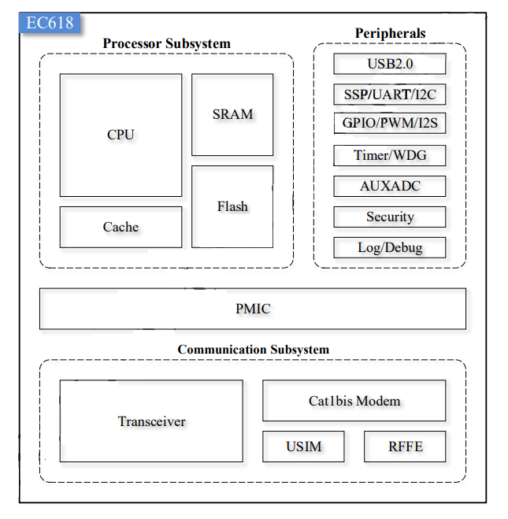
     
    

        EC618 芯片功能框图
    

### 紫光展锐（Unisoc）

紫光展锐（上海）科技有限公司是中国领先的集成电路设计企业，也是全球少数掌握 2G/3G/4G/5G、Wi-Fi、蓝牙、电视调频、卫星通信等全场景通信技术的企业之一。2018 年，展讯通信（上海）有限公司和锐迪科微电子有限公司合并成为紫光展锐，实现了强强联合，扛起了中国芯片设计产业的大旗。紫光展锐的崛起，将打破国外垄断，领跑 5G 芯片，成为中国芯片设计行业的标杆。

#### LTE Cat.1 物联网芯片UIS8910DM

紫光展锐公司的 8910DM 芯片是一款 LTE Cat.1bis 物联网芯片，它采用了 28nm 成熟工艺，支持 LTE Cat.1bis 和 GSM 双模，上行速率达 5Mbps，下行速率达 10Mbps。此外，它还集成了蓝牙通讯和 Wi-Fi 室内定位，可实现更稳定的连接，支持 VoLTE，并通过系统优化设计实现显著的低功耗优势 。8910DM 的推出解决了目前物联网连接中的痛点，填补了低功耗窄带物联网与传统宽带物联网之间的蜂窝通信方案空白。其相比 NB-IoT、2G 模组在网络覆盖、速度和延时上具有优势，相比传统 LTE Cat.4 模组则拥有更低的成本和功耗，同时适配当前国内的 4G 网络，非常适用于对性价比、时延性、覆盖范围、通信速度有要求的应用场景。

    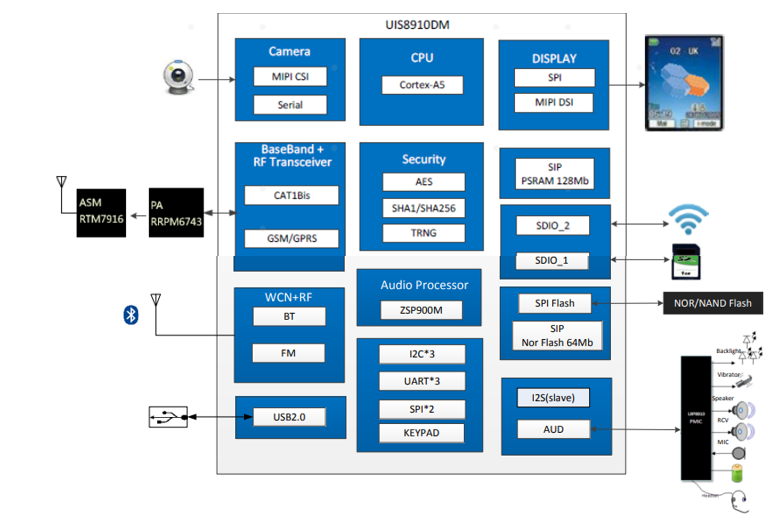
     
    

        UIS8910DM 芯片功能框图
    

#### LTE Cat.1 物联网芯片UIS8850DG

紫光展锐公司的 V8850 芯片是业界首个融合室内外定位的安全可信 Cat.1bis 芯片。它在上一代产品基础上进行了智能化升级，具备高集成度更小尺寸、室内外融合定位、更强 Open CPU 能力、更低功耗、工规宽温、安全可信等六大亮点。V8850 高度集成了 BB/RF/PMIC/GNSS，拥有更小尺寸 8.2x8.2mm, 可使模组尺寸较上一代减小 30%, 最小可至 16x18mm，适合对于设备尺寸要求较高的更广泛应用场景。V8850 支持多种卫星定位系统（GPS/北斗/GLONASS/Galileo），并且通过与 Wi-Fi 室内定位技术融合，实现室内外无缝切换定位。

    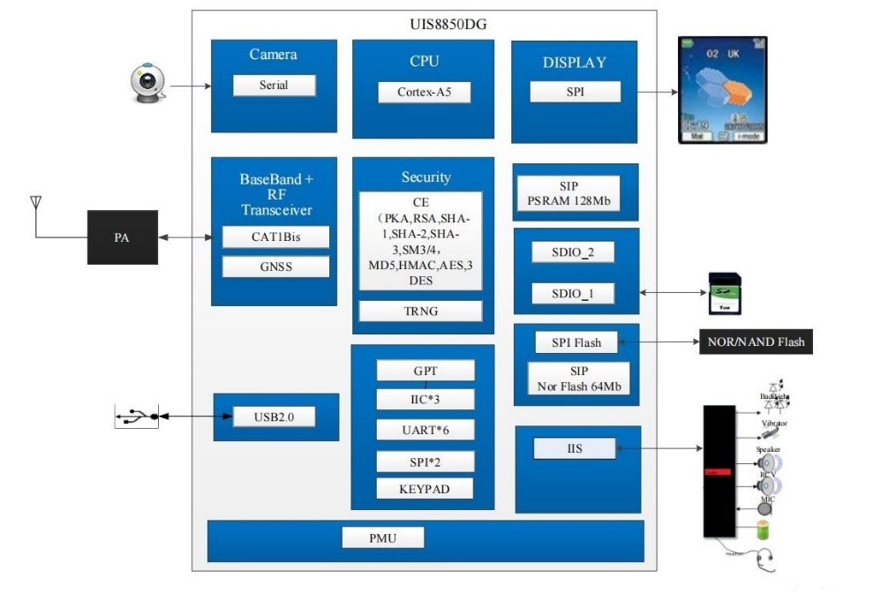
     
    

        UIS8850DG 芯片功能框图
    

#### NB-IoT 芯片春藤 8908A

紫光展锐公司的春藤 8908A 芯片平台是一款超低功耗、超大容量、超强覆盖的 NB-IoT 芯片解决方案。它采用 40nm 工艺，在定点场景和移动场景下的业务成功率、业务时延、功耗等关键性能上表现优异。频率范围覆盖 690~2200MHz 宽频段，可以适配全球主流运营商网络。春藤 8908A 支持多种电源管理模式，并且具有超低待机功耗，在 eDRX 模式下待机电流仅为 1.2uA。此外，春藤 8908A 还支持多种安全特性，包括硬件安全引擎、安全启动、安全调试和安全存储等。

    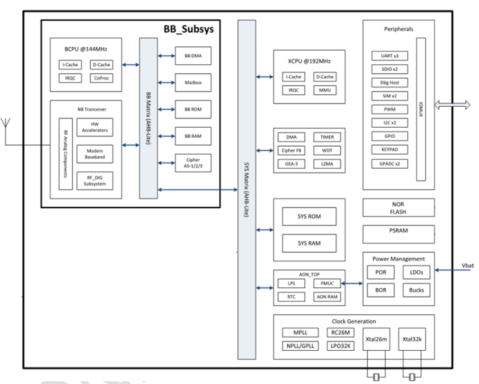
     
    

        IVY8908A 芯片功能框图
    

### 高通（Qualcomm）

高通（Qualcomm）公司是一家全球领先的半导体和无线通信技术公司。公司总部位于美国加利福尼亚州圣地亚哥，成立于 1985 年。高通以其在移动通信领域的创新技术而闻名，是全球最大的无线通信芯片供应商之一。公司的产品包括移动处理器、调制解调器、射频前端、无线充电技术等，广泛应用于智能手机、平板电脑、物联网设备等各种移动终端和通信设备。高通也在 5G 技术研发和标准制定方面发挥重要作用，推动了全球移动通信的发展和创新。

#### 多模 LTE 物联网芯片 MDM9X05

以物联网应用及一系列可穿戴跟踪器提供支持可靠、优化的蜂窝连接为宗旨，高通推出 Qualcomm 9X05 LTE 调制解调器，其在单芯片上集成了支持蜂窝物联网产品及服务所需的关键创新，包括全球多模 LTE category M1（eMTC）和 NB2（NB-IoT）以及 2G/E-GPRS 连接、应用处理、地理定位、基于硬件的安全、IoT平台及软件解决方案支持及配套开发者工具，同时内部集成高通第 9 代 GNSS 引擎系统，支持 GPS/GLONASS/BeiDou/Galileo。

    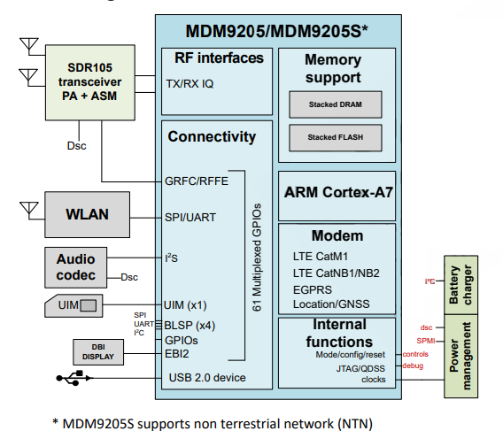
     
    

        MDM9205 芯片功能框图
    

### 翱捷科技（ASR）

翱捷科技（ASR）是一家提供无线通信、超大规模芯片的平台型芯片企业。公司自设立以来一直专注于无线通信芯片的研发和技术创新，同时拥有全制式蜂窝基带芯片及多协议非蜂窝物联网芯片设计与供货能力，且具备提供超大规模高速 SoC 芯片定制及半导体 IP 授权服务能力。

公司各类芯片产品下游应用场景广阔，可应用于以手机、智能可穿戴设备为代表的消费电子市场及以智能家居、自动驾驶为代表的智能物联网市场。

#### LTE Cat.1 物联网芯片 ASR1603

ASR1603 是一款高性价比、超低功耗的多模蜂窝芯片，采用 22nm 工艺制造。与其前身相比，ASR1603 减少了 14% 的面积，降低了 20%~25% 的功耗，并丰富了外围接口。此外，ASR1603 还是一款高集成度的片上系统（SoC）设备，集成了应用程序处理子系统、通信子系统、音频编解码器和嵌入式 pSRAM + Flash，能够支持最紧凑的单芯片 LTE/GSM 多模数据模块、POC、POS 和其他物联网解决方案。

    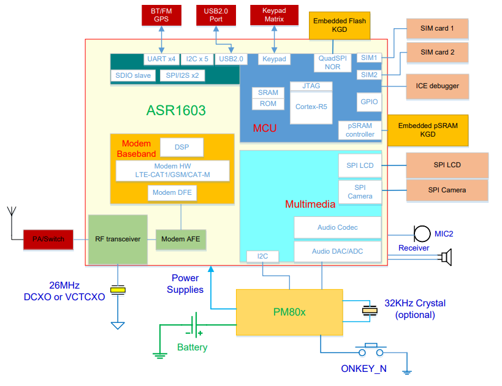
     
    

        ASR1603 芯片功能框图
    

#### LTE Cat.1 物联网芯片 ASR1606

ASR1606 是 ASR160x 系列的新一代成员，兼容并继承了 ASR160x 系列软件基线及优势。它不仅针对物联网应用场景提供了更为丰富的外围接口，而且针对芯片集成度、整体性能、存储空间进行了进阶优化。ASR1606 采用 22nm 制程工艺，将 CPU、Modem 通信单元、射频、Codec 音频单元、pSRAM & Flash 存储单元以及 PMU 集成在单芯片 SoC 上，搭载 Cortex-R5 处理器，可强化中低速率应用场景及运行低功耗 RTOS 系统设备的处理性能，适用于环境监测、智慧城市、移动支付、共享经济、工业物联网等领域。

    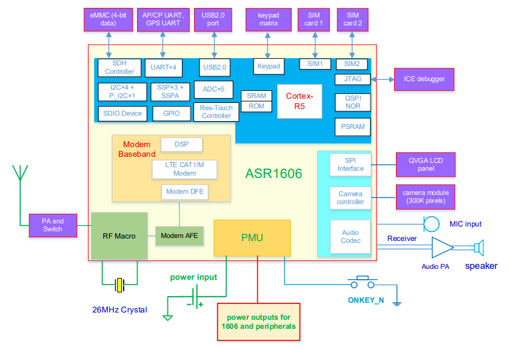
     
    

        ASR1606 芯片功能框图
    

#### LTE Cat.4 移动智能终端芯片 ASR1803S

ASR1803S 是一款基于先进工艺的 4G 基带射频一体化芯片，是集成了射频和内存的高集成度基带通信芯片。该芯片采用 22nm 先进工艺，支持 6 层 1 阶 PCB，拥有 450MHz~2.7GHz 的频宽，支持 RTOS 操作系统，所占内存小。同时该芯片集成有应用处理器（ARM Cortex-A7），可用于支持 Linux 环境下的各种应用程序，为客户不同产品开发提供灵活选择。ASR1803S 支持全新的动态电压调节技术，能有效降低工作电压，降低功耗，并且支持 QSPI NOR/NAND flash，令 boot 速度更快。该芯片可广泛应用于民用及工业与行业应用当中，如 POS 机、POC 对讲机、数据卡 Dongle、MiFi 终端以及各类水、电、气表的行业综合应用中。

    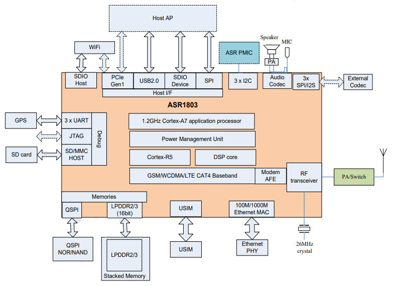
     
    

        ASR1803 芯片功能框图
    

## 模组型号与平台的对应关系

以下的一些表格展示了当前 QuecPython 支持的各种型号的模块与各个芯片厂家和芯片平台的对应关系。

### 移芯平台

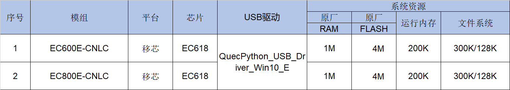

### 展锐平台

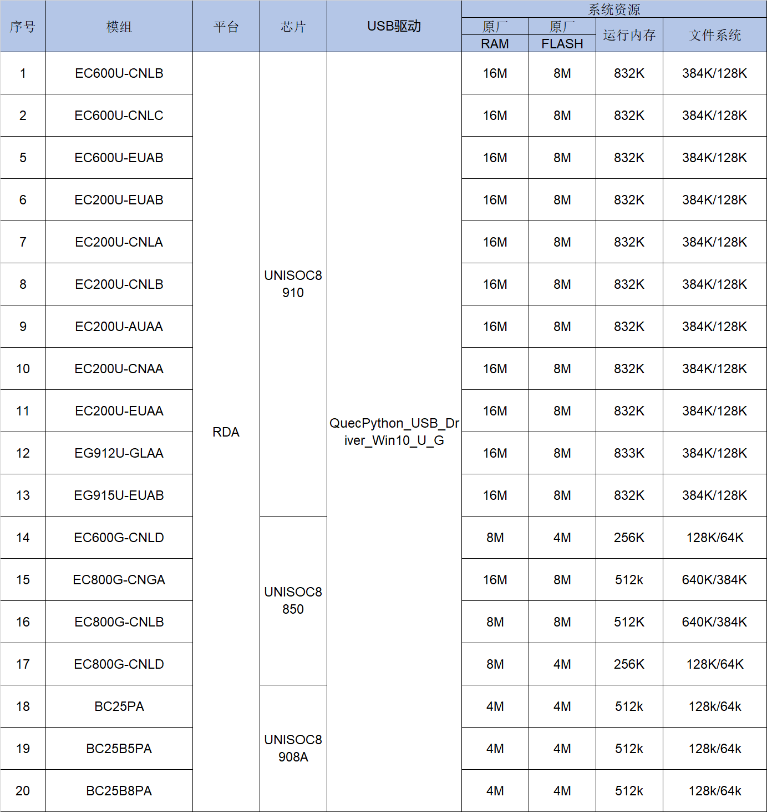

### 高通平台

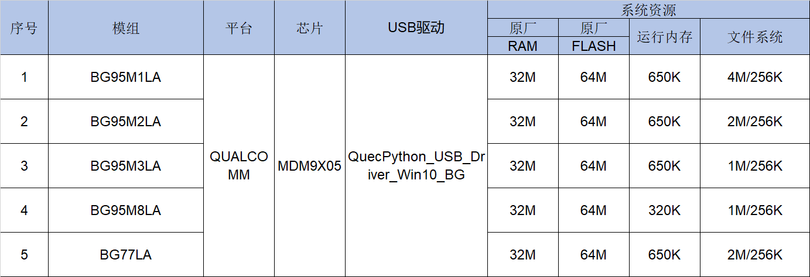

### ASR 平台

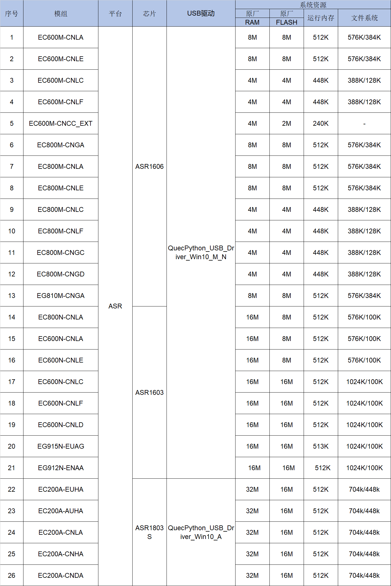
