# ASR平台Log工具使用说明

ASR平台AP和CP的Log抓取，既可以使用CATStudio工具，也可以使用QWinLog工具，本文将介绍如何使用这两种工具来抓取AP和CP的Log。同时也将说明如何使用CATStudio工具来导出dump文件和pcap文件。

## 概述

### 工具简介

CATStudio是用于实时监控和抓取ASR平台模组log的软件工具，功能非常丰富，对于用户来说，最常用的就是抓取设备的AP/CP log、dump文件导出和pcap文件导出。

QWinLog是专门用来进行log抓取的工具，目前支持高通和ASR平台AP/CP log的抓取，使用非常简单。

### 软件安装

CATStudio和QWinLog工具均为免安装软件，只需要将工具压缩包解压到电脑某个目录下即可。需要注意，解压路径中，不要包含中文字符，否则可能导致工具无法正常运行。

### 运行环境

CATStudio支持在Windows XP/7/10 系统上运行，计算机内存应在512M以上，处理器双核以上。

QWinLog工具支持在Windows 7/10系统上运行。


## 硬件连接

抓取log之前，用户应做如下准备：

* 确认计算机已经安装ASR平台模组的USB驱动程序。

* 使用USB数据线连接模组和计算机。

* 模组上电运行。

进入计算机的设备管理器界面，如果USB驱动程序加载正常，应该可以看到下图所示的几个端口：

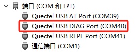


几个端口的作用如下：

* Quectel USB AT Port：该端口用于发送AT指令。

* Quectel USB DIAG Port：该端口用于抓取Log。

* Quectel USB REPL Port：对于QuecPython固件而言，该端口是python的REPL端口，用户可通过该端口执行一些python代码。 需要注意的是，不同的平台，python的REPL端口名称可能是不同的。如果用户不清楚哪个端口是python的REPL端口，可以咨询我司的FAE进行确认。

上图中红框标注的端口，就是接下来我们使用CATStudio抓取Log时需要使用的端口。


## 使用指南

硬件环境准备完成后，按照下面的步骤来操作。

### AP和CP日志抓取

#### 使用CATStudio抓取

**步骤1：选择功能类型**

打开CATStudio软件，默认会弹出下图所示界面，选择“在线解析日志”选项，并点击“OK”。

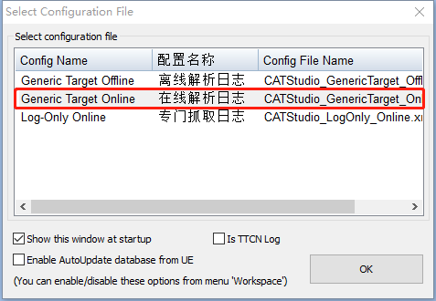


**步骤2：通信端口选择与配置**

经过步骤1后会进入如下界面，点击右下角的“Device Communication”选项，弹出对应配置界面后，默认选择“Device 0”，点击“Settings”。

<div style="display: flex; justify-content: space-between; align-items: center;">    <!-- 第一张图片，将其缩放到宽度为 200px -->   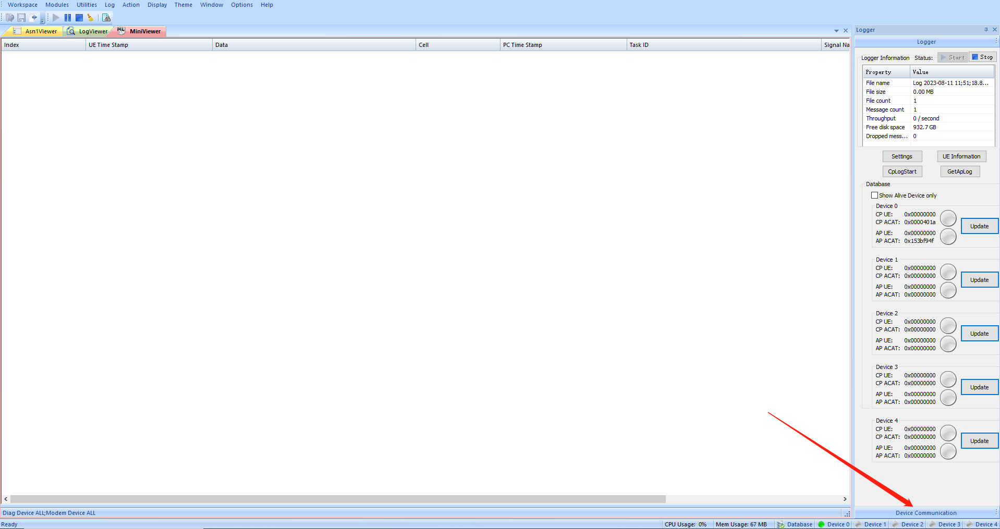    <!-- 第二张图片，将其缩放到宽度为 300px -->   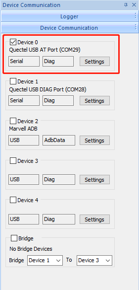  </div>

 进入如下界面，选中“Serial”，点击“Serial Port”选择框的下拉按钮，选择“Quectel USB DIAG Port”端口，波特率保持默认即可，点击“OK”，之后应该就能看到工具窗口开始输出Log信息了。

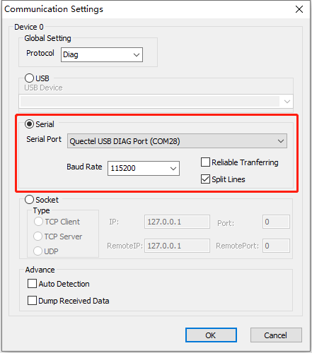


> 如果经过这一步骤后，CATStudio主窗口无Log信息输出，需要重启电脑，然后重新打开CATStudio软件工具。


**步骤3：匹配DB文件**

如果没有匹配DB文件，CatStudio工具界面上很多Log都是处于未解码的状态。为了方便看Log信息，用户可以选择匹配模组当前使用固件所对应的DB文件。DB文件一般都在对应固件包中，如下所示：

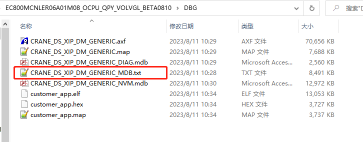


> 如果用户的固件包中没有DBG目录，可以将使用的固件版本号提供给我司FAE，让FAE提供对应固件的DB文件。


如果没有匹配DB文件，从工具界面上，可以看到如下图所示的红色指示灯：

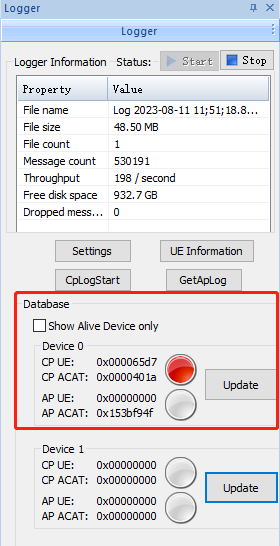


点击红色指示灯边上的“Update”按钮，进入下面的界面，然后按照下面步骤设置：

* 选择①处的“TEXT”。

* 点击②处的按钮，在弹出的文件选择窗口中，切换到模组固件包所在路径，然后进入固件包中的DBG目录下，选择对应的DB文件。

* 点击③处的“Update”按钮，如果选择的DB文件与模组中的固件是匹配的，则可以看到图中右边CP部分的指示灯变成绿色。
* DB文件匹配成功后，点击④处的“Close”按钮，重新回到Log输出界面，此时应该可以看到上图中Device 0的指示灯也变成绿色。

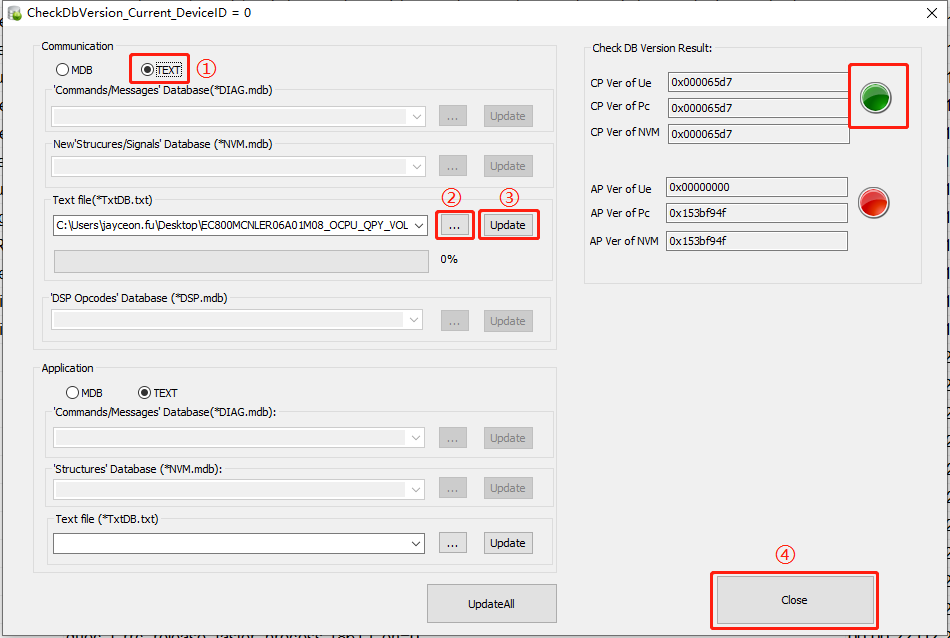


> 对于用户来说，匹配DB文件这一步骤并不是必须的，如果客户仅需要抓取Log并提供给我司研发人员分析，也可以省略该步骤，由我司研发人员自行匹配DB文件。


**步骤4：Log文件导出**

当Log抓取结束后，需要将Log文件导出，然后提供给我司FAE或者研发人员，用于分析相关问题。用户可按照如下操作导出Log文件：

* 点击菜单栏的“Log”选项，在弹出的下拉框中，继续点击“Export Log-File”选项，弹出ExportLog窗口。

* 在ExportLog窗口中，点击“Select Path(P)”，选择Log保存路径。

* 点击“Output”按钮，等待Log文件导出结束。

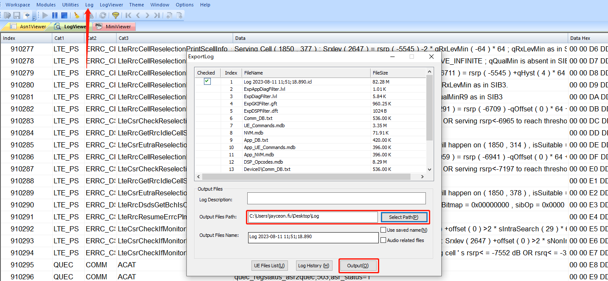


导出的Log文件，同时包含了AP和CP的Log，用户如需我司协助分析相关问题，需要将导出的Log文件提供给我司FAE或者研发人员。


#### 使用QWinLog抓取

**步骤1：打开QWinLog**

将QWinLog工具的压缩包解压到电脑某个路径下，注意路径中不要包含中文字符。进入到QWinLog工具根目录下，双击QWinLog.exe打开工具后，进入下图所示的界面：

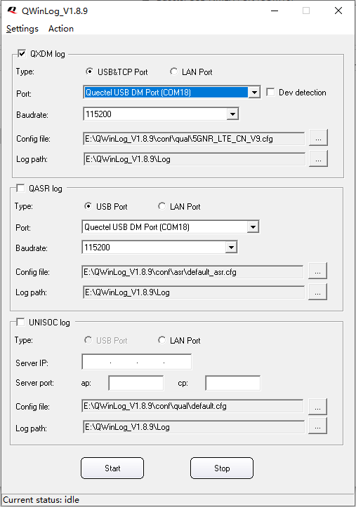


**步骤2：参数配置**

由于是使用QWinLog抓取ASR平台的log，因此只需要配置QWinLog工具界面中和ASR平台相关的参数即可，如下图所示：

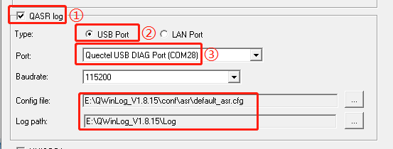

具体配置说明如下：

* 首先勾选①处的“QASR log”选项。

* 选中②处的“USB Port”。

* 点击图中③处端口选择窗口后面下拉按钮，选择“Quectel USB DIAG Port”端口。该端口是ASR平台抓取AP和CP log的端口。

* “Config file”是QWinLog抓取log所使用的配置文件，用户可以使用工具默认的配置文件或者联系我司FAE提供相关配置文件。

* “Log path”为抓取的log保存路径，一般保持默认即可，用户也可根据需要修改。


**步骤3：开始Log抓取**

点击QWinLog界面的“Start”按钮开始抓取log，点击“Stop”按钮则停止log抓取。


**步骤4：Log文件打包**

当需要的log抓取完成，点击“Stop”按钮停止后，进入到“Log path”选项中设置的路径下，就可以看到保存的log文件，如下图所示：

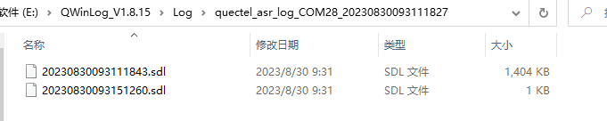

用户只需要将这些log文件打包压缩后，发送给我司FAE或者研发人员即可。


### Dump文件导出

当用户使用ASR平台模组过程中，遇到dump问题时，可以通过CATStudio工具来导出dump文件，然后将dump文件发送给我司研发人员进行分析。

**步骤1：配置dump模式**

模组在默认情况下，如果发生dump，会直接重启，这种情况下，无法导出dump文件。因此，我们需要在模组正常运行时，先发送AT指令来配置模组的dump模式，确保发生dump时不会自动重启，而是一直停在dump状态，等待用户导出dump文件。下面是ASR平台模组配置dump模式，需要发送的AT指令。

```
AT+QDUMPCFG=0,0
AT+QDUMPCFG=2,1
AT+log=19,1
```

在模组正常运行时，打开QPYcom工具，“COM Port”选择“Quectel USB AT Port”，然后点击“Open port”。依次发送上述3条AT，如下所示：

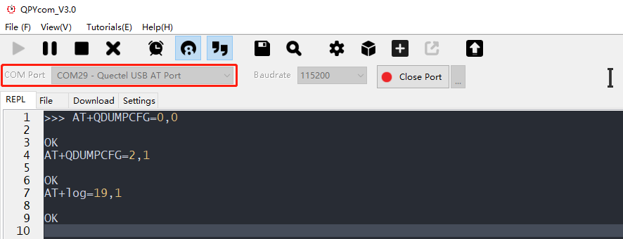


**步骤2：复现dump问题**

按照步骤1中的说明，确定所使用的模组型号并发送了对应的AT指令后，按照之前测试出现dump问题的方法步骤重新测试，等待dump问题复现。当出现dump问题时，从电脑的设备管理器中，可以看到出现如下所示的dump端口：


**步骤3：选择功能类型**

打开CATStudio软件，默认会弹出下图所示界面，选择“专门抓取日志”选项，并点击“OK”。

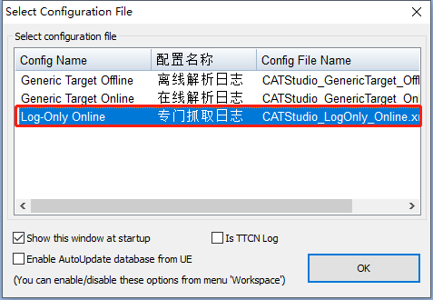


**步骤4：参数设置与dump文件导出**

按照步骤3操作后，会弹出下面的窗口，我们先点击①处的“Dump”，切换到dump导出标签页，依次按照下图标号进行参数设置即可：

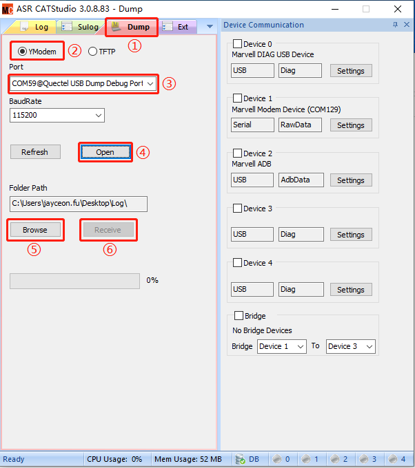

* 选择YModem模式，如图中②处所示；

* 图中③处，点击下拉按钮，选择步骤2中dump端口；

* 点击图中④处的“open”按钮，打开对应端口；

* 点击图中⑤处的“Browse”按钮，选择dump文件保存的路径；

* 点击图中的⑥处的“Receive”按钮，开始dump文件的导出，并等待dump文件导出结束。当文件导出结束时，会弹出窗口提示用户，用户点击“确定”即可。如下图所示：

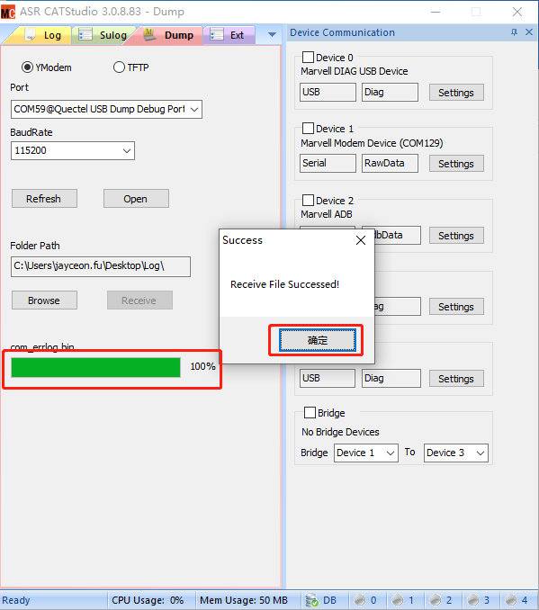


经过这些步骤后，dump文件就已经导出完成，可将导出的dump文件打包压缩为一个文件，提供给我司FAE或者研发人员进行分析。


### Pcap文件导出

pcap文件是一种常见的网络数据存储文件，通常与Wireshark、Tcpdump等流行的网络分析工具一起使用，用来监控和分析与网络应用相关的问题。比如像MQTT和HTTP等应用协议的数据传输问题。

CATStudio工具支持导出pacp文件，下面说明如何通过CATStudio工具来导出pacp文件。

**步骤1：导出AP和CP Log**

先按照前面[AP和CP日志抓取](./ASR.html#AP和CP日志抓取)章节的步骤，将Log文件导出备用。

**步骤2：选择功能类型**

重新打开CATStudio软件，默认会弹出下图所示界面，选择“离线解析日志”选项，并点击“OK”。

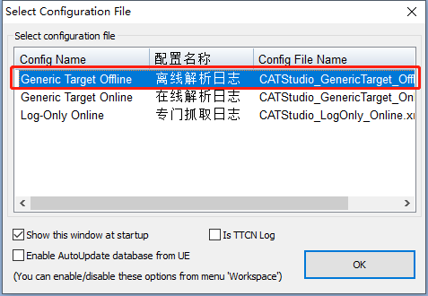


> 这里需要注意，是选择“离线解析日志”，前面《AP和CP日志抓取》章节中，选择的是“在线解析日志”。


**步骤3：加载Log文件**

进入CATStudio主界面后，点击右上角的“Open ZIP/ICL ...”按钮，在弹出的窗口中选择之前导出Log压缩文件，等待文件解压并加载完成。

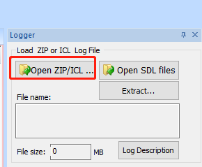

如果加载文件过程中，弹出如下窗口，说明选择的Log文件比较大，超过了默认的文件大小限制。这种情况我们直接选择“Cancel（Load whole file）”选项，即选择加载整个文件。

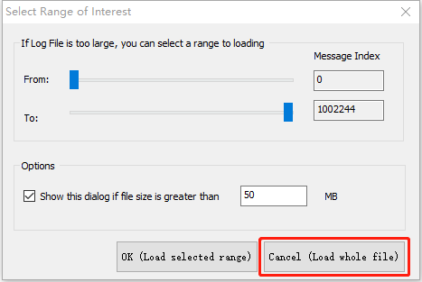


**步骤4：匹配DB文件**

如果用户在导出Log文件的步骤中，已经按照说明匹配过了DB文件，则可以省略该步骤，直接进行步骤5，否则需要按照前面的说明匹配DB文件。


**步骤5：导出pacp文件**

点击菜单栏的“Action”选项，在弹出的下来框中，选择“Export SN Trace to pacp file”选项，弹出如下窗口：

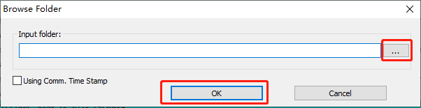


在弹出的窗口中，选择导出文件的保存路径，然后点击“OK”，等待导出完成，会弹出如下提示窗口，点击“确定”即可。

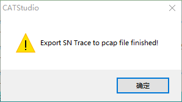


## 常见问题

**问题1：**使用QWinLog工具抓取log失败，并弹出如下窗口，是什么原因？

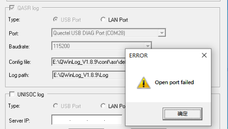

这种情况可能有两种原因导致：

原因1：有其他程序占用了“Quectel USB DIAG Port”端口，可以检查是否存在这种情况，如果有，请先关闭占用该端口的软件，然后重新尝试。

原因2：USB驱动程序加载异常。可以先尝试断开模组和计算机的USB连接再重新接上，或者将模组断电后再重新上电，如果仍然不能正常使用，则需要重启计算机。