# EIGEN平台Log工具使用说明

EIGEN平台AP、CP Log的抓取和dump文件的导出，都是使用EPAT工具。本文将介绍如何使用ArmLogel工具来抓取AP和CP Log，以及如何导出dump文件。

## 概述

### 工具简介

EPAT是用于抓取和分析EIGEN平台模组log的工具，可在线实时抓取分析，也可以离线分析。同时支持pcap和dump文件的导出功能。

### 软件安装

EPAT为绿色免安装软件，只需要将工具压缩包解压到电脑某个目录下即可。需要注意，解压路径中，不要包含中文字符，否则可能导致工具无法正常运行。解压后，进入到工具的Bin目录下，执行EPAT.exe 即可打开该工具。


> EPAT需要VC MFC DLLs，如果第一次运行EPAT失败，请安装执行Bin目录下的vc_redist.x86.exe文件。


### 运行环境

EPAT支持在Windows7/8/10系统上运行，计算机内存应在2G以上，处理器建议酷睿i3以上。


## 硬件连接

抓取log之前，用户应做如下准备：

* 确认已经安装EPAT平台模组的USB驱动程序。

* 使用USB数据线连接模组和计算机。

* 模组上电运行。

进入计算机的设备管理器界面，如果USB驱动程序加载正常，应该可以看到下图所示的几个端口：

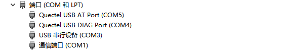

图中几个端口的作用如下：

* Quectel USB AT Port：该端口用于发送AT指令，是专用AT端口。
* Quectel USB Diag Port：该端口用于AP/CP log的抓取以及dump文件的导出。
* USB 串行设备：对于QuecPython固件而言，该端口是python的REPL端口，用户可通过该端口执行一些python代码。 需要注意的是，不同的平台，python的REPL端口名称可能是不同的。如果用户不清楚哪个端口是python的REPL端口，可以咨询我司的FAE进行确认。


## 使用指南

确认设备与PC硬件连接正常，并且所有USB端口枚举成功，接下来就可以进行软件工具的配置和使用。

### AP和CP日志抓取

**步骤1：打开AP Log工具**

进入EPAT工具的根目录，双击EPAT.exe，打开EPAT工具：

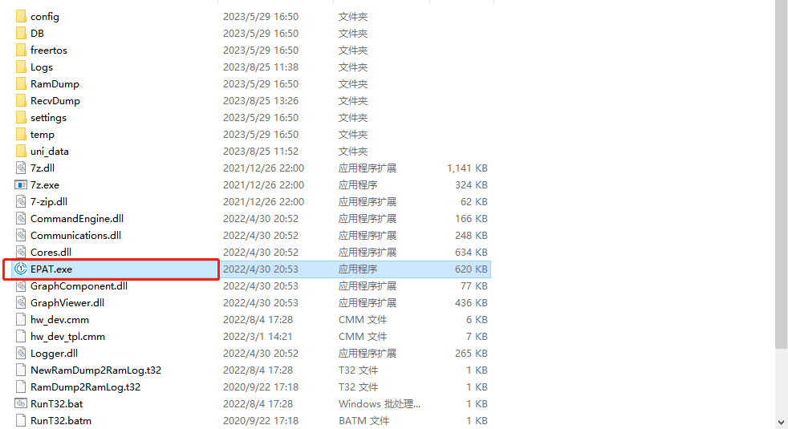

打开EPAT工具后，会先弹出如下窗口，让用户选择在线还是离线模式：

* Serial Device：该选项表示在线模式，即直接从串口设备上实时抓取。

* Select From Local Files：该选项表示离线模式，即从计算机本地加载log文件。

这里我们选择第一个“Serial Device”模式，然后点击“OK”。

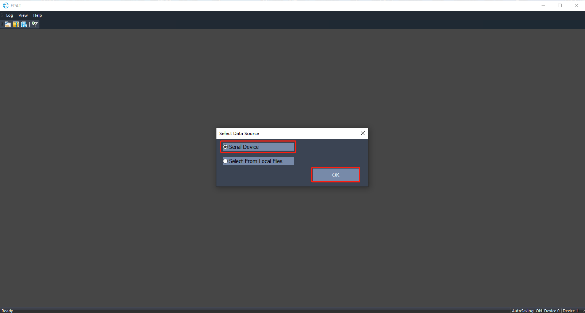


**步骤2：端口参数配置**

点击工具栏的如下图中①处的按钮，弹出“Device Selection”窗口。

点击②处的“Setting”按钮，弹出“Communications Settings”窗口。

点击③处选择“Quectel USB DIAG Port”端口。然后依次点击④和⑤处的“OK”按钮。

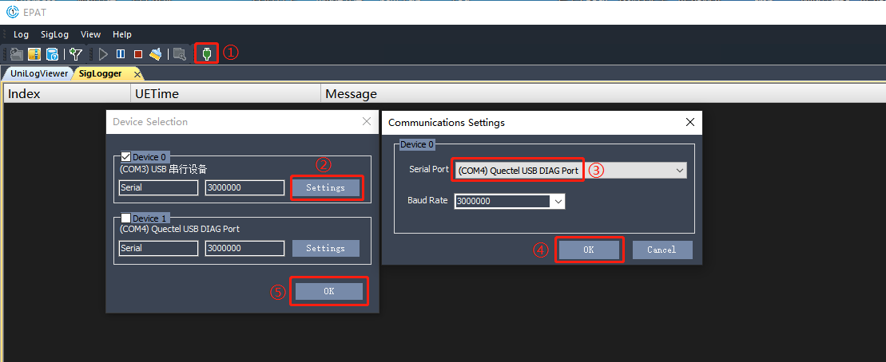


**步骤3：DB匹配**

步骤2中端口参数配置完成后，工具会自动打开并连接USB端口，此时应该可以看到工具窗口中有log开始输出，如下图所示：

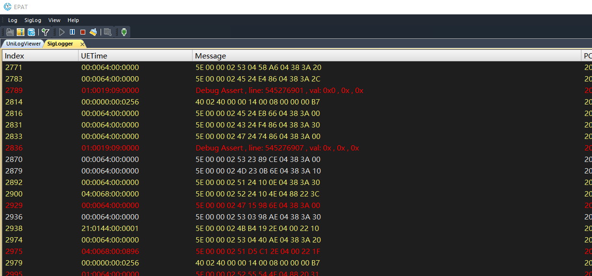

因为没有匹配DB文件，所以输出的log基本都是处于未解码的状态，为了看到解码后的明文log，我们需要先匹配DB文件，具体操作如下：

点击图中①处的按钮，弹出“State”窗口。

点击“State”窗口中②处的“Update”按钮，弹出“CheckVersion”窗口。

点击“CheckVersion”窗口中③处的按钮，在弹出的窗口中选择模组当前固件所对应的DB文件，如④处所示。选中后点击“打开”。

点击“CheckVersion”窗口中⑥处的“Update”按钮，然后点击⑦处的“Close”按钮。如果匹配成功，应该可以看到“State”窗口中的指示灯变成绿色。

点击“State”窗口中⑧处的“Close”按钮。到此DB文件就匹配完成了，此时应该可以看到log输出窗口输出的都是明文信息。

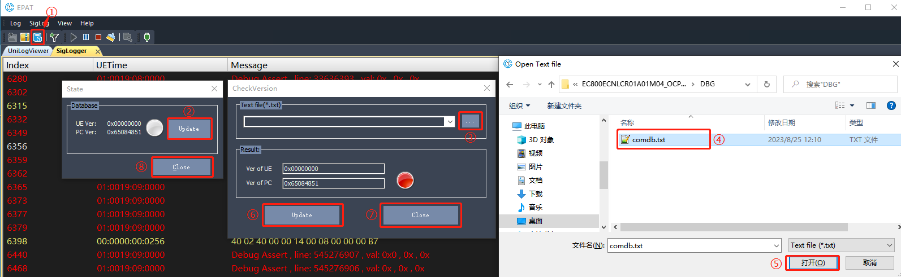


**步骤4：重启设备并开始log抓取**

DB文件匹配完成后，我们重启设备，EPAT工具会自动识别端口并开始抓取log。


**步骤5：log文件保存**

需要的log抓取完成后，点击工具栏的保存按钮，选择目录保存导出的log文件，确认后等待文件保存完成。默认保存的log是zip压缩文件。

<div style="display: flex; justify-content: space-between; align-items: center;">    <!-- 第一张图片，将其缩放到宽度为 200px -->   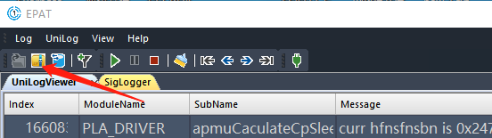    <!-- 第二张图片，将其缩放到宽度为 300px -->   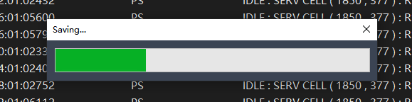  </div>

文件保存完成后，打开log保存目录，将对应的log压缩文件发送给我司FAE。


### Dump文件导出

EPAT支持dump文件导出，当模组发生dump死机问题时，EPAT工具会自动抓取dump文件并导出。

**步骤1：配置dump模式**

模组在默认情况下，如果发生dump，会直接重启。这种情况下，无法导出dump文件。因此，我们需要在模组正常运行时，先发送AT指令来配置模组的dump模式，确保发生dump时不会自动重启。

下面是EIGEN平台模组配置dump模式，需要发送的AT指令:

```
AT+ECPCFG="faultAction",0
```

打开QPYcom工具，“COM Port”选择“Quectel USB AT Port”端口，点击“Open Port”，然后发送上面的AT指令：

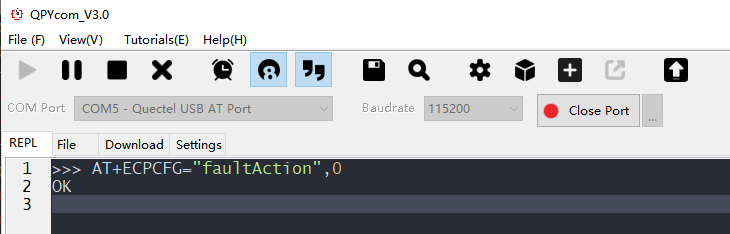


>上述AT发送后立即生效，并且配置掉电保存。


**步骤2：复现dump问题**

按照步骤1发送相关AT指令后，就可以去复现相关的dump问题。


**步骤3：dump文件保存**

当模组出现dump问题时，EPAT工具会自动检测并开始dump文件的导出。dump文件导出完成时，会弹出如下窗口，此时dump文件已经导出并保存到计算机本地，默认保存在工具根目录下的Bin\RamDump目录中。用户可以直接点击图中①处的按钮关闭“RamDump”窗口。

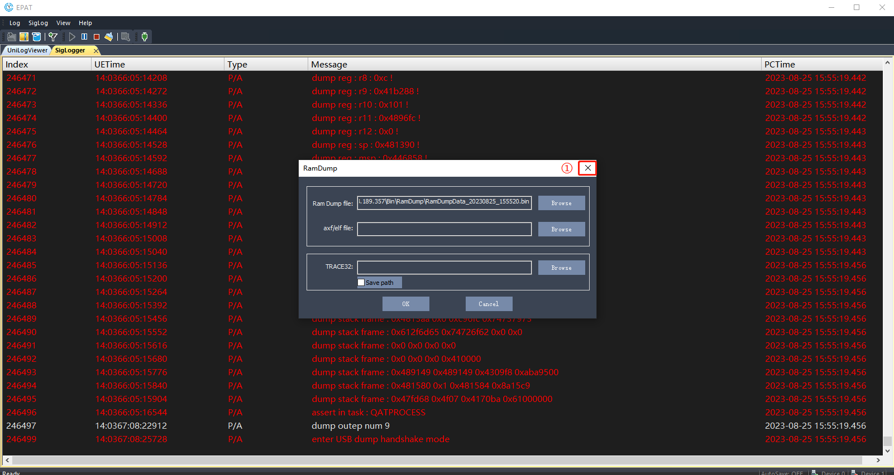

进入到EPAT工具根目录下的`Bin\RamDump`目录，即可看到dump文件。将该文件打包压缩后发送给我司FAE即可。

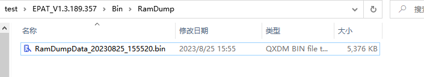


### Pcap文件导出

当用户需要导出pcap文件来分析MQTT/HTTP/HTTPS等网络问题时，可以按照如下步骤进行操作。

* 点击图中①处的“SigLogger”标签。

* 点击图中②处的暂停按钮。

* 点击菜单栏的“SigLog”选项，在弹出的下拉窗口中，选择“Export As pcap file”选项。

* 在弹出的窗口中，选择pcap文件保存目录并设置文件名，确认后即可导出pcap文件。

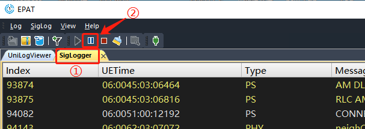

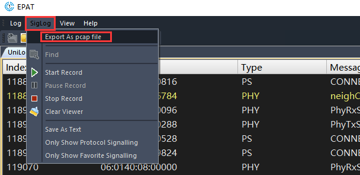


## 常见问题

**问题1：**使用EPAT工具连接模组后，为什么log输出窗口中看到的几乎都是一些十六进制的数据？

这是因为没有匹配DB文件导致的，此时输出的log信息大致如下，log是处于未解码的状态，需要匹配正确的DB文件才能看到明文log。

