# OpenClaw 技能配置和使用教程

## 一、核心概念与关联关系

### 1. OpenClaw

OpenClaw 是本地优先、开源的 AI 智能体（Agent）框架，并非单纯的聊天机器人或大模型，核心能力是将自然语言指令拆解为可执行任务，调用各类工具 / 服务完成执行并反馈结果。它支持本地部署（Windows 11 / 服务器）、对接本地大模型、调用本地 / 外部工具（Shell、串口、API 等），还具备多渠道交互、持久记忆等特性。

### 2. QuecPython-dev

QuecPython-dev 是围绕 QuecPython 开发场景的工具集 / 开发套件总称，涵盖了模组调试、脚本开发、固件管理、设备交互等一系列开发辅助能力，是开发者基于 QuecPython 进行物联网应用开发的核心支撑体系。

### 3. 两者核心关系

QuecPython-dev-skills 是基于 OpenClaw 框架开发的专属技能插件，OpenClaw 作为 AI 执行代理，通过加载 QuecPython-dev-skills 技能，将自然语言指令转化为针对 QuecPython 开发场景的具体操作（如模组信息探测、脚本下发运行、固件查询下载、串口交互等），实现 QuecPython 开发流程的自动化、智能化，让开发者无需手动执行繁琐的调试、操作命令，仅通过自然语言即可完成 QuecPython 相关开发任务。

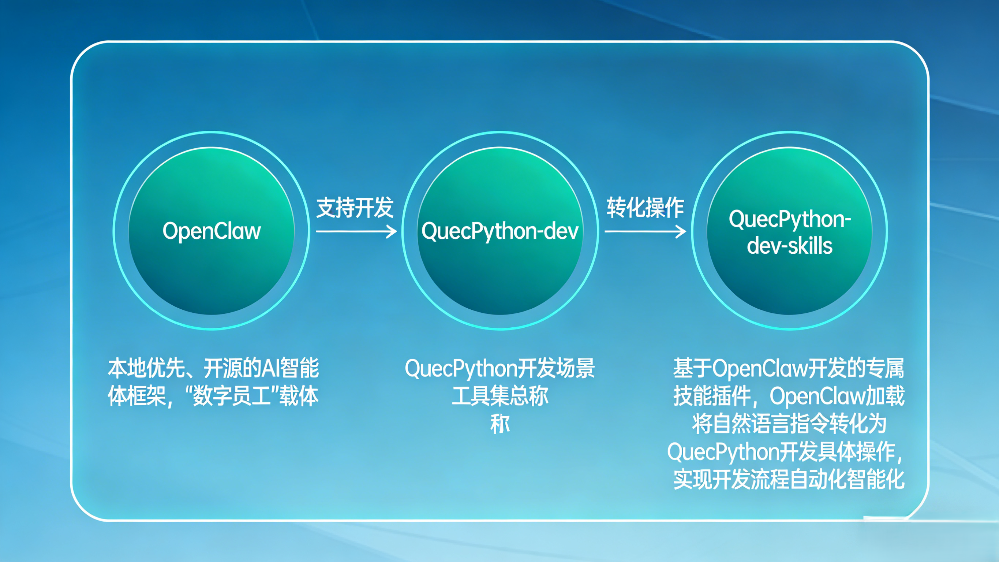

简单来说：**OpenClaw 是 “数字员工” 载体，QuecPython-dev-skills 是面向 QuecPython 开发的 “专属技能”，二者结合赋能 QuecPython 开发全流程自动化**。

## 二、OpenClaw 部署流程

### 安装wsl（Windows的Linux子系统）

以管理员身份运行powershell，防止在部署的过程中因为权限问题导致的环境配置问题

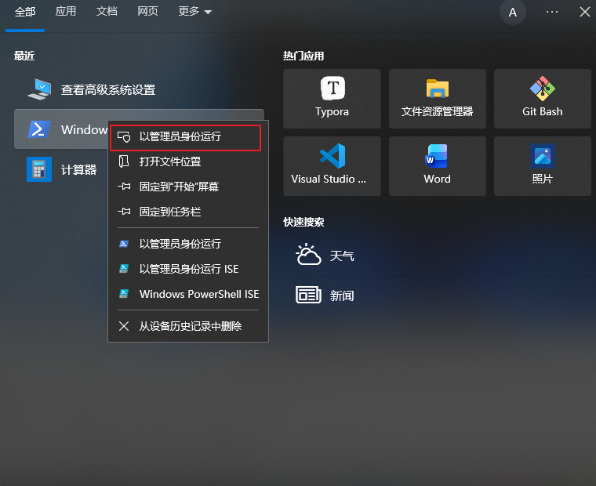

使用命令：`wsl.exe --install`进行安装，等他安装完之后需要我们重启电脑

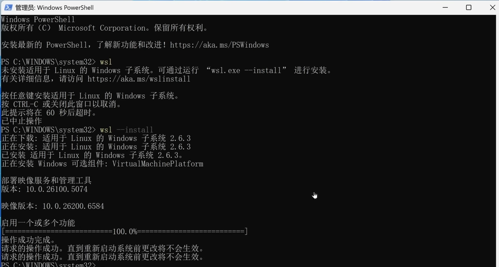

重启电脑之后我们继续以管理员身份打开powershell，使用命令：`wsl --install ubuntu-24.04`,用于按照Ubuntu（Linux的发行版），也就是openclaw官方推荐的系统；

设置好后会出现有颜色的命令行：


### 更新系统依赖，安装所需工具

执行以下命令更新系统软件源，并安装 curl、git 等基础工具，为后续安装做好准备：

```none
sudo apt update
sudo apt install -y curl git ca-certificates build-essential jq
```

### 安装Node.js 22

OpenClaw 官方要求运行环境的 Node.js **版本不低于** 22，执行以下命令完成安装：

```none
curl -fsSL https://deb.nodesource.com/setup_22.x | sudo -E bash -
sudo apt install -y nodejs
```

安装完成后，验证版本是否符合要求：

```none
node -v   # 正常输出应为 v22.x.x 或更高版本
npm -v    # 正常输出应为 10.x.x 或更高版本 
```

### 安装OpenClaw

通过 npm 全局安装最新版本的 OpenClaw，并验证安装结果：

```none
sudo npm install -g openclaw@latest
openclaw --version
```

> 安装耗时通常为 5–10 分钟，具体取决于网络环境的下载速度。

### 初始化OpenClaw

首次安装完成后，必须完成配置向导流程，否则 OpenClaw 无法正常运行。执行以下命令启动配置向导，并安装网关守护进程：

```none
openclaw onboard --install-daemon
```

网关守护进程（launchd/systemd 用户服务）会确保 OpenClaw 保持后台运行状态。

配置向导截图（仅供参考）

1.进入安装确认界面，选择【Yes】并按下回车；

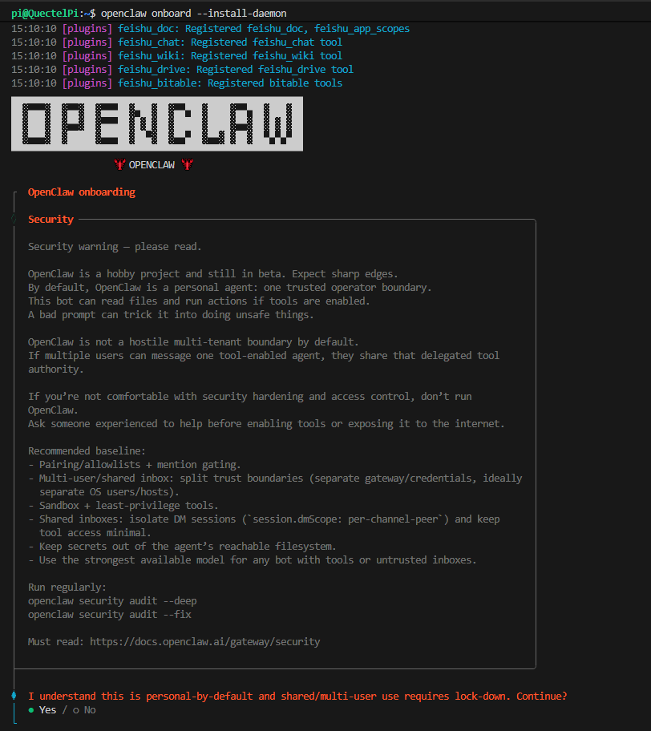

2.在【Onboarding mode】选项中选择【QuickStart】；

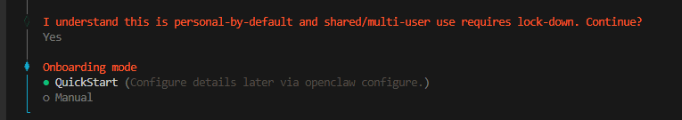

3.在【Model/auth provider】选项中选择【Qwen】并按下回车；

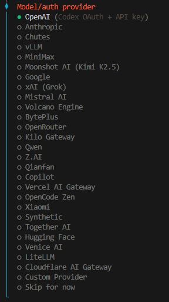

4.打开指定网站登录 qwen-code 平台，完成身份认证操作；

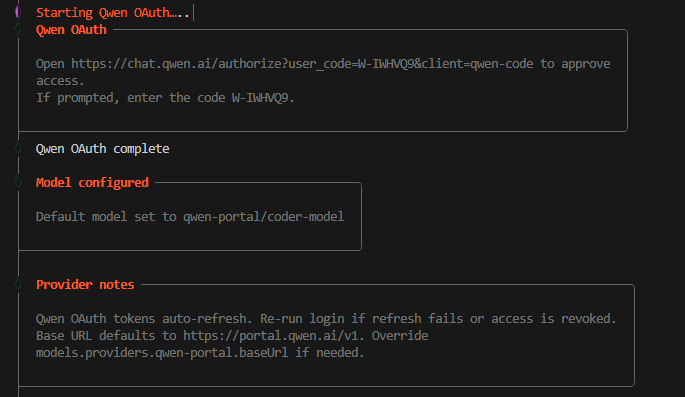

配置完成后，重启网关使配置生效：

```none
openclaw gateway restart
```

## 三、添加QuecPython-dev-skills技能

**1.安装 Skill**

将仓库克隆后，放入你的 Skills 目录（路径按工具约定）

`git clone https://github.com/QuecPython/quecpython-dev-skill.git`

**2.Linux安装与启动 SSH 服务**

```
sudo apt update
sudo apt install openssh-server
```

**3.Linux和Windows之间通过SSH打通**

```
Windows：

ssh wsl用户名@IP地址
```

**4.Windows 安装串口驱动**

Windows 管理员终端：

```Plain
winget install usbipd
```

查看 USB 设备

```Plain
usbipd list
```

绑定串口模块

```Plain
usbipd bind --busid 你看到的BUSID
```

连接到 WSL2

```Plain
usbipd attach --wsl --busid BUSID
```

## 四、QuecPython-dev-skill 自动化开发流程的实践

### 工具应用流程：

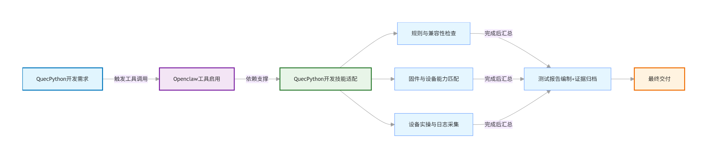

### QuecPython-Dev-Skill核心能力矩阵

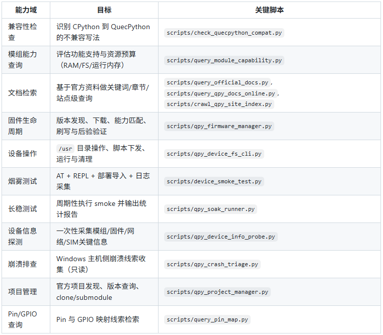

### **功能演示：**

PS.最低建议输入上下文：

1. 移远模组型号（如 `EC800KCNLC`）
2. 固件版本（当前版本与目标版本）
3. 设备串口与波特率
4. 部署目标路径（如 `/usr/_main.py`）

#### 设备操作（`/usr` 目录操作、脚本下发、运行与清理）：

1.输入需求

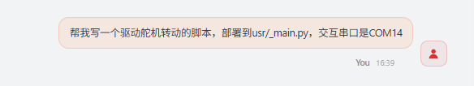

2.Openclaw启用QuecPython-Dev-Skill技能按照流程通过ssh控制Windows本地设备上的qpycom下载脚本并运行

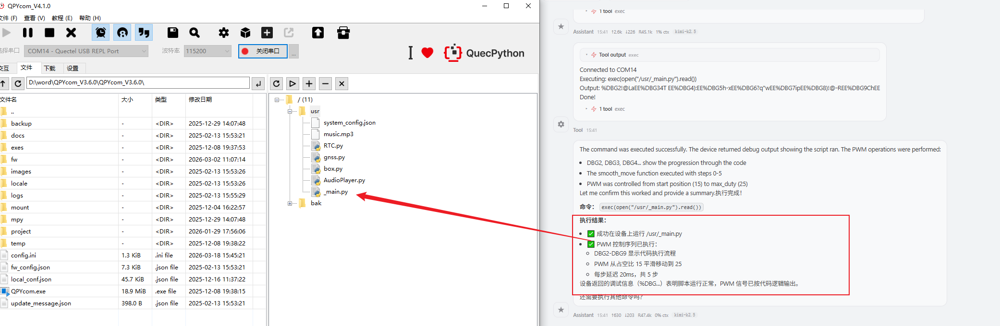

3.运行脚本出错，Openclaw自动修复脚本bug

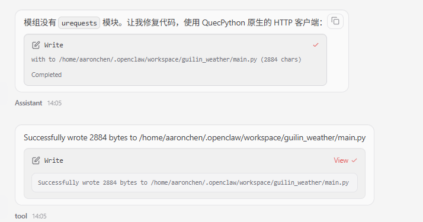

#### **设备信息探测：**

1.输入需求

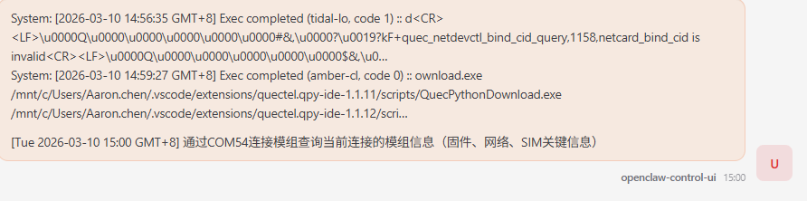

2.Openclaw输出脚本->下载脚本

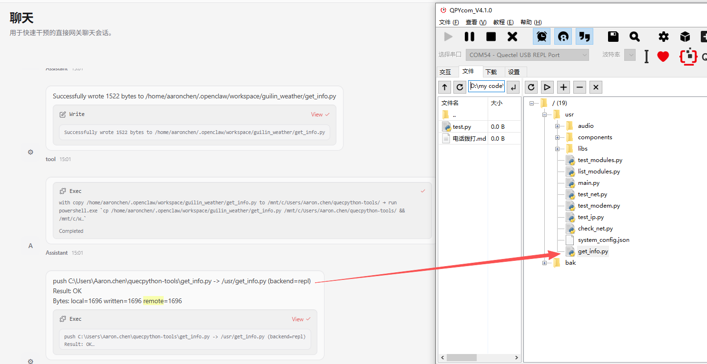

3.脚本自动检查

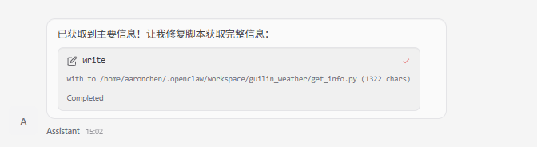

4.输出模组查询结果

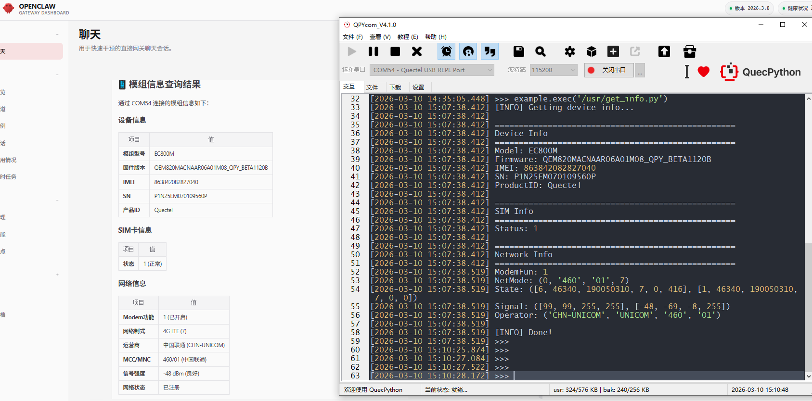

#### 开发资料查询：

1.输入需求

`“帮我在QuecPython官网查询EC800MCNLF的固件并下载到本地”`

2.Openclaw筛选资料

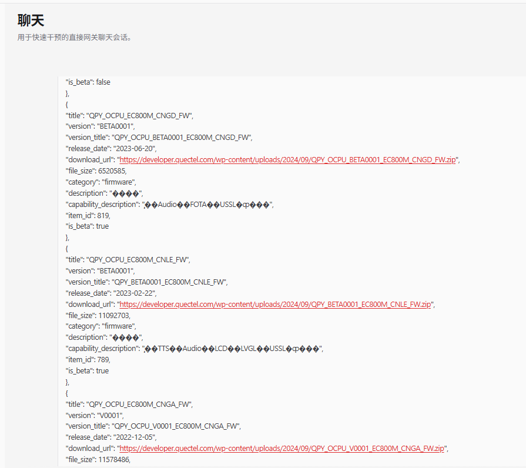

3.自动下载资料：

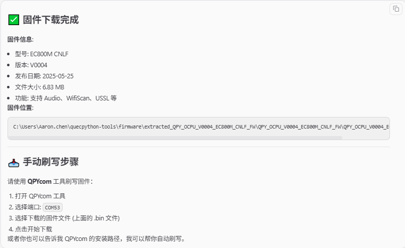


## 五、常见问题

**1.wsl无法识别到Windows的端口：可在powershell中切换Ubuntu1版本，可以直接操控Windows端口**

```powershell
wsl --set-version Ubuntu 1
Openclaw gateway run
```

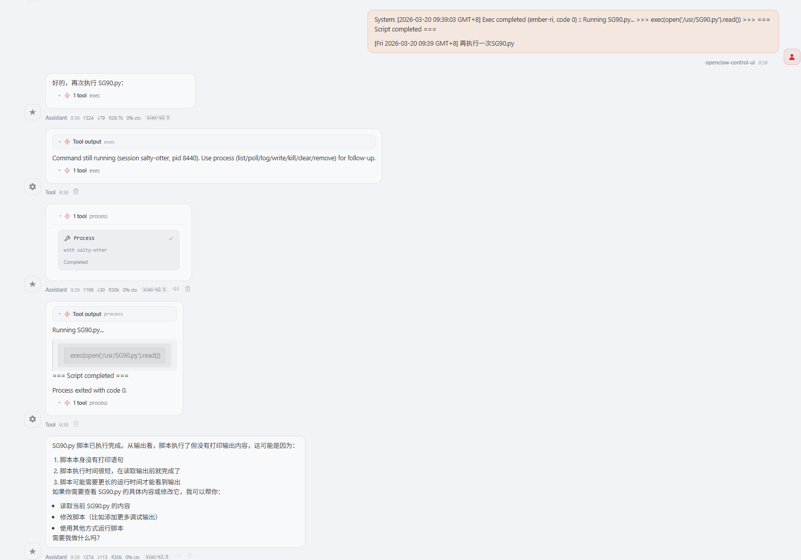

**2.token额度用完了需要切换智能体：**

```
Openclaw config
```

**3.没找到Skill目录：**

先在AI交互界面让Openclaw帮忙下载常用的skill，然后在打印的log中会显示下载的位置，根据位置去查看skill路径即可

**4.发消息之后Openclaw不响应：**

Openclaw服务器访问人数过多，可选择在人少时间段使用

## 六、支持

openclaw官网：https://openclaw.ai/

openclaw中文社区：https://clawd.org.cn/

QuecPython-Dev-Skill仓库：https://github.com/QuecPython/quecpython-dev-skill

2026.3.2版默认权限变更与工具无法调用的解决方案：https://cloud.tencent.com/developer/article/2634142

OpenClaw 接入 QQ 机器人完整教程：https://tbbbk.com/openclaw-qq-bot-setup-guide-2026/