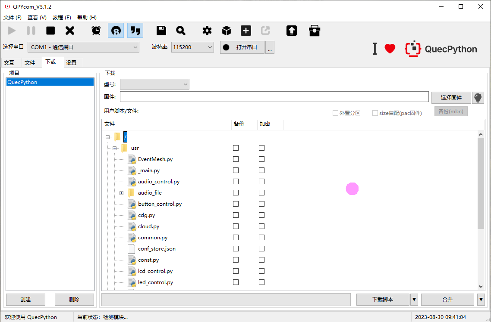
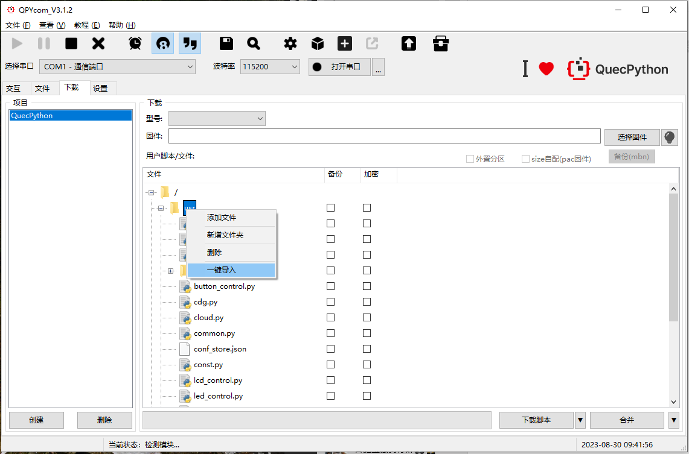
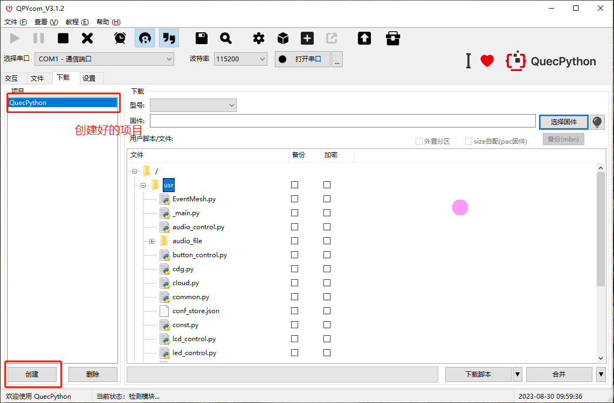
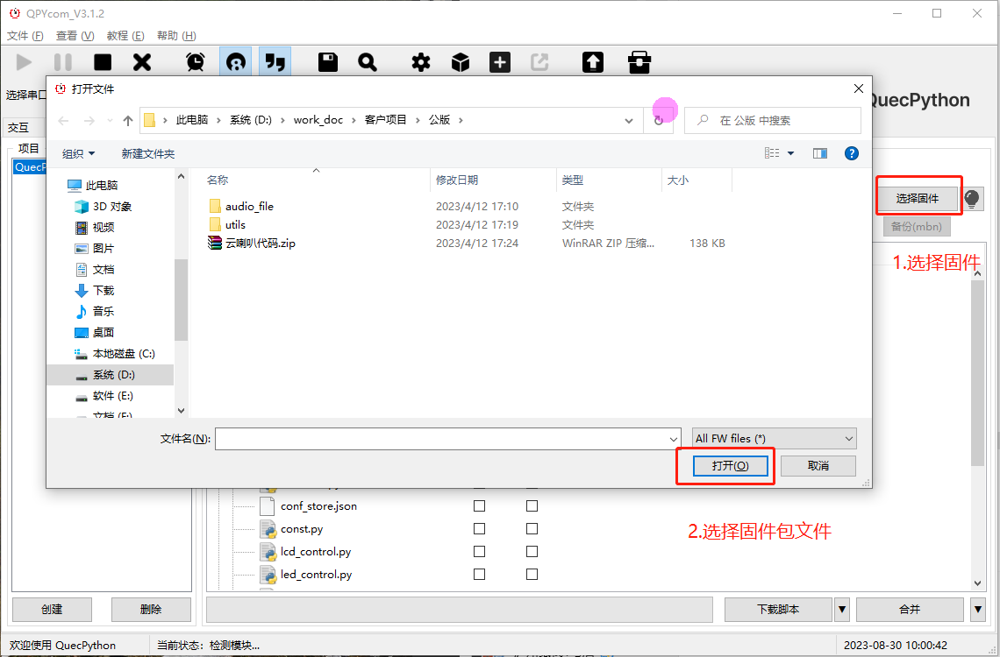
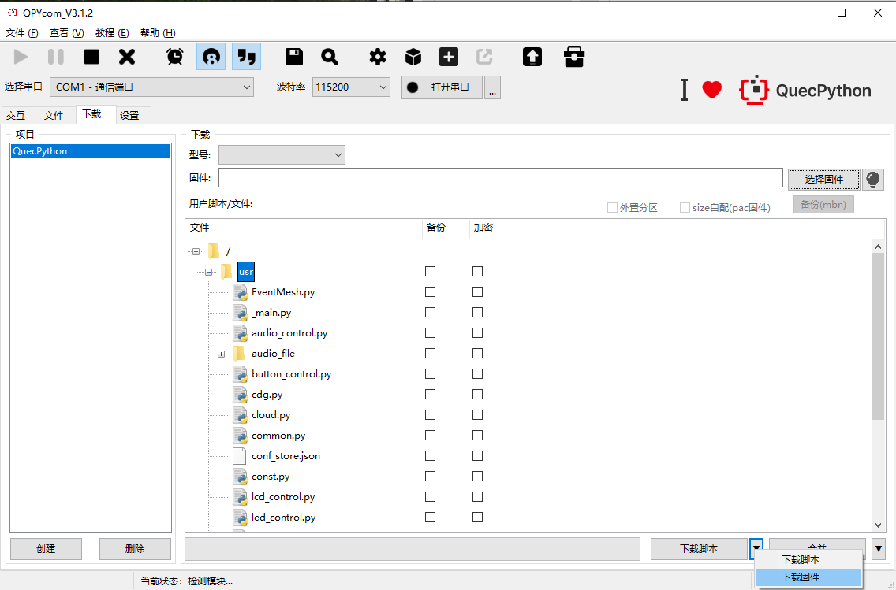
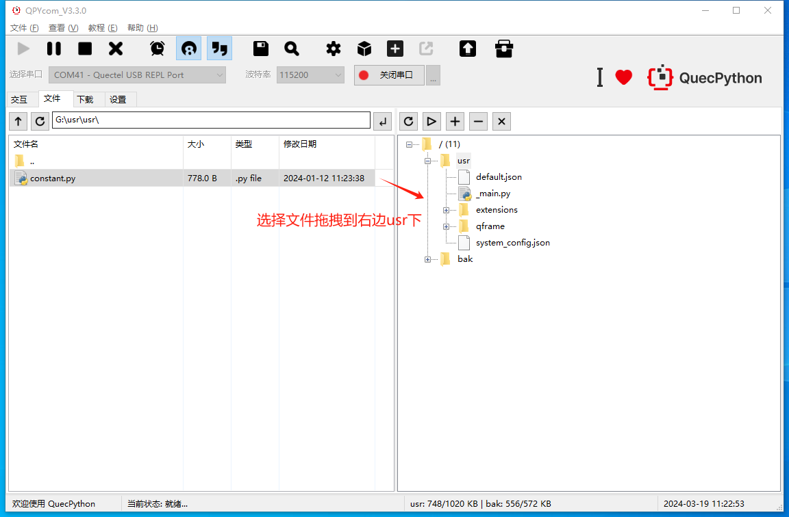
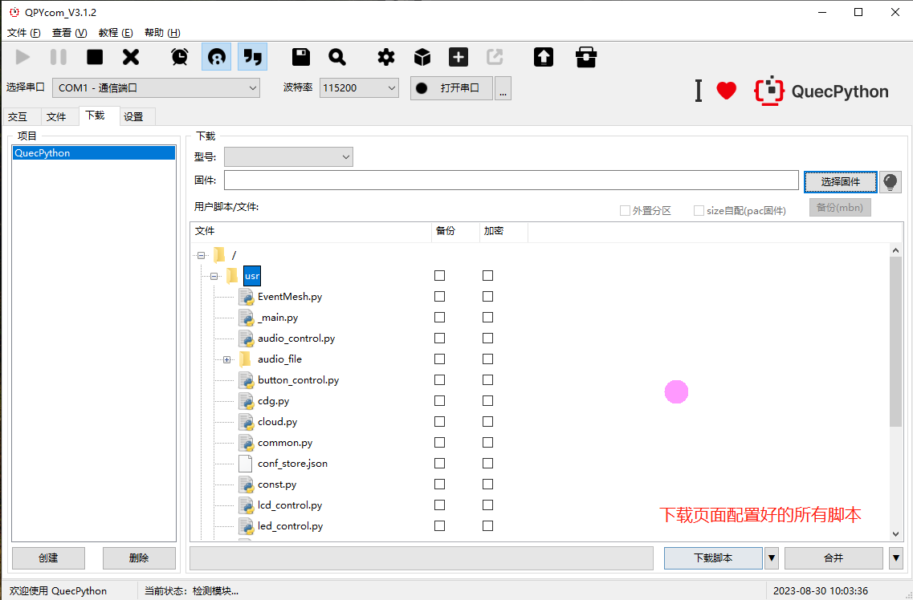

# QPYcom 固件脚本下载

## 下载固件与脚本

用户选择“**下载**”页签，可以在该页面实现本地python脚本文件批量上传以及模块烧录固件功能，操作步骤如下：

-   在工具下载页面左侧导航栏创建项目

-   点击“**选择固件**”从本地选择固件，也可从官网下载对应模组的固件，注意选择固件的后缀有zip和bin两种

-   通过图示位置选择要下载的脚本，可以通过选择指定脚本文件并点击“**-**”进行删除

-   通过左键点击图中倒三角标识来切换下载脚本和下载固件的功能

-   如图所示：

### 下载固件

- **Step1：创建项目**

工具进入下载页面，点击“**创建**”新建一个项目，选择要下载的固件。

- **Step2：选择固件**

选择固件，注意固件包的后缀。

- - **Step3：下载固件**

左键点击图中倒三角标识，选择“**下载固件**”，单击“**下载固件**”按钮。

- **Step4：下载成功**

等待进度条完成，下载成功弹窗弹出后即为固件下载成功

###  下载脚本

本地python脚本文件上传到模块有如下两种方法

**下载方法一:**

- **Step1：打开串口**

首先选择模组的交互口,点击“**打开串口**”按钮

- **Step2：通过工具按钮下载**

可以通过文件页面右侧上面的 "**+**","**-**" 按钮来上传和删除文件

- **Step3：通过拖拽形式下载**

也可以通过拖拽的方式将文件页面左侧显示的本地文件直接拖拽到右侧模组中去（也可以拖拽文件夹）

- **Step4：下载进度和结果**

下载过程中会在状态栏显示下载文件名和下载进度

**下载方法二:**

- **Step1：创建项目**

根据需求，创建用户项目（点击"**创建**"按钮）,步骤同上文烧录固件

- **Step2：配置要下载的文件**

选择需要下载到模块的用户脚本(在"用户脚本"区域通过右键菜单添加)

- **Step3：设置下载模式**

左键点击图中倒三角标识，选择"**下载脚本**"

- **Step4：开始下载脚本**

点击"下载脚本"开始下载脚本，下载过程中有进度条提示

