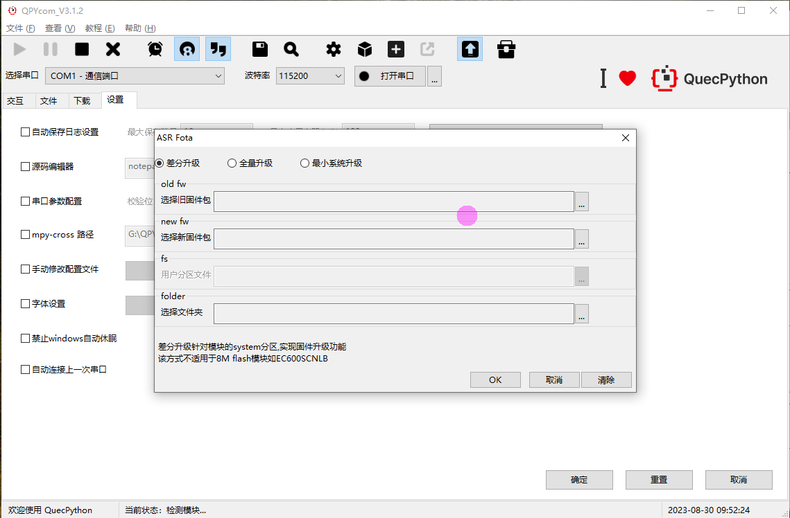
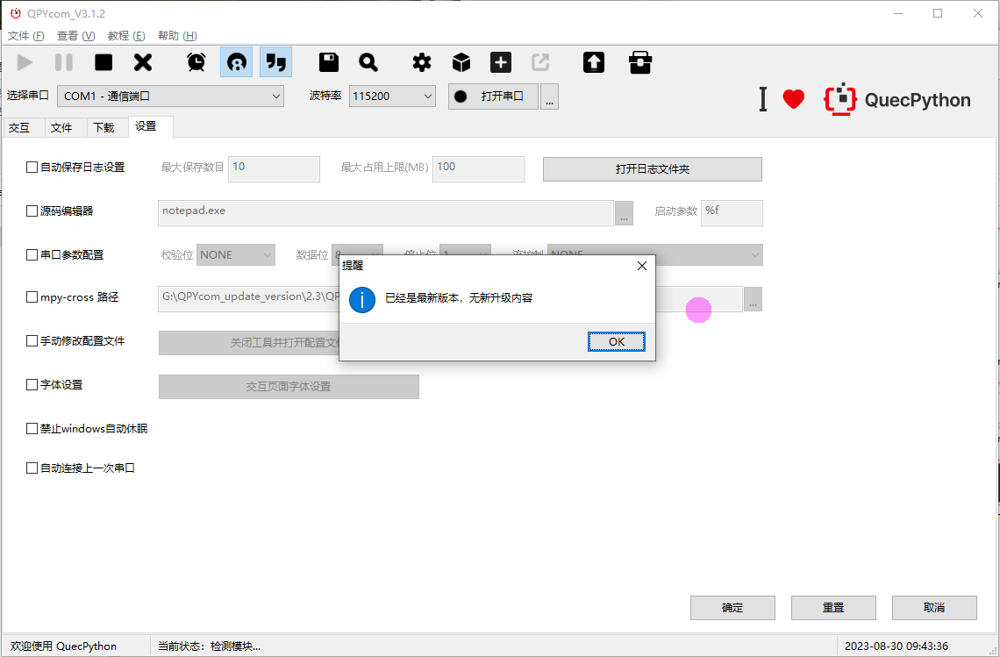
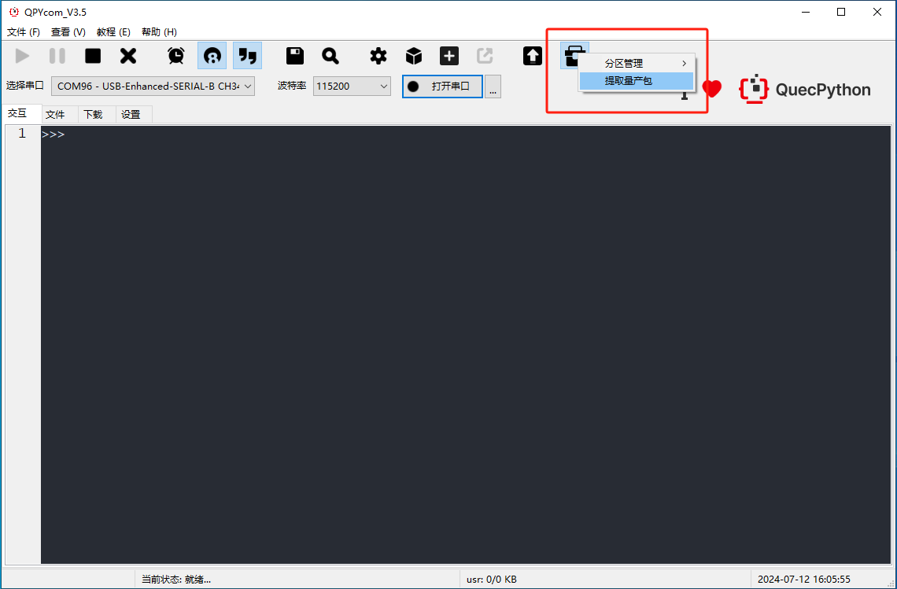

#QPYcom 扩展功能

## fota包制作流程

点击fota升级按钮后，会弹出三个子菜单，分别是ASR Fota、Unisoc Fota和200A Fota。



**ASR_FOTA包制作**

**步骤1**：选择需要做差分包的新旧固件包

**步骤2**：选择生成差分包的目录，其中全量升级需要选择用户分区的文件系统镜像

**步骤3**：点击ok生成差分包，生成的差分包位置为folder指定目录，若未指定则在exes/ASR_Fotatools目录下

**Unisoc_FOTA包制作**

**步骤1**：选择需要做差分包的新旧固件包

**步骤2**：选择生成差分包的目录

**步骤3**： 点击ok生成差分包

**200A_FOTA包制作**

**步骤1**：选择需要做差分包的新旧固件包

**步骤2**：选择生成差分包的目录

**步骤3**： 点击ok生成差分包


## QPYcom在线升级

升级触发有两种方式

方式一: 用户点击'**帮助\--\>检查升级**'菜单会联机进行版本升级检测，如果有版本升级会弹窗升级选择页面

用户可选择升级、忽略本次升级、忽略本次弹窗等


方式二: QuecPython官网上传新版本时会向用户推送最新版本的升级通知，同样，用户可选择升级、忽略本次升级、忽略本次弹窗等

如图所示：




## 工具箱

工具箱可一键执行配置的代码

例如在工具箱中配置一条查询版本号的子菜单,名称为**查询版本号**

```python
import uos
uos.uname()
```

只需要点击工具箱按钮中该名称的子菜单，即可在交互命令行中发送上文配置的代码，从而实现查询版本号的功能

工具中预配置了查询版本号、信号、拨号信息、SIM卡状态、查询目录下文件、关机等命令

如果需要额外增加指令，可以通过手动配置的方式增加指令，在工具目录下的**config.ini**文件中按照预配置命令格式在后面追加后重启工具即可，或者点击配置工具箱按钮后在弹窗中添加。

> 指令配置完毕后，重启后生效。

## 提取量产包

当需要使用其他工具（例如: Qflash工具, QMulti_DL批量烧录工具等）烧录固件时，若固件后缀与烧录工具不匹配，需要用该功能提取出量产包。

