# QPYcom 图形化界面介绍

## 工具获取

使用QuecPython进行开发需要用到专用的开发调试工具——**QPYcom**，包括但不限于调试代码、分析日志、文件传输、烧录固件、合并固件等。

[QPYcom](https://developer.quectel.com/wp-content/uploads/2024/09/QPYcom_V4.1.0.zip) : 适用于QuecPython开发的一站式调试工具

*注意:该工具无需安装，解压即用，建议提前手动关闭系统中安装的防病毒软件，以避免潜在的误报导致工具被误删或者无法使用。*

## 主界面功能

本章主要介绍QPYcom工具的主界面的主要功能说明，具体操作功能使用说明详见[扩展功能说明](./qpycom-ext.md)

在上文步骤获取工具后，解压下载的QPYcom.zip文件，进入解压后的目录找到 QPYcom.exe 工具。
通过该工具，我们可以将自己的python脚本文件下载到模块中，与模块进行命令行交互，同时该脚本工具也支持固件下载合并、升级检测等功能，用户可根据需求选择相关功能模块进行操作。

工具主要页面如下图所示：
1. 与模组交互页面

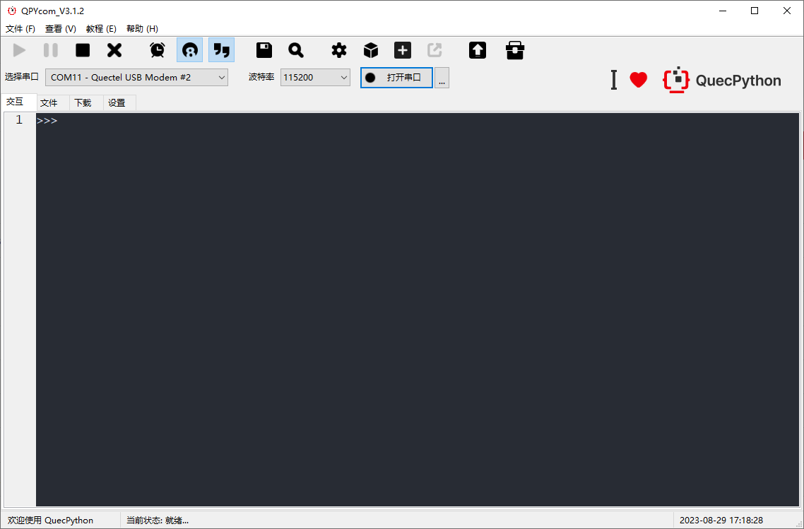

2. 操作模组文件页面

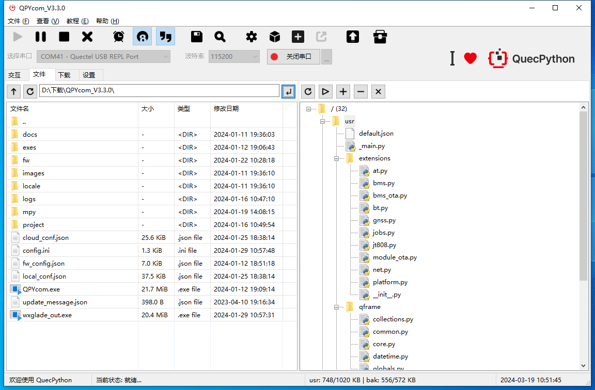

2. 固件及python脚本下载页面

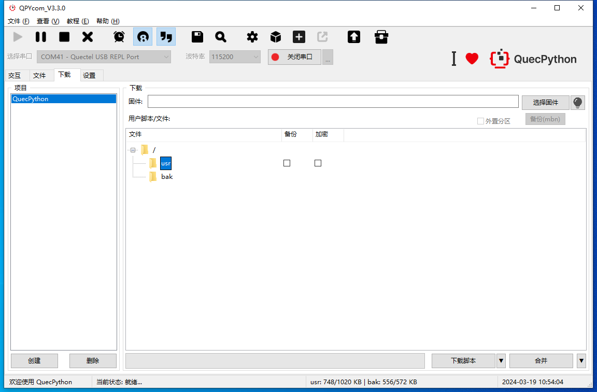

3. 设置页面

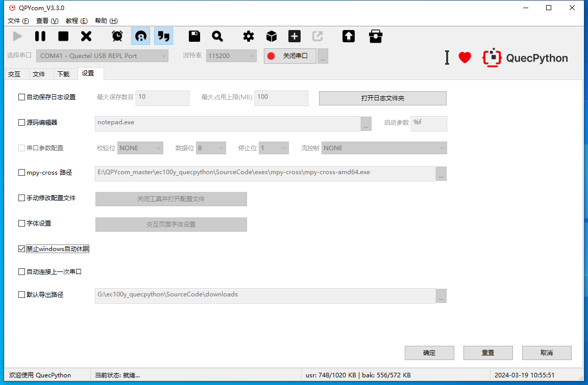

## 交互页面按钮

交互主界面相关按钮说明如下：

-   
    开启与模块间命令行交互。

-   
    暂停与模块间命令行交互。

-   
    停止与模块间命令行交互。

-   
    屏幕打印清除。

-   
    显示打印时间。

-   
    行号显示。

-   
    主交互界面主题切换（黑色与白色主题切换）。

-   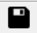
    交互日志保存。

-   
    交互日志关键字搜索。

-   
    模块日志设置、串口参数配置等选项设置。

-   
    工具箱，可手动添加快捷指令(配置在config.ini中)。

-   
    配置工具箱按钮,可自行配置需要的命令,注意命令数量最大16条,命令名称长度最大16个字符。

-   
    置顶按钮,点击按钮使工具处于置顶状态。

-   
    fota升级按钮用于制造fota包。

## 文件栏目

### 保存

-   文件栏目，有日志文件保存选项，点击'**保存**'用户可选择日志保存的路径。如图所示：

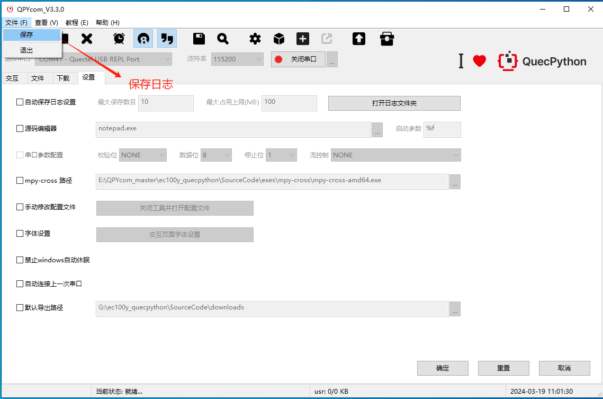

文件栏目

-   用户点击保存按钮后，选择日志保存路径，如图所示：

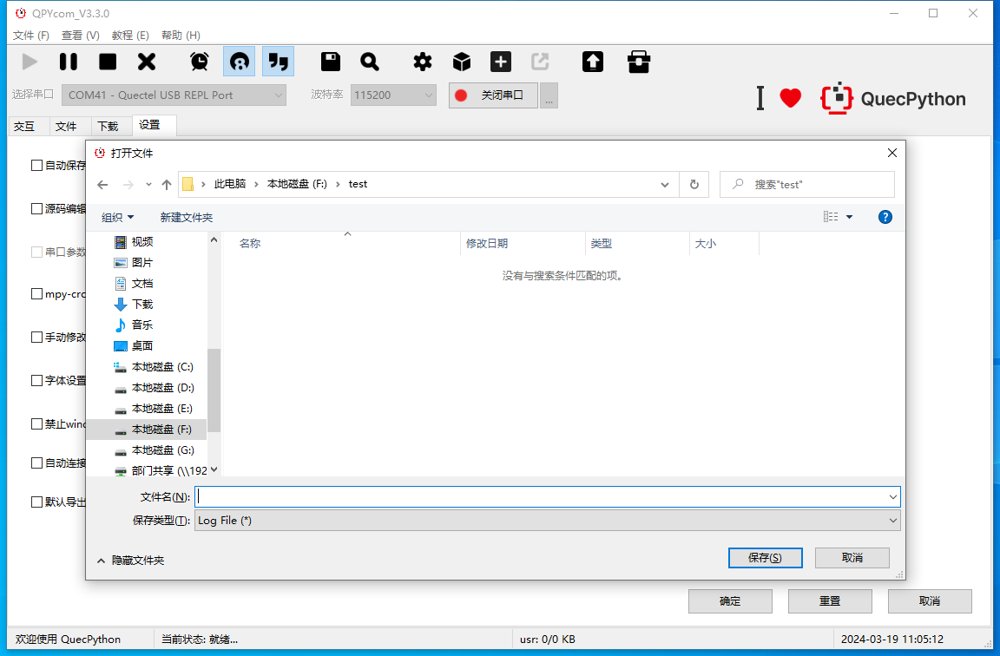

文件保存

### 退出

-   用户选择退出，则退出整个应用程序。

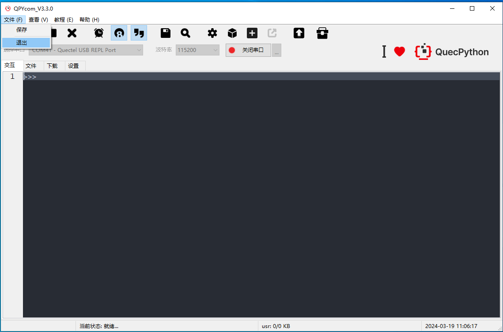

## 查看栏目

查看栏目包含【**交互命令行、文件浏览、下载固件/脚本、软件设置、语言切换、模块日志和下载日志保存查看**】功能。如图所示。

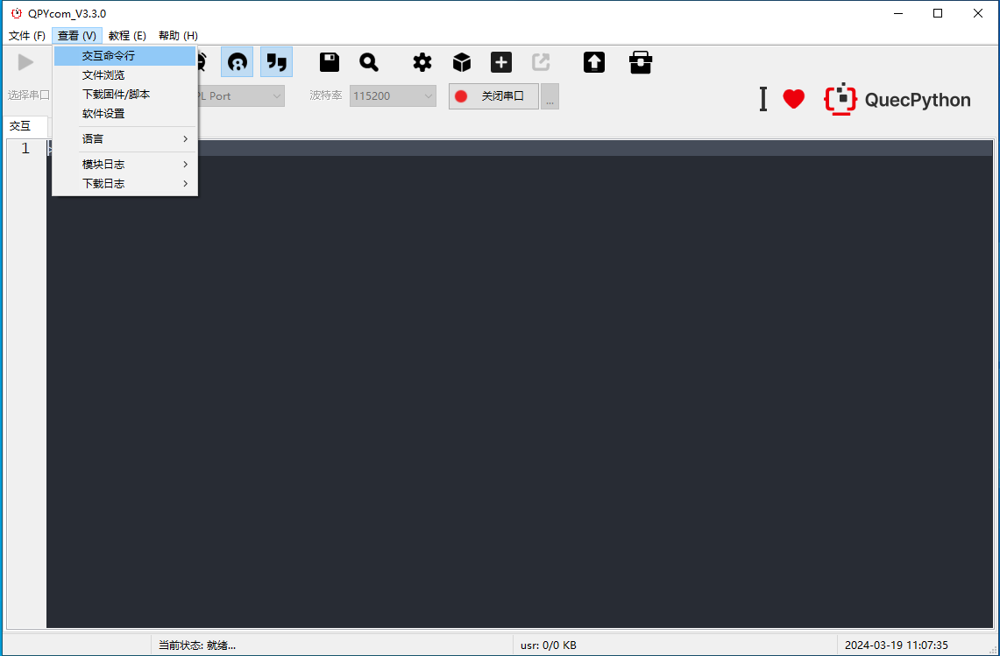

### 交互命令行

用户依次点击'**查看\--\>交互命令行**'可进入交互主界面，在交互主界面可以通过交互窗口与模块进行手动输入交互，交互主界面说明如图所示：

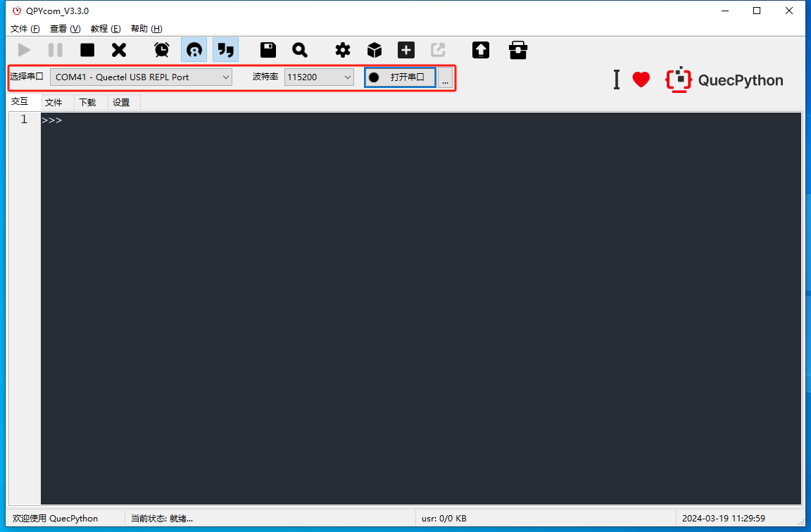

### 文件浏览

用户选择'**查看\--\>文件浏览**'，可以实现本地python文件与模块端python文件的上传、查看、添加、删除操作，如图所示：

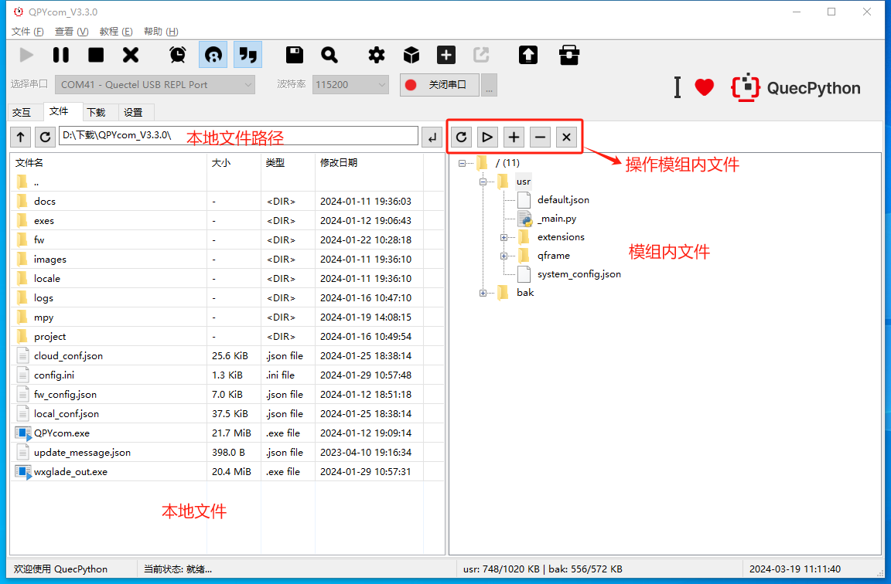

除了通过上传按钮上传文件之外,还可通过拖拽实现本地文件上传模块,需要选中左侧本地文件拖拽至右侧文件夹中实现文件上传功能,拖拽后状态栏会有下载进度显示,注意文件只可拖放至文件夹中,拖到错误的位置会提示相应错误,可以通过uos.mkdir()来新建文件夹然后拖拽本地文件来实现在在模块中新建文件夹的需求,注意文件只可拖拽至显示'+','-'的文件夹中,对于没有显示相应符号的文件夹,重新刷新即可显示。

### 下载固件脚本

用户选择'**下载**'按钮，可以实现本地python脚本文件批量上传以及模块烧录固件功能，操作步骤为：

-   在左侧导航栏创建项目

-   点击选择固件从本地选择固件，固件位置为提供的SDK包中firmware目录下，注意选择固件只可选择zip文件

-   通过图示位置选择要下载的脚本，可以通过点击脚本文件进行指定删除

-   通过左键点击图中倒三角标识来切换下载脚本和下载固件的功能

-   用户选择固件和所需要的脚本文件后点击合并按钮生成量产文件，合并过程中，除进度条外所有控件皆不可用，注意下载过程中保持USB AT Port不被占用

-   注意V1.6之后的下载页面下载脚本改成以目录结构的形式下载到模块，取消原先的按钮，可通过右键点击的形式来增加文件和文件夹以及删除，也可通过拖放来将文件从本地拖到工具中，点击下载脚本下载到模块中。

如图所示：

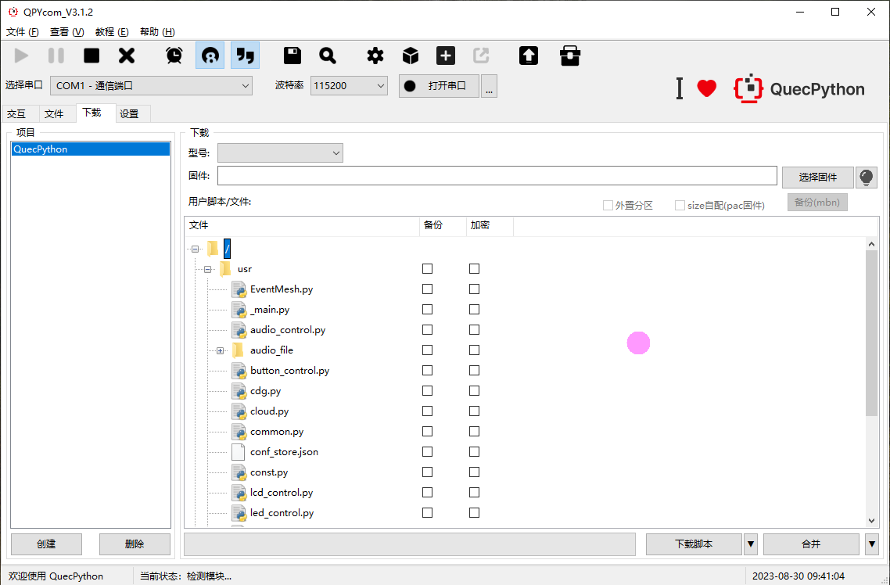

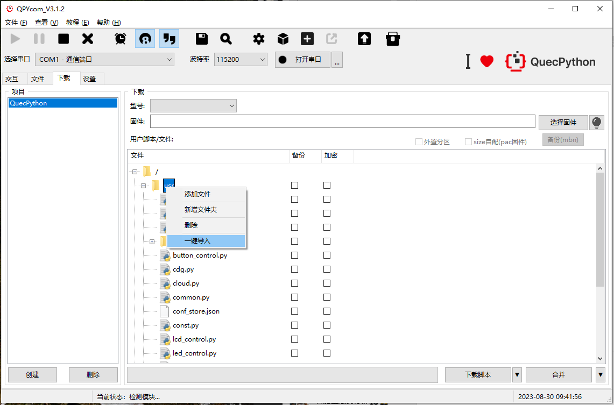

### 软件设置

用户选择'**查看\--\>软件设置**'栏目，可以进入软件设置界面，在软件设置界面，用户可以进行模块日志自动保存、单条日志保存大小限制、日志保存条数设置、串口参数配置（包括校验位、数据位、停止位、流控制）、mpy-cross加密工具路径设置，新增设置交互页面字体设置,且设置可保存持久生效,如图所示。

###  Language 栏目

-   用户选择**'查看\--\>Language'**栏目，可以进行软件语言切换，目前支持简体中文和英文两种语言的切换。

### 模块日志

-   用户选择**'查看\--\>模块日志'**，可以对模块日志进行查看以及选择模块日志新的保存路径。

### 下载日志

-   用户选择**'查看\--\>下载日志'**，可以对下载日志进行查看以及选择下载日志新的保存路径。

##  教程栏目

### 官方网站

-   用户选择'**教程\--\>官方网站**'可以访问我们QuecPython的官方网址

### 在线wiki

-   用户选择 '**教程\--\>在线wiki**'，可以访问我们QuecPython的wiki教程

### 在线教程

-   用户选择'**教程\--\>在线教程**'，可以访问我们QuecPython的视频教程

### 在线交流

-   用户选择 '**教程\--\>在线交流**'，可以访问我们QuecPython的在线社区

### 资料下载

-   用户选择'**教程\--\>资料下载**'，可以访问我们QuecPython的资源下载

## 帮助

在帮助界面，用户可以进行版本更新检查，版本查阅，访问QuecPython官网及移远官网。

### 检查升级

用户选择'**帮助\--\>检查升级**'栏目，则软件会检查是否有新版本更新，如果没有新版本则会提示目前已经是最新版本，如果有新版本则会把更新内容及版本号提示用户。

-   如果是强制升级提醒，用户选择升级则会开始更新操作，用户选择取消则会直接退出应用程序；

-   如果是忽略升级，是本次可忽略的文件，用户选择忽略则会在下次软件启动时重新提示用户更新，本次不再提示，用户选择升级则会开始更新操作；

-   如果是忽略升级，是永久可忽略的文件，用户选择忽略则会在下次软件启动时不再重新提示用户更新，用户选择升级则会开始更新操作。

-   升级过程中会有进度条和升级日志显示，且在升级过程中无法对工具进行操作

如图所示：

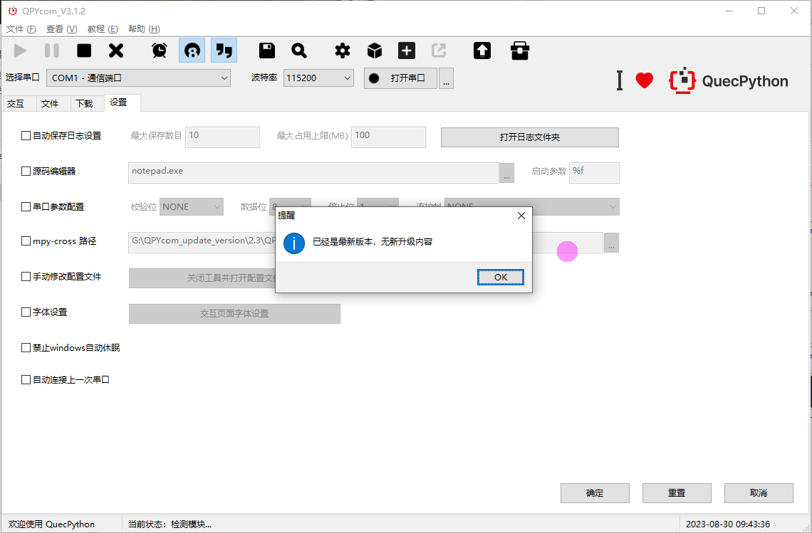

### changelog

-   用户选择**'帮助\--\>changelog'**，将会打开工具changelog，查看工具迭代功能点，changelog文件在工具根目录下。

### 使用指导

-   用户选择**'帮助\--\>使用指导**'，将会打开本文档，查看工具的使用说明书。

### 关于Quectel移远

-   用户选择**'帮助\--\>关于Quectel移远'**，将会访问移远Quectel官网。

### 关于QuecPython

-   用户选择**'帮助\--\>关于QuecPython'**，将会访问移远QuecPython官网。

### 版本

-   用户选择**'帮助\--\>版本'**，将会提示工具当前版本号。
