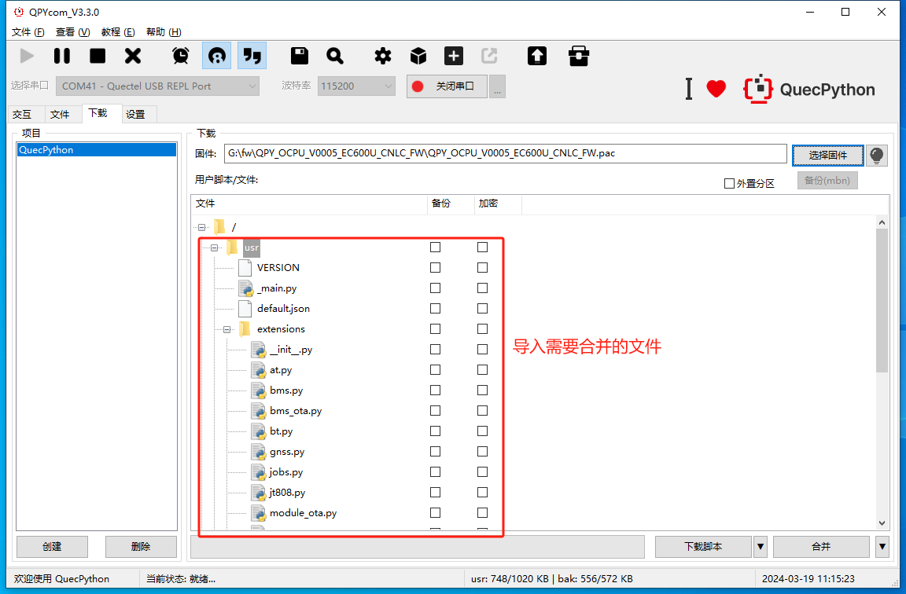
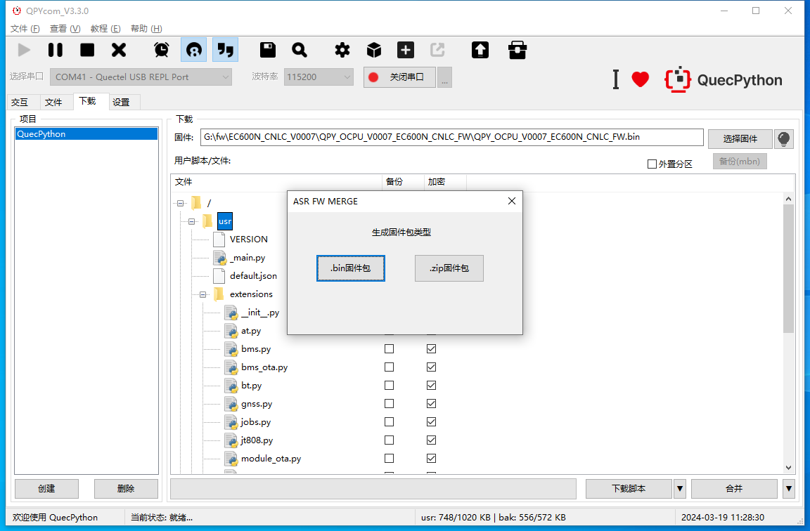
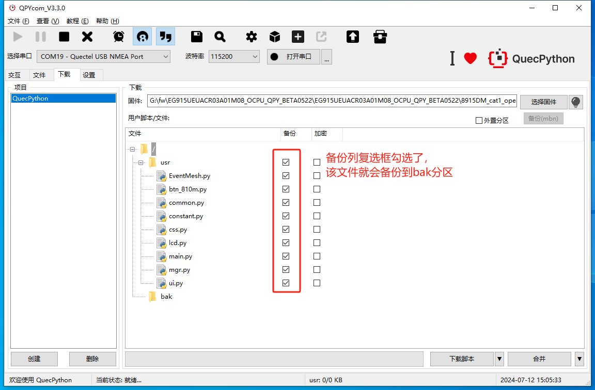
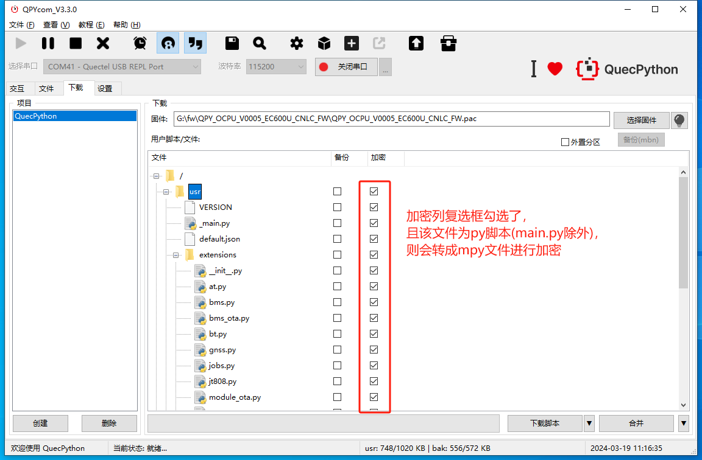
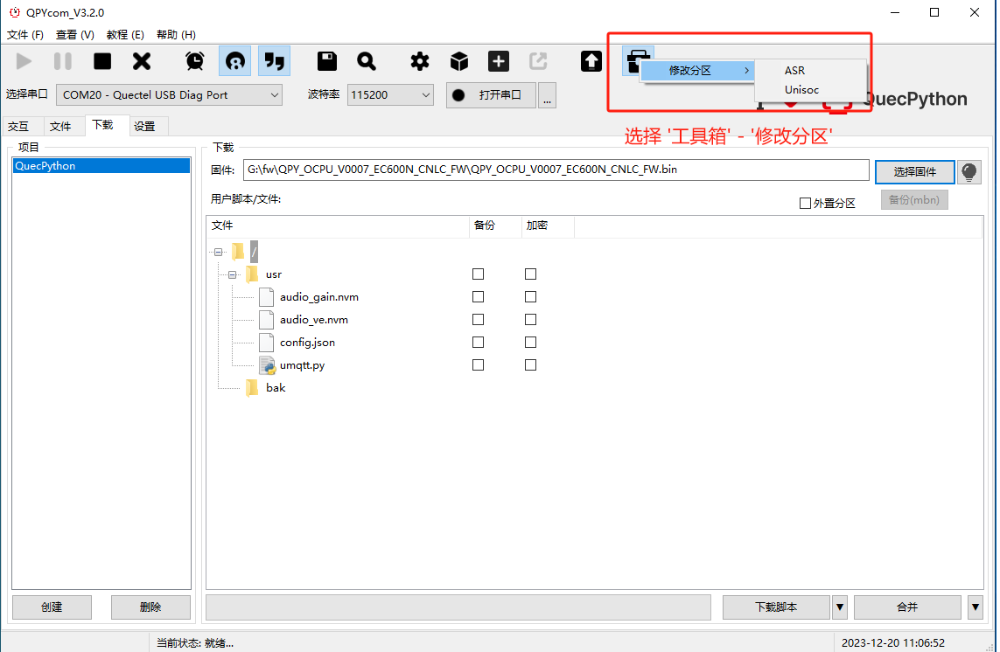
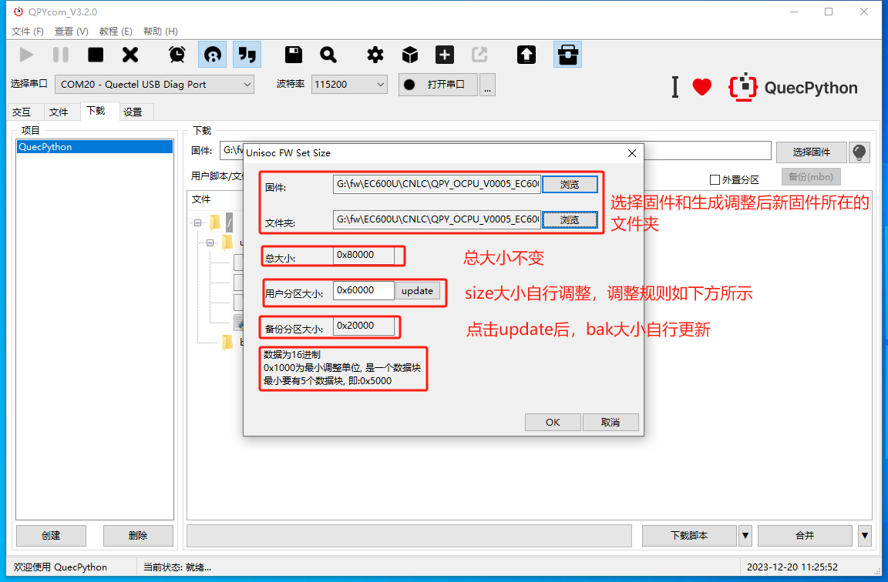
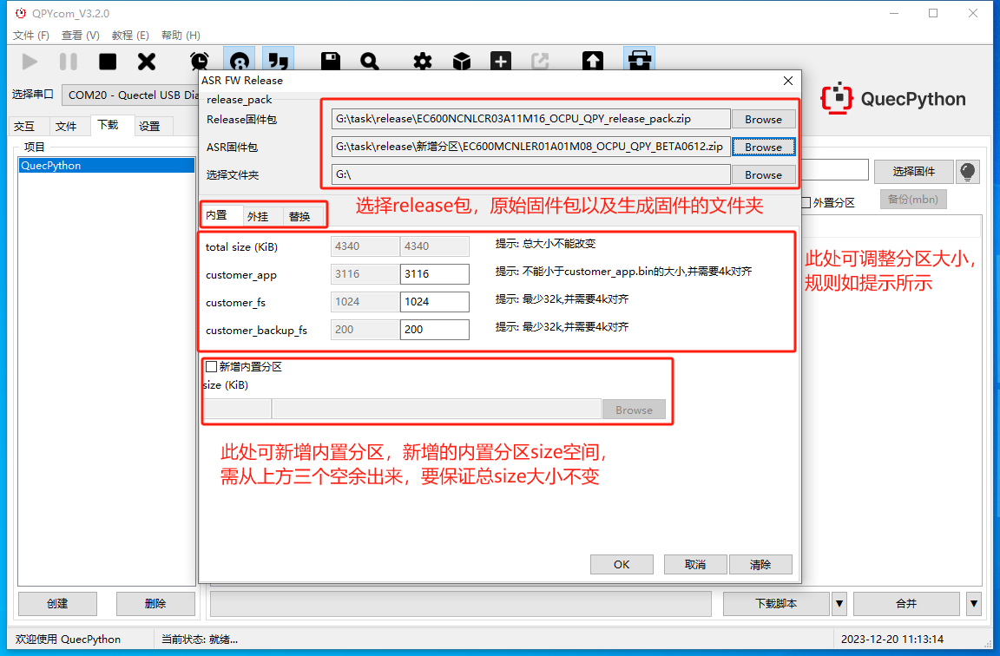
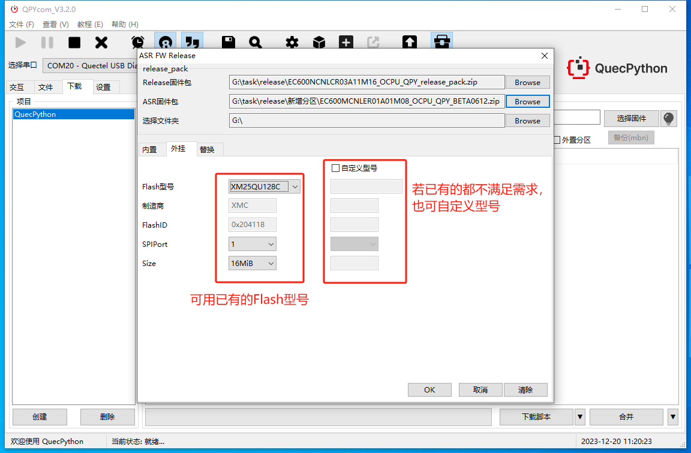
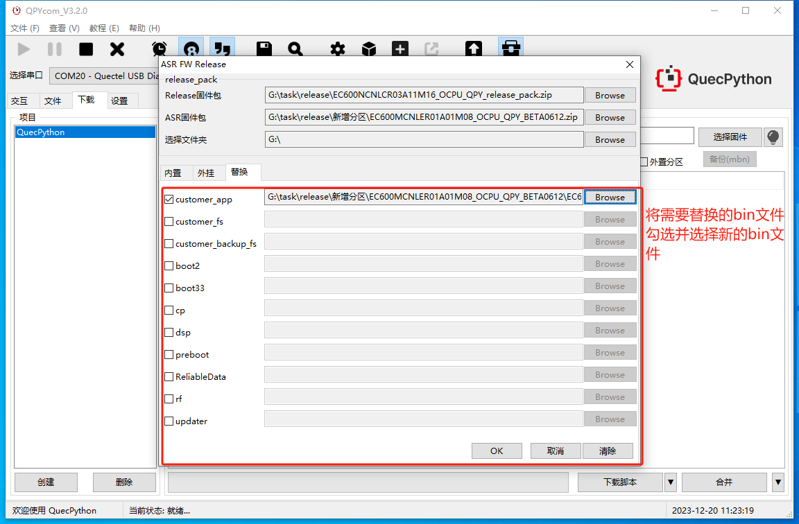
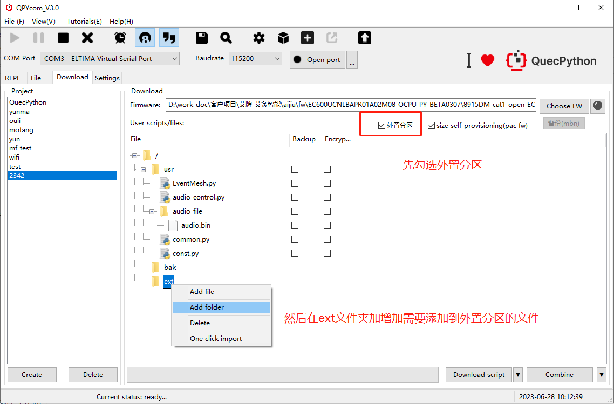

# QPYcom 固件脚本合并

## 固件脚本合并

用户选择'**下载**'页面，可以实现本地python脚本文件与固件合并生成量产文件功能，操作步骤为：

-  在左侧导航栏创建项目

-  点击选择固件从本地选择固件

-  通过图示位置选择要合并的脚本，可以通过点击脚本文件进行指定删除，可以一键导入整个目录结构来实现合并具有复杂目录结构的项目,用户选择加密和备份复选框来实现备份和加密功能

-  ASR固件合并，可选择 .zip 和 .bin 后缀（QPYcom工具2.9版本添加）

## 代码备份

### Python脚本备份概述

工具可以在合并的固件的过程中将待合入的文件进行备份

备份后的文件如果意外删除，可以通过重启虚拟机的方式进行还原

### 备份操作步骤

1. 按照上文固件脚本合并的过程，在选择好要合并的固件和脚本之后，通过勾选备份复选框开启备份功能

2. 勾选备份之后点击合并按钮，在合并前会对已选择的脚本进行备份操作

## 代码加密

### Python脚本加密概述

工具可以在合并的固件的过程中将待合入的py脚本加密成mpy文件以达到代码安全的要求

加密后的mpy文件不可读但是仍然可以通过导入库的形式来使用,但是无法通过工具的执行按钮来运行

工具在加密脚本文件的过程中会避开main.py, 应用程序的编写规范一般是将main.py作为入口文件来调用其他代码

如：user.py加密后，就会变成user.mpy，我们可以直接用user.mpy代替原有的user.py文件，使用起来和原来一样。

### 加密操作步骤

1. 按照上文固件脚本合并的过程，在选择好要合并的固件和脚本之后，通过勾选加密复选框开启加密功能

2. 勾选加密之后点击合并按钮，在合并前会对已选择的脚本进行加密操作，最后合并到固件中的脚本文件均为mpy文件,此外，在合并完成后可以在工具目录下的mpy文件夹中找到本次合并过程中生成的mpy文件

### 单独加密脚本

若不想跟随固件包一起捆绑加密，可使用加密工具对单个脚本进行加密，工具可咨询移远获取

将加密工具与脚本放置于同一文件夹下(不要存在特殊字符). 使用CMD命令对脚本进行加密. 

示例(对user.py进行加密): mpy-cross-amd64.exe -o user.mpy -mno-unicode user.py

## 调整镜像分区

点击 **工具箱** - **修改分区** 可对分区进行调整(3.2.0版本支持ASR和Unisoc平台)

### Unisoc平台

### ASR平台

1. 内置分区调整

2. 外挂分区调整

3. bin文件替换

### 合并外置分区

1. 用户在合并固件制作文件系统时除了用户分区和备份分区以外需要增加外置分区的镜像时，可以通过选择此功能来实现
2. 勾选下载页面的 `外置分区` 复选框，此时工具的用户脚本页面的目录会增加一个`ext` 目录
3. 在该目录下增加文件再通合并流程即可完成包含外置分区的固件合并

> 注意: 只有支持外置分区的定制固件可支持外置分区合并功能