# VSCode 插件使用教程

为方便开发者使用 [VSCode](https://code.visualstudio.com/) 开发 [QuecPython](https://developer.quectel.com/)，QuecPython 团队特推出了名为 [`QuecPython` 的 VSCode 插件](https://marketplace.visualstudio.com/items?itemName=Quectel.qpy-ide)。

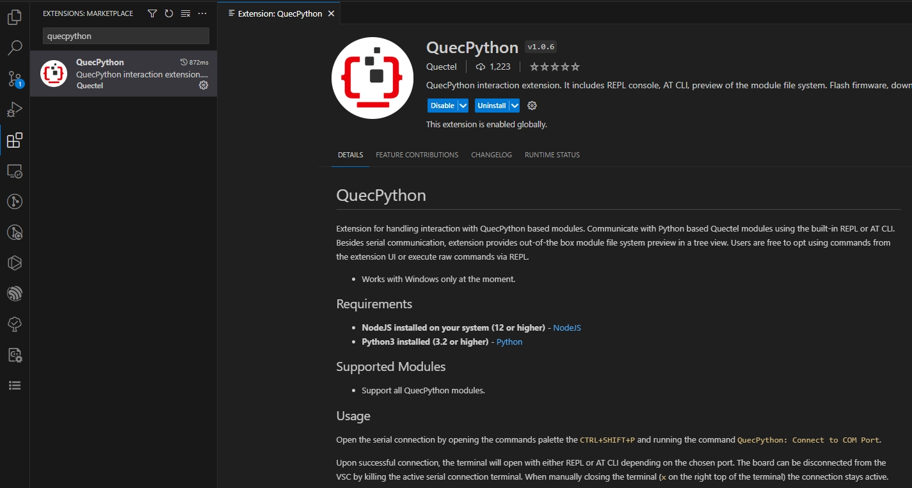

插件目前支持的功能有：

- 固件烧录
- REPL 命令交互
- 代码补全
- 文件传输
- 文件系统目录树
- 运行指定脚本文件

目前支持所有QUecPython系列模组。

## 插件安装

1. **点击主侧边栏的 `Extensions` 图标 **。
2. **在插件搜索框输入 `QuecPython`。**
3. **在搜索列表中找到 QuecPython 插件，点击 `install` 按钮，完成插件安装。**

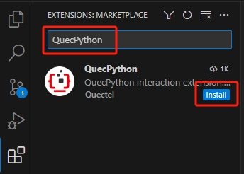

## 插件使用方法

> 开始前，用户需要下载适合自己模组型号的 QuecPython 固件包，[点此查看固件包下载方式](../../media/dev-tools/VSCode-Plugin-quecpython/download-fw-pkg.png)。

以下内容基于 [U-235 开发板](https://developer.quectel.com/doc/quecpython/Dev_board_guide/zh/ec600u-235.html)演示。

### 固件烧录

1. **调出主侧边栏的固件烧录界面**

    有两种方法：

    - 点击主侧边栏的 QuecPython 插件图标 。

    - 使用快捷键 `Ctrl+Shift+P`，打开命令面板，在其中输入 `> QuecPython`，在候选项中选择 `QuecPython: Focus on Firmware Manager View`，如下图所示：

        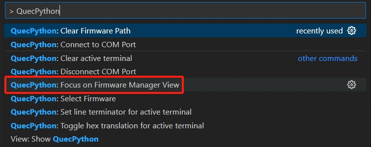

    调出的主侧边栏的固件烧录界面如下图所示：

    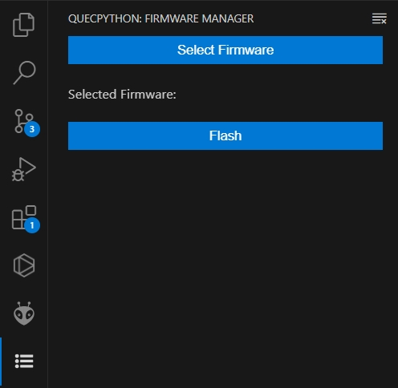

2. **选择固件**

    点击固件烧录界面中的 `Select Firmware` 按钮 ，选择 U-235开发板模组的固件包。

    固件包路径将会在界面中显示：

    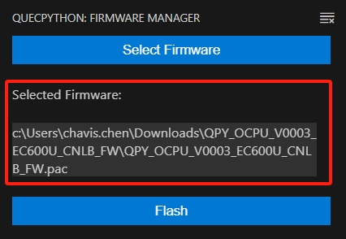

3. **烧录固件**

    i. 点击固件烧录界面中的 `Flash` 按钮 。

    ii. 在弹出的确认窗口中，点击 `Yes` 按钮 。

    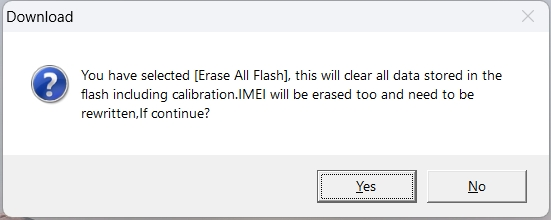

    此时看到 VSCode 界面的右下角出现固件烧录进度条：

    

    当进度条内容为 `Flashing Firmware: 8/8 100%` 时，固件烧录完成，同时模组会重启。

### REPL 命令交互

> 在开始 QuecPython 的 REPL 命令交互前，必须先烧录支持 QuecPython 功能的固件。

1. **在命令面板中找到连接终端的命令**

    使用快捷键 `Ctrl+Shift+P`，打开命令面板，在其中输入 `> QuecPython`，在候选项中选择 `QuecPython: Connect to COM Port`，如下图所示：

    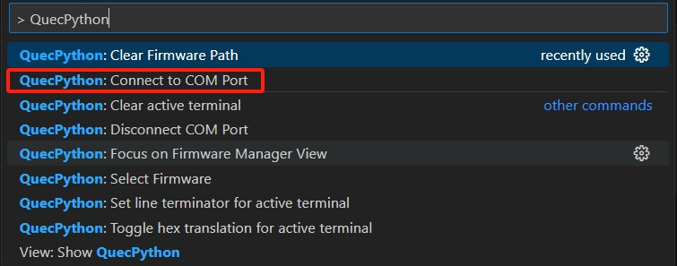

2. **连接终端**

    按照下图进行操作：

    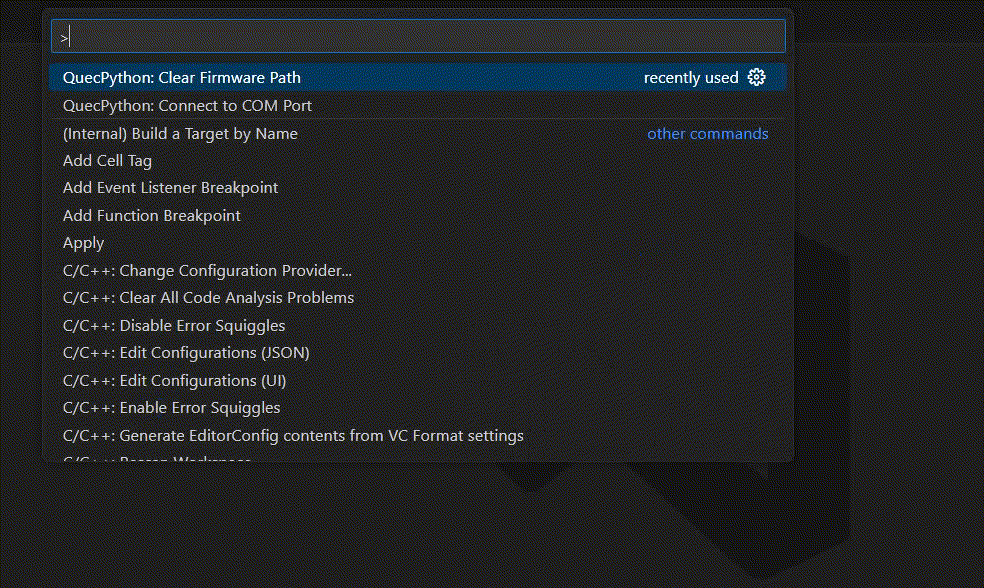

    操作完成后，模组便与 VSCode 的终端建立了连接。

    同时，终端窗口会弹出下图内容：

    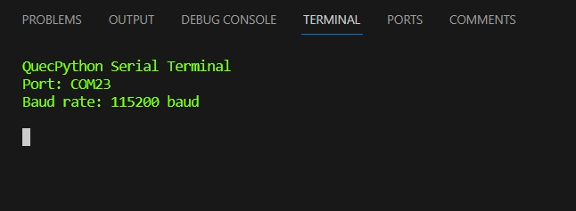

3. **REPL 命令交互**

    在终端中键入回车，会显示 QuecPython 的命令提示符 `>>>`。

    我们在终端中输入代码：

    ```python
    print("Hello, QuecPython!")
    ```

    键入回车后，可看到如下图所示的执行效果：

    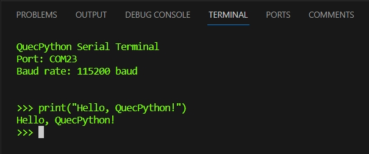

    此时，我们已经完成了最简单的 QuecPython REPL 交互。

### 代码补全

1. **新建 Python 脚本文件 `test.py`，并在 VSCode 中打开。**

2. **在 `test.py`文件的编辑页面输入如下代码：**

    ```python
    import utime
    
    for i in range(100):
        print("Hello, QuecPython!")
        utime.sleep(1)
    ```

    该段代码用于每间隔 1 秒钟，循环打印字符串 `"Hello, QuecPython!"`。

    由下图可以看出，当输入 QuecPython 中特有的 `utime`模块时，VSCode 界面会对其下包含的方法进行提示。

    按下上下方向键，使光标移动到需要的接口，按下 `Tab` 或 `Enter` 键，即可将代码补全到 `test.py` 文件中。

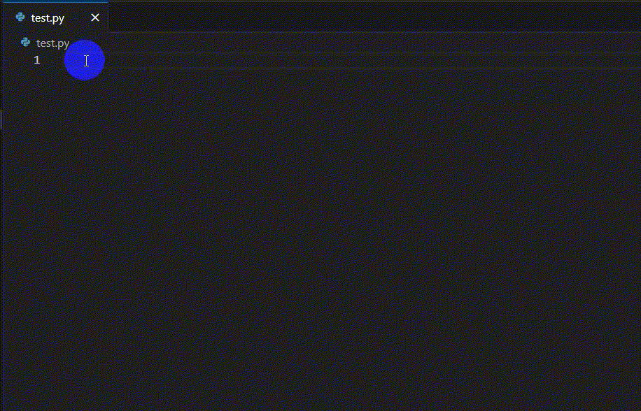

### 文件传输

编辑完成的脚本文件 `test.py` 需要导入至模组的文件系统才可运行。

1. **在需要传输的文件（即 `test.py`）的编辑器页面，单击鼠标右键。**
2. **单击 `QPY: Download File` 命令，开始传输文件。**

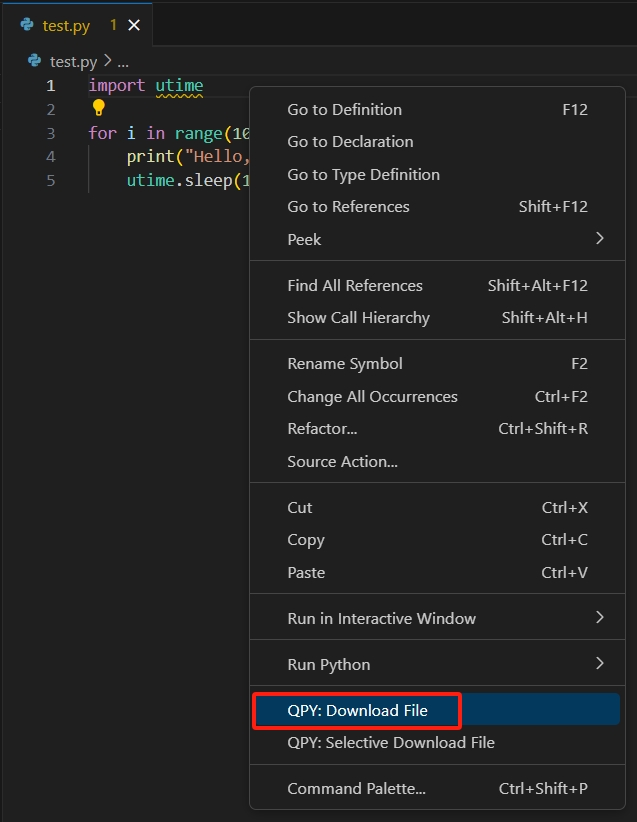

文件传输过程中，VSCode 界面的右下角出现下图的弹窗提示：

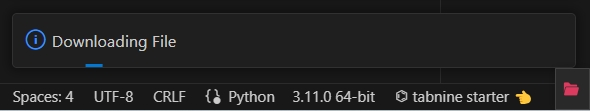

### 文件系统目录树

1. **当文件传输完成后，点击主侧边栏的 `Explorer` 按钮 。**

2. **调出 `Explorer` 界面后，在最下面找到 `QPY: FILE SYSTEM (USR)`，它展示了模组文件系统 `/usr` 的目录树。**

    我们导入的文件 `test.py` 如下图所示：

    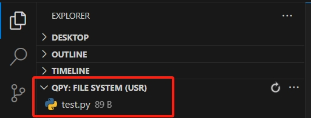

### 运行脚本文件

1. 在目录树中选中需要运行的脚本文件 `test.py`。

2. 在脚本文件 `test.py` 上单击鼠标右键，选择 `Run Script`，执行脚本文件。

    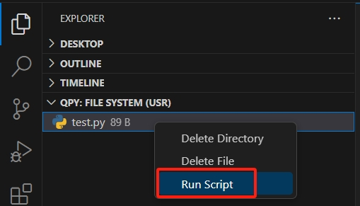

在终端窗口上可以看到脚本在周期性输出字符串 `"Hello, QuecPython!"`。

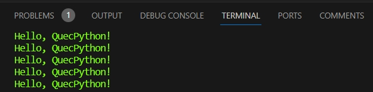

