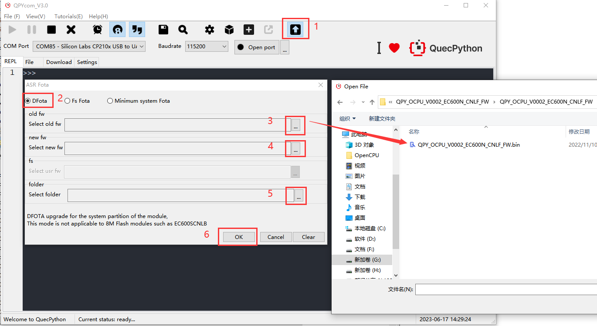
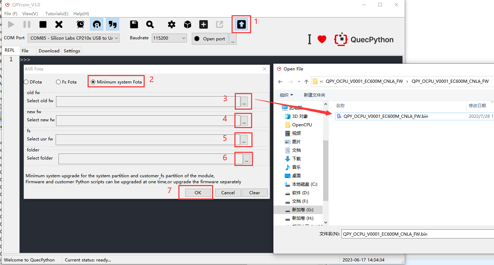
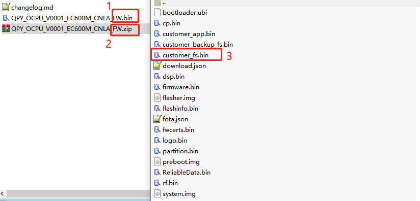
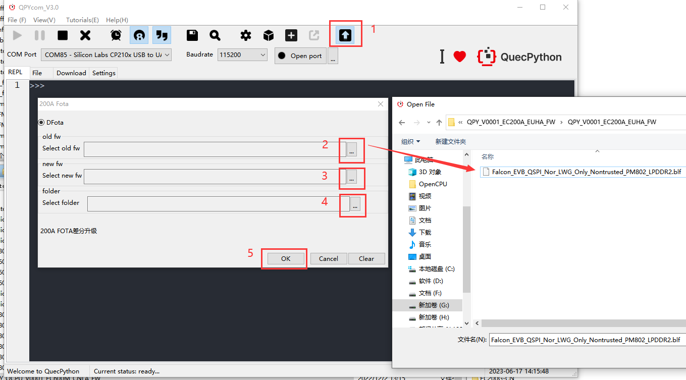
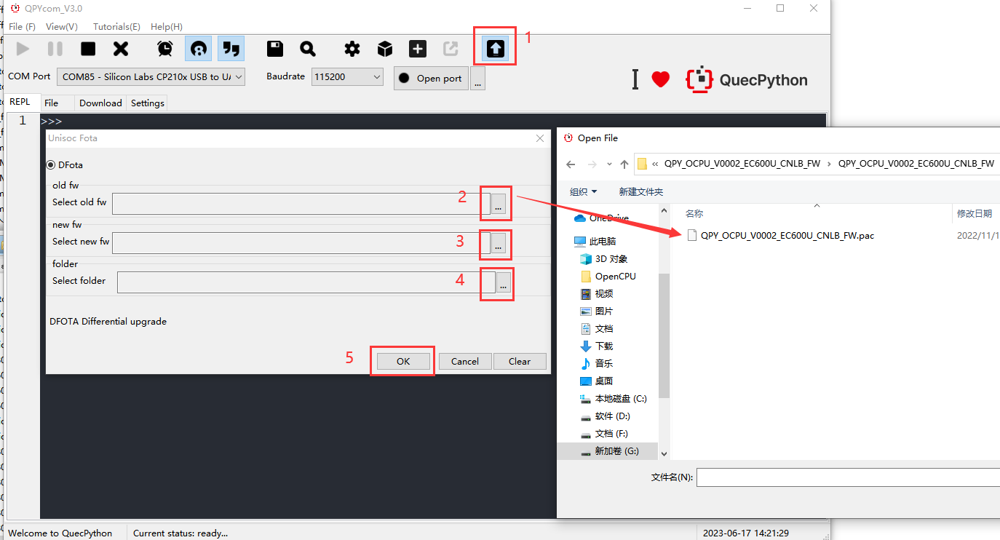
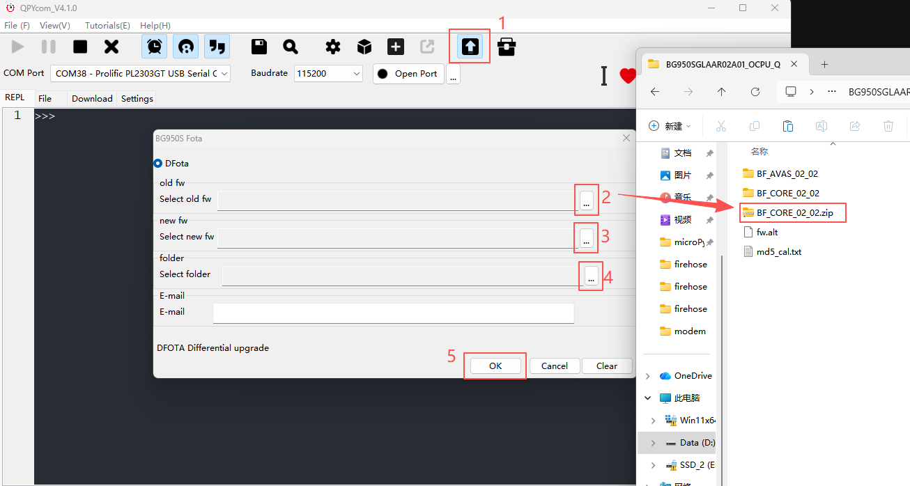

# 固件 OTA 升级包制作指引

本文档旨在介绍QuecPython固件OTA差分包制作方法，指导客户使用工具制作OTA差分包。

## ECx00N&EG91xN系列

### 差分升级方案 - ECx00N&EG91xN系列

1、点击升级按钮，选择ASR Fota。

2、弹出对话框，选择DFota。

3、选择当前版本固件。

4、选择目标版本固件。

5、选择升级包输出位置.

6、点击OK生成升级包文件。

## ECx00M&EGx00M系列

### MiniFOTA升级方案

1、点击升级按钮，选择ASR Fota。

2、弹出对话框，选择Minimum system Fota。

3、选择当前版本固件。

4、选择目标版本固件。

5、选择文件系统bin文件，即存放用户文件的分区。需要选择合并用户文件之后的固件包中的customer_fs.bin，如何获取参照下述步骤。（可选）

6、选择升级包输出位置。

7、点击OK生成升级包。

固件包中文件系统bin文件获取方法：

1、如果合并后的固件是.bin后缀，则需要将其手动改成.zip后缀。如果本来就是.zip后缀则跳过此步骤。

2、使用解压缩软件解压缩.zip后缀的固件包。

3、获取固件包中customer_fs.bin文件，即为文件系统bin文件。

## EC200A系列

### 差分升级方案 - EC200A系列

1、点击升级按钮，选择200A Fota，弹出对话框。

2、选择当前版本固件中的blf文件。

3、选择目标版本固件中的blf文件。

4、选择升级包输出位置。

5、点击OK生成升级包。

## ECx00U&EGx00U&ECx00G系列

### 差分升级方案 - ECx00U&EGx00U&ECx00G系列

1、点击升级按钮，选择Unisoc Fota，弹出对话框。

2、选择当前版本固件中的.pac文件。

3、选择目标版本固件中的.pac文件。

4、选择升级包输出位置。

5、点击OK生成升级包。

## BG950S&BG770S系列

### 差分升级方案 - BG950S&BG770S系列

压缩文件获取方法：

将原始固件包中BF_AVAS_02_02与BF_CORE_02_02文件压缩为一个压缩包，得到该固件包的压缩文件。

1、点击升级按钮，选择BG950S Fota，弹出对话框。

2、选择当前版本固件中的压缩文件。

3、选择目标版本固件中的压缩文件。

4、选择升级包输出位置。

5、点击OK生成升级包。

## ECx00E系列

### 差分升级方案 - ECx00E系列

待QPYCOM工具支持后补充。

## BG95&BG600L系列

### 差分升级方案 - BG95&BG600L系列

特定的制作工具，该工具不开放。客户可向Quectel申请制作对应版本的升级包。