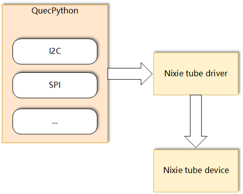
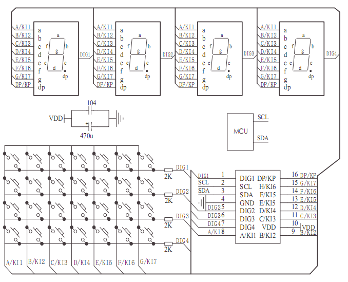

## 数码管

数码管/LED 点阵是嵌入式系统中常见的显示方案，该方案比 LCD 显示屏占用更少的引脚和内存资源，实现也更加简单，比较适合计时、计数、状态显示等具有单一显示需求的应用场景。

数码管主要有 LED 数码管、LCD 数码管和 VFD 数码管等类型。

1. **LED 数码管**

   - **工作原理**：LED 数码管是利用发光二极管（LED）的 PN 结正向导通时产生发光的原理制成的。数码管内部通常有 7 段或 14 段 LED 条组成，可以通过控制器控制这些 LED 条的亮暗，从而显示出各种数字或字符。
   - **特点**：LED 数码管具有亮度高、视角大、寿命长、耐震性能好等优点，缺点是功耗较大。
   - **应用**：广泛应用于各种电子设备和仪表中，如电子表格、计时器、计算器和闹钟等。

2. **LCD 数码管**

   - **工作原理**：LCD 数码管利用液晶材料在电场作用下对光的传输性质产生变化的特性来显示信息。通常有 7 段或 14 段液晶条组成，通过控制器控制液晶的状态，从而显示各种数字或字符。
   - **特点**：LCD 数码管具有功耗低、显示效果柔和、对环境适应性强等优点，缺点是视角较小、对温度敏感。
   - **应用**：广泛应用于各种便携式和低功耗电子设备，如手表、电子词典、移动电话等。

3. **VFD 数码管**

   - **工作原理**：VFD 数码管是利用气体放电原理来产生发光的。数码管内部通常有 7 段或 14 段荧光发射体，通过控制器控制发射体的放电状态，从而显示各种数字或字符。
   - **特点**：VFD 数码管具有亮度高、显示颜色丰富、视角大、反应速度快等优点，缺点是功耗大、寿命较短。
   - **应用**：广泛应用于各种家电和娱乐设备中，如电视、DVD 播放器、音响等。

### 驱动框图



1. **主控微处理器（MCU）**：主控微处理器是系统的核心，负责处理并执行所有的操作。它根据需要显示的信息，通过接口向显示驱动 IC 发送指令。
2. **显示驱动 IC**：显示驱动 IC（也被称为数码管驱动 IC）是一个专门用于驱动数码管显示的集成电路。它接收来自主控微处理器的指令，并根据这些指令来驱动数码管显示相应的数字或字符。
3. **接口（SPI, I2C 等）**：接口是用于连接主控微处理器和显示驱动 IC 的通信路径。主控微处理器通过接口向显示驱动 IC 发送指令。
4. **数码管显示**：数码管是显示驱动 IC 驱动的显示设备。根据显示驱动 IC 的指令，数码管显示相应的数字或字符。

在一个基本的数码管显示系统中，这些组件的关系可以概括为以下几个步骤：

- 主控微处理器根据需要显示的信息，生成相应的指令。
- 主控微处理器通过接口将指令发送给显示驱动 IC。
- 显示驱动 IC 接收这些指令，根据指令驱动数码管显示相应的数字或字符。

这就是一个基本的数码管显示系统的工作原理。不同的数码管显示系统可能会有不同的具体实现，但大部分系统都会遵循这个基本模式。

### 适配说明

QuecPython 系列模块适配设备情况如下:

| 名称   | 功能                                                        | 接口 | 驱动             | 数据手册      |
| ------ | ----------------------------------------------------------- | ---- | ---------------- | ------------- |
| TM1650 | 带键盘扫描的 LED 驱动控制芯片，支持 8 段 ×4 位和 7 段 ×4 位 | I2C  | [tm1650.py](../../media/hardware/display/tm1650.zip) | [TM1650](../../media/hardware/display/TM1650.pdf) |

#### TM1650

TM1650 是一种带键盘扫描接口的 LED（发光二极管显示器）驱动控制专用电路。内部集成有 MCU 输入输出控制数字接口、数据锁存器、LED 驱动、键盘扫描、辉度调节等电路。

支持两种显示模式：8 段 ×4 位和 7 段 ×4 位

可通过 I2C 接口与 QuecPython 模组进行通信



[tm1650 脚本](../../media/hardware/display/tm1650.zip)已对 TM1650 的基本操作进行了封装，用户可以直接调用 Tm1650.show_num Tm1650.show_str Tm1650.show_dp 等接口再数码管上进行显示

示例

```
from usr.tm1650 import Tm1650
tube = Tm1650(Pin.GPIO13, Pin.GPIO12) #600U PIN60,PIN59
tube.on()
tube.all_show()
utime.sleep(1)
tube.clear_bit(3)
utime.sleep(1)
tube.all_clear()
utime.sleep(1)
tube.show_dp(3)
utime.sleep(1)
tube.show_str("PPJ")
utime.sleep(1)
tube.show_num(-537)
utime.sleep(1)
tube.show_num(8537)
utime.sleep(1)
tube.circulate_show("AbCdEFH")
```

### 常见问题

- 数码管不亮：这可能是供电问题，如电源线接触不良或电源电压不足。也可能是数码管本身的问题，如内部电路损坏。此外，如果使用的是控制器驱动的数码管，驱动程序或控制器的硬件可能存在问题。
- 数码管显示不全或显示错误：这通常是驱动电路或控制程序的问题。例如，如果驱动程序没有正确地设置或更新显示数据，可能会导致显示错误。
- 数码管闪烁：如果数码管在没有意图的情况下闪烁，可能是供电不稳定或驱动程序问题。例如，如果供电电压不稳定，可能会导致数码管的亮度不断变化，造成闪烁现象。另外，如果驱动程序没有正确地刷新显示数据，也可能导致数码管闪烁。
- 数码管亮度不均或颜色不一：这可能是数码管本身的质量问题，或者是驱动电路的问题。例如，如果数码管的某些 LED 不均匀地老化，可能会导致亮度不均或颜色不一。