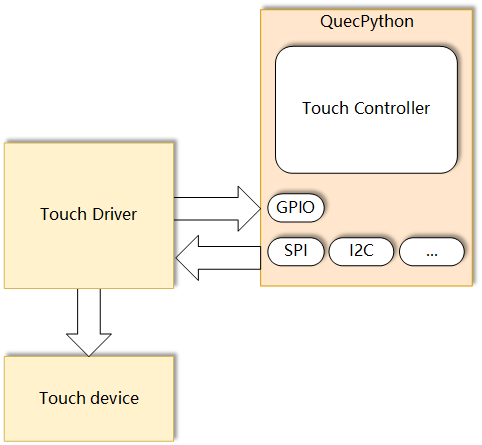
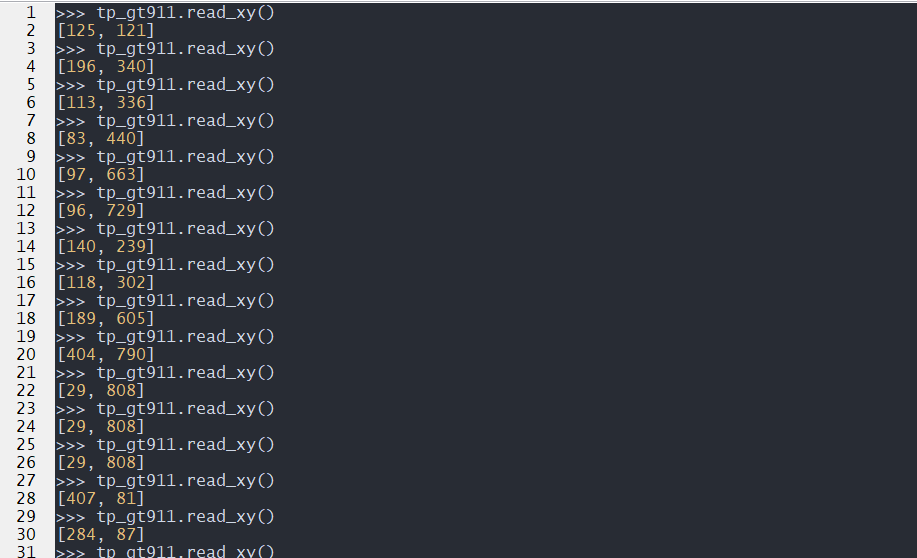

## 触摸屏

在嵌入式设备中，触摸屏是一种常见的输入设备，用于替代鼠标或其他指针设备，以实现对设备界面的操作和控制。它通常是一块平面表面，用户可以通过手指在其上进行触摸和滑动来实现相应的操作。

### 分类

以下是一些常见的触摸屏类型，以及它们的工作原理，特点和应用：

1. **电阻式触摸屏**：
   - **工作原理**：电阻式触摸屏包括两层电阻层，当触摸时，两层会在接触点产生电连接，电阻改变，通过测量电阻的改变，计算出触摸点的位置。
   - **特点**：成本较低，耐用性高，能应对各种环境因素（如灰尘和水）。缺点是触摸精度较低，且只能支持单点触控，透光性和色彩也不如其他类型。
   - **应用**：常见于低成本设备和工业设备，如 POS 系统，工业控制面板等。
2. **电容式触摸屏**：
   - **工作原理**：电容式触摸屏通过测量屏幕上的电容变化来确定触摸位置。当手指接近屏幕表面时，会引起电容的变化，从而检测到触摸事件。
   - **特点**：触摸精度高，支持多点触控，色彩和透光性好。缺点是成本相对较高，而且只能通过手指或特殊的触摸笔进行触摸。
   - **应用**：电容式触摸屏现在被广泛用于智能手机，平板电脑和笔记本电脑等个人电子设备。
3. **红外触摸屏**：
   - **工作原理**：红外触摸屏通过测量被触摸对象阻挡的红外光线来检测触摸位置。屏幕边缘装有红外发射器和接收器，当触摸事件发生，会阻挡部分红外线。
   - **特点**：可以支持多点触控，且可以通过任何物体进行触摸。缺点是精度不如电容式和电阻式触摸屏，且容易受到光线的干扰。
   - **应用**：通常应用于大型显示设备，如交互式电视，电子白板等。
4. **声表面波（SAW）触摸屏**：
   - **工作原理**：SAW 触摸屏使用超声波来检测触摸位置。当你触摸屏幕时，会吸收或扰动一部分超声波，通过测量这种变化，就可以确定触摸的位置。
   - **特点**：具有很高的触摸精度和优良的图像质量，但对环境变化敏感，比如温度、湿度和液体溅落等都可能影响其性能。
   - **应用**：常见于游戏机和一些需要高精度和高质量图像的设备。

每种类型的触摸屏都有其优点和适用的场合，选择哪种类型主要取决于具体的应用需求。

### 驱动框图

其主控，驱动 IC, 接口关系如下：



1. **触摸屏控制器（Touch Controller）**：也被称为主控，它是触摸屏系统中的核心部分。它负责接收从触摸屏传感器发来的信号，并将这些信号转换成我们可以理解的坐标信息。触摸控制器可能是一个单独的 IC，也可能是一个内置在微处理器或微控制器中的模块。
2. **触摸屏传感器（Touch Sensor）**：这是触摸屏系统中的物理部分，它可以是一个薄膜，也可以是一个玻璃面板。当我们触摸这个传感器时，它会将我们的触摸行为转换成电信号，并发送给触摸屏控制器。
3. **接口（Interface）**：这是触摸屏控制器与其它部分（比如微处理器或微控制器）通信的方式。常见的接口类型包括 I2C、SPI 和 USB 等。
4. **微处理器或微控制器（Microprocessor or Microcontroller）**：它处理来自触摸屏控制器的数据，并将这些数据转换为有用的指令，比如移动光标、打开应用等。

因此，这个系统的工作过程可以被简化为如下几个步骤：

触摸 -> 触摸屏传感器 -> 电信号 -> 触摸屏控制器 -> 数据 -> 接口 -> 微处理器或微控制器 -> 指令

### 适配说明

QuecPython 系列模块支持情况如下:

| 名称    | 功能          | 接口  | 数据手册           |
| ------- | ------------ | ----  | ------------------ |
| xpt2046 | 电阻触控芯片 | SPI  | [xpt2046.pdf](../../media/hardware/display/XPT2046.PDF) |
| gt911   | 电容触控芯片 | I2C  | [gt911.pdf](../../media/hardware/display/GT911.PDF)   |
| cst816  | 电容触控芯片 | I2C  | [cst816.pdf](../../media/hardware/display/CST816D数据手册V1.3.pdf)  |

### 校准触摸屏

在实际应用中，电阻触摸屏必须在使用前进行校准，而电容触摸屏则一般由控制芯片完成该工作，无需额外的校准步骤。驱动中已经集成了电阻触摸屏的校准算法，校准过程屏幕会点亮四个点，依次点击来校准，采集数据进行数据比对，误差太大则点击失败，重新点击。

调用校准函数 xtp2046.adjust()将会在屏幕上开始校准的过程，校准完成后，将参数保存在文件中，下次初始化 xtp2046 时读取校准数据，避免每次使用前的重复校准。

### 触摸屏的按下

不论是电阻还是电容触摸屏，通常的触摸屏控制芯片会有一个用于通知触摸事件的中断引脚，可以通过该引脚中断来读取电平。但触摸控制器给出的信号往往不如程序通过寄存器判断的准确性高。创建触摸对象时，会要求传入中断引脚号。

对于电阻触摸屏来说，判断按下的依据是 Z 方向的压力大于配置的阈值；对于电容触摸屏则是判断至少有一个触摸点存在。

### 触摸屏的旋转

触摸屏具有与显示屏一样的 8 个方向。定义在创建触摸对象的参数中(x_inv, y_inv, xy_swap)。 这里的旋转是通过软件换算来实现的 。

触摸屏的分辨率设置也是很重要的，因为触摸屏旋转后的换算依赖于触摸屏的宽和高分辨率大小，设置不当将无法得到正确的旋转效果。

<font color='red'>**注解：**</font>

**在使用电阻屏时，由于电阻屏在每个方向上的电阻值不一定均匀分布，这会导致经过旋转换算后触摸位置的不准确，所以建议电阻屏校准后不再进行旋转操作。**

### 示例

QuecPython 内部已适配三款触摸驱动，可以<font color='red'>**直接使用**</font>。

以[铀开发板](TODO 链接)触摸屏（GT911）为例：

```python
from tp import gt9xx
tp_gt911 = gt9xx(irq=40,reset=20)
tp_gt911.activate()
tp_gt911.init()
tp_gt911.read_xy()
```

效果如下：



### 常见问题

#### 触摸不准确

触摸不准确可能是由以下原因引起的：

1. **校准问题**：如果触摸屏未经过正确的校准，或者校准过程中有误，那么触摸屏可能无法准确地识别触摸位置。此时，需要进行触摸屏校准。
2. **驱动问题**：如果触摸屏的驱动程序存在问题，可能会导致触摸定位不准确。在这种情况下，可能需要更新或者修复触摸屏驱动程序。
3. **硬件问题**：硬件的问题也可能会导致触摸不准确。例如，触摸屏的感应器有损坏，或者触摸屏和控制器之间的连接存在问题等。
4. **电磁干扰**：在某些环境中，电磁干扰可能会导致触摸定位不准确。这可能需要更换设备的使用环境或者增加电磁防护措施。
5. **软件问题**：某些情况下，应用程序的问题可能会影响到触摸的准确性。例如，某些应用程序可能没有正确地处理触摸输入，导致触摸定位偏离。

#### 触摸失灵

触摸屏失灵的原因可能有以下几种：

1. **硬件故障**：触摸屏自身或与其连接的硬件（如控制器、数据线等）可能出现故障，包括物理损坏、老化、接触不良等。
2. **驱动问题**：触摸屏驱动软件可能出现故障，如驱动程序存在缺陷、兼容性问题、驱动未正确安装或更新等。
3. **软件冲突**：操作系统中，其他软件或驱动可能与触摸屏驱动产生冲突。
4. **电源问题**：触摸屏的电源供应不稳定，或电源供应不足，都可能导致触摸屏失灵。
5. **环境因素**：极端的环境条件，如温度、湿度、静电等，都可能影响触摸屏的正常工作。

#### 触摸响应延迟

触摸响应延迟可能是由以下几个因素导致的：

1. **处理器过载**：如果嵌入式设备的处理器正在处理大量任务，它可能没有足够的资源来快速处理触摸输入，这会导致触摸响应延迟。
2. **软件问题**：触摸屏的驱动程序或操作系统可能存在问题，导致触摸事件处理延迟。另外，如果运行在设备上的应用程序设计或优化不佳，也可能导致用户感觉到触摸响应延迟。
3. **硬件问题**：如果触摸屏或其相关硬件存在问题，也可能导致触摸响应延迟。例如，触摸屏的感应器或控制器可能存在性能问题。
4. **通信延迟**：在某些嵌入式系统中，触摸屏与处理器之间的数据传输可能存在延迟，这可能是由于接口速度较慢或数据线质量问题等原因造成的。
