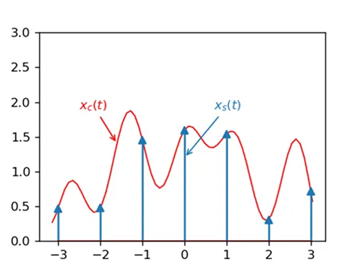
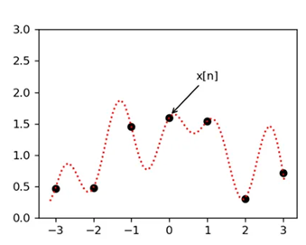
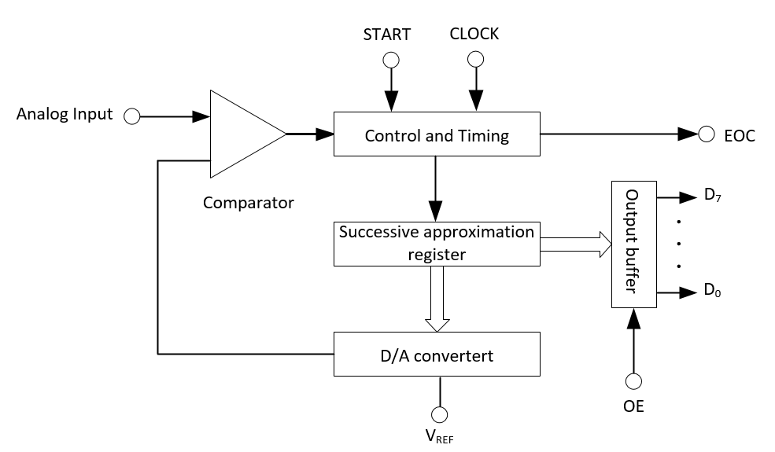
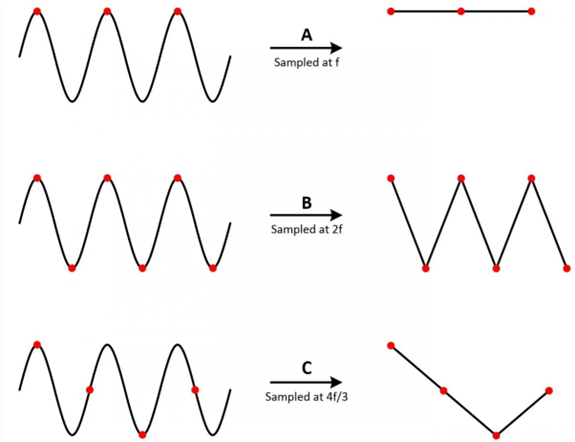
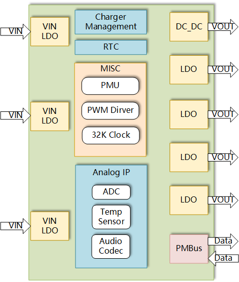
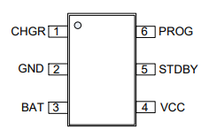
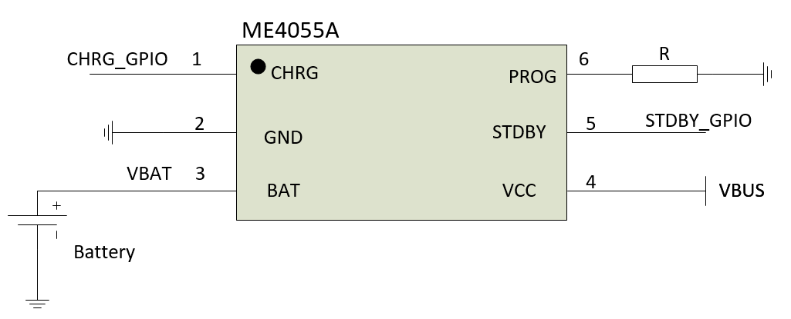
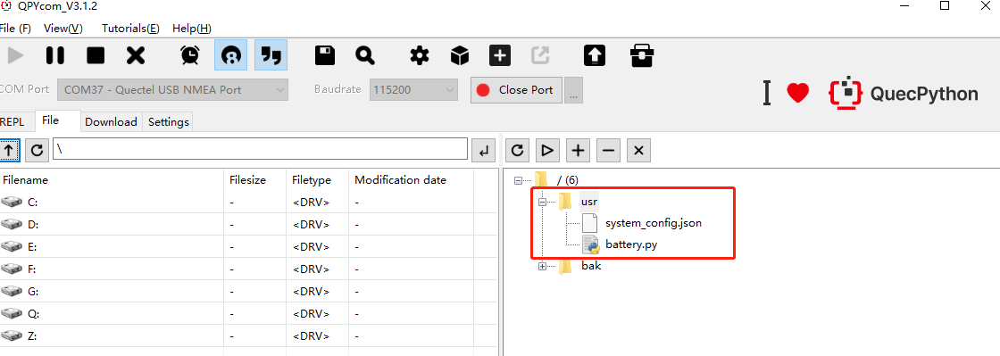
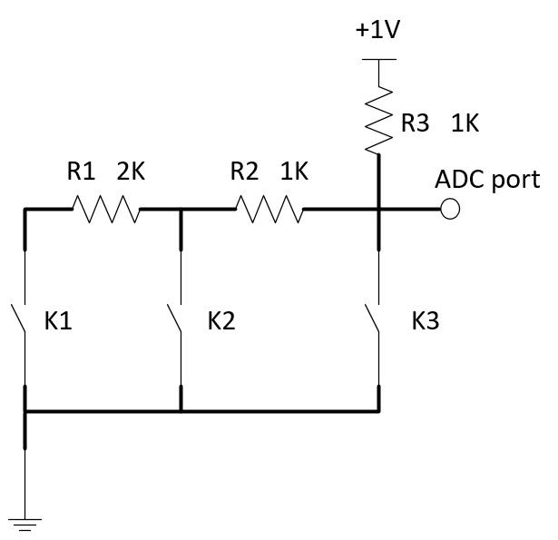
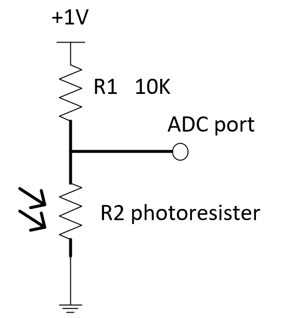

# ADC- 模数转换

## ADC 原理和常见用法

模拟信号指在时域上数学形式为连续的信号，不同时间点位置的信号值是连续变化的。所传达的信息是连续变化的物理量，如温度、湿度、压力、长度、电流等等。不同的数据必须转换为相应的信号才能进行传输。
数字信号指自变量和因变量都是离散的信号，可以理解为在时域和幅值上都是离散的，不连续的。数字信号在计算机中以二进制的方式进行存储。





以一个工作电压为3.3V的处理器为例，其工作过程中始终伴随着要么是0V（逻辑0），要么是3.3V（逻辑1）的矩形波电信号。物理世界中一个电压为1V的电信号，是不能直接被CPU识别到的，其必须由一个叫做ADC的器件，将其转换为数字信号后，方能被CPU识别。
ADC全称Analog-to-Digital Converter,即模拟至数字信号转换器，作用是将物理世界中计算机无法直接识别的模拟信号，转换为能够识别的二进制数字信号。
ADC的基本工作原理是采样和量化。首先，ADC对模拟信号进行采样，即在一定的时间间隔内测量模拟信号的值。然后，采样的模拟信号被量化，即将连续的模拟信号离散化为一系列离散的数字值。这些数字值通常使用二进制表示。




ADC的分辨率表示其能够量化模拟信号的精度，它是指ADC能够表示的离散数值的数量。分辨率通常以位（bit）为单位表示，例如8位、10位、12位等。因此，一个8位的ADC可以将输入范围分成2的8次方（256）个不同的离散级别，而一个12位的ADC可以将输入范围分成2的12次方（4096）个离散级别。较高的分辨率意味着ADC可以更精确地量化模拟信号。
ADC的采样率是指在一秒钟内进行采样的次数。采样率越高，得到的离散数字信号对真实模拟信号波形的还原度越高。根据奈奎斯特采样定理，采样率至少是待测量信号最大频率的2倍，才可能保证采样后的波形不失真。在实际应用中，采样频率往往高达待采样信号最大频率的10倍甚至更大。



ADC的输入电压范围指的是它能够接受的模拟信号的电压范围。它通常以电压表示，例如0V至5V或-5V至+5V。确保输入信号不超过ADC的输入范围，以避免信号失真或损坏。
ADC的触发方式通常分软件触发和硬件触发，软件触发当设置开始转换时ADC会立即启动转换，硬件触发则需要等待指定的外部事件发生时ADC才会启动转换。ADC广泛应用于各种领域，如数据采集、传感器接口、音频处理、通信系统等。它们是将模拟信号转换为数字信号的关键组件，使得模拟信号能够与数字系统进行交互和处理。

## 各平台ADC说明

ADC通常位于PMU上，位于Analog IP中，PMU的典型结构图如下：



各平台ADC差异如下表：

| 平台   | 支持路数 | 位宽 | 输入电压范围(单位：V) |
| ------ | -------- | ---- | --------------------- |
| EC600N | 1        | 10   | 0~1.3                 |
| EC600M | 2        | 12   | 0~1.2                 |
| EC800N | 1        | 10   | 0~1.8                 |
| EC600U | 4        | 12   | 0~VBAT                |
| EC200U | 3        | 12   | 0~VBAT_BB             |
| EC200A | 2        | 12   | 0~VBAT_BB             |
| BG95   | 1        | 16   | 0~1.8                 |
| EG915U | 2        | 12   | 0~VBAT                |
| EC800M | 2        | 12   | 0~1.2                 |
| EG912N | 2        | 12   | 0~VBAT_BB             |
| EC600E | 2        | 12   | 0~1.2                 |
| EC800E | 2        | 12   | 0~1.2                 |

> - VBAT：模组电源电压。
> - VBAT_BB：模块基带电源和射频电源。
> - VBAT没有供电时，ADC管脚不要接入电压。

## ADC API说明

> - 输入电压不要超过允许电压范围的上限，超过上限的需要先进行分压。
> - 参考电压Vref由模组内部产生，无需额外提供。

### ADC 创建对象

```python
from misc import ADC
adc = ADC()
```

创建一个ADC对象，使用ADC功能需要先创建对象。

### ADC功能初始化

```python
adc.open()
```

创建对象后调用该接口初始化。

### 读取指定通道的电压值

```python
adc.read(ADCn)
```

读取 ADC 调用该接口；读取指定通道的电压值，调用该接口首先触发 ADC 采集，转换结束后读取转换结果，然后转换为电压值返回。
`ADCn` 指ADC通道，例如 `adc.read(ADC.ADC0)` 读取 ADC 通道 0 电压值，返回值单位为 `mV`。

> - 返回的电压值是模组管脚的电压值，部分型号模组内部有分压电阻，返回的是内部分压前的管脚的电压值。
> - ADC管脚悬空时，读取的电压可能是随机值，建议不要悬空。
> - 读取接口比较耗时，避免频繁调用。

### 关闭ADC

```python
adc.close()
```

不使用时关闭ADC。

## 应用场景

### 电池电压采集与充电检测

准备材料：电池、EC600U模组、ME4055A。

原理：

ME4055A 是一款专用的电池充电芯片，专为单个电池提供恒流或恒压线性充电，其封装如下图所示。

CHRG 脚是充电状态指示脚，当电池正在充电中时，CHRG 脚被内部电路拉低，否则 CHRG 脚处于高阻态。

BAT 管脚是电池连接管脚，把电池的正极接到 BAT 管脚，BAT 脚输出的电压恒定为 4.2V。

VCC 是电源输入脚，为 ME4055A 提供电源。

STDBY 是充电结束指示脚，当充电结束时，STDBY 被内部电路拉低，否则STDBY是高阻态；模组通过监控CHRG和STDBY管脚的电平高低，来判断充电状态。

PROG 脚是充电电流检设置和检测脚，PROG 脚通过一个电阻 R~PROG~ 连接到地，那么充电电流 I~BAT~=(V~PROG~/R~PROG~)*1100，其中在预充电模式 V~PROG~=0.1V，在恒流充电模式，V~PROG~=1V。



检测电池电压的原理是采用电阻分压的方法，即硬件上用两个电阻把电池电压进行比例分压，把分压后的电压送到模组ADC管脚进行检测，软件根据模组ADC读取的电压值经过换算计算出电池的电压。

连接硬件：如下图所示，ME4055A的CHRG和STDBY分别接模组的GPIO，BAT接电池正极，VCC接电源，通过把电池电压分压，接入到模组的ADC管脚，以测量电池电压。



[点此链接](https://github.com/QuecPython/QuecPython_lib_bundles/blob/master/libraries/battery/battery.py)下载 `battery.py`，`battery.py` 实现了电池电压采集、充电状态采集、充电事件上报、电池电量计算功能。其中充电状态检测和电池电压采集代码如下：

充电状态检测的脚本：通过读ME4055A的CHRG和STDBY脚的状态进行充电状态判断。

```python
def __update_charge_status(self):
    """Update Charge status by gpio status"""
    if not self.__usb:
        chrg_level = self.__chrg_gpio.read()
        stdby_level = self.__stdby_gpio.read()
        if chrg_level == 1 and stdby_level == 1:
            # Not charge.
            self.__charge_status = 0
        elif chrg_level == 0 and stdby_level == 1:
            # Charging.
            self.__charge_status = 1
        elif chrg_level == 1 and stdby_level == 0:
            # Charge over.
            self.__charge_status = 2
        else:
            raise TypeError("CHRG and STDBY cannot be 0 at the same time!")
    else:
        self.__usb_charge()

def charge_status(self):
    """Get charge status
    Returns:
        0 - Not charged
        1 - Charging
        2 - Finished charging
    """
    self.__update_charge_status()
    return self.__charge_status
```

电池电压采集：通过间隔指定的时间多次采样，然后去掉最大值和最小值后取平均的方法作为返回数据。

```python
def __get_adc_vbatt(self):
    """Get vbatt from adc"""
    self.__adc.open()
    utime.sleep_ms(self.__adc_period)
    adc_list = list()
    for i in range(self.__adc_period):
        adc_list.append(self.__adc.read(self.__adc_num))
        utime.sleep_ms(self.__adc_period)
    adc_list.remove(min(adc_list))
    adc_list.remove(max(adc_list))
    adc_value = int(sum(adc_list) / len(adc_list))
    self.__adc.close()
    vbatt_value = adc_value * (self.__factor + 1)
    return vbatt_value
```

下载 `battery.py` 到模组的 usr 分区后，可以通过 `from usr.battery import Battery` 来导入 `Battery` 类；创建一个 `Battery` 类对象，我们就可以调用相关方法。usr 分区是 Python 虚拟机文件系统的一个分区，可以存放用户的脚本，如下图：



`battery.py` 的 API 介绍如下。

> [点此查看](https://github.com/QuecPython/QuecPython_lib_bundles/blob/master/libraries/battery/README.md) API 介绍详情。

**实例化对象**

示例：

```python
from usr.battery import Battery
adc_args = (adc_num, adc_period, factor)
chrg_gpion = 0
stdby_gpion = 1
battery = Battery(adc_args=adc_args, chrg_gpion=chrg_gpion, stdby_gpion=stdby_gpion)
```

adc_num：adc通道，adc_period：adc循环读取次数，factor：计算系数；chrg_gpion：连接CHRG的gpio；stdby_gpion：连接STDBY的gpio。

**设置充电事件回调函数**

示例:

```python
def charge_callback(charge_status):
    print(charge_status)
res = battery.set_charge_callback(charge_callback)
```

回调参数charge_status：0-未充电;1-充电中;2-充电完成。

**设置电池当前温度**

示例：

```python
res = battery.set_temp(20)
```

设置温度为20℃。

**查询电池电压**

示例：

```python
battery.voltage
```

返回值单位mV。

**查询电池电量**

```python
res = battery.energy
```

返回值表示百分比，0~100。

**查询充电状态**

```python
battery.charge_status
```

返回0：未充电，1：充电中，2：充电完成。

**应用示例：**

```python
from battery import Battery

# instantiation object
adc_args = (adc_num, adc_period, factor)
chrg_gpion = 0
stdby_gpion = 1
battery = Battery(adc_args=adc_args, chrg_gpion=chrg_gpion, stdby_gpion=stdby_gpion)

def charge_callback(charge_status):
    print(charge_status)

# set charge status callback 
battery.set_charge_callback(charge_callback)
# True

# set current temp
temp = 30
battery.set_temp(temp)
# True

# get battery volt
battery.voltage
# 3000

# get battery soc
battery.energy
# 100

# get charge status
battery.charge_status
# 1
```

### ADC功能实现按键检测

在IO资源紧张时可以用ADC的方式实现一个ADC管脚实现多按键识别。

准备材料：EC600U模组,相关硬件电路

原理：

根据不同按键按下ADC口的电压不同来判断对应按键按下。

如下图所示，当R3上端接的电压为1V时，当没有按键按下时，测试点的电压为1V。

K1按下时，测试点的电压为0.75V。

K2按下时，测试点的电压为0.5V。

K3按下时，测试点的电压为0V。

软件可以周期的读取ADC管脚电压值，并据此进行判断哪个按键按下。

实际应用时可以调整上拉电压值和阻值、开关个数。

连接硬件：如下图所示电路，由K1、K2、K3三个按键和三个电阻组成，图中的ADC port连接模组的ADC0管脚。



为提高 ADC 电压测量的准确度，ADC 接口在布线时需做包地处理。

示例代码：

```python
from misc import ADC
import utime
adc = ADC()
adc.open()
ADC_VALUE_1 = 100
ADC_VALUE_2 = 600
ADC_VALUE_3 = 900
while True:
    # Read ADC result
    adc_value = adc.read(ADC.ADC0)
    # Detect pressed key based on ADC result
    if adc_value < ADC_VALUE_1:
        # key3 pressed
        print("K3 is now pressed")
    elif adc_value < ADC_VALUE_2:
        # key2 pressed
        print("K2 is now pressed")
    elif adc_value < ADC_VALUE_3:
        # key1 pressed
        print("K1 is now pressed")
    else:
        # no key pressed
        print("no key is now pressed") 
    utime.sleep_ms(20)
```


### 光敏传感器

准备材料：EC600U模组，光敏电阻(如GL5528)

原理：光敏电阻的电阻值随着光照强度的变化而变化。当光敏电阻受到光照时，其电阻值下降；当光照减弱或完全没有光照时，其电阻值增加，从而影响测试点的电压值。通过读取ADC电压值来计算出光敏电阻的阻值，再根据光敏电阻的光照强度和阻值关系可以知道光照的强弱。

硬件连接：如下图进行连接。R2为光敏电阻，R1为10K，根据具体光敏电阻参数选择R1的值，ADC port为测试点，连接到模组的ADC管脚。

本例程通过打印ADC测量的电压值和光敏电阻的阻值来观察不同光亮对光敏电阻的影响。



```python
from misc import ADC
import utime 
import _thread

# unit as kΩ
def Voltage_to_Resistance(Volt):
    resistance = (10 * Volt)/(1000 - Volt)
    return resistance

def Photoresistor_thread(delay, retryCount):
    	# creat a adc device
    	AdcDevice = ADC()
    	while retryCount:
            retryCount = retryCount - 1
            # get ADC.ADC0 value
            adcvalue = AdcDevice.read(ADC.ADC0)
            print("get ADC.ADC0 Voltage value as {0}mv".format(adcvalue))
            # Converted to resistance
            resistance = Voltage_to_Resistance(adcvalue)
            print("Photoresistor resistance as {0}Ω".format(resistance * 1000))
            utime.sleep(delay)
    	pass
    	
if __name__ == "__main__":
    	# creat a thread Convert ADC to Voltage
    	_thread.start_new_thread(Photoresistor_thread, (1, 10))
    	print("main thread has exit")

```

## 常见问题

### ADC 电压范围

1. 每个 ADC 接口引脚的输入电压不能超过其允许的电压范围，当被测电压大于输入电压范围时，先进行电阻分压缩小后再接入模组ADC管脚；
2. 在模块 VBAT 不供电的情况下，为了避免损坏模组，ADC 接口不允许直接输入任何输入电压。

### ADC位宽

ADC位宽指ADC转换结果以多少位数据表示，位宽越大分辨率越高，采集越精准，例如1V电压经过10位位宽的ADC转换，每一位表示1/1024V；模组ADC返回的是处理后的电压值。

### 模组是否带充电功能

模组目前不支持充电功能。

### 如何检测电池电压

采用电阻分压的方法，测量分压后的电压值。如果要获取模组自身的VBAT电压，可以调用Power.getVbatt()接口，返回的单位mV。