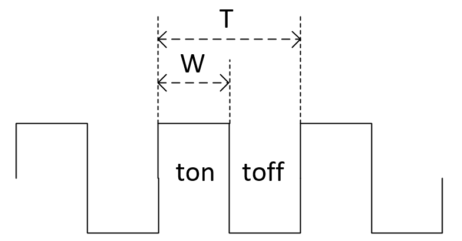
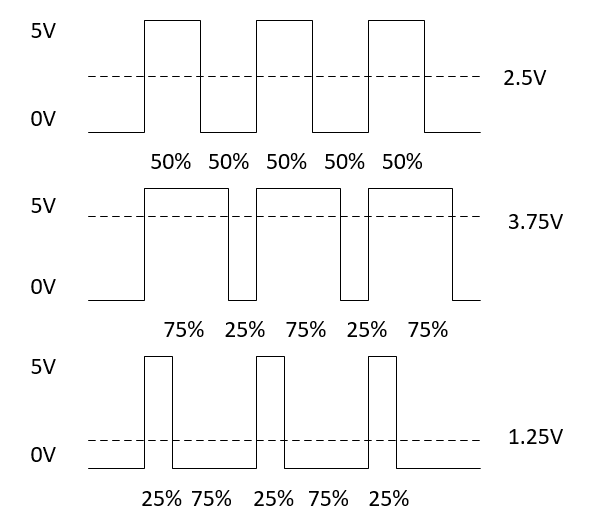

# PWM- 脉宽调制

## PWM 原理和常见用法

PWM（Pulse Width Modulation）简称脉宽调制，是利用微处理器的数字输出来对模拟电路进行控制的一种非常有效的技术，广泛应用在测量、通信、工控等方面。PWM 的频率是指在 1 秒钟内，信号从高电平到低电平再回到高电平的次数，也就是说一秒钟 PWM 有多少个周期，单位 Hz。PWM 的周期单位是时间，是指信号从高电平到低电平再到高电平的时间长度，周期 T=1/f，f 是频率。如果频率为 50Hz ，也就是说一个周期是 20ms，那么一秒钟就有 50 次 PWM 周期。脉冲宽度是指一个周期里高电平持续的时间，单位是时间。占空比是指一个脉冲周期内，高电平的时间与整个周期时间的比例，单位是% (0%-100%)。

示意图如下：



上图中，T 表示周期，W 表示脉宽，ton 是高电平阶段，toff 是低电平阶段，则 T=ton+toff，频率 f=1/T，占空比=W/T。例如 T 是 10ms，W 时间是 8ms，那么占空比是 8/10= 80%，这就是占空比为 80%的脉冲信号。

在合适的信号频率下，可以通过改变占空比的方式来改变输出的有效电压。假设 IO 口高电平为 5V、低电平则为 0V，通过改变 IO 口输出的方波的占空比，获得使用数字信号模拟成的模拟电压信号。在一定的频率下，占空比为 50%，可以得到模拟的 2.5V 输出电压；占空比为 75%，就可以得到模拟的 3.75V 输出电压；占空比为 25%，就可以得到模拟的 1.25V 输出电压。如下图所示：



PWM 的应用范围很广，常见应用于电机控制、舵机控制、呼吸灯、屏幕背光控制等。

## 各平台 PWM 说明

| 平台   | 支持路数           | 频率范围     |
| ------ | ------------------ | ------------ |
| EC600N | 4                  | 1Hz~1MHz     |
| EC600M | 4                  | 1Hz~1MHz     |
| EC800N | 4                  | 1Hz~1MHz     |
| EC600U | 1                  | 100Hz~1MHz   |
| EC200U | 1                  | 100Hz~1MHz   |
| EC200A | 3                  | 1Hz~1MHz     |
| EG915U | 1                  | 100Hz~1MHz   |
| EC800M | 4                  | 1Hz~1MHz     |
| EG912N | 4                  | 1Hz~1MHz     |
| EC600E | 15（不可同时使用） | 1Hz~1MHz     |
| EC800E | 15（不可同时使用） | 1Hz~1MHz     |
| BG95   | 2                  | 293Hz-600kHz |

## PWM API 说明

### PWM 创建对象和初始化

```python
from misc import PWM_V2
PWM_V2(PWM_V2.PWMn,frequency,duty)
```

使用 PWM 首先需要创建 PWM 对象。

PWMn 表示支持的 PWM 号，frequency 表示输出频率，单位 Hz，格式为浮点形式，100.0 表示 100Hz；duty 表示占空比，输入范围 0~100，50 表示占空比 50%。

根据 PWM 时钟源与目标频率和占空比，算出时钟分频系数、周期寄存器值和占空比寄存器值。

分频系数的选择标准是从小到大选择分频系数，当时钟源被 n 分频后，周期寄存器装载最大值时输出的频率不大于目标输出频率，那么就采用 n 分频；假设 PWM 的时钟源频率为 f，则 n 分频后的时钟频率为 f/n，则周期寄存器的值=(f/n)/frequency；占空比寄存器的值=周期寄存器的值\*占空比。

PWM 时钟源通常为 13M 或 26M，当输出频率接近时钟源频率时，波形会误差较大，建议频率在 1MHz 以内。

### 开启 PWM 输出

```python
PWM_V2.open([frequency], [duty])
```

当需要使能 PWM 输出时调用此接口。 frequency，duty 为可选参数；不传入参数时，按照创建对象时设置的参数输出；传入参数时（需两个参数都传入）按照传入的参数输出。

示例：

```python
from misc import PWM_V2
PWM = PWM_V2(PWM_V2.PWM0,2000.0,20) #set pwm frequency:2000Hz,duty20%
PWM.open() #enable output
PWM.open(100.0,50)#set pwm frequency:100Hz,duty50% and enable output
```

### 关闭 PWM 输出

```python
PWM_V2.close()
```

当需要停止 PWM 输出时，调用此接口。

## 应用场景

### 1.驱动马达

准备材料：EC600U 模组、马达和控制板

原理：以 24V 直流电机为例，在电机两端接上 24V 的直流电源，电机会以满速转动，如果将 24V 电压降至 2/3 即 16V，那么电机就会以满速的 2/3 转速运转。可见想要调节电机的转速，只需要控制电机两端的电压即可，电压越大，电机转速越快。
对于直流电机来讲，当给电机提供电源时，电机会转动，但是是一点一点的提速，在突然停止供电给电机供电时，电机由于电感有防止电流突变的作用是不会停止的，会保持这原有的转速，以此往复，电机的转速就是周期内输出的平均电压值，所以实质上我们调速是将电机处于一种，似停非停，似全速转动又非全速转动的状态，那么在一个周期的平均速度就是我们占空比调出来的速度了。
综上所述，PWM 输出一定频率的脉冲，占空比越大，提供给电机的平均电压越大，电机转速就高。反之占空比越低，提供给电机的平均电压越小，电机转速就低。正常的 PWM 频率在 6~16kHz 为好。

连接硬件：根据具体马达的接口设计电路。

示例代码：控制马达速度从最小到最大，以此反复

```python
from misc import PWM_V2
import utime
DUTY = 1
pwm = PWM_V2(PWM_V2.PWM0,10000.0,DUTY)#set pwm frequency:10KHz
pwm.open()
while True:
    DUTY = DUTY + 1
    pwm.open(10000.0, DUTY)
    if DUTY >= 100:
        DUTY = 0
    utime.sleep_ms(100)
```

### 2.调节屏幕亮度

准备材料：EC600U 模组,LCD 显示屏

原理：PWM 调光方式，背光的亮度实际上是固定的，它是通过控制周期性开启和关闭背光的时间长短从而调节屏幕亮度，例如显示 75%的亮度，那就是每个很短的时间周期内，75%的时间开启背光，25%的时间背光关闭，由于人眼具有视觉暂留效应，屏幕呈现给肉眼的感觉就会是一直以 75%的亮度亮着，但实际上它是以 100%的亮度快速“亮 → 灭 → 亮 → 灭”闪烁的。通过调节占空比来控制单位周期中屏幕亮和暗的时间比例来控制屏幕的亮度，控制屏幕的发光量，从而控制屏幕的亮度。

连接硬件：根据具体 LCD 的背光的接口进行电路设计。

示例代码：控制屏幕亮度从暗到亮再到暗周期变化

```python
from misc import PWM_V2
import utime
DUTY = 1
flag = 0
pwm = PWM_V2(PWM_V2.PWM0,10000.0,DUTY)#set pwm frequency:10KHz
pwm.open()
while True:
    if flag == 0:
        DUTY = DUTY + 1
    else:
        DUTY = DUTY - 1
    pwm.open(10000.0,DUTY)
    if DUTY >= 100:
        flag = 1
    elif DUTY == 0:
        flag = 0
    utime.sleep_ms(100)
```

## 常见问题

### 1.如何动态调整占空比?

在创建 PWM 对象后，可以通过 PWM.open() 接口动态调整占空比而不用每次都重新创建对象，如通过 PWM.open(100.0,50) 设置占空比为 50%，通过 PWM.open(100.0,25) 设置占空比为 25%。

### 2.PWM 输出频率范围

EC200A/EC600N/EC800N/EG912N/EC600E/EC800E 支持 1Hz-1MHz，EC200U/EC600U/EG915U 支持 100Hz-1MHz，BG95支持293Hz-600kHz。
