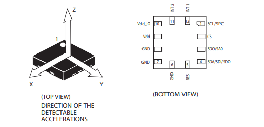
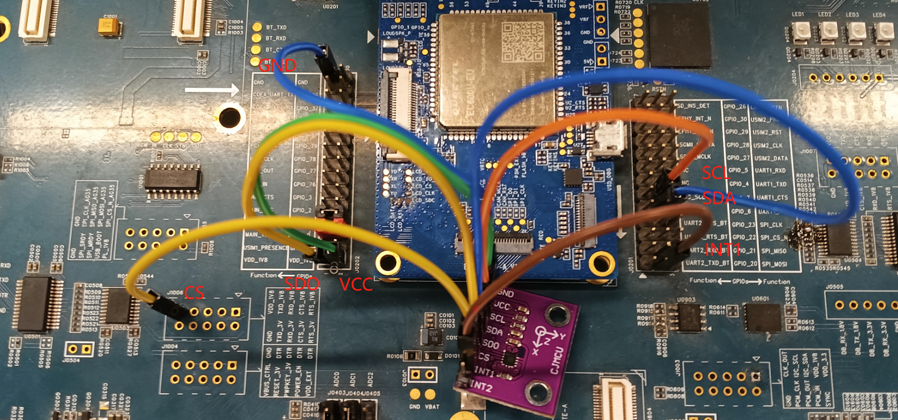

## 硬件介绍

本章节主要基于 LTE OPEN-EVB_V1.1和EC600U TE-A和LIS2DH12TR传感器模块，演示如何调试一款加速度传感器。

 LIS2DH12TR传感器是一款高性能 3 轴线性加速度传感器，具有数字 I2C、SPI串行接口标准输出。 器件具有超低功耗工作模式，可实现高级节能、智能、睡眠唤醒以及恢复睡眠功能。 LIS2DH12TR具有 ±2g/±4g/±8g/±16g 的动态用户可选满量程，并能通过 1 Hz 到 5 kHz 的输出数据速率测量加速度。器件可配置为通过独立的惯性唤醒 / 自由落体事件以及通过器件自身的位置生成中断信号。中断发生器的阈值 和时序可由终端用户动态设定。

### 封装规格

LIS2DH12TR传感器规格图如下：

### 硬件连接

引脚功能介绍：

| 引脚号 | 引脚名                | 说明                                                         |
| ------ | --------------------- | ------------------------------------------------------------ |
| 1      | SCL SPC          | I2C/SPI时钟引脚。                                            |
| 2      | CS                    | SPI使能引脚，控制芯片通信方式。 1：I2C通信；2：SPI通信。 |
| 3      | SDO SA0          | SPI模式下为数据输出引脚； I2C模式为设备从地址选择引脚，1：0x19；0：0x18。 |
| 4      | SDA SDI SDO | I2C模式下为数据引脚； 标准SPI模式下为数据输入引脚； 也可以作为SPI的数据输出引脚。 |
| 5      | Res                   | 接地即可。                                                   |
| 6      | GND                   | 地                                                           |
| 7      | GND                   | 地                                                           |
| 8      | GND                   | 地                                                           |
| 9      | VDD                   | 电源                                                         |
| 10     | VDD_IO                | IO参考电平引脚                                               |
| 11     | INT2                  | 中断引脚2                                                    |
| 12     | INT1                  | 中断引脚1                                                    |

本章我们采用 I2C 接口通讯，供电电压采用1.8V。具体接线为VCC接J0202 的2脚，GND接J0202的30脚，SCL接J0201的17脚，SDA接J0201的14脚，SDO/SA0接J0202的1脚，CS接J1006的9脚，INT1接J0201的2脚；LIS2DH12加速度模块与EVB板接线图如下。

SDO/SA0 引脚为高电平， 因此可以确认加速度传感器的从机地址为0x19。

