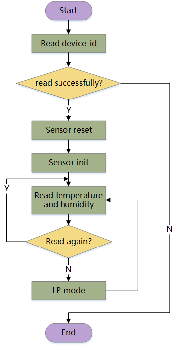
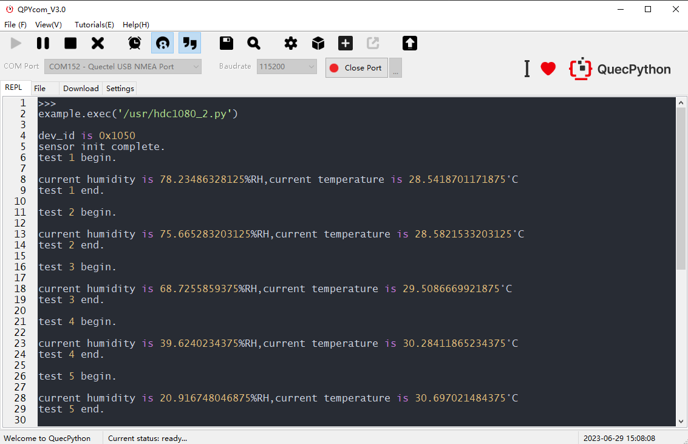

# 温湿度传感器

温湿度传感器采用高精度传感技术，能够实时监测环境的温度和湿度变化，以下是一些典型应用场景。

- 智能家居：温湿度传感器可以嵌入智能家居系统中，监测各个房间的温湿度情况。系统可根据传感器数据，自动控制空调、加湿器等设备的运行，提供更舒适的居住环境。
- 智能农业和温室：在农业领域，温湿度传感器可用于监测农作物生长环境的温度和湿度。这对于控制温室条件、提供适宜的生长环境和实现智能灌溉等都非常重要。
- 工业自动化：在工业自动化领域，温湿度传感器可以用于监测生产线上的环境条件。它可以帮助控制和调节工业设备的运行，确保生产过程的稳定性和产品质量。

## 支持列表

**Quecpython目前已支持的温湿度传感器型号表**

| 型号    | 总线 | 规格书                                                       | 代码链接                                                     |
| ------- | ---- | ------------------------------------------------------------ | ------------------------------------------------------------ |
| HDC1080 | I2C  | [规格书](https://github.com/QuecPython/QuecPython_lib_bundles/blob/master/libraries/HDC1080/hdc1080.pdf) | [代码链接](https://github.com/QuecPython/QuecPython_lib_bundles/blob/master/libraries/HDC1080/hdc1080.py) |
| HDC2080 | I2C  | [规格书](https://github.com/QuecPython/QuecPython_lib_bundles/blob/master/libraries/HDC2080/hdc2080.pdf) | [代码链接](https://github.com/QuecPython/QuecPython_lib_bundles/blob/master/libraries/HDC2080/hdc2080.py) |
| AHT10   | I2C  | [规格书](https://github.com/QuecPython/QuecPython_lib_bundles/blob/master/libraries/aht10/AHT10.pdf) | [代码链接](https://github.com/QuecPython/QuecPython_lib_bundles/blob/master/libraries/aht10/aht10.py) |
| AHT20   | I2C  | [规格书](https://github.com/QuecPython/QuecPython_lib_bundles/blob/master/libraries/aht20/AHT20-datasheet.pdf) | [代码链接](https://github.com/QuecPython/QuecPython_lib_bundles/blob/master/libraries/aht20/aht20.py) |

## 硬件介绍

本章节基于 LTE OPEN-EVB_V1.1和EC600U TE-A开发板和HDC1080传感器模块，演示如何调试一款温湿度传感器。

详见[HDC1080传感器硬件连接](./hdc1080.md)。

## 软件设计

### 工作流程

如下图所示为一个典型的温湿度传感器的工作流程。



### API参考

以下 API 实现了对Hdc1080传感器的功能抽象，用户可直接引用Hdc1080类，调用其API编写传感器应用程序。

> 不同温湿度传感器与MCU通信接口和温湿度计算方式可能有点差异，用户可以根据规格书，调整上述两点来实现自己的传感器类。

**类引用：**

```python
from hdc1080 import Hdc1080
```

**实例化：**

```python
i2c_dev = I2C(I2C.I2C1, I2C.STANDARD_MODE)
hdc = Hdc1080(i2c_dev)
```

**参数描述：**

- `i2c_obj` - I2C对象，obj类型。
- `dev_addr` - I2C从设备地址，int类型，默认0x40。

#### **`Hdc108.read`**

读取湿度和温度。

**返回值描述：**

- `(humidity,temperature)` - 湿度，温度，tuple类型。

#### **`Hdc108.read_temperature`**

读取温度。

**返回值描述：**

- `temperature` - 温度，float类型。

#### **`Hdc108.read_humidity`**

读取湿度。

**返回值描述：**

- `temperature` - 温度，float类型。

#### **`Hdc108.reset`**

重置传感器。

### 实验设计

1. 初始化HDC1080传感器。
2. 循环读取10次温度和湿度并打印。

### 实验代码

传感器类设计如下：

```python
class Hdc1080(object):
    '''
    HDC1080 sensor class
    '''
    def __init__(self,i2c,addr=HDC1080_ADDRESS):
        self._i2c = i2c
        self._i2c_addr = addr

        time.sleep_ms(15)
        dev_id = self._read_data(HDC1080_DEVICEID_REGISTER,2)
        dev_id = (dev_id[0] << 8) | dev_id[1]
        print("dev_id is 0x%4x"%dev_id)
        if dev_id != 0x1050:
            raise CustomError("HDC1080 manu id err.")

        self.reset()
        self._write_data(HDC1080_CONFIGURATION_REGISTER,[0x10,0x00])
        time.sleep_ms(15)
        print("sensor init complete.")

    def _write_data(self, reg, data):
        self._i2c.write(self._i2c_addr,
                           bytearray([reg]), len([reg]),
                           bytearray(data), len(data))
    
        def _read_data(self,reg, length):
        r_data = [0x00 for i in range(length)]
        r_data = bytearray(r_data)
        ret = self._i2c.read(self._i2c_addr,
                          bytearray([reg]), len([reg]),
                          r_data, length,
                          0)
        return list(r_data)

    def _read_data_delay(self,reg, length):
        r_data = [0x00 for i in range(length)]
        r_data = bytearray(r_data)
        ret = self._i2c.read(self._i2c_addr,
                          bytearray([reg]), len([reg]),
                          r_data, length,
                          150)
        return list(r_data)
    
    def reset(self):
        self._write_data(HDC1080_CONFIGURATION_REGISTER, [0x10, 0x00])

    def read_temperature(self):
        tem_data = self._read_data_delay(HDC1080_TEMPERATURE_REGISTER,2)
        tem_data = (tem_data[0] << 8) | tem_data[1]
        tem = (tem_data / 65536) * 165 - 40
        return tem

    def read_humidity(self):
        hum_data = self._read_data_delay(HDC1080_HUMIDITY_REGISTER,2)
        hum_data = (hum_data[0] << 8) | hum_data[1]
        hum = (hum_data / 65536) * 100
        return hum

    def read(self):
        return (self.read_temperature(),self.read_humidity())
```

> **注意**
>
> - 初始化过程中读取设备ID错误，可能是因为总线通信失败，或是规格书中的设备ID与代码中的不符。
> - 如您正在调试一款支持列表中未包含的型号时，请先仔细阅读传感器的规格书，可以仿照上述代码流程进行开发。

实验主程序设计如下：

```python
if __name__ == "__main__":
    i2c_dev = I2C(I2C.I2C1, I2C.FAST_MODE)
    hdc=Hdc1080(i2c_dev)
    for i in range(10):
        print("test %d begin." % (i + 1))
        tem, hum = hdc.read()
        print("current humidity is {0}%RH,current temperature is {1}°C".format(hum, tem))
        print("test %d end." % (i + 1))
        time.sleep(1)
```

## 效果验证

将实验代码下载至模组中运行，可以使用不同温度和湿度的物体接触传感器，观察测量数值的变化，结果打印如下图所示。


