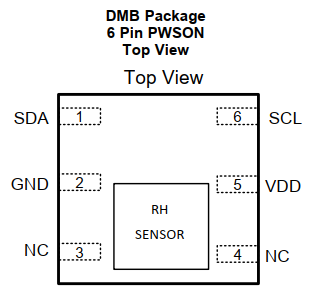
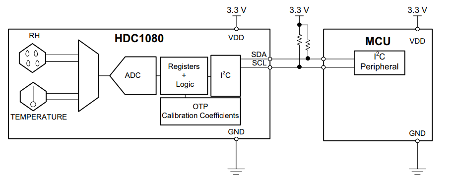
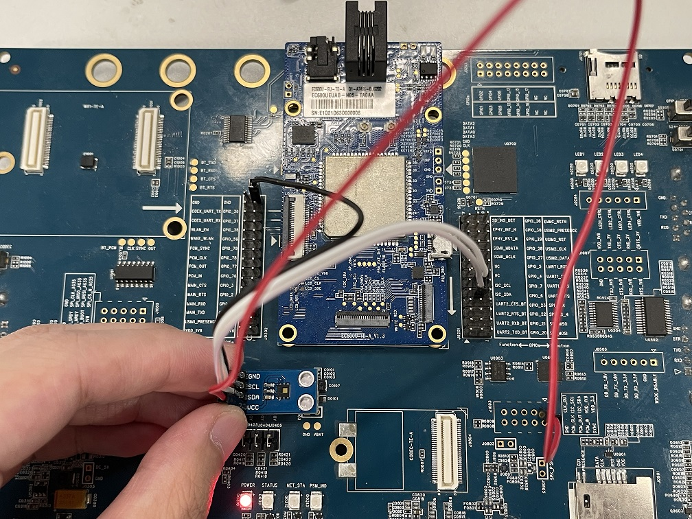

## 硬件介绍

本章节基于 LTE OPEN-EVB_V1.1和EC600U TE-A开发板和HDC1080传感器模块，演示如何调试一款温湿度传感器。

### 封装规格

HDC1080(6 引脚)规格图如下：

**典型应用**

### 硬件连接

引脚功能介绍：

| 引脚号 | 引脚名 | 说明      |
| ------ | ------ | --------- |
| 1      | SDA    | I2C数据线 |
| 2      | GND    | 接地      |
| 3      | NC     | 不接      |
| 4      | NC     | 不接      |
| 5      | VDD    | 电源      |
| 6      | SCL    | I2C时钟线 |

本章实验采用 I2C 接口通讯，供电电压采用3.3V。具体接线为VCC接J1003 的VDD_3.3脚，GND接J0202的30脚，SCL接J0201的17脚，SDA接J0201的14脚，HDC1080传感器模块与EVB板接线如下图所示。

