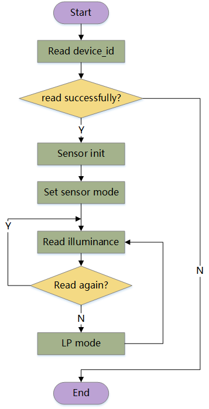
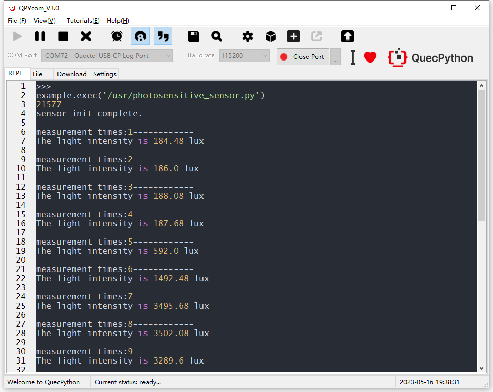

# 环境光传感器

环境光传感器包含光照强度传感器、颜色传感器、紫外线传感器和兼具多种功能的传感器。它可以提供多种环境光相关的数据，包括光照强度、颜色信息和紫外线辐射等，为系统提供丰富的环境感知能力。以下是一些典型应用场景。

- 智能亮度调节：环境光传感器可以测量周围环境的光照强度，并根据测量结果自动调节显示屏、背光灯或照明设备的亮度。这可以实现室内和室外显示设备的舒适视觉体验，并节省能源。
- 智能农业系统：在农业领域，光照强度传感器可以用于监测环境的光照水平。根据测量数据，触发自动调光系统或实现节能措施。
- 健康监测设备：紫外线传感器可以测量环境中的紫外线辐射强度。应用在穿戴设备上，可在户外环境中对紫外线辐射水平进行实时监测，并提醒用户采取适当的防护措施。

## 支持列表

**Quecpython目前已支持的环境光传感器型号表**

| 型号    | 类型         | 总线 | 规格书                                                       | 代码链接                                                     |
| ------- | ------------ | ---- | ------------------------------------------------------------ | ------------------------------------------------------------ |
| OPT3001 | 光照度传感器 | I2C  | [规格书](https://github.com/QuecPython/QuecPython_lib_bundles/blob/master/libraries/OPT3001/opt3001.pdf) | [代码链接](https://github.com/QuecPython/QuecPython_lib_bundles/blob/master/libraries/OPT3001/opt3001.py) |
| BH1750  | 光照度传感器 | I2C  | [规格书](https://github.com/QuecPython/QuecPython_lib_bundles/blob/master/libraries/BH1750(GY-302)/bh1750fvi-e-186247.pdf) | [代码链接](https://github.com/QuecPython/QuecPython_lib_bundles/blob/master/libraries/BH1750(GY-302)/BH1750.py) |
| GL5516  | 光敏电阻     | ADC  | [规格书](https://github.com/QuecPython/QuecPython_lib_bundles/blob/master/libraries/gl5516/GL55.pdf) | [代码链接](https://github.com/QuecPython/QuecPython_lib_bundles/blob/master/libraries/gl5516/gl5516.py) |
| GL5528  | 光敏电阻     | ADC  | [规格书](https://github.com/QuecPython/QuecPython_lib_bundles/blob/master/libraries/gl5528/GL55.pdf) | [代码链接](https://github.com/QuecPython/QuecPython_lib_bundles/blob/master/libraries/gl5528/gl5528.py) |

## 硬件介绍

本章节主要基于 LTE OPEN-EVB_V1.1和EC600U TE-A和OPT3001传感器模块，演示如何调试一款光照传感器。

详见[OPT3001传感器硬件连接](./opt3001.md)。

## 软件设计

### 工作流程

如下图所示为一个典型的光照度传感器的工作流程。



### API参考

以下 API 实现了对OPT3001传感器的功能抽象，用户可直接引用OPT3001类，调用其API编写传感器应用程序。

> 不同光照传感器通信总线和光照强度计算方式可能有点差异，用户可以根据规格书，调整这两点来实现自己的传感器类。

**类引用：**

```python
from opt3001 import Opt3001
```

**实例化：**

```python
i2c_obj=I2C(I2C.I2C1,I2C.FAST_MODE)
opt = Opt3001(i2c_obj)
```

**参数描述：**

- `i2c_obj` - I2C对象，obj类型。
- `dev_addr` - I2C从设备地址，int类型，默认0x44。

#### **`Opt3001.set_measure_mode`**

设置测量模式，持续测量和单次测量或休眠模式。

**参数描述：**

- `mode` - 测量模式，非必填，int类型，缺省值2，2：连续测量模式。0：休眠模式，1：单次测量模式。

**返回值描述：**

- `-1` - 失败。
- `0` - 成功。

#### **`Opt3001.read `**

读取照度值。

> **注意：**转化时间初始化为800ms，两次读取之间间隔需大于800ms。

**返回值描述：**

- `illuminance` - 照度，float类型。

### 实验设计

1.初始化EC600U的I2C 1通道，通过I2C来读取opt3001数据。

2.配置opt3001寄存器。

3.设置测量模式为连续测量模式，将读取值转化成lux值。

### 实验代码

​	传感器类设计如下：

```python
class Opt3001(object):
    def __init__(self,i2c,dev_addr=I2C_ADDR):
        self._i2c = i2c
        self._i2c_addr = dev_addr

        manu_id = self._read_data(I2C_LS_REG_MANUFACTURERID, 2)
        manu_id = (manu_id[0] << 8)  | manu_id[1]
        print(manu_id)
        if manu_id != 0x5449:
            raise Exception("OPT3001 manu id err.")

        self._write_data(I2C_LS_REG_CONFIG, [0xcc,0x10])
        utime.sleep_ms(15)
        print("sensor init complete.")

    def _write_data(self, reg, data):
        self._i2c.write(self._i2c_addr,
                        bytearray([reg]), len([reg]),
                        bytearray(data), len(data))

    def _read_data(self, reg, length):
        r_data = [0x00 for i in range(length)]
        r_data = bytearray(r_data)
        ret = self._i2c.read(self._i2c_addr,
                             bytearray([reg]), len([reg]),
                             r_data, length,
                             0)
        return list(r_data)

    def set_measure_mode(self,mode=CONTINU_MODE):
        '''
        Set the measurement mode, continuous measurement and single measurement or shutdown
        :param mode: measurement mode 0-off 1-single 2-continuous
        :return: 0-success -1-mode wrong selection
        '''
        if mode not in range(3):
            return -1
        r_data = self._read_data(I2C_LS_REG_CONFIG, 2)
        r_data = (r_data[0] << 8) | r_data[1]
        print(r_data)
        w_data = (r_data & 0xf9ff) | (mode << 9)
        print(w_data)
        self._write_data(I2C_LS_REG_CONFIG, [(w_data >> 8), (w_data & 0xff)])
        utime.sleep_ms(20)
        return 0

    def read(self):
        '''
        The read value is converted into a lux value 
        please ensure that the measurement mode is not 0, otherwise it will get stuck
        @return: illuminance value，Unit:lux
        '''
        while 1:
            r_data = self._read_data(I2C_LS_REG_CONFIG, 2)[1]
            if (r_data & (1 << 7)):            #converted flag
                lux_ori = self._read_data(I2C_LS_REG_RESULT,2)
                lux_ori = (lux_ori[0] << 8) | lux_ori[1]
                #convert illuminance value
                mantisse = lux_ori & 0x0fff
                exponent = (lux_ori & 0xf000) >> 12
                lux = 2 ** exponent * mantisse * 0.01
                return lux

```

>  **注意**
>
> - 初始化过程中读取设备ID错误，可能是因为总线通信失败，或是规格书中的设备ID与代码中的不符。
> - 如您正在调试一款支持列表中未包含的型号时，请先仔细阅读传感器的规格书，可以仿照上述代码流程进行开发。

主程序设计如下：

```python
if __name__ == "__main__":
    i2c_obj=I2C(I2C.I2C1,I2C.FAST_MODE)
    opt = Opt3001(i2c_obj)
    for i in range(20):
        opt.set_measure_mode(1)
        utime.sleep_ms(1000)  # at least 800ms
        print("measurement times:{}------------".format(i+1))
        lux = opt.read()
        print("The light intensity is {0} lux".format(lux))
```

## 效果验证

将示例代码下载进模组运行，运行期间，可以选择用手遮盖或者手电筒照射，可以观察到OPT3001光敏传感器的照度值变化




