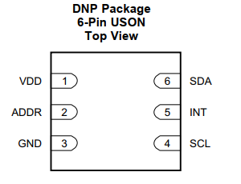
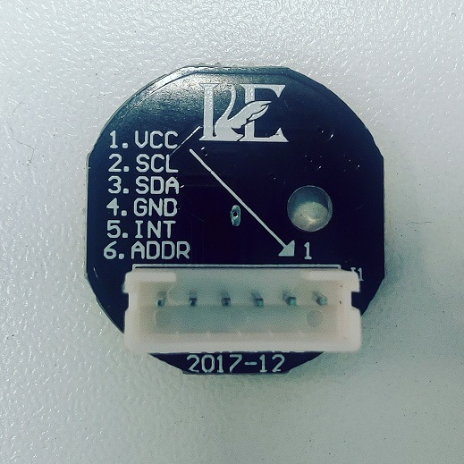
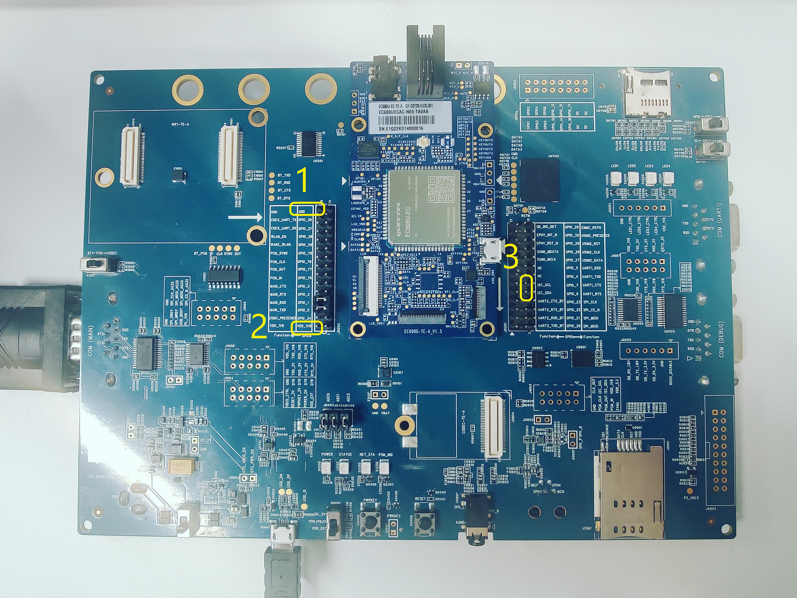
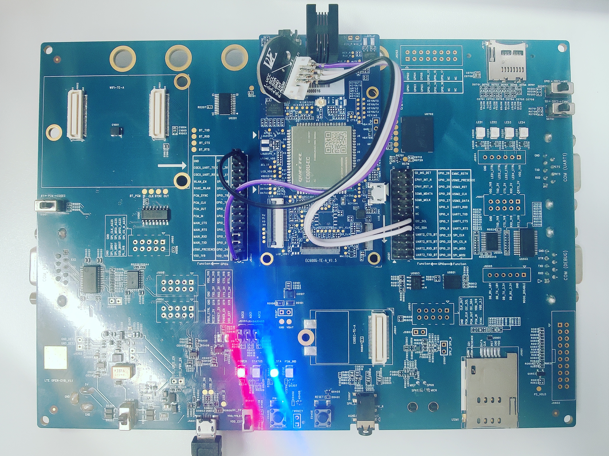

# 硬件介绍

本章节主要基于 LTE OPEN-EVB_V1.1和EC600U TE-A和OPT3001传感器模块，演示如何调试一款光照传感器。

OPT3001是一款低功耗环境光照度传感器，用于测量人眼可见的光强度。OPT3001自动采集转换数据，但不会主动上报，我们可以通过I2C协议读写OPT3001的寄存器来控制传感器。

### 封装规格

OPT3001(6 引脚)规格图如下：

| 引脚号 | 引脚名 | 说明      |
| ------ | ------ | --------- |
| 1      | VDD    | 电源      |
| 2      | ADDR   | 地址引脚  |
| 3      | GND    | 接地      |
| 4      | SCL    | I2C时钟线 |
| 5      | INT    | 中断输出  |
| 6      | SDA    | I2C数据线 |

### 硬件连接

实物图：

本章实验中，OPT3001模块需要接四根线到开发板上，VCC接VDD_1V8，如下图中2标注。SCL和SDA我们选择接到EC600U的I2C_SCL和I2C_SDA，如下图中3标注的GPIO_7、GPIO_6位置。GND选择接地即可，INT引脚本章实验不接。

接线完成后如下图

