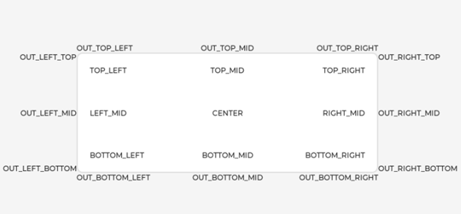

# LVGL-常用组件

LVGL库提供了一系列组件，用于构建用户界面的基本元素。这些组件包括但不限于按钮、标签、文本框、列表、滑块、图表等。每个组件都具有独特的功能和样式，开发者可以通过设置属性和样式来定制它们的外观和行为，以满足特定应用场景的需求。

以下介绍LVGL常用组件，使用以下组件可以实现绝大部分界面需求。若需了解所有的组件及其API说明，可以访问[LVGL官网](https://docs.lvgl.io/8.3/examples.html#widgets)查看。

## LVGL基础对象

### 概述-LVGL

`基础对象`实现了屏幕上组件的基本属性，例如：

- 坐标

- 父对象

- 基于父对象的后代

- 包含样式

- 诸如可点击(Clickable)、可滚动(Scrollable) 等属性。

`基础对象`是 LVGL 中所有组件的基类，其他组件对象均继承自基础对象。

`基础对象`可以直接用作一个简单的组件：它就是一个矩形。在没有指定父类对象的时候，一个基础对象就独自构成一个LVGL界面。在指定父类对象的时候，它是一个容器。

#### 坐标(Coordinates)

##### 大小(Size)

您可以使用`set_width(new_width)`和`set_height(new_height)`设置或修改单个轴上的对象大小，或者可以使用`set_size(new_width, new_height)`同时修改两个轴 。

##### 位置(Position)

您可以使用`set_x(new_x)`和`set_y(new_y)`设置相对于父级的位置，或者使用`set_pos(new_x, new_y)`来同时设置两个轴的位置。

##### 对齐(Alignment)

可以使用设置align(对齐)设置一个控件相对于父容器的对齐方式，Quecpython接口有下面两个:

- `obj.align(lvgl.ALIGN.type,x,y)`
- `obj.set_align(lvgl.ALIGN.type)`

> 如果设置居中,有快捷接口`obj.center()`

LVGL支持的对齐方式见下图：



例如，以下代码会将对象从其父对象的中心移动 10(x)，20(y) 像素：

```python
import lvgl as lv

obj = lv.obj(lv.scr_act())

obj.set_align(lv.ALIGN.CENTER);
obj.set_pos(10, 20);

//Or in one function
obj.align(lv.ALIGN.CENTER, 10, 20);
```

#### 父对象和子对象(Parents and children)

除了界面对象，所有LVGL组件对象都有父对象。

父对象和子对象具有以下特点：

- 一起移动
- 子对象仅在父对象范围可见

组件对象在创建的时候，就需要指定父级对象。您可以使用 `obj.set_parent(new_parent)`为对象设置新的父级。要获取当前父级，请使用 `obj.get_parent()`。

要获取父对象的特定子对象，请使用`obj.get_child(idx)`。 idx 的一些示例：

- `0` 获取创建的第一个子对象

- `1` 获取创建的第二个子对象

- `-1` 获取最后创建的子对象

父级的子对象们可以这样迭代：

```python
for i in range(obj.get_child_cnt()):
	child_obj = obj.get_child(i)
```

`obj.get_index()`返回对象在其父对象中的索引。

您可以使用`obj.move_foreground()`和`obj.move_background()`将对象移到前台或将其移到后台。

#### 显示和屏幕(Display and Screens)

在 LVGL 中，对象层次结构的最高级别是 `display`，它代表显示设备（物理显示器或模拟器）的驱动程序，[LVGL与显示设备的关联](./LVGL流程.MD)在前面的章节已有描述，不做赘述。 一个显示器可以有一个或多个与其相关联的界面。 每个界面都包含图形组件的对象层次结构。

当你创建了一个像`screen = lv.obj()`这样的界面对象时，你可以用`lv.scr_load(screen)`激活它。

`lv.scr_act()` 函数为当前活动的界面对象。

#### 事件(Events)-LVGL

要为对象设置事件回调，请使用 `obj.add_event_cb(event_cb, lv.EVENT.type, user_data)`，

要手动向对象发送事件，请使用 `lv.event_send(obj, lv.EVENT.type, param)`

请阅读 [事件概述](https://docs.lvgl.io/8.3/overview/event.html) 章节，以了解有关事件的更多信息。

#### 样式(Styles)

可以使用`obj.add_style(new_style, selector)`函数向对象添加新样式。

selector可以组合使用。 例如：`lv.PART.SCROLLBAR | lv.STATE.PRESSED`。

基础对象的selector使用`lv.PART.MAIN`和`lv.PART.SCROLLBAR`。

请阅读 [样式概述](https://docs.lvgl.io/8.3/overview/style.html) 章节详细了解。

#### 宏开关(Flags)

有一些属性可以通过`obj.add/clear_flag(lv.obj.FLAG.type)`启用/禁用。`lv.obj.FLAG.type`见API常量。

### API

> **注意：**本章节只介绍了一些常见API，如需查看所有API，可以访问[LVGL官网](https://docs.lvgl.io/8.3/examples.html#widgets)查看。
>
> 以下描述均默认`import lvgl as lv`。

#### 构造函数-LVGL

##### `lv.obj(parent)`

创建一个基础对象(矩形)。

**参数描述：**

- `parent` - 父对象，object类型，不指定则创建的是界面对象。

#### 方法-LVGL

##### `obj.add_style(style_obj,selector)`

给对象添加样式。

**参数描述：**

- `style_obj` - 样式对象，style_obj类型，要添加的样式。
- `selector` - 选择器，常量，要添加样式的部分及状态，可以组合使用。 例如：`lv.PART.SCROLLBAR | lv.STATE.PRESSED`。

##### `obj.add_flag(type)`

给对象添加宏开关。

**参数描述：**

- `type` - flag类型，常量，要添加的宏开关类型，可以一个或多个类型。

##### `obj.clear_flag(type)`

清除对象的宏开关。

**参数描述：**

- `type` - flag类型，常量，要清除的宏开关类型，可以多个类型。

##### `obj.add_state(state)`

向对象添加一个或多个状态。其他状态位将保持不变。如果在样式中指定，则过渡动画将从以前的状态开始到当前状态。

**参数描述：**

- `state` - state类型，常量，要添加的状态类型，可以一个或多个状态 。

##### `obj.clear_state(state)`

删除对象的一个或多个状态。其他状态位将保持不变。如果在样式中指定，则过渡动画将从以前的状态开始到当前状态。

**参数描述：**

- `state` - state类型，常量，要清除的状态类型，可以一个或多个状态 。

##### `obj.get_state()`

获取对象的状态。

#### 常量-LVGL

##### `flag`

宏开关

- `lv.obj.FLAG.HIDDEN` 隐藏对象
- `lv.obj.FLAG.CLICKABLE` 使输入设备可点击对象
- `lv.obj.FLAG.CLICK_FOCUSABLE` 单击时将焦点状态添加到对象
- `lv.obj.FLAG.CHECKABLE` 对象被点击时切换选中状态
- `lv.obj.FLAG.SCROLLABLE` 使对象可滚动
- `lv.obj.FLAG.SCROLL_ELASTIC` 允许在内部滚动但速度较慢
- `lv.obj.FLAG.SCROLL_MOMENTUM` 在“抛出”时使对象滚动得更远
- `lv.obj.FLAG.SCROLL_ONE` 只允许滚动一个可捕捉的子对象
- `lv.obj.FLAG.SCROLL_CHAIN` 允许将滚动传播到父级
- `lv.obj.FLAG.SCROLL_ON_FOCUS` 自动滚动对象以使其在聚焦时可见
- `lv.obj.FLAG.SNAPPABLE` 如果在父对象上启用了滚动捕捉，它可以捕捉到这个对象
- `lv.obj.FLAG.PRESS_LOCK` 保持对象被按下，即使按下从对象上滑动
- `lv.obj.FLAG.EVENT_BUBBLE` 也将事件传播给父级
- `lv.obj.FLAG.GESTURE_BUBBLE` 将手势传播给父级
- `lv.obj.FLAG.ADV_HITTEST` 允许执行更准确的命中（点击）测试。例如。考虑圆角。
- `lv.obj.FLAG.IGNORE_LAYOUT` 使对象可以通过布局定位
- `lv.obj.FLAG.FLOATING` 父滚动时不滚动对象，忽略布局

##### `PART`

- `lv.PART.MAIN` 类似矩形的背景
- `lv.PART.SCROLLBAR` 滚动条部分
- `lv.PART.INDICATOR` 指示部分，例如用于圆弧、条、开关或复选框的勾选框
- `lv.PART.KNOB` 向圆弧的帽子部分
- `lv.PART.SELECTED` 表示当前选择的选项或部分
- `lv.PART.ITEMS` 如果小部件有多个相似的元素（例如表格单元格）
- `lv.PART.TICKS` 刻度上的刻度，例如对于图表或仪表
- `lv.PART.CURSOR` 标记一个特定的地方，例如文本区域或图表的光标
- `lv.PART.CUSTOM_FIRST` 可以从这里添加自定义部件。

##### `state`

- `lv.STATE.DEFAULT` 正常, 释放状态默认状态
- `lv.STATE.CHECKED` 切换或者选中状态
- `lv.STATE.FOCUSED` 被按键或者编码器聚焦/被触摸屏或鼠标点击
- `lv.STATE.FOCUS_KEY` 被按键或者编码器聚焦但不是被触摸屏或鼠标点击
- `lv.STATE.EDITED` 被编码器编辑
- `lv.STATE.HOVERED` 鼠标悬停（暂不支持）
- `lv.STATE.PRESSED` 被按住
- `lv.STATE.SCROLLED` 正在滚动
- `lv.STATE.DISABLED` 失效状态

##### `flex-flow`

- `lv.FLEX_FLOW.ROW` 将子对象排成一行而换行
- `lv.FLEX_FLOW.COLUMN` 将子对象放在一列中而不换行
- `lv.FLEX_FLOW.ROW_WRAP` 将子对象排成一排,不超过父容器的宽,否则换行
- `lv.FLEX_FLOW.COLUMN_WRAP` 将子对象放成一列，不超过父容器的高，否则换行
- `lv.FLEX_FLOW.ROW_REVERSE` 将子对象排成一行而不换行，但顺序相反
- `lv.FLEX_FLOW.COLUMN_REVERSE` 将子对象放在一列中，不换行，但顺序相反
- `lv.FLEX_FLOW.ROW_WRAP_REVERSE` 将子对象排成一行而不换行，但顺序相反
- `lv.FLEX_FLOW.COLUMN_WRAP_REVERSE` 将子对象放在一列中，不换行，但顺序相反

## 标签(label)

### 概述-label

标签是用来显示文本的对象类型。

### 部分和风格(Parts and Styles)-label

- `lv.PART.MAIN`表示整个背景和文本部分。 填充值可用于在文本和背景之间添加间隙。
- `lv.PART.SCROLLBAR` 当文本大于组件的大小时显示的滚动条。
- `lv.PART.SELECTED` 表示所选文本的部分。 只能使用 `text_color` 和 `bg_color` 样式属性。

### 用法(Usage)-label

#### 设置文本(Set text)

您可以在LVGL运行时使用 `label.set_text("New text")` 设置标签上的文本。

换行符由标签对象自动处理。 您可以使用 `\n` 来换行。 例如：`"line1\nline2\n\nline4"`

#### 长模式(long mode)

默认情况下，标签的大小会自动扩展到文本大小。 如果显式设置宽度或高度（使用例如`label.set_size` 或布局），则可以根据几种长模式策略来操作比标签宽度更宽的行。 类似地，如果文本的高度大于标签的高度，则可以应用策略。

- `lv.label.LONG.WRAP` 文本太长，将被剪裁。 （默认）
- `lv.label.LONG.DOT` 将标签右下角的最后 3 个字符替换为点 (`.`)
- `lv.label.LONG.SCROLL` 如果文本比标签宽，则水平来回滚动它。如果它更高，垂直滚动。只滚动一个方向，水平滚动的优先级更高。
- `lv.label.LONG.SCROLL_CIRCULAR` 如果文本比标签宽，则水平滚动它。如果它更高，请垂直滚动。只滚动一个方向，水平滚动的优先级更高。
- `lv.label.LONG.CLIP` 只需剪掉标签外的文本部分。

您可以使用 `label.set_long_mode(type)` 指定长模式。

#### 事件(Events)-label

标签组件不发送特殊事件。

可以使用`lv.obj.FLAG.CLICKABLE` 使标签变成可点击对象，这样它近似于一个透明的按钮，可以添加点击事件。

### API-label

> **注意：**本章节只介绍了一些常见API，如需查看所有API，可以访问[LVGL官网](https://docs.lvgl.io/8.3/examples.html#widgets)查看。

#### 构造函数-label

##### `lv.label(parent)`

创建一个标签。

**参数描述：**

- `parent` - 父对象，object类型，必填。

#### 方法-label

##### `label.set_text(text)`

给标签设置显示文本。

**参数描述：**

- `text` - 文本内容，string类型，要显示的文本。

##### `label.set_long_mode(type)`

给标签设置长文本模式。

**参数描述：**

- `type` - 模式，常量，长文本模式。

##### `label.get_text()`

获取标签的显示文本。

**返回值描述：**

- `text` - 文本内容，string类型，显示的文本。

#### 常量-label

##### `LONG`

长文本模式

- `lv.label.LONG.WRAP` 文本太长，将被剪裁。 （默认）
- `lv.label.LONG.DOT` 将标签右下角的最后 3 个字符替换为点 (`.`)
- `lv.label.LONG.SCROLL` 如果显示文本比标签宽，则水平来回滚动它。如果它更高，垂直滚动。只滚动一个方向，水平滚动的优先级更高。
- `lv.label.LONG.SCROLL_CIRCULAR` 如果文本比标签宽，则水平滚动它。如果它更高，垂直滚动。只滚动一个方向，水平滚动的优先级更高。
- `lv.label.LONG.CLIP` 只需剪掉标签外的文本部分。

## 图像(image)

### 概述-image

图像是显示来自闪存（作为数组）或来自文件的图像的基本对象。 图像也可以显示符号（`lv.SYMBOL....`）。

### 部分和风格(Parts and Styles)-image

- `lv.PART.MAIN`表示整个背景和图像部分。

### 用法(Usage)-image

#### 图片来源(Image source)

为了提供最大的灵活性，图像的来源可以是：

- 文件系统的文件。
-  Symbols图标。

要设置图像的来源，请使用`img.set_src(src)`。

要使用文件系统的文件，请将图片文件下载至文件系统，使用`img.set_src("U:/my_img.jpg")`。

您还可以设置类似于标签的符号。 在这种情况下，图像将根据样式中指定的 font 呈现为文本。 它其实是一个轻量级单色“字母”而不是真实图像。 你可以设置像`img.set_src(lv.SYMBOL.OK)`这样的符号。

#### 转换(Transformations)-image

使用 `img.set_zoom(factor)` 图像将被缩放。 将 `factor` 设置为 `256` 为原图大小。 较大的值会放大图像（例如“512”双倍尺寸），较小的值会缩小图像（例如“128”半尺寸）。 分数尺度也有效。 例如。 `281` 放大 10%。

要旋转图像，请使用 `img.set_angle(angle)`。 角度的精度为 0.1 度，因此对于 45.8° 设置 458。

默认情况下，旋转的轴心点是图像的中心。 它可以通过 `img.set_pivot(pivot_x, pivot_y)` 改变。 `0;0` 是左上角。

转换的质量可以通过 `img.set_antialias(True/False)` 来调整。 启用抗锯齿后，转换质量更高但速度更慢。

请注意，图像对象的真实坐标在转换过程中不会改变。 即`obj.get_width/height/x/y()` 将返回原始的、未缩放的坐标。

#### 事件(Events)-image

图像组件不发送特殊事件。

可以使用`lv.obj.FLAG.CLICKABLE` 使标签变成可点击对象，这样它近似于一个图像按钮，可以添加点击事件。

> **注意**：图像组件能使用图片缓存机制，所以相较于图像按钮组件，更推荐使用图像组件。

### API-image

> **注意：**本章节只介绍了一些常见API，如需查看所有API，可以访问[LVGL官网](https://docs.lvgl.io/8.3/examples.html#widgets)查看。

#### 构造函数-image

##### `lv.img(parent)`

创建一个图像。

**参数描述：**

- `parent` - 父对象，object类型，必填。

#### 方法-image

##### `img.set_src(src)`

给图像设置图像源。

**参数描述：**

- `src` - 1)图像文件的路径，string类型，要显示的图像的路径。2)`SYMBOL`，例如`lv.SYMBOL.OK`

##### `img.set_offset_x(x)`

为图像的源设置x轴偏移，以便从新原点显示图像。

**参数描述：**

- `x` - x轴偏移，int类型。

##### `img.set_offset_y(y)`

为图像的源设置y轴偏移，以便从新原点显示图像。

**参数描述：**

- `y` - y轴偏移，int类型。

##### `img.set_angle(angle)`

图像设置旋转角度。

**参数描述：**

- `angle` - 角度，int类型，精度为0.1度。

##### `img.set_zoom(factor)`

图像设置缩放大小。

**参数描述：**

- `factor` - 缩放程度，int类型，256为原图大小，512双倍尺寸。

##### `img.set_pivot(x,y)`

设置图像的旋转中心，图像将围绕此点旋转。

**参数描述：**

- `x` - 旋转中心x轴坐标，int类型。
- `y` - 旋转中心y轴坐标，int类型。

##### `img.set_antialias(antialias)`

是否启用/禁用变换的抗锯齿（旋转、缩放）。抗锯齿效果更好，但速度较慢。

**参数描述：**

- `antialias` - 抗锯齿，bool类型，True为使能，False为禁止。

## 按钮(Button)

### 概述-Button

与基础对象相比，按钮没有新功能。 它们可用于语义目的，并且默认设置略有不同。

默认情况下，按钮在以下方面与基础对象不同：

- 不可滚动
- 添加到默认组
- 默认高度和宽度设置为 `LV_SIZE_CONTENT`

### 部分和风格(Parts and Styles)-Button

- `lv.PART.MAIN`表示按钮的背景部分。

### 用法(Usage)-Button

与基础对象相比，按钮没有新功能

#### 事件(Events)-Button

当对象被点击时有选中切换(Toggle)状态的效果，并且可以在 `lv.EVENT.VALUE_CHANGED` 事件类型中处理事件。

请注意，`lv.KEY.ENTER` 的状态被转换为 `lv.EVENT.PRESSED/PRESSING/RELEASED` 等。

参见基础对象的事件。

### API-Button

> **注意：**本章节只介绍了一些常见API，如需查看所有API，可以访问[LVGL官网](https://docs.lvgl.io/8.3/examples.html#widgets)查看。

#### 构造函数-Button

##### `lv.btn(parent)`

创建一个按钮。

**参数描述：**

- `parent` - 父对象，object类型，必填。

## LVGL其他组件

除了上述介绍的组件，LVGL还提供以下组件，项目中选择使用哪种组件请视需求而定。

| **组件** | 构造函数        | 说明                                                         | LVGL官网链接                                                 |
| -------- | --------------- | ------------------------------------------------------------ | ------------------------------------------------------------ |
| 列表     | `lv.list()`     | 一个垂直布局的矩形，可以向其中添加按钮和文本                 | [点击此处查看组件详细信息](https://docs.lvgl.io/8.2/widgets/extra/list.html) |
| 窗口     | `lv.win()`      | 由一个带有标题、按钮和内容区域的标题构建而成的容器           | [点击此处查看组件详细信息](https://docs.lvgl.io/8.2/widgets/extra/win.html) |
| 弧       | `lv.acr()`      | 圆弧由背景和前景弧组成。前景（指示器）可以进行触摸调整       | [点击此处查看组件详细信息](https://docs.lvgl.io/8.2/widgets/core/arc.html) |
| 进度条   | `lv.bar()`      | 显示进度                                                     | [点击此处查看组件详细信息](https://docs.lvgl.io/8.2/widgets/core/bar.html) |
| 开关     | `lv.switch()`       | 看起来像一个小滑块，开关的功能类似于按钮，也可以用来打开和关闭某些东西 | [点击此处查看组件详细信息](https://docs.lvgl.io/8.2/widgets/core/switch.html) |
| 滑动页   | `lv.tileview()` | 菜单页可用，比较界面切换的动画，多出了手指跟随的效果         | [点击此处查看组件详细信息](https://docs.lvgl.io/8.2/widgets/extra/tileview.html) |
| 仪表盘   | `lv.meter()`    | 以非常灵活的方式可视化数据。在中可以显示圆弧、指针、刻度线和标签 | [点击此处查看组件详细信息](https://docs.lvgl.io/8.2/widgets/extra/meter.html) |
| 图表     | `lv.chart()`    | 折线图，直方图，散点图                                       | [点击此处查看组件详细信息](https://docs.lvgl.io/8.2/widgets/extra/chart.html) |
| 键盘     | `lv.keyboard()` | 特殊的按钮矩阵，自身实现了按键映射                           | [点击此处查看组件详细信息](https://docs.lvgl.io/8.2/widgets/extra/keyboard.html) |
| 菜单     | `lv.menu()`     | 多级菜单，它自动处理页面之间的遍历                           | [点击此处查看组件详细信息](https://docs.lvgl.io/8.2/widgets/extra/menu.html) |
