# LVGL-字体库

## 概述

在 LVGL 中，`字体`是渲染字母（字形）图像所需的位图和其他信息的集合。

`字体`具有bpp（像素深度）属性。它显示了使用多少位来描述字体中的像素。为像素存储的值决定了像素的不透明度。 这样，使用更高的 bpp，字母的边缘可以更平滑。可能的 bpp值为 1、2、4 和 8（值越高表示质量越好）。

bpp还会影响存储字体所需的内存大小。例如，bpp = 4的字体所占用的内存比 bpp = 1的字体所占用的内存大近4倍。

## 字体分类

因LVGL字体的实质是字形图像的位图，所以不以字体语种作为分类依据。

`Quecpython LVGL字体`可分为：

1. **内置字体**(built-in fonts)
2. **外置字体**(external fonts)

> 注意：目前仅EC600M系列，EC600N系列，EC800M系列，EG810M系列支持外置字体。

## 内置字体(built-in fonts)

### 概述 - 内置字体

顾名思义，内置字体就是已经编辑集成进固件中的LVGL字体，可直接在应用代码中通过接口`style_obj.set_text_font(lv.font_name)`或`obj.set_style_text_font(lv.font_name,0)`使用。

### 默认字体

Quecpython LVGL默认集成了`MONTSERRAT 14`号字体，包含全部英文字符和部分常见英文符号。

默认字体可以通过`lv.font_default()`接口获取，或者直接使用`lv.font_montserrat_14`。

### 添加新字体 - 内置字体

默认字体往往无法满足项目需求，如果您是使用pythonSDK开发，可以按以下方法将新字体编译到固件中。

#### 基于Lvgl 官网字体转换工具添加

此种方式添加新的内置字体较为简单，缺点是在bpp较小的时候，最后字体的显示质量较差。

##### 工具

[Lvgl 官网字体转换工具](https://lvgl.io/tools/fontconverter)

##### 字体C文件生成

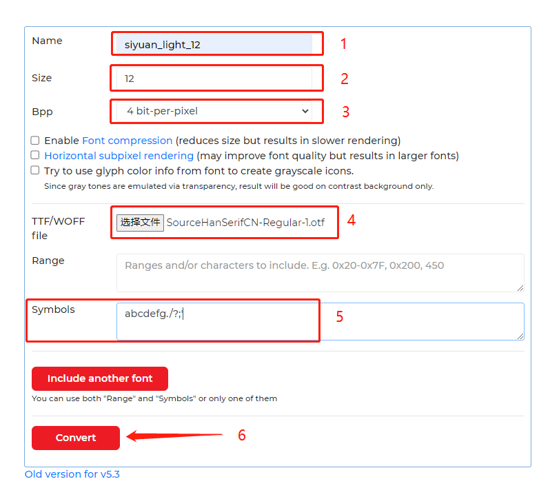

1. 输入要生成的字体名称（最后会生成同名的 C 文件）；
2. 输入要转换的字体大小；
3. 选择锯齿平滑度；
4. 选择本地 TTF 或者 WOFF 格式的字体文件，(请确保该字体为免费商用)， 即你要转换成的目标字体；
5. 输入字库需要包含的文字，如需空格，符号，数字，字母也需一并输入；
6. 完成上述五步必须操作，点击 convert 进行在线转换，字体会自动下载到本地。
7. 将生成的C文件复制到你的 LVGL 工程目录：`pythonSDK\services\microPython\lib\lvgl\lvgl\src\font`文件夹下。

您可以照上述步骤添加多个你需要的字体C文件到font目录。

##### 修改字体C文件

为了和其它字库文件统一，对生成的C文件做出以下修改，如果想使用宏控，则添加您项目对应的宏控，如本教程的`#if LV_FONT_UI_DEMO`。

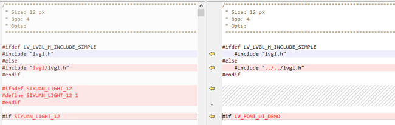

#### 基于LvglFontTool 工具添加

此种方式添加新的内置字体较为复杂，优点是在bpp较小的时候，最后字体的显示质量较好。

##### 工具

[LvglFontTool工具V0.4](http://www.armbbs.cn/forum.php?mod=viewthread&tid=99387)

> 注意：此工具目前只有中文版本，海外客户可照下面图示及文字描述的步骤操作。

##### 字体C文件生成

打开工具，在选择字体的时候，有两种选项，第一种可以勾选”使用FreeType TTF“并选择TTF字体文件来制作字体，第二种不勾选”使用FreeType TTF“也可以选择pc上自带的字体来制作字体，步骤如下：

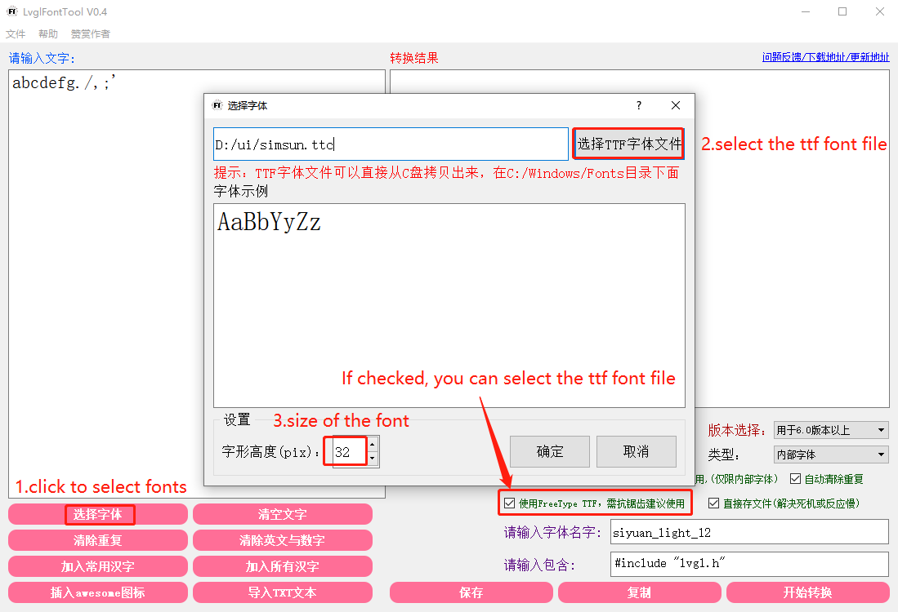

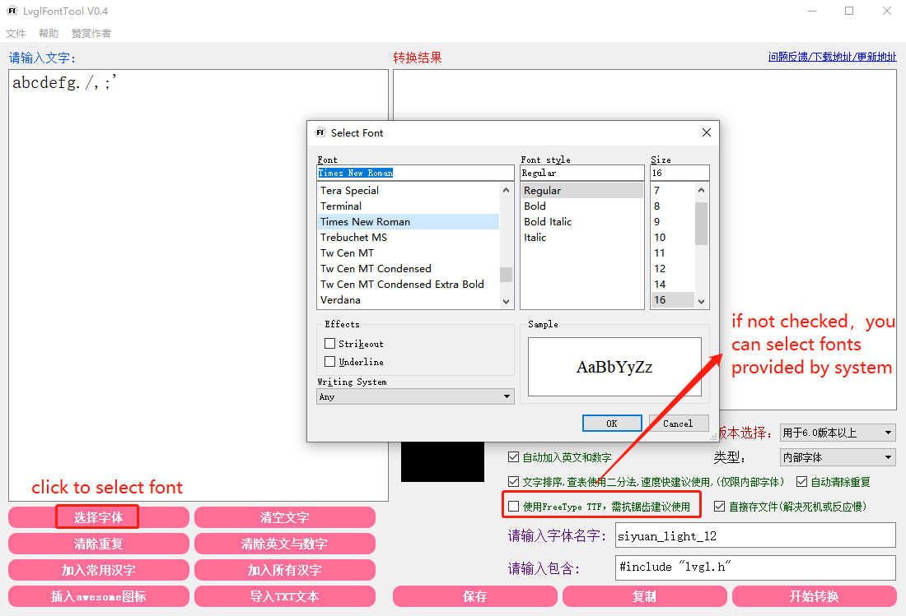

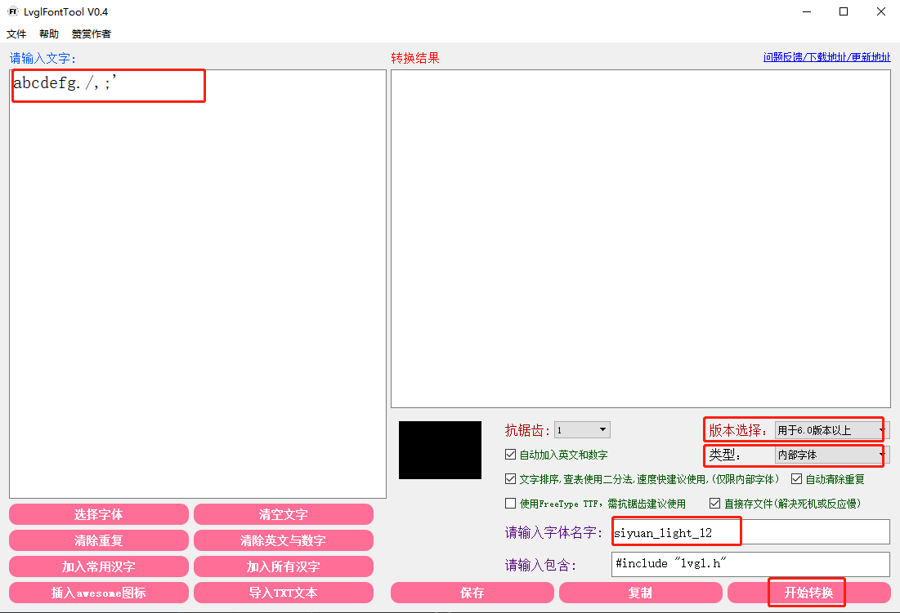

1. 勾选使用”使用FreeType TTF“(或不勾选)；
2. 选择TTF字体文件(或选择电脑自带字体)；
3. 设置字体大小，点击确定；
4. 输入字库需要包含的文字，如需空格，符号，数字，字母也需一并输入；
5. 选择6.0版本以上；
6. 选择内部字体；
7. 输入字体名字；
8. 完成上述必须操作，点击开始转换，选择保存路径即可；
9. 打开文件保存目录，将siyuan_light_12.c 复制到你的 LVGL 工程目录：
   `pythonSDK\services\microPython\lib\lvgl\lvgl\src\font`文件夹下。

您可以照上述步骤添加多个你需要的字体C文件到font目录。

##### 修改字体C文件

为了和其它字库文件统一，对生成的C文件做出以下修改。

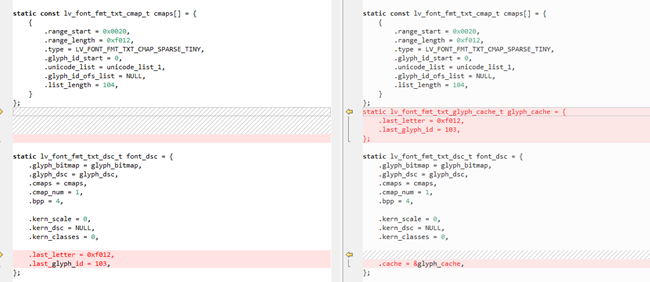

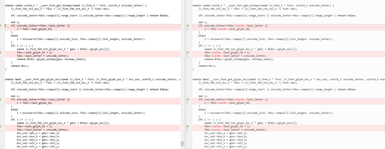

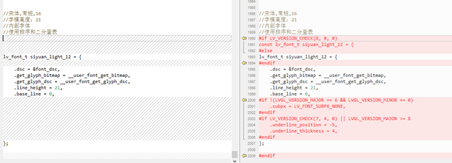

至此，字体C文件修改完成。

#### 参与编译

按上述步骤完成字体C文件的添加后，还需要按如下操作修改文件，使添加的字体C文件能参与编译。

- 在`pythonSDK\services\microPython\lib\lvgl\lvgl\src\font\lv_font.mk`中加入添加的字体文件。

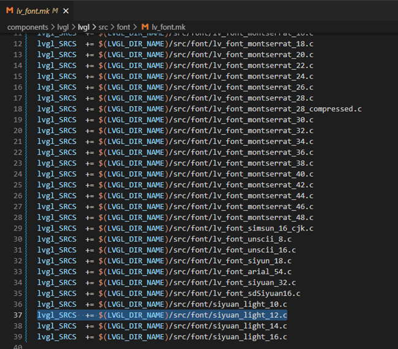

- 在`pythonSDK\services\microPython\microPython.mk`中加入添加的字体文件

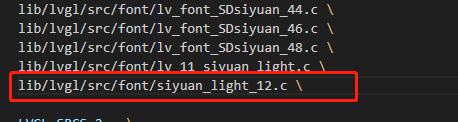

- 在`pythonSDK\services\microPython\lib\lvgl\lvgl\src\font\lv_font.h`中声明添加的字体

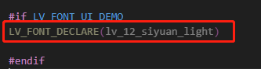

- 在Quecpython中添加该字体的使用。

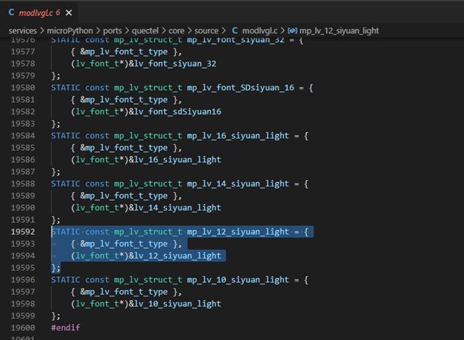


至此修改结束，编译固件并烧录到模块，就可以使用添加的内部字体库了。

## 外置字体(external fonts)

### 概述 - 外置字体

默认字体往往无法满足项目需求，如果您并未使用pythonSDK开发，您可以选择使用LVGL外置字体。

外置字体是将需要的字体制作成二进制bin文件，用指定方式合入固件中使用。

> 注意：目前仅EC600M系列，EC600N系列，EC800M系列，EG810M系列支持外置字体。

### 添加新字体 - 外置字体

#### ext_font.bin文件生成

##### 工具

bin文件生成工具: [LvglFontTool工具V0.4](http://www.armbbs.cn/forum.php?mod=viewthread&tid=99387)

bin文件合成工具: font_bin_merge.py

```python
# font_bin_merge.py
from struct import *

def bin_create(*args):
    if len(args) < 1:
        print("wrong params number!")
        return -1

    with open("ext_font.bin","wb") as dest_file:
        # start
        start = "s"
        end = "e"

        font_num = len(args)
        bin_data = []
        bin_size = []
        font_name = ""

        for i in range(font_num):
            with open(args[i], "rb") as bin_file:
                data = bin_file.read()
            padding = "\0" * (128 - len(args[i]))
            string_padded = args[i] + padding
            font_name += string_padded
            bin_size.append(len(data))
            bin_data.append(data)

        write_data = pack("<B%ds%dI"% (font_num*128, font_num), font_num, font_name.encode(), *bin_size)

        dest_file.write(start.encode())
        dest_file.write(write_data)
        for i in range(font_num):
            dest_file.write(bin_data[i])
        dest_file.write(end.encode())


if __name__ == "__main__":
    # bin_create("main_chic.bin")
    # bin_create("myFont.bin","myFont2.bin")
    bin_create("myFont2.bin")

# CMD执行：python font_bin_merge.py
# 同目录下生成：ext_font.bin
```

> 注意：此工具目前只有中文版本，海外客户可照下面图示及文字描述的步骤操作。
>
> 最终使用的二进制bin文件可能包含多个字体，所以需要先使用bin文件生成工具生成单个bin文件，再使用bin文件合成工具合成最终使用的二进制bin文件：ext_font.bin。

##### 单个bin文件生成

使用LvglFontTool转换字体工具进行文件生成。

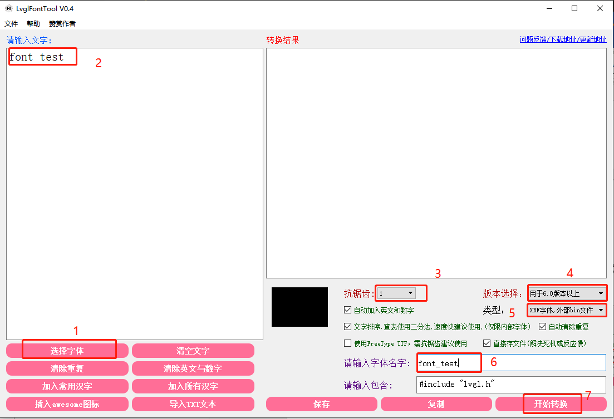

1. 选择您要转换的字体文件，并输入要使用的字体大小（就是汉字在显示器上占用像素的高度），点击确定。
2. 在左上角的方框中输入需要添加的字体库文字，下方的按钮可以作为辅助。
3. 选择锯齿平滑度,抗锯齿高占用空间大,需权衡。
4. 版本选择，选择用于6.0版本以上。
5. 选择保存类型：XBF字体，外部bin文件。
6. 输入要保存的字体库名称。
7. 点击开始转换，选择要保存文件的目录点击确定即可完成转换。该目录会生成bin文件和c文件。

操作的时候注意以下几点:

- 制作字体生成的C文件中，找到该字体的line_height，纪录它，后面使用接口的时候需要传参! line_height也可在生成工具的右上侧代码中找到：

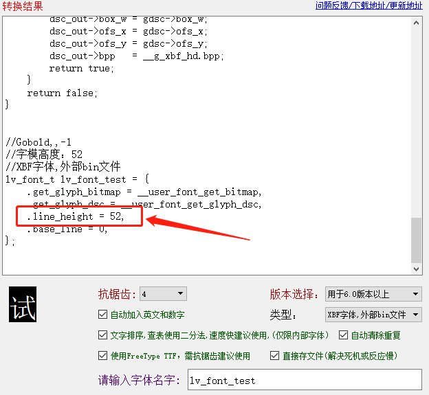

- 抗锯齿可以增加字体的圆润度，相应的会增加bin文件的大小

- 如果勾选了使用FreeType TTF选项，需要提前准备好一个字体TTF文件，或者可以取消勾选该选项，则可以从本机字体种选取字体进行bin文件制作。

- 尤其注意的是，**bin文件的大小，取决于包含的字符在unicode中的index的跨度！**

##### 字体bin文件合成

通过上述步骤，我们创建了单独字体的bin文件，我们需要将它们合成LVGL外部字体库接口可以使用的ext_font.bin文件。

> 注意：若只有一个bin文件，也需要执行这一步。

打开font_bin_merge.py脚本，将main中的bin_create()的参数改成您需要合并的bin文件的路径即可,有几个bin文件就传几个参数。

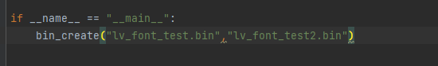

执行修改好的font_bin_merge.py脚本,即可在同目录下生成最终需要的bin文件:ext_font.bin。

> 注意：请先确保您正确安装了python。

#### flash分区调整

制作好ext_font.bin后，需要按以下操作将文件合入固件中。

#### 修改分区配置文件

将固件包中的 xxx_release_pack.zip 拷贝到 release_tool 目录下， 即和 release.exe 同级目录。
将 xxx_release_pack.zip 解压到当前路径。 会解压出 2 个目录 config 和 images， config 存放分区配置文件，
images 存放烧录时用到的各种 bin 文件。

这里以 EC600NCN_LF 系列新增字库分区为例。 具体如下：
1、 config\template\目录下的 CRANE_EVB.json 文件， 需要增加新增分区的信息。 涉及 2 处如下图：

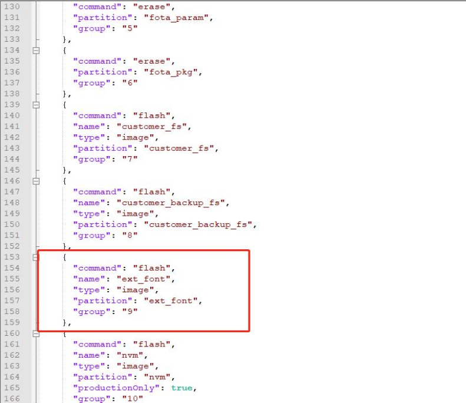

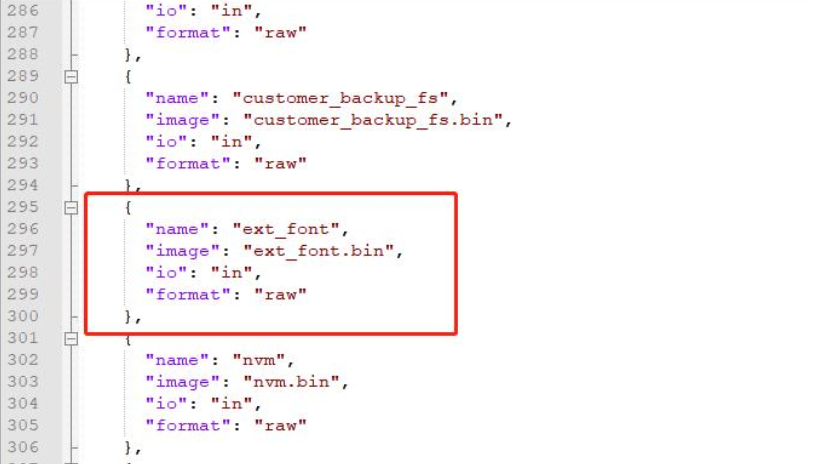

2、 config\partition\目录下的 CRANE_SINGLE_FLASH_LAYOUT_LTEONLY.json 文件， 用来修改分区大小。
需要增加新增分区的信息， 这里新增字库分区 ext_font 的大小为 1536KB， 根据实际需要决定该分区大小。
同时由于总的分区空间不变， 所以需要减少另一个分区 customer_app 空间大小， 从 3116KB 减到 1580KB，
同理该分区大小也要根据实际情况调整， 最小不能小于 image\customer_app.bin 文件的实际大小。 如下图：

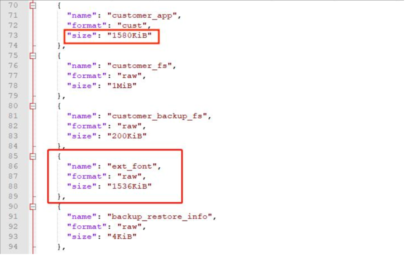

> **注意：**
>
> - 对于 EC600N 系列， 新增的 ext_font 分区空间来源于 customer_app 分区剩余空间+reserved 分区剩余
>   空间， ext_font 分区的大小不能超过这 2 个之和， reserved 分区是预留的空间， 会自动调整， 不需要专门调整。 即这里 ext_font 分区的大小可以大于或等于 customer_app 分区减小的大小。
> - 对于 EC600M 系列， 新增的 ext_font 分区空间只能来源于 customer_app 分区剩余空间， 而且 ext_font分区的大小必须等于 customer_app 分区减去的大小， 否则会导致 APP 启动失败。

#### ext_font.bin文件放置

将ext_font.bin文件copy 到 images\目录下。

#### 新固件生成

将修改内容后的 config 和 image 目录重新压缩成 xxx_release_pack.zip(注意不要多加一层文件夹， 需要
xxx_release_pack.zip 点击进去直接是 config 和 image 目录)， 然后点击运行 release.exe 即可生成包含字
库文件 ext_font.bin 的新固件。

如果生成固件失败， 基本是因为超过了空间的总大小。 请检查 ext_font 分区大小是否超过了 customer_app
分区剩余的空间大小（对于 EC600N 再加上 reserved 分区剩余的空间大小） 。 如果超了， 只能通过减小字
库文件 ext_font.bin 的大小来解决。

#### 外置字体使用接口

按照上文内容，生成了包含ext_font.bin的固件包之后，烧录固件包。

#### 接口说明

Lvgl外部字体库接口：

`lvgl.style_t().set_text_font_v2(font_name,line_height, flash_port)`

参数说明:

- `font_name`: 字体名称，系合成ext_font.bin文件的bin文件名称；
- `line_height`: 字形高度，可在工具生成的C文件中找到；
- `flash_port`: 内部flash填0即可；外部flash根据连接的spi port填写。

> **注意：**
>
> - 这里的font_name是您要使用的字体的原始bin文件名字，不是"ext_font.bin"。比如您制作了font_12.bin和font_14.bin，将它们合成了ext_font.bin，则font_name参数需填”font_12.bin”或”font_14.bin”。
> - Line_height不要填错，否则可能字体显示不全或显示过高。