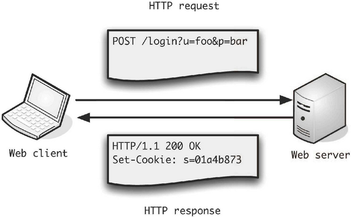
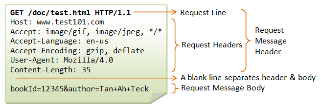
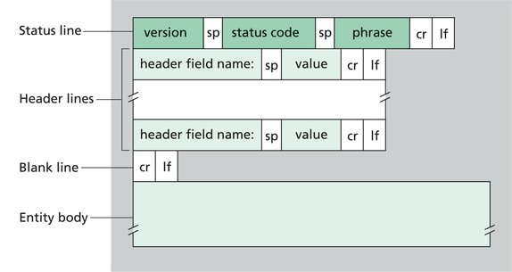
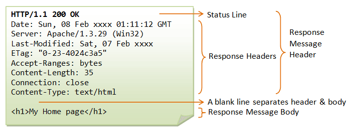

# HTTP 协议应用指导

## HTTP 简介

### HTTP协议

HTTP（Hyper Text Transformer Protocol，超文本传输协议）是一种由客户端发起请求，通过 URL（Uniform Resource Locator，统一资源定位符）来访问服务器资源的一种通信协议。该协议基于 C/S 模型，以文本的形式组织请求和响应的报文。通信模型如下：



HTTP 协议的主要应用场景有：基于浏览器的网页获取与表单提交、文件上传与下载、移动应用、物联网设备的数据上报等。

### 请求和响应报文

#### 请求报文

HTTP 请求报文的格式如下：


- `Request line`：请求行，由`method`、`URL`、`Version`字段组成。
    - `method`：请求方法，常用的方法有 GET、POST、PUT、HEAD、DELETE 等，详见[下文](#http_request_method)。
    - `URL`：统一资源定位符，用于标识服务器资源的路径。
    - `Version`：协议版本，目前常用的版本为`HTTP/1.1`。
- `Header lines`：请求首部，由一个或多个头域组成，每个头域的格式为`header field name: value`。
    - `head field name`：头域的名称。
    - `value`：头域的值。
- `Entity body`：消息体，即向服务器传递的消息正文。

> 值得注意的是，图中的`sp`表示空格，`cr` `lf`表示回车与换行，请求首部与消息体之间必须插入一行空行，即图示的`Blank line`。

请求报文的示例如下：



#### 响应报文

HTTP 响应报文的格式如下：



- `Status line`：响应状态行，由`version`、`status code`、`phrase`字段组成。
    - `version`：协议版本，目前常用的版本为`HTTP/1.1`。
    - `status code`：响应状态码，详见[下文](#http_status_code)。
    - `phrase`：原因短语。
- `Header lines`：响应首部，由一个或多个头域组成，每个头域的格式为`header field name: value`。
    - `head field name`：头域的名称。
    - `value`：头域的值。
- `Entity body`：消息体，即服务器响应的消息正文。

> 值得注意的是，图中的`sp`表示空格，`cr` `lf`表示回车与换行，响应首部与消息体之间必须插入一行空行，即图示的`Blank line`。

响应报文的示例如下：



## <span id="http_request_method">HTTP 请求方法</span>

HTTP 常用的方法有 GET、POST、PUT、HEAD、DELETE 等。

- **GET**：HTTP 请求中最常用的方法，用于向服务器请求获取资源。

- **HEAD**：和 GET 方法一样，但是不返回报文实体主体部分。主要用于确认 URL 的有效性以及资源更新的日期时间等。

- **PUT**：用于向服务器上传资源，当资源不存在时则创建资源，否则会替换资源。

- **POST**：用于修改服务器资源，当资源不存在时则创建资源，否则会修改资源。

- **DELETE**：删除资源，与 PUT 功能相反。

## <span id="http_status_code">HTTP 状态码</span>

服务器返回的响应报文中第一行为状态行，包含了状态码以及原因短语，用来告知客户端请求的结果。

| 状态码 |               类别               |          原因短语          |
| :----: | :------------------------------: | :------------------------: |
|  1xx   |  Informational（信息性状态码）   |     接收的请求正在处理     |
|  2xx   |      Success（成功状态码）       |      请求正常处理完毕      |
|  3xx   |   Redirection（重定向状态码）    | 需要进行附加操作以完成请求 |
|  4xx   | Client Error（客户端错误状态码） |     服务器无法处理请求     |
|  5xx   | Server Error（服务器错误状态码） |     服务器处理请求出错     |

> - HTTP 协议的具体内容请参考国际互联网工程任务组的[官方文档](https://www.ietf.org/rfc/rfc2616.txt)。
>
> - HTTP 协议与 TCP 协议的区别与联系：
>
>     - HTTP 协议是基于 TCP 协议实现的。
>
>     - TCP 协议面向字节流，用户无法很好地确定业务数据的边界；而 HTTP 协议具有特定的报文格式，而且用户业务数据可通过`Content-Length: ${Length}`头域来指定用户数据长度，或通过`Transfer-Encoding：chunked`头域来指定用户数据编码格式，两种方式均可确定业务数据的边界。QuecPython 模组已同时支持对`Content-Length: ${Length}`和`Transfer-Encoding：chunked`两种方式的解析。

## HTTP 应用

### 连接网络

启动 HTTP 应用之前，首先要确保网络畅通。

而 QuecPython 相关模组在上电后会自动进行蜂窝网络连接。因此，一般情况下开发者只需在应用中检测网络状态即可，示例代码如下：

```python
import checkNet

if __name__ == '__main__':
    stage, state = checkNet.waitNetworkReady(30)
    if stage == 3 and state == 1:
        print('Network connection successful.')
    else:
        print('Network connection failed, stage={}, state={}'.format(stage, state))

```

> 如果网络连接异常，可参考网络拨号相关的应用指导，重新进行网络连接。

### HTTP 请求代码示例

#### HTTP GET 请求

本节以 GET 和 POST 请求为例，展示了最基础的 HTTP 请求代码编写。

首先以 GET 请求为例，示例代码如下：

```python
import request

# Construct an HTTP GET request
url = 'http://api.example.com/resource'

# Set the request header to JSON. if the header is not set, the default value is application/json
headers = {'Content-Type': 'application/json'}

# Send the HTTP GET request
response = request.get(url, headers=headers)

# Get the HTTP response status
status_code = response.status_code
print('GET status code:', status_code)

# Get the HTTP response data
data = response.json()
print('GET response data:', data)
```

#### <span id="http_post_exam">HTTP POST 请求</span>

由于 GET 请求是向服务器请求资源，请求报文中一般无需携带消息体。

而 POST 请求则用于向服务器推送消息，需要携带消息体，示例代码如下：

```python
import request
import ujson

# Construct an HTTP POST request
url = 'http://api.example.com/resource'

# Set the request header to JSON
headers = {'Content-Type': 'application/json'}

# Construct the request data
payload = {'key1': 'value1', 'key2': 'value2'}
json_payload = ujson.dumps(payload)

# Send the HTTP POST request
response = request.post(url, headers=headers, data=json_payload)

# Get the HTTP response status
status_code = response.status_code
print('POST status code:', status_code)

# Get the HTTP response data
data = response.json()
print('POST response data:', data)
```

上述两段代码可以看出，GET 和 POST 请求的代码在编写时有两个主要区别：

1. `request`模块后使用的方法不同，分别是`request.get()`和`request.post()`。
2. POST 请求需要构建请求数据，而 GET 请求不需要。

其余编程的思路几乎一样，服务器响应后，HTTP 请求返回响应对象`response`。通过`response`提供的方法，可以获取 HTTP 的响应码、原因短语、响应消息体等数据。

### HTTP 请求常用接口

本节讲述下`request.get()`、`request.post()`和响应结果`response`对象常用方法的使用说明。

- `request.get()`函数原型：`request.get(url, data=None, **kwargs)`
- `request.post()`函数原型：`request.post(url, data=None, **kwargs)`
- `response`类型：`<class 'Response'>`
- 参数说明：
    - `url`：位置参数，服务器资源地址。
    - `data`：默认参数，请求报文的消息体。
    - `**kwargs`：关键字参数，HTTP 请求其它的相关参数。
        - `headers`：请求头，字典类型。
        - `decode`：是否将响应结果进行 utf-8 解码，布尔类型，默认值为`True`。
        - `sizeof`：读取缓冲区的数据块大小，默认 255 个字节，建议 255-4096，数值越大读取的速度越快。
        - `ssl_params`：SSL 证书参数，格式为：`{"cert": certificate_content, "key": private_content}`。
- 返回值：`<class 'Response'>`类型的对象`response`。该响应对象的属性和方法如下：
    - `status_code`：响应状态码，int 类型。
    - ``headers``：响应头，dict 类型。
    - `text`：响应消息体的字符串类型生成器。
    - `json`：将响应的 json 消息体转换为 dict 类型。 
    - `content`：响应消息体的 bytes 类型生成器。

### HTTP 应用范例

#### 天气查询

高德开放天气查询接口：`http://restapi.amap.com/v3/weather/weatherInfo?key=2875b8171f67f3be3140c6779f12dcba&city=北京&extensions=base`

> `北京`可替换为其他国内城市名称。

调用 HTTP GET 方法可查询指定城市的天气，示例代码如下（[点此在 github 中下载完整代码](https://github.com/QuecPython/examples/blob/main/network-comm/net-protocols/http/example_get_weather.py)）：

```python
import request

# Weather query URL
url = 'http://restapi.amap.com/v3/weather/weatherInfo?key=2875b8171f67f3be3140c6779f12dcba&city=北京&extensions=base'

# Send the HTTP GET request
response = request.get(url)

# Get the raw data returned by the weather query website
data = ''
for i in response.text:
    data += i
print('raw data responsed from website:')
print(data)
```

以上代码的执行结果为：

```log
raw data responsed from website:
{"status":"1","count":"1","info":"OK","infocode":"10000","lives":[{"province":"北京","city":"北京市","adcode":"110000","weather":"阴","temperature":"36","winddirection":"东南","windpower":"≤3","humidity":"34","reporttime":"2023-07-02 18:40:39","temperature_float":"36.0","humidity_float":"34.0"}]}
```

想进一步处理该数据，比如美化输出，可以调用`response`对象的`json`方法（[点此在 github 中下载完整代码](https://github.com/QuecPython/examples/blob/main/network-comm/net-protocols/http/example_get_weather_json_resolve.py)）：

```python
import request

# Weather query URL
url = 'http://restapi.amap.com/v3/weather/weatherInfo?key=2875b8171f67f3be3140c6779f12dcba&city=北京&extensions=base'

# Send the HTTP GET request
response = request.get(url)

# Get raw data from the website and parse it into a dict type by calling the json() method of response object
data = response.json()
data = data['lives'][0]
for k,v in data.items():
	print('%s: %s' % (k, v))
```

以上代码的执行结果为：

```log
province: 北京
city: 北京市
adcode: 110000
weather: 阴
temperature: 36
winddirection: 东南
windpower: ≤3
humidity: 34
reporttime: 2023-07-02 18:40:39
temperature_float: 36.0
humidity_float: 34.0
```

#### 文件下载

此处以下载百度搜索首页的 html 网页文件为例进行演示，发送请求的代码如下（[点此在 github 中下载完整代码](https://github.com/QuecPython/examples/blob/main/network-comm/net-protocols/http/example_file_download.py)）：

```python
import request

# Baidu URL over HTTP protocol (not HTTPS)
url = 'http://www.baidu.com'

# Send the HTTP GET request
response = request.get(url)
```

在读取网页数据前，在模组的 /usr 目录下以`wb`的模式创建一个名为`baidu.html`的文件：

```python
# Create file baidu.html
f = open('/usr/baidu.html', 'wb')    # 'wb' means writing binary data
```

网页文件可能会包含一些超出 ASCII 范围的字符，在获取响应数据时，建议使用`request.content`，而不是`request.text`。

代码如下：

```python
# Get web page content and write to the file
for i in response.content:
	f.write(i)

# Close the file after fetching the web page data
f.close()
```

至此文件下载完毕。

想要查看下载的文件内容，执行以下代码即可：

```python
# Open file baidu.html
with open('/usr/baidu.html', 'rb') as f:    # 'rb' means reading the file in binary mode
	r = f.read()
    while r:
        print(r)
        r = f.read()

# Close the file
f.close()
```

打印的文件内容如下：

```python
b'<!DOCTYPE html>\r\n<!--STATUS OK--><html> <head><meta http-equiv=content-type content=text/html;charset=utf-8><meta http-equiv=X-UA-Compatible content=IE=Edge><meta content=always name=referrer><link rel=stylesheet type=text/css href=http://s1.bdstatic.com/r/www/cache/bdorz/baidu.min.css><title>\xe7\x99\xbe\xe5\xba\xa6\xe4\xb8\x80\xe4\xb8\x8b\xef\xbc\x8c\xe4\xbd\xa0\xe5\xb0\xb1\xe7\x9f\xa5\xe9\x81\x93</title></head> <body link=#0000cc> <div id=wrapper> <div id=head> <div class=head_wrapper> <div class=s_form> <div class=s_form_wrapper> <div id=lg>  </div> <form id=form name=f action=//www.baidu.com/s class=fm> <input type=hidden name=bdorz_come value=1> <input type=hidden name=ie value=utf-8> <input type=hidden name=f value=8> <input type=hidden name=rsv_bp value=1> <input type=hidden name=rsv_idx value=1> <input type=hidden name=tn value=baidu><span class="bg s_ipt_wr"><input id=kw name=wd class=s_ipt value maxlength=255 autocomplete=off autofocus></span><span class="bg s_btn_wr"><input type=submit id=su value=\xe7\x99\xbe\xe5\xba\xa6\xe4\xb8\x80\xe4\xb8\x8b class="bg s_btn"></span> </form> </div> </div> <div id=u1> <a href=http://news.baidu.com name=tj_trnews class=mnav>\xe6\x96\xb0\xe9\x97\xbb</a> <a href=http://www.hao123.com name=tj_trhao123 class=mnav>hao123</a> <a href=http://map.baidu.com name=tj_trmap class=mnav>\xe5\x9c\xb0\xe5\x9b\xbe</a> <a href=http://v.baidu.com name=tj_trvideo class=mnav>\xe8\xa7\x86\xe9\xa2\x91</a> <a href=http://tieba.baidu.com name=tj_trtieba class=mnav>\xe8\xb4\xb4\xe5\x90\xa7</a> <noscript> <a href=http://www.baidu.com/bdorz/login.gif?login&amp;tpl=mn&amp;u=http%3A%2F%2Fwww.baidu.com%2f%3fbdorz_come%3d1 name=tj_login class=lb>\xe7\x99\xbb\xe5\xbd\x95</a> </noscript> <script>document.write(\'<a href="http://www.baidu.com/bdorz/login.gif?login&tpl=mn&u=\'+ encodeURIComponent(window.location.href+ (window.location.search === "" ? "?" : "&")+ "bdorz_come=1")+ \'" name="tj_login" class="lb">\xe7\x99\xbb\xe5\xbd\x95</a>\');</script> <a href=//www.baidu.com/more/ name=tj_briicon class=bri style="display: block;">\xe6\x9b\xb4\xe5\xa4\x9a\xe4\xba\xa7\xe5\x93\x81</a> </div> </div> </div> <div id=ftCon> <div id=ftConw> <p id=lh> <a href=http://home.baidu.com>\xe5\x85\xb3\xe4\xba\x8e\xe7\x99\xbe\xe5\xba\xa6</a> <a href=http://ir.baidu.com>About Baidu</a> </p> <p id=cp>&copy;2017&nbsp;Baidu&nbsp;<a href=http://www.baidu.com/duty/>\xe4\xbd\xbf\xe7\x94\xa8\xe7\x99\xbe\xe5\xba\xa6\xe5\x89\x8d\xe5\xbf\x85\xe8\xaf\xbb</a>&nbsp; <a href=http://jianyi.baidu.com/ class=cp-feedback>\xe6\x84\x8f\xe8\xa7\x81\xe5\x8f\x8d\xe9\xa6\x88</a>&nbsp;\xe4\xba\xacICP\xe8\xaf\x81030173\xe5\x8f\xb7&nbsp;  </p> </div> </div> </div> </body> </html>\r\n'
```

#### <span id="http_multipart_form_data">multipart/form-data 表单提交</span>

HTTP 的`multipart/form-data`形式的表单提交在 HTTP 通信中很常用，可用于文件上传。需要在请求首部中增加`Content-Type: multipart/form-data;boundary=${Boundary}`头域，完整格式如下：

```http
POST / HTTP/1.1
host: www.example.com
Content-Type: multipart/form-data; boundary=${Boundary}

--${Boundary}
Content-Disposition: form-data; name="text"

title
--${Boundary}
Content-Disposition: form-data; name="file"; filename="test.png"
Content-Type: image/png

<binary data of the image>
--${Boundary}--
```

上述表单请求报文实现的是 test.png 文件的上传，同时增加了一个表单字段`text`，它的值为`title`。

报文格式说明如下：

- `${Boundary}`：请求方自行设置的分隔字符串，比如`----WebKitFormBoundaryrGKCBY7qhFd3TrwA`。

- 请求的消息体由多个`--${Boundary}`分隔的表单项组成，每个表单项又由请求头和消息体组成，格式为：

    ```http
    --${Boundary}
    Content-Disposition: form-data; name="parameter_name"

    Parameter value
    ```

    - `--${Boundary}`后追加回车换行符`cr` `lf`。

    - 每个请求头后也追加回车换行符`cr` `lf`。

    - 请求头与消息体（即上述的参数值）之间也追加一行空行，即`cr` `lf`。

- 如果表单项中携带的是文件数据：

    - Content-Disposition 头域后需追加 filename 字段，如`Content-Disposition: form-data; name="file"; filename="test.png"`，表明表单携带的是文件内容，文件名称为 test.png。
    - 需追加 Content-Type 请求头，表明文件类型，如`Content-Type: image/png`。

- 在所有表单的最后，以`--${Boundary}--`结尾。

在 QuecPython 中实现此类型的表单，需要用户自行组织完整的表单格式消息体，示例代码如下（[点此在 github 中下载完整代码](https://github.com/QuecPython/examples/blob/main/network-comm/net-protocols/http/example_multipart_form_data.py)）：

```python
import request

url = 'http://www.example.com'
boundary = '----WebKitFormBoundaryrGKCBY7qhFd3TrwA'
headers = {'Content-Type': 'multipart/form-data; boundary=' + boundary}

data = ''
data += '--' + boundary + '\r\n'
data += 'Content-Disposition: form-data; name="text"\r\n'
data += '\r\n'
data += 'title\r\n'
data += '--' + boundary + '\r\n'
data += 'Content-Disposition: form-data; name="file"; filename="test.png"\r\n'
data += 'Content-Type: image/png\r\n'
data += '\r\n'

data = bytes(data.encode())

with open('/usr/test.png', 'rb') as f:
    data += f.read()

data += b'\r\n'
data += b'--' + bytes(boundary.encode()) + b'--'

request.post(url, headers=headers, data=data)
```

#### application/x-www-form-urlencoded 表单提交

另一种表单形式` application/x-www-form-urlencoded`在 HTTP 通信中也很常用。

- 在请求首部中增加头域`Content-Type: application/x-www-form-urlencoded; charset=utf-8`，其中字符集编码格式按需取舍，一般网络数据传输均以 utf-8 编码，增加该字符集编码无副作用。
- 消息体的格式为`key1=value1&key2=value2`。

可以看出该种形式的表单格式很简单，较为完整的报文如下：

```http
POST / HTTP/1.1
host: www.example.com
Content-Type: application/x-www-form-urlencoded; charset=utf-8

key1=value1&key2=value2
```

#### JSON 表单提交

物联网设备使用 HTTP 协议上报数据时，最常见的就是以 JSON 格式进行上报。

[点此查看参考代码](#http_post_exam)。

### HTTP 常见问题

**1. 用 POST 方法向百度或其他服务器提交数据时，报如下错误怎么办？**

```log
Traceback (most recent call last):
  File "<stdin>", line 1, in <module>
  File "request.py", line 272, in post
  File "request.py", line 252, in request
NotImplementedError: Redirects not yet supported
```

​	QuecPython 的 HTTP 请求暂未支持 URL 重定向，请使用最终有效的 URL 进行数据提交。

**2. HTTP POST 的消息体格式与 Content-Type 头域的对应关系是怎样的？**

| Content-Type 头域的值                            | 消息体格式                            |
| ------------------------------------------------ | :------------------------------------ |
| text/plain                                       | 纯文本                                |
| text/html; charset=utf-8                         | html格式                              |
| application/json                                 | json格式                              |
| application/xml                                  | xml格式                               |
| application/x-www-form-urlencoded; charset=utf-8 | key1=value1&key2=value2               |
| multipart/form-data; boundary=${Boundary}        | [点此查看](#http_multipart_form_data) |
| image/jpeg                                       | jpeg格式的图像数据                    |
| audio/mpeg                                       | mpeg格式的音频数据                    |
