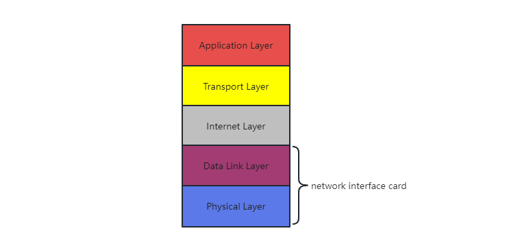
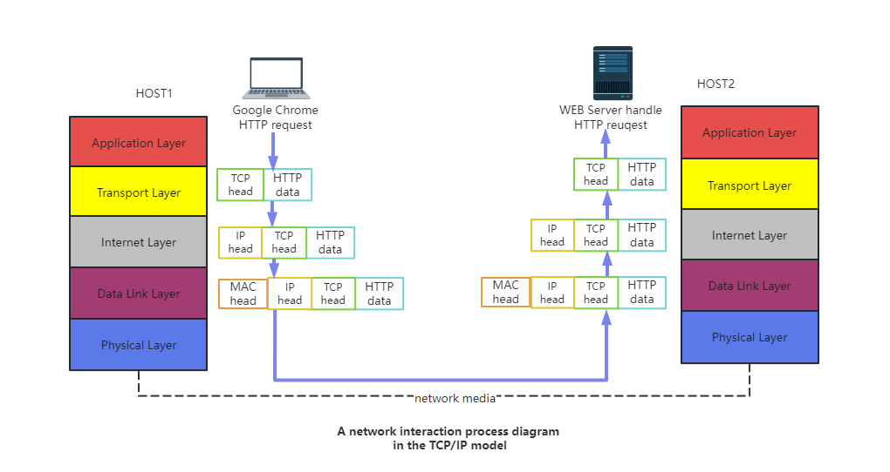

# 网卡

网卡又称网络接口控制器，网络适配器，或局域网接收器，是一块被设计用来允许计算机在计算机网络上进行通讯的计算机硬件。这意味着一块独立设备，必须有网卡才能对外进行网络通信。

## 网卡的作用

网卡是局域网中连接计算机和传输介质的接口，不仅能实现与局域网传输介质之间物理连接和电信号匹配，还涉及帧的发送和接收、帧的封装和拆帧、介质的访问控制、数据的编码解码、数据缓存等。 

## 网卡在 TCP/IP 模型中工作层次

网卡一般工作在 TCP/IP 模型的物理层和数据链路层。  
- 物理层定义了数据传送与接收所需要的电与光信号、线路状态、时钟基准、数据编码和电路等，并向数据链路层设备提供标准接口。
- 数据链路层则提供寻址机构、数据帧的构建、数据差错检查、传送控制、向网络层提供标准的数据接口等功能。

如下图所示，介绍网卡在 TCP/IP 模型中的工作层次。

## 网卡在 TCP/IP 模型中数据流转过程

在数据通信转发过程中，网卡主要处理 lwIP 协议栈(网络层)的数据，将 lwIP 协议栈（网络层）的数据交给网卡转发通过网线/电磁波发送到局域网，或者收到局域网数据转发给 lwIP 协议栈（网络层）。   
在网络通信中，网卡是主机与介质的桥梁设备，应用层协议提供了信息互通的基础。

如下图所示，介绍一次网络请求两台主机在 TCP/IP 模型中的传输过程。

