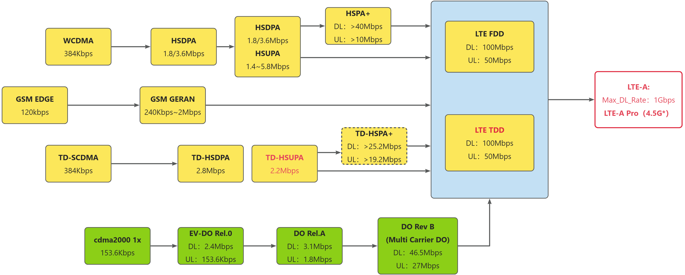
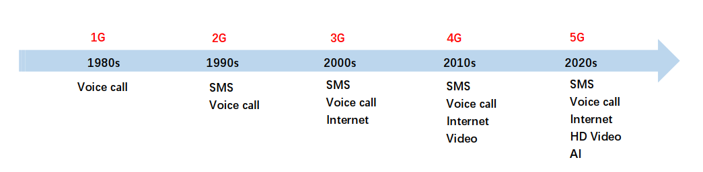
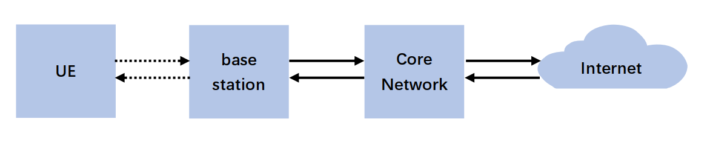
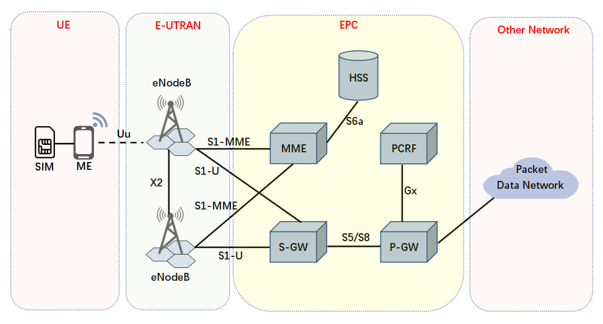

# 蜂窝无线网络

蜂窝无线网络（Cellular Network），又称移动通信网络（mobile network），是一种广泛应用于移动通信的无线通信技术。它基于蜂窝拓扑结构，将服务区域分割为多个小区，每个小区都由一个无线基站负责覆盖，由于构成网络覆盖的各通信基站的信号覆盖呈六边形，从而使整个网络像一个蜂窝，所以叫它蜂窝无线网络。目前应用比较广泛的蜂窝网络类型有：GSM（2G）、UMTS（3G）、LTE（4G）和NR（5G）。

## 发展简史

在蜂窝无线通信的发展过程中，GSM、UMTS以及LTE等几个网络技术并不是唯一的移动通信技术，它们只是比较主流的移动通信技术，还有其他一些不太常见的移动通信技术。具体可以参考下面的移动通信技术演进路线图，它不仅说明了移动通信技术是如何从2G发展到4G，还说明了其他一些移动通信技术和当前主流通信技术的关系以及发展路线。

【注释】LTE-A Pro（4.5G*）：
在3GPP技术规范中，4.5G被命名为LTE-Advanced Pro，是移动宽带网络新的建设基准。它包括已经发布的Release 13和下一步将会到来的Release 14。

为了能更加简单明了的让读者理解，我们可以将移动通信技术的发展路线简化如下：

* 1G - 模拟时代

  1G是指第一代移动通信技术，在1980年代初期首次推出。是以模拟技术为基础的蜂窝无线通话系统。主要提供语音通话功能，代表性的通讯手段就是大哥大。

* 2G - 数字时代

  2G是指第二代移动通信技术，在1990年代推出。开始采用数字信号技术，极大地提高了通话质量和网络容量。同时，2G还引入了一些新的服务，例如短信息服务(SMS)和低速数据传输。GSM是最广泛使用的2G标准。

* 3G - 宽带时代

  3G是指第三代移动通信技术，在21世纪初推出。3G提供了更高的数据传输速度，可以提供网页浏览、音乐等基本数据业务。UMTS是最早和最广泛使用的3G系统。

* 4G - 智能时代

  4G是指第四代移动通信技术，在2010年代初开始广泛使用，主要技术是LTE。相比3G，4G提供了更快的数据传输速度，实现了更高质量的音视频流，以及更快的移动互联网访问。

* 5G - 万物互联时代

  在2019年开始逐渐推出第五代移动通信技术，也是目前商业化应用的最新的移动通信技术。由于其更高的数据速度、更低的延迟，以及更高的网络容量，满足了万物互联的应用需求。

## 组网方式

蜂窝无线网络中，移动终端的组网方式，是通过无线电波和基站进行数据交互，基站将处理后的数据发送到运营商的核心网络，最后到达外部网络。

以LTE网络为例，终端设备的组网方式如下：

