# 网络异常处理

本文主要讲述在QuecPython中，常见的网络异常有哪些，以及如何排查和处理这些网络异常情况，并提供一个示例，演示了在设备运行过程中，出现网络异常时的处理方式。

## 常见网络异常

比较常见的网络异常，主要有以下3种情况，分别是：

* SIM卡异常

* 模组网络注册失败

* 蜂窝无线网卡自动激活失败

这3种情况导致的直接结果，就是模组无法连接到网络。因此我们将这些情况都称之为“网络异常”。下面我们分别来说明如何排查和处理这3种网络异常情况。

## 网络异常处理

下面将详细说明可能有哪些原因会引起上述的网络异常，以及如何去排查解决这些网络异常情况。

### SIM卡异常

SIM卡异常主要有下面3种情况，分别是：

#### 设备没有检测到SIM卡

我们可以先通过如下方式，查看SIM卡的状态：

步骤1：将终端设备通过USB数据线连接到电脑的USB端口上。

步骤2：在电脑上打开QPYcom工具，打开QuecPython的REPL命令端口（图示的 NMEA Port），进入到交互模式。

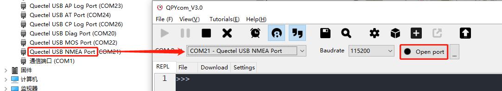

步骤3：在命令交互行，按照如下方式调用API查询注网状态。

```
import sim
sim.getStatus()
```

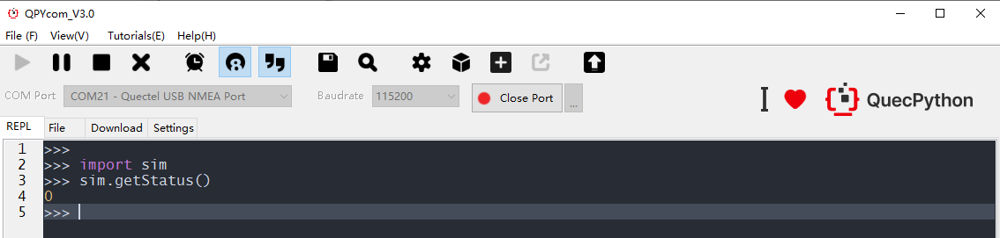

如果`sim.getStatus()`的返回值为0，说明设备没有检测到SIM卡，此时需要确定是否插入了SIM卡。如果用户已经插入SIM卡并且重启设备后，查询状态值还是0，那可能的原因如下：

* SIM卡没有插好，比如插反了，或者没有插紧。可以重新插入SIM卡并重启设备，开机后再次查询SIM卡状态是否为1。

* SIM卡本身有损坏。可以换一张可以正常使用的SIM卡插入后，重启设备，然后再次查询SIM卡状态是否为1。

* SIM卡卡槽有损坏。如果确认是这个问题，则需要更换新的卡槽。

* SIM卡的硬件电路存在问题，比如接触不良，导致设备无法正常识别SIM卡。需要硬件工程师检查电路确认问题。

用户可以依次排查上面几种情况来确认问题。

<br>

#### SIM卡状态异常

SIM卡状态异常是指通过`sim.getStatus()`这个API查询的值既不是0也不是1，比较常见的是2和3。

* 当SIM卡状态值是2时

当SIM卡状态值为2的时候，说明用户之前为这张SIM卡启用了PIN码验证功能。这种情况下，需要先输入正确的PIN码进行验证，然后关闭PIN码验证功能，最后重启设备，开机后再次确认SIM卡状态是否为1。

> 关于SIM卡应该使用什么PIN码，一般在标准SIM卡上有标注默认的PIN码。如果用户找不到标准SIM卡了，则需要用户与SIM卡所属运营商进行确认，请勿随意输入PIN码进行尝试。我们强烈建议用户，如果没有特殊需要，不要随便使用PIN码相关的功能，因为很可能因为误操作导致SIM卡永久无法使用。

比如用户现在使用的是中国联通的SIM卡，默认的PIN码是'1234'，现在这张卡启用了PIN码验证，查询的状态值是2，那么可以按照如下步骤来恢复：

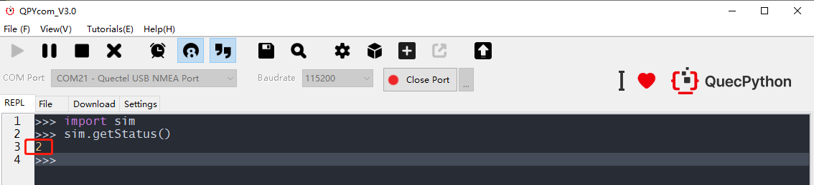

步骤1：先通过下面方法输入PIN码进行验证。

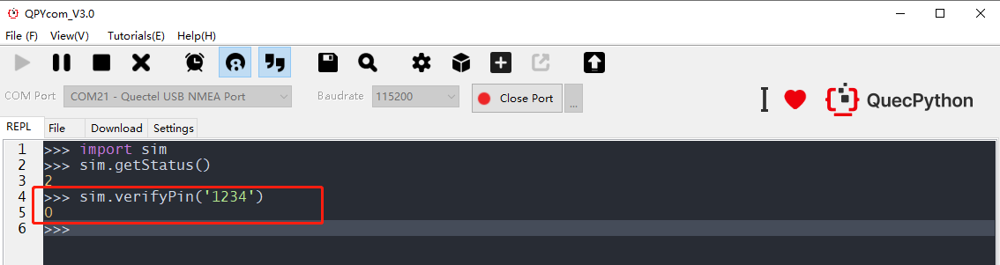

步骤2：关闭PIN码验证。

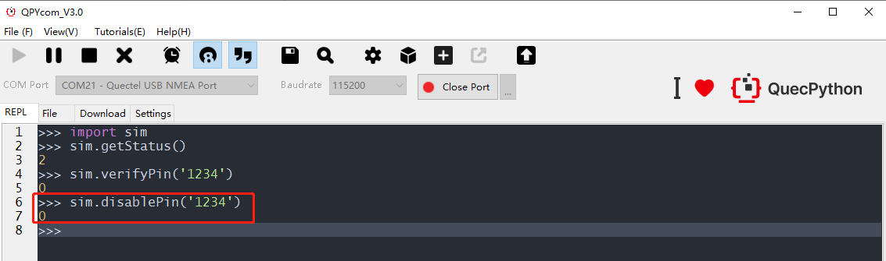

步骤3：重启设备，再次查询SIM卡状态，确认是否恢复正常。

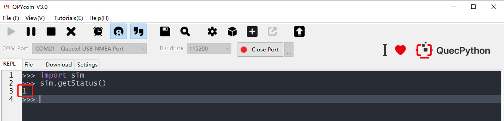


* 当SIM卡状态值是3时

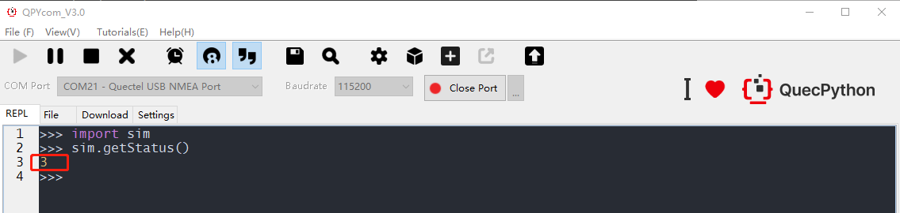

当SIM卡状态值为3的时候，说明这一张卡已经被锁，此时需要使用PUK码来进行解锁。PUK码一般在标准SIM卡上可以找到，如下图所示：

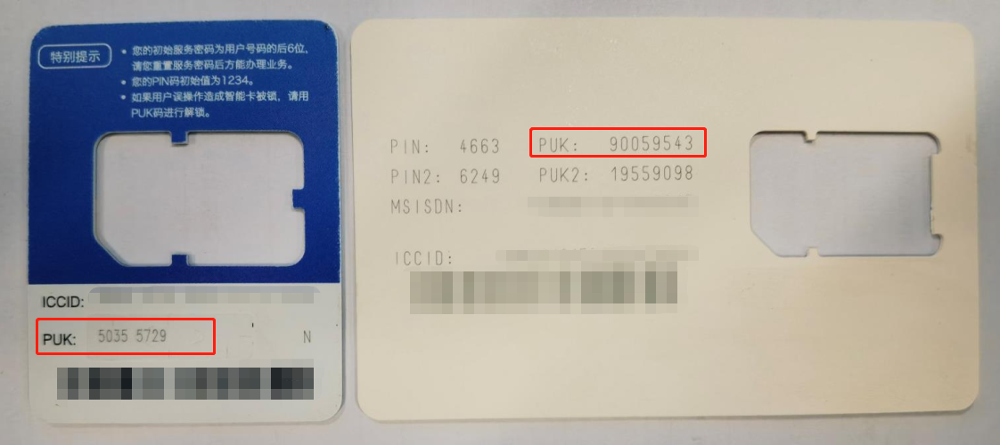

需要说明的是，每一张SIM卡都有自己的PUK，用户在解锁SIM卡时，一定要确定使用的PUK是正确的。如果PUK码输错10次，这张SIM卡将永久锁定，再也无法使用。

当用户确认了PUK码后，可以按照下面的步骤来解锁：

步骤1：输入正确的PUK解锁，并设置新的PIN码。

SIM卡解锁使用的是下面的方法。该方法有两个参数，第一个参数表示PUK码，第二个参数表示新设置的PIN码。一般SIM卡被锁的原因就是用户启用了PIN码验证，但是在进行PIN码验证时，连续3次输入了错误的PIN码，此时SIM卡就会被锁。所以使用PUK码进行解锁时，需要用户重新设置一个新的PIN码。

```python
sim.unblockPin(puk, newPin)
```

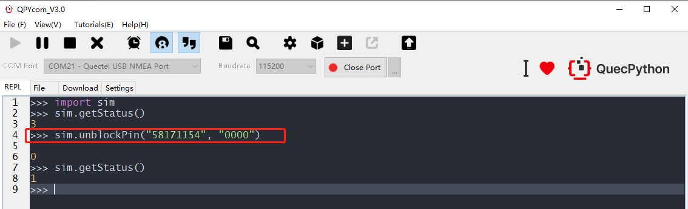

通过上图可以看到，SIM卡已经解锁成功，解锁后查询SIM卡状态，状态值已经变成了1。但是需要注意，此时仅仅是解锁成功了，但是SIM卡的PIN码验证功能并没有关闭，如果现在重启设备，开机后，SIM卡的状态值依然是2，表示需要用户输入PIN码进行验证。因此我们可以先将PIN码验证功能关闭，然后再重启设备。当然，也可以在解锁SIM卡并重启后，先进入PIN码验证，验证成功后，再把PIN码验证功能关闭。

步骤2：关闭PIN码验证功能。

注意，由于SIM卡解锁时，我们已经重新设置了PIN码，因此进行PIN码验证和关闭PIN码验证时，必须使用最新设置的PIN码。

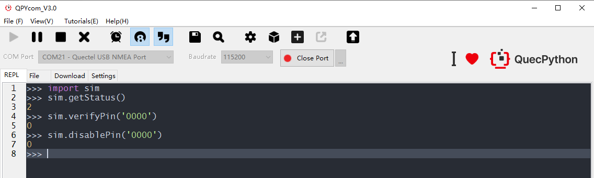

步骤3：重启设备，确认SIM卡状态是否为1。


#### SIM卡欠费

这种情况有些特殊，因为不同运营商的SIM卡情况可能不太一样，没办法用一个完全统一的标准去判断。一般如果出现下面两种情况，我们建议用户先去查询一下SIM卡是否出现欠费的情况。

情况1：SIM卡状态值为1，设备网络注册已经成功，并且蜂窝无线网卡也激活成功，但是无法进行网络业务，比如无法发送数据或者接收数据。

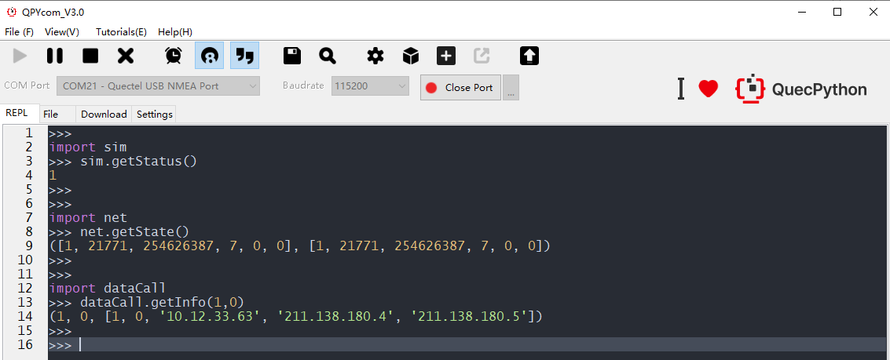

情况2：SIM卡状态值为1，但是网络注册失败。

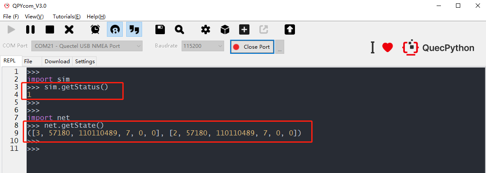


> 注意，并不是说出现“SIM卡状态值为1，但是网络注册失败。”的情况时，就一定是SIM卡欠费了。SIM卡欠费仅仅是导致出现这种情况的可能原因之一。


### 模组网络注册失败

这种情况是指模组已经正常检测到SIM卡，即通过`sim.getStatus()`方法查询结果为1，但是通过`net.getState()`方法查询模组网络注册状态，发现网络注册状态既不是1也不是5。


导致这种情况的原因有很多，常见的有下面这些：

#### 射频性能不好

当设备的射频性能不好时，可能会导致模组发送的消息无法到达基站，或者无法接收到基站下发的消息。结果就是导致模组无法注册到网络。一般我们可以先查询模组的CSQ信号强度参数，来进行初步的判断。若CSQ值小于6，终端基本无法进行网络通信。查询CSQ方法如下：

```python
net.csqQueryPoll()
```

操作如下：

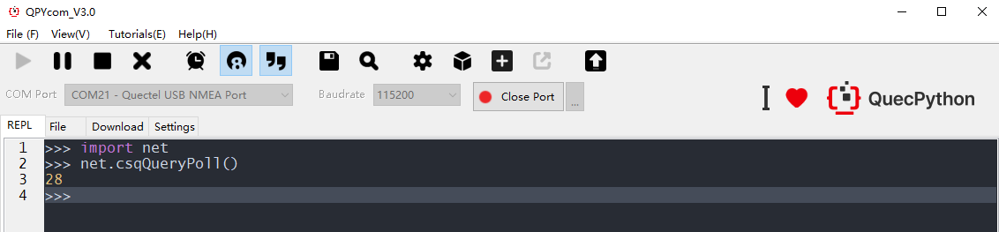


影响模组射频性能的因素比较多，比如设备没有接天线、天线性能不好、设备所处环境比较封闭、模组没有进行射频参数校准、设备硬件设计问题、模组射频器件有损坏等。这些原因中，用户能直接进行排查的，主要有下面两种：

* 没有接天线/天线性能不好

  如果用户没有接天线，请先接上适合的天线，然后看看是否可以成功注册到网络。如果接了天线，可以尝试换一个天线，然后再次查询CSQ，确认是否有改善。

* 设备所处环境比较封闭

  如果用户的设备处于一个比较封闭的环境，也会影响到模组的射频性能，导致设备无法正常进行网络通信。用户可以尝试到室外开阔地带重新测试。

其他的情况，需要联系我司FAE协助处理。


#### 没有配置APN

有的国家和地区，UE在进行网络注册时，需要携带APN信息，否则会被核心网拒绝导致网络注册失败。当用户发现设备无法注册到网络时，请先确认是否配置了正确的APN。如果没有配置或者配置错误，请按照如下步骤进行配置：

步骤1：和运营商确认这张SIM卡应该使用什么APN。

步骤2：查询模组的APN配置情况，确认是否需要配置APN。如果当前APN已经是用户需要配置的，则无需重复配置；否则需要重新配置，并重启设备。

QuecPython默认开机自动激活第一路蜂窝无线网卡，下面以此为例，说明如何为第一路蜂窝无线网卡配置APN。假如用户现在使用的是中国联通的SIM卡，经过确认，应该使用的APN为`3gnet`，则示例代码如下：

```python
>>> import dataCall
>>> dataCall.getPDPContext(1)
(0, '', '', '', 0) # 返回值中，APN为空，说明没有配置APN
>>> dataCall.setPDPContext(1,0,'3gnet','','',0)
0
```

上述示例，是在QPYcom工具的REPL交互模式下直接执行API，如果是在用户的python脚本文件中，我们可以按照如下方式编写：

```python
import checkNet
import usocket
import dataCall
from misc import Power

# 用户需要配置的APN信息，根据实际情况修改
usrCfg = {'apn': '3gnet', 'username': '', 'password': ''}

def checkAPN():
    # 获取第一路网卡的APN信息，确认当前使用的是否是用户指定的APN
    pdpCtx = dataCall.getPDPContext(1)
    if pdpCtx != -1:
        if pdpCtx[1] != usrCfg['apn']:
            # 如果不是用户需要的APN，使用如下方式配置
            ret = dataCall.setPDPContext(1, 0, usrCfg['apn'], usrCfg['username'], usrCfg['password'], 0)
            if ret == 0:
                print('APN configuration successful. Ready to restart to make APN take effect.')
                print('Please re-execute this program after restarting.')
                # 重启后按照配置的信息进行拨号
                Power.powerRestart()
            else:
                print('APN configuration failed.')
                return False
        else:
            print('The APN is correct and no configuration is required')
            return True
    else:
        print('Failed to get PDP Context.')
        return False


def main():
    checkpass = checkAPN()
    if not checkpass:
        return

    stage, state = checkNet.waitNetworkReady(20)
    if stage == 3 and state == 1:
        print('Network connected successfully.')
        # do something
    else:
        print('Network connected failed, stage={}, state={}'.format(stage, state))


if __name__ == '__main__':
    main()
```

上述示例代码下载链接：[示例下载](https://github.com/QuecPython/examples/blob/main/network-comm/nic/cellular/example_network_exception_handle_set_apn.py)


#### 无SIM卡所属运营商的网络覆盖

每个运营商在不同地方的基站部署情况可能都不相同，并且不同的基站，其信号覆盖范围可能也不相同。这就会导致设备在一些地方无法注册到网络。因为这些地方没有设备使用的SIM卡所属运营商的网络覆盖，或者覆盖很弱。设备在开机后搜索可用网络时，找不到适合的小区，导致网络注册失败。

> 覆盖很弱，指的是设备处于某一个小区的边缘。此时设备搜索该小区时，很可能无法搜到，或者偶尔能搜到。

比较常见的现象，就是用户发现同样一台设备，使用的也是同一张SIM卡，但是在地点A可以成功注册到网络上，然后到另外一个地点B后，发现设备一直无法注册到网络，或者花了很长时间才注册到网络。

如果客户遇到这种情况，基本可以确认是因为设备所处地点没有对应运营商网络覆盖或者是覆盖很弱导致。这种情况下，用户可以换一个地方进行测试，或者换一张其他运营商的SIM卡进行测试，进一步确认是否是该问题。


#### SIM卡只支持特定网络制式

有的SIM卡只支持特定的网络制式，比如一些SIM卡只支持GSM网络，但是设备所处的地点没有GSM网络覆盖，就会导致设备无法注册到网络。这种情况下用户可以进行下面的处理：

* 和SIM卡所属运营商进行确认，确认该SIM卡是否只支持特定的网络制式。

* 联系我司FAE协助，抓取设备开机网络注册过程的log，提供给我司研发人员进一步确认。


#### SIM卡只支持特定频段

有的SIM卡比较特殊，只能注册到特定频段的网络。此时用户需要确认两件事：

* 和SIM卡运营商确认该SIM卡是否只支持特定频段，如果是，那支持哪些频段。

* 查阅对应模组的规格书或者联系我司的FAE，确认该模组支持哪些频段。如果SIM卡支持的频段，模组不支持，则设备无法注册到网络。还有一种情况是，设备所处的地方，没有该频段的网络覆盖，也会导致设备无法注册到网络。

上述仅列出了一些比较常见的导致设备网络注册失败的原因。如果经过排查后，导致设备网络注册失败的原因依然无法确认，请联系我司FAE协助，抓取设备开机网络注册过程的log，提供给我司研发人员进行分析确认。


### 蜂窝无线网卡自动激活失败

蜂窝无线网卡自动激活失败，特指模组网络已经注册成功，但是无线网卡激活失败的情况。即模组网络注册成功了，但是没有获取到IP信息。如下图所示：

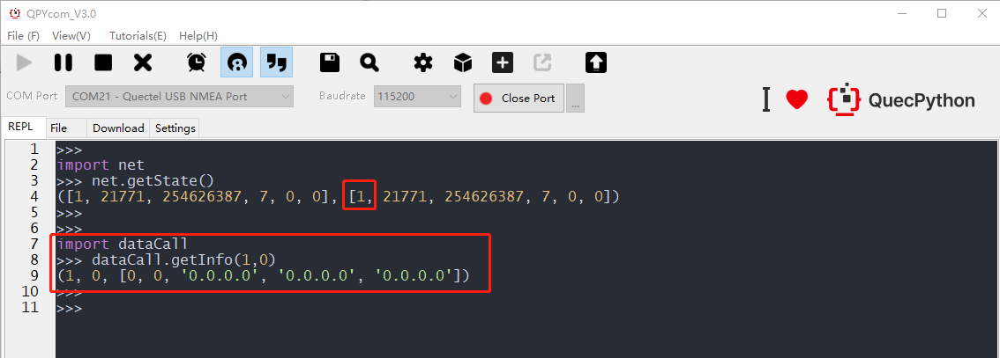

一般这种情况，可能有如下3种原因：

#### 没有配置APN

如果出现这种无线网卡激活失败的情况，用户首先可以去确认是否配置了APN，如果配置了，那配置的APN是否正确。用户可以通过下面的方法来查询确认：

```python
>>> import dataCall
>>> dataCall.getPDPContext(1) # 查询第一路无线网卡的APN配置信息
(0, '', '', '', 0) # 返回值中，APN为空，说明没有配置APN
```

如果上述方法的返回值中，APN为空，或者不是正确的APN，则用户需要使用下面的方法来设置，设置成功后，重启设备。这里假设需要设置的APN为`3gnet`：

```python
>>> dataCall.setPDPContext(1,0,'3gnet','','',0)
0
```

关于APN配置的更详细示例，请参考前面“模组网络注册失败”章节中“没有配置APN”部分的示例。


#### 用户关闭了开机自动激活网卡功能

排除APN配置的原因，用户也可以检查一下，之前是否有使用`dataCall.setAutoActivate`方法把开机自动激活无线网卡功能给关闭了，或者配置成了开机自动激活第2路或者第3路无线网卡。排查方式如下：

步骤1：通过QPYcom工具查看`usr`目录下是否有`datacall_config.json`文件。

如果像下图中所示一样，`usr`目录下存在`datacall_config.json`文件，说明用户配置过QuecPython无线网卡的开机自动激活功能或者自动重连功能。如果不存在该文件，则无需再进行后面的步骤。

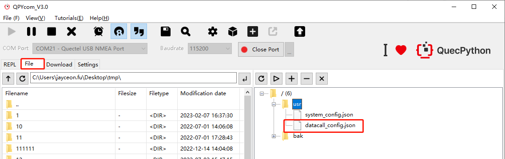

步骤2：打开`datacall_config.json`文件，进一步确认每一路无线网卡的配置情况。

在命令行执行下面的代码：

```python
>>> import ujson
>>> fd = open('/usr/datacall_config.json', 'r')
>>> cfg = ujson.load(fd)
>>> print(cfg)
{'1': {'autoConnect': 0, 'autoActivate': 0}, '3': {'autoConnect': 0, 'autoActivate': 0}, '2': {'autoConnect': 0, 'autoActivate': 0}}
```

我们将上述`cfg`的格式整理一下：

```
{
	'1': {'autoConnect': 0, 'autoActivate': 0}, 
	'2': {'autoConnect': 0, 'autoActivate': 0}, 
	'3': {'autoConnect': 0, 'autoActivate': 0}
}
```

此时，各路无线网卡的配置情况就非常清楚了。如果用户的结果和上述一致，说明用户将开机自动激活无线网卡的功能关闭了。如果用户的结果和上面的情况不一致，用户需要确认3路无线网卡的`autoActivate`配置项的值是什么，因为该值决定了开机是否自动激活无线网卡，为0说明开机时不激活，为1说明开机时需要激活。

步骤3：恢复开机自动激活无线网卡功能。

这里有两种方式可以恢复：

* 方式1：直接删除`usr`目录下的`datacall_config.json`文件，然后重启设备。

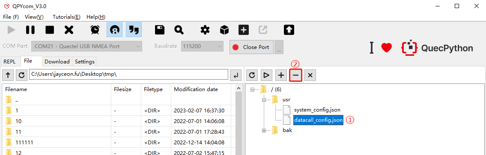

* 方式2：使用`dataCall.setAutoActivate`方法打开某一路无线网卡开机自动激活功能，然后重启设备。

下面以打开第一路无线网卡开机自动激活功能为例：

```python
>>> import dataCall
>>> dataCall.setAutoActivate(1, 1) # 开启第一路无线网卡的开机自动激活功能
>>> dataCall.setAutoConnect(1, 1) # 开启第一路无线网卡的自动重连功能
```

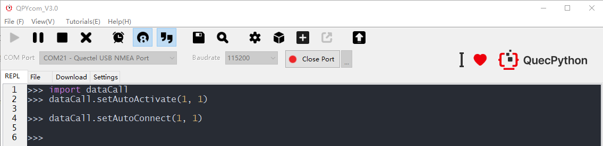


#### 等待时间不足

还有一种情况，也会导致模组网络注册成功了，但是没有获取到IP信息的情况。即模组网络注册成功，正在进行无线网卡激活的时候，用户使用`dataCall.getInfo`去查询了网卡激活结果，此时也是获取不到IP信息的。这种情况并不是无线网卡激活失败，需要用户多等一段时间。

我们建议用户使用QuecPython的`checkNet`模块来等待网络就绪，可以将超时时间设置的长一点。可以避免这种情况。下面是一个简单的使用示例：

```python
import checkNet


def main():
    stage, state = checkNet.waitNetworkReady(30)
    if stage == 3 and state == 1:
        print('Network connected successfully.')
        # do something
    else:
        print('Network connected failed, stage={}, state={}'.format(stage, state))


if __name__ == '__main__':
    main()
```


## 设备运行过程中网络异常处理

蜂窝无线网卡激活成功后，用户的应用程序还需要关注一件事——设备与网络的连接状态。这是因为在设备运行过程中，可能会因为一些异常原因（如网络异常、环境干扰、信号差等）导致模组与网络的连接断开。如果用户应用程序没有关注这种网络事件，很可能导致用户应用程序中和网络相关的业务执行异常，导致出现无法预料的问题。

QuecPython提供了网络事件监听功能，用户应用程序可以通过注册回调函数的方式来监听网络状态变化事件。当设备与无线网络的连接状态发生变化时，系统就会自动将对应的事件通过用户注册的回调函数，推送给用户的应用程序。

注册网络监听回调函数的方法如下：

```python
dataCall.setCallback(fun)
```

回调函数的示例如下：

```python
def netCallback(args):
    profileID = args[0]
    netState = args[1]
    if netState == 0:
        print('### network {} disconnected.'.format(profileID))
    elif netState == 1:
        print('### network {} connected.'.format(profileID))
```

该回调函数的参数是一个元组，包含3个元素，目前用户只需要关注前两个元素即可。前两个参数说明如下：

| 参数    | 类型 | 说明                                                         |
| ------- | ---- | ------------------------------------------------------------ |
| args[0] | 整型 | 蜂窝无线网卡编号，表示当前是哪一路无线网卡的网络连接状态发生了变化。 |
| args[1] | 整型 | 网络状态，0表示网络连接断开，1表示网络连接成功。             |

我们建议用户注册该回调函数，用于监听网络连接状态，确保当网络连接状态发生变化时，用户应用程序可以根据网络状态变化进行及时的处理。通常，我们可以参考下面的方式来处理：

* 回调函数中收到网络连接状态发生变化的事件后，通过消息队列功能将网络事件发送给其他线程去处理。当然，用户也可以使用QuecPython的`sys_bus`功能来代替消息队列。

* 其他线程在收到网络事件时，判断如果是网络连接断开事件，则停止socket、mqtt等这类和网络相关的业务。同时，该线程也可以选择启动一个定时器，比如先将定时器时间设定为60s。如果60s后，网络还没有恢复，则执行CFUN0/1切换，然后看网络是否可以恢复。

  

> **什么是CFUN0/1切换？**
>
> 通过《蜂窝网络基础概念》章节中关于CFUN的说明，可以知道，CFUN指的是移动终端的功能模式。CFUN0/1切换是指通过`net.setModemFun(0)`方法先将设备切换到模式0（最小功能模式），然后再通过`net.setModemFun(1)`方法将设备切换到模式1（全功能模式）。当切换到模式0，设备的整个射频网络协议栈全部关闭，SIM卡模块停止供电；再次切换到模式1时，会重新恢复对SIM卡的供电并重新进行初始化，同时与射频相关的软硬件功能都会重新开启，此时设备会重新发起网络注册流程。
>
> **为什么要进行CFUN0/1切换？**
>
> QuecPython具有自动重连功能，如果发生网络异常导致设备与网络的连接断开，异常消失后，不是应该自动恢复吗？为什么上面提到的处理方式中，还要进行CFUN0/1的切换？
>
> 我们需要搞清楚，QuecPython的自动重连功能指的是在网络异常恢复后，模组自动重新激活无线网卡，而不是重新注册到网络。设备的网络注册行为是由系统的射频网络协议栈自动控制的，理论上在网络异常因素消失后，射频网络协议栈会自动重新发起网络注册。但是不排除因为一些原因，导致设备没有及时重新进行网络注册的情况。这时因为设备网络注册尚未成功，无线网卡也无法重新激活。因此，我们主动进行了CFUN0/1的切换操作。其实就像是我们平时使用手机时，有时候遇到网络差或者没信号的时候，我们会选择先关闭手机的移动网络，然后再重新打开是一样的道理。当然，用户也可以选择进行重启。


关于这种场景下的示例，请参考下面的章节。


## 网络异常事件处理示例

下面提供一个模组在运行中出现网络异常的处理代码，提供给用户参考，用户也可按照自己的方案进行处理。

```python
import net
import dataCall
import _thread
import osTimer
import utime
import sys_bus


CFUN_SWITCH_TOPIC = 'cfun_switch_timer'
NETWORK_EVENT_TOPIC = 'network_event'

network_monitor = None

class NetworkConnectState:
    DISCONNECT = 0
    CONNECT = 1


class NetworkExceptionService:
    def __init__(self):
        self.timer_period = 1000 * 60 * 2  # 2 * 60s
        self.__cfun_timer = osTimer()

        sys_bus.subscribe(CFUN_SWITCH_TOPIC, self.__cfun_switch_timer_handle)
        sys_bus.subscribe(NETWORK_EVENT_TOPIC, self.__network_event_handle)

    def enable(self):
        dataCall.setCallback(self.__network_event_callback)

    def __cfun_switch_timer_callback(self, args):
        print('cfun switch timer.')
        sys_bus.publish(CFUN_SWITCH_TOPIC, 0)

    def __cfun_switch_timer_handle(self, topic, msg):
        print('recv event form cfun_switch_timer.')
        net.setModemFun(0)
        utime.sleep(5)
        net.setModemFun(1)

    def __network_event_callback(self, args):
        print('The state of the network connection has changed.')
        sys_bus.publish(NETWORK_EVENT_TOPIC, args)

    def __network_event_handle(self, topic, msg):
        print('recv event form network_event_callback.')
        profile_id = msg[0]
        conn_state = msg[1]
        if conn_state == NetworkConnectState.DISCONNECT:
            print('The network connection has been disconnected.')
            print('start cfun_switch_timer.')
            self.__cfun_timer.start(self.timer_period, 1, self.__cfun_switch_timer_callback)
        elif conn_state == NetworkConnectState.CONNECT:
            print('The network connection has been connected.')
            self.__cfun_timer.stop()
        else:
            print('unknown state value:{}.'.format(conn_state))


def main():
    global network_monitor
    network_monitor = NetworkExceptionService()
    network_monitor.enable()


if __name__ == '__main__':
    main()
```

上述示例代码下载链接：[示例下载](https://github.com/QuecPython/examples/blob/main/network-comm/nic/cellular/example_network_exception_handle.py)