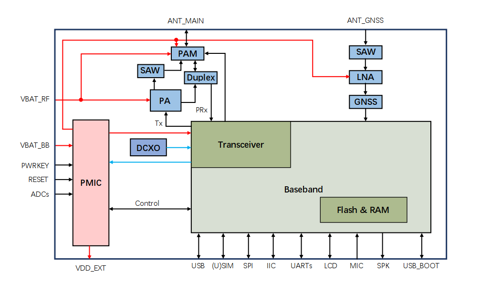
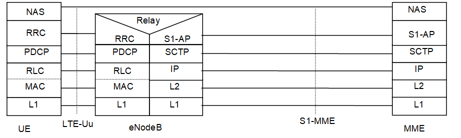
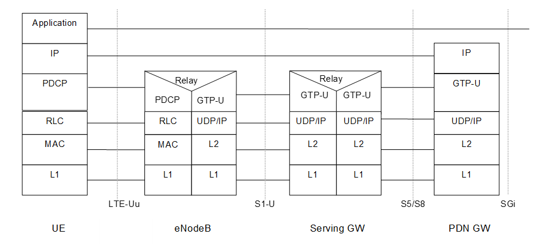
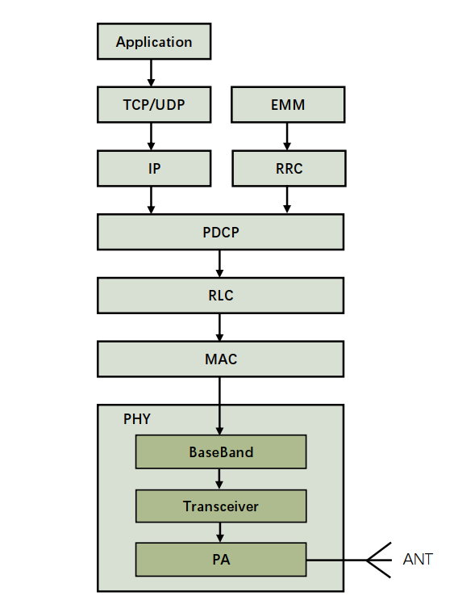
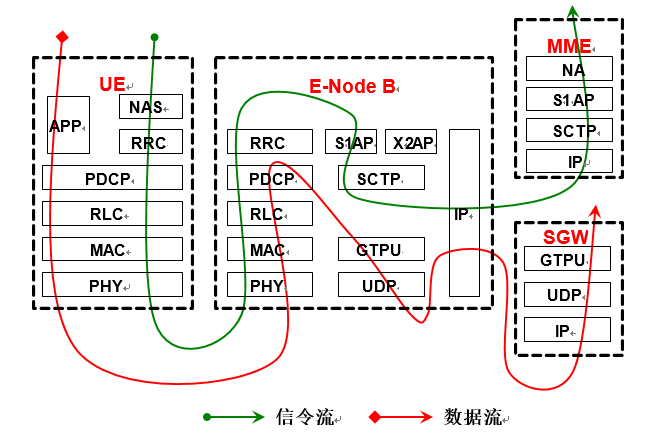

# 蜂窝无线网卡硬件结构与数据流

本文主要讲述模组作为蜂窝无线网卡时的硬件结构和数据流。

## 蜂窝无线网卡硬件结构

模组作为蜂窝无线网卡，其硬件结构主要包括如下几个部分：

* 电源管理
* 基带部分
* 射频部分
* 存储器
* 外围接口

其硬件功能框图主要如下：

> 1. 上图中外围接口仅为示例，不同的模组支持的硬件外设可能不同，具体情况请参考对应模组的硬件设计手册。
>
> 2. GNSS功能是可选的，并非所有的模组都支持，具体情况请参考对应模组的硬件设计手册。

下面主要说明和蜂窝无线网卡有直接关联的几个部分：

* 基带部分

  在无线网卡中，基带部分主要负责对上层网络提供的数据进行编码和解码处理，将数字数据转换成可以在物理介质（例如电磁波）上传输的信号，或者将从物理介质上接收到的信号转换成数字数据。此外，基带处理还包括其他一些功能，例如射频信号的调制和解调等。

* 射频部分

  射频部分主要负责将基带处理部分生成的电信号转换成高频电磁波（射频信号），并通过天线发送出去。同时，它也负责接收天线接收到的射频信号，并将其转换成电信号，然后交给基带部分进行处理。射频部分的主要任务就是射频信号的发射和接收。

* PA

  PA是指功率放大器（Power Amplifier）。主要用于增加发射信号的功率，以确保射频信号能够覆盖足够的距离，并改善信号质量。

## 蜂窝无线网卡数据流

在介绍蜂窝无线网卡数据流之前，我们先来简单了解一下移动无线网络的分层结构。了解了无线网络分层结构后，可以帮助我们进一步理解蜂窝无线网卡数据流向的知识。

下面以LTE为例来说明无线网络分层结构。LTE核心网接口协议分为控制面（Control Plane，简称C-Plane）和用户面（User Plane，简称U-Plane）。

* 控制面：控制面主要负责信令的传输，包括控制信息的传递和网络管理。控制面通信涉及的信息包括呼叫设置、路由选择、网络连接管理、鉴权、位置更新、移动性管理等。通过控制面，网络可以对用户设备进行有效的控制和管理。

* 用户面：用户面主要负责用户的数据传输。比如所有的语音、视频、文本或其他形式的数据都是通过用户面进行传输的。用户面的主要任务是有效地传输用户数据，并确保数据的完整性和可靠性。

在实际的网络通信中，控制面和用户面的通信通常是同时进行的。例如，当用户使用手机打电话时，控制面将管理呼叫设置和路由选择，而用户面则负责传输用户的语音数据。

### 控制面协议栈

下图是LTE网络架构中，控制面的协议栈分层结构示意。

由于控制面对用户来说是无感的，并且也不是由用户来直接控制，这里不再详述。如果用户想了解更详细的情况，可以参考[3GPP TS 23401](https://www.3gpp.org/ftp/Specs/archive/23_series/23.401)协议文档的Control Plane章节。

### 用户面协议栈

下图是LTE网络架构中，用户面的协议栈分层结构示意。该图详细的说明了，用户应用程序是如何与蜂窝无线网络实现数据通信。图中的UE表示用户的终端设备（比如手机），而最右边经过PDN GW后，为互联网中的应用服务器。

应用层只存在于终端设备和应用服务器中，是基于IP传输的。用户数据先经过蜂窝无线网卡的层层处理，然后通过无线接口发送到基站，再通过核心网的网关进行路由，最终达到目的地。

通过控制面和用户面的协议栈分层结构图可以看出，它们都包含了如下几个功能：

* PDCP（Packet Data Convergence Protocol，分组数据汇聚协议）层：主要作用是实现头压缩，并且实现加密和完整性保护。

* RLC（Radio  Link Control，无线链路控制）层：提供可靠的数据传输，实现数据分段和自动重传请求机制。

* MAC（Medium Access Control，媒体介入控制）层：负责数据调度和快速重传。

* L1层：在无线通信系统中，L1层通常是指物理层（PHY）。物理层的主要作用是进行信道编码和调制，并将数据发送到无线接口。

### 数据流

上述主要是对蜂窝无线网络的分层结构进行一个简要描述。那么用户的数据具体是怎样一步步到达核心网以及互联网的呢？我们可以通过下面两个图示来理解。

#### 基于硬件结构的数据流

如下是基于蜂窝无线网卡硬件结构的数据流向图。基于该图，可以看到，用户数据在软件上先依次经过TCP/UPD层、IP层、PDCP层、RLC层、MAC层，最终达到物理层（即蜂窝无线网卡）。当数据到达基带部分，会被编码调制，并经过射频部分处理转换为电磁波这种模拟信号，最后再经过功率放大器处理后，通过射频天线发送出去，到达基站。再结合基于蜂窝无线网络分层结构的数据流向图，数据如何从UE达到目的地的过程就很明确了。

#### 基于分层结构的数据流

下面是基于蜂窝无线网络分层结构的数据和信令流程示意。

