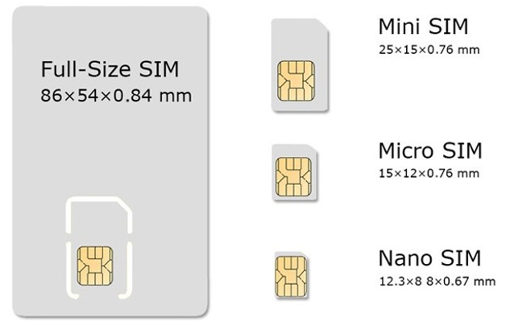
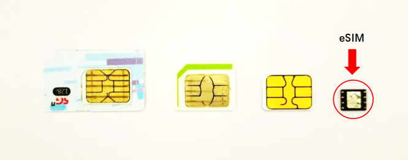

# 概述

本文主要介绍SIM卡相关的一些概念和基础知识，旨在帮助用户对SIM卡有一个基本的认知和了解。

## SIM卡定义

SIM（Subscriber Identity Module）卡，全称用户识别模块，也称为用户身份识别卡。在全球移动通信系统中，广泛应用于移动设备。主要用于存储与移动用户相关的信息，并使移动设备能与网络或者其他移动设备进行通信。

## SIM卡的作用

SIM卡的作用主要如下：

* 用户身份验证：SIM卡内嵌有一个国际移动用户识别码（IMSI），它可以唯一地标识移动通信网络的每一个用户。移动网络通过对SIM卡的IMSI进行验证，确认用户的身份，并授予其使用网络的权利。

* 存储信息：SIM卡可以存储多种信息，包括电话簿、短消息以及用户的个人设置等。

* 移动性：用户可以将SIM卡插入任何一个与其网络提供商兼容的移动设备中，实现在不同设备间自由切换的功能。

* 安全性：SIM卡有防止复制和窃听的功能。SIM卡上存储的数据都是经过加密的，只有通过特定的密钥才能访问。

## SIM卡的分类

SIM卡种类很多，根据外形尺寸、用途不同可以分为多种类型。下面列出常见的几种SIM卡。

### 卡片式SIM卡

根据尺寸不同，SIM卡可以分为标准SIM卡（也叫Mini SIM卡）、Micro SIM卡、Nano SIM卡。这三种SIM卡的功能是一样的，只是尺寸不同。具体差异如下图所示：

### eSIM

eSIM（Embedded SIM），即嵌入式SIM卡，是一种相对于传统SIM卡的新技术，其信息可以远程编程，无需物理更换即可更换运营商。这种SIM卡技术，将SIM卡信息打包成一个独立的文件，称之为profile，将profile文件下载到eSIM中即可成为一张完整可用的SIM卡。因此，eSIM更换运营商非常方便，只需要下载不同运营商的profile到eSIM中即可，无需物理更换。

通常eSIM都是上图中的芯片样式，也有一些eSIM依然采用插拔式的SIM卡形式，外形上和卡片式SIM卡没有区别。

### vSIM

vSIM，全称为Virtual SIM，即虚拟SIM卡。它的核心思想是把物理SIM卡转换为软件形式，存储在云端，并能实现在云端管理和分发SIM卡的配置文件。在使用时，SIM卡的配置文件通过网络被下载到设备中，并在设备上进行认证和激活。相当于在eSIM的基础上，完全摒弃了SIM卡profile文件的物理存储介质。

相比较于传统SIM卡和eSIM，vSIM的灵活性和便利性要更好，并且对运营商和制造商来说，还节省了制作SIM卡物理存储介质的成本，以及PCB上放置SIM卡的空间，有利于进一步缩小集成电路板的尺寸。

需要注意的是，vSIM的使用需要运营商和设备制造商的支持，同时还需要一定的网络条件。虽然vSIM有很多优点，但是它也有一些潜在的问题，比如用户的隐私保护问题和网络安全问题等。目前应用最广泛的依然是卡片式SIM卡和eSIM。

## 支持的SIM卡类型

QuecPython所有模组都支持卡片式SIM卡，部分平台的模组支持eSIM，但是需要定制版本才能支持，QuecPython不支持vSIM。目前，支持定制eSIM的平台如下：

| 支持定制eSIM的模组型号          |
| ------------------------------- |
| EC200U/EC600U/EG912U/EG915U系列 |
| EC200A系列                      |
| BG95M1/BG95M3/BG95M8            |

