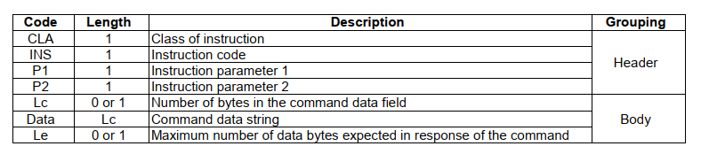
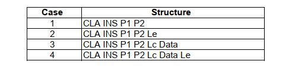
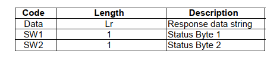

# APDU

本文主要介绍APDU的定义、作用和数据结构。

## 什么是APDU

APDU（Application Protocol Data Unit），全称应用协议数据单元，是用于在智能卡和设备之间传输命令和响应的基本信息单元。

APDU最初是由ISO 7816标准协议定义的，后续又被ETSI的SIM卡技术规范以及3GPP协议引用并进行了扩展。


## APDU的作用

APDU主要起到信息传递的作用。它为设备和SIM卡之间的交互提供了一种标准化的通信方式。通过APDU，设备可以向SIM卡发送命令，SIM卡也可以将执行结果返回给设备。


## APDU的格式

在ISO7816协议中，APDU主要分为两种：

* 命令APDU（Command APDU，简称C-APDU）

* 响应APDU（Response APDU，简称 R-APDU）

它们分别有不同的数据结构。

### 命令APDU

命令APDU由标头（command header）和主体（command body）两个部分组成。


命令的标头是必须的字段，包含下面几个字段：

* CLA：占1个字节，用于指示APDU的类别或者组，通常表明命令的一些基本属性。

* INS：占1个字节，用于指示具体的指令或者操作，例如读取数据或者更新数据。

* P1和P2：P1和P2各占1个字节，用于给指令提供更具体的参数，例如要操作对象的地址或者其他特定信息。如果没有需要携带的参数，则P1和P2设置为`00`。

命令的主体是可选字段，包含下面3个部分：

* Lc：占1个字节，如果命令APDU包含数据字段，那么这个字段用于指示数据字段的长度。

* 数据字段：这个字段的长度由Lc决定，包含了命令所需的具体数据。

* Le：占1个字节，这个字段用于指示预期响应数据的长度，如果没有这个字段，那么响应APDU的数据字段可以是任意长度。

在ETSI协议文档中，描述如下：



由于命令主体部分的字段都是可选的，所以按照ETSI协议文档的规定，命令APDU可以有如下4种结构：



在ETSI协议文档中，命令APDU的字节编码规定如下：

| COMMAND               | CLA                  | INS        |
| --------------------- | -------------------- | ---------- |
| SELECT FILE           | '0X' or '4X' or '6X' | 'A4'       |
| STATUS                | '8X' or 'CX' or 'EX' | 'F2'       |
| READ BINARY           | '0X' or '4X' or '6X' | 'B0'       |
| UPDATE BINARY         | '0X' or '4X' or '6X' | 'D6'       |
| READ RECORD           | '0X' or '4X' or '6X' | 'B2'       |
| UPDATE RECORD         | '0X' or '4X' or '6X' | 'DC'       |
| SEARCH RECORD         | '0X' or '4X' or '6X' | 'A2'       |
| INCREASE              | '8X' or 'CX' or 'EX' | '32'       |
| RETRIEVE DATA         | '8X' or 'CX' or 'EX' | 'CB'       |
| SET DATA              | '8X' or 'CX' or 'EX' | 'DB'       |
| VERIFY PIN            | '0X' or '4X' or '6X' | '20'       |
| CHANGE PIN            | '0X' or '4X' or '6X' | '24'       |
| DISABLE PIN           | '0X' or '4X' or '6X' | '26'       |
| ENABLE PIN            | '0X' or '4X' or '6X' | '28'       |
| UNBLOCK PIN           | '0X' or '4X' or '6X' | '2C'       |
| DEACTIVATE FILE       | '0X' or '4X' or '6X' | '04'       |
| ACTIVATE FILE         | '0X' or '4X' or '6X' | '44'       |
| AUTHENTICATE          | '0X' or '4X' or '6X' | '88', '89' |
| GET CHALLENGE         | '0X' or '4X' or '6X' | '84'       |
| TERMINAL CAPABILITY   | '8X' or 'CX' or 'EX' | 'AA'       |
| TERMINAL PROFILE      | '80'                 | '10'       |
| ENVELOPE              | '80'                 | 'C2'       |
| FETCH                 | '80'                 | '12'       |
| TERMINAL RESPONSE     | '80'                 | '14'       |
| MANAGE CHANNEL        | '0X' or '4X' or '6X' | '70'       |
| MANAGE SECURE CHANNEL | '0X' or '4X' or '6X' | '73'       |
| TRANSACT DATA         | '0X' or '4X' or '6X' | '75'       |
| SUSPEND UICC          | '80'                 | '76'       |
| GET IDENTITY          | '8X' or 'CX' or 'EX' | '78'       |
| EXCHANGE CAPABILITIES | '80'                 | '7A'       |
| MANAGE LSI            | '80'                 | '7C'       |
| GET RESPONSE          | '0X' or '4X' or '6X' | 'C0'       |


### 响应APDU

响应APDU是智能卡在接收并处理完命令APDU（C-APDU）后，返回给接口设备（如读卡器或手机）的数据结构。响应APDU由数据字段和状态字段两个部分组成，其数据结构如下所示：


数据字段是可选的，这部分包含了命令执行的结果数据，例如读取文件操作，那么该字段包含的就是读取的文件内容。数据字段的长度是可变的。在C-APDU中，有一个可选的字段叫做Le，用来指定预期的响应数据长度。如果C-APDU没有包含Le字段，那么R-APDU的数据字段可以是任意长度。当然，实际的数据长度还取决于命令的类型和执行结果。比如，如果C-APDU是一个读文件的命令，那么R-APDU的数据字段会包含读取到的文件数据，长度取决于文件的大小以及Le字段的值。如果文件的大小超过了Le字段的值，那么只返回前Le字节的数据。如果文件的大小小于Le字段的值，那么返回整个文件的数据。

状态字段是必须有的部分。它包含了两个字节，分别为SW1和SW2，表示C-APDU执行的结果状态。

在ETSI协议文档中，关于响应APDU的描述如下：



下面仅列出一些常见的响应APDU状态值说明，如用户希望了解更多，请参考ISO 7816标准协议和ETSI TS 102 221协议文档：

| SW1  | SW2  | 说明                                   |
| ---- | ---- | -------------------------------------- |
| '90' | '00' | 命令执行成功                           |
| '93' | '00' | SIM 应用程序工具包正忙。               |
| '62' | '00' | 操作失败，未给出进一步信息             |
| '62' | '81' | 部分返回数据可能已损坏                 |
| '62' | '82' | 文件长度小于Le                         |
| '62' | '83' | 选中的文件无效                         |
| '62' | '85' | 文件标识已经失效                       |
| '63' | '00' | 验证失败，密码无效或禁止值             |
| '65' | '81' | 存储器故障，无法执行命令               |
| '67' | '00' | 长度错误                               |
| '68' | '81' | 不支持的逻辑通道                       |
| '68' | '82' | 不支持安全消息传递                     |
| '69' | '81' | 命令与文件结构不兼容（文件类型不匹配） |
| '69' | '82' | 安全状态不满足                         |
| '69' | '83' | 认证/PIN方法被锁定                     |
| '69' | '84' | 引用数据无效                           |
| '69' | '85' | 不满足使用条件                         |
| '6A' | '80' | 数据段参数错误                         |
| '6A' | '81' | 不支持的功能                           |
| '6A' | '82' | 找不到文件                             |
| '6A' | '83' | 找不到记录                             |
| '6A' | '84' | 内存空间不足                           |
| '6A' | '86' | P1-P2参数错误                          |
| '6A' | '88' | 未找到引用的数据                       |

## 应用示例

以下用例请参考ETSI TS 102 221，ETSI TS 151 011，ISO/IEC  7816-4文档。

用户直接通过APDU读取SIM卡内的ICCID，IMSI，以下操作适用于eSIM和普通SIM。不建议用户直接操作SIM卡，如操作不当容易引发SIM或eSIM卡异常，进而引起网络异常。

```
一、读取ICCID
# 组包可以参考ISO/IEC 7816文档，3GPP文档。
# 1、选定文件读取ICCID
# CLA		：00　
# SELECT 	：A4
# P1		：08 
# P2		：04
# Lc		：02
# data		：2FE2
# Le		：0A （期望返回的长度）

APDU串：00A40804022FE20A 

# 2、读取文件内容
# CLA		：00　
# READ BINARY 	：B0
# P1		：00 
# P2		：00
# Le		：0A （ICCID 长度） 

APDU串：00B000000A

二、读取IMSI
# 1、选定DF（GSM）文件
# CLA		：00　
# SELECT 	：A4
# P1		：00 
# P2		：00
# Lc		：02
# data		：7F20 （文件标识id）
APDU串：00A4000C027F20

# 2、选定IMSI文件
# 1、选定DF（GSM）文件
# CLA		：00　
# SELECT 	：A4
# P1		：00 
# P2		：04
# Lc		：02
# data		：6F07  （文件标识id）
APDU串：00A40004026F07

# 3、读取IMSI文件
# CLA		：00　
# READ BINARY 	：B0
# P1		：00 
# P2		：00
# Le		：09 （IMSI 长度） 
APDU串：00B0000009

```

对于eSIM卡的数据交互，如profile的安装需要首先打开逻辑通道，才能进行profile安装的操作。以下以打开逻辑通道指令为例，不建议用户直接通过APDU串和eSIM卡交互。

```
# 1、打开逻辑通道
# CLA		：00　
# MANAGE CHANNEL 	：70
# P1		：00 
# P2		：00
# Le		：01 （期望返回数据长度）
APDU串：0070000001

# 发起上述指令后，会收到逻辑通道id以及返回的处理结果
# 2、关闭逻辑通道
# 当业务处理完毕，需要关闭逻辑通道
# CLA		：00　
# MANAGE CHANNEL 	：70
# P1		：08
# P2		：01 （第一步返回的逻辑通道ID）
# Le		：00 
APDU串：0070800100

```

