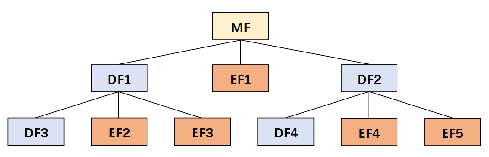
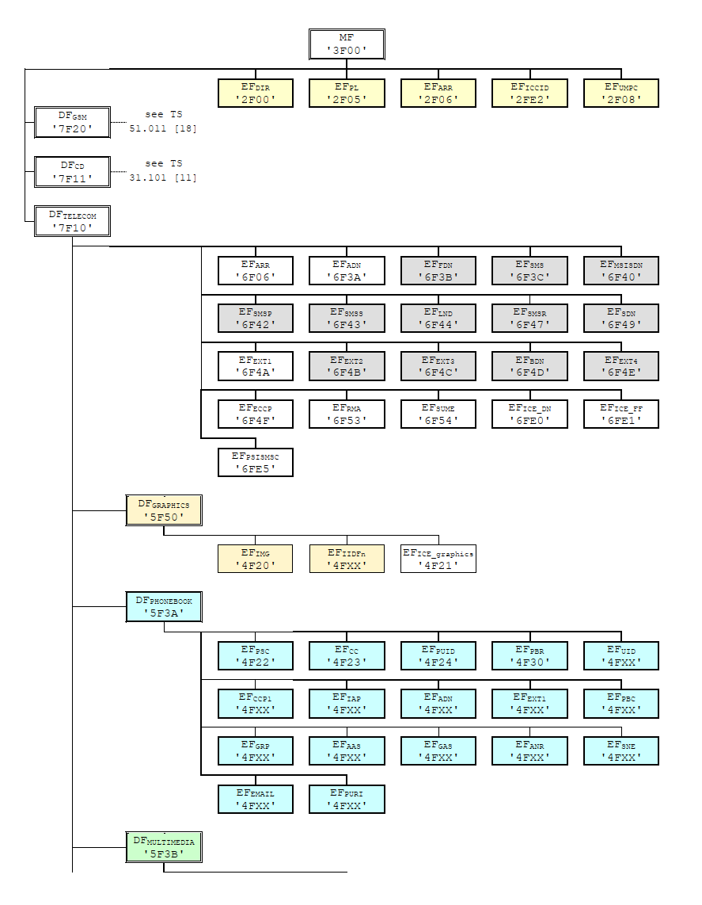

# SIM卡文件系统

SIM卡内部采用了一种类似于计算机中的文件管理系统结构，即一个文件夹下有文件夹也有文件，子文件夹下又可以存放文件夹和文件。通过这种文件系统来存储和组织各种数据信息，包括服务提供商信息、用户身份识别信息、电话簿、短信等各种数据。

## 文件系统结构

关于SIM卡的文件系统的结构大致如下：

可以看出，SIM卡的文件系统是一个树形结构，包含下面三种类型的文件：

* MF（Master File）：这是文件系统的根，一个SIM卡中只有一个MF。它包含了各种DF和EF。

* DF（Dedicated File）：这是文件系统的下一级，可以看作是文件夹，每个DF下都包含了一组相关的EF。例如，有一个DF是用来存储电话簿的，它包含了存储各个电话记录的EF。常见的DF有DF-GSM、DF-TELECOM以及ADF。

* EF（Elementary File）：EF是基本文件，直接用于存储数据。每个EF有一个特定的格式和长度，用来存储特定的数据。例如，有一个EF是用来存储IMSI（国际移动用户识别码）的，只有在选择了这个EF后，设备才能读取IMSI。

在SIM卡文件系统中，所有文件（包括文件夹）都有一个ID，这个ID是一个两字节的十六进制数。文件ID用于设备发送SELECT命令选择文件时的参数。如果需要定位到某一个具体文件，则需要确定MFID、DFID和EFID。这几个ID确定后，相当于确定了某个文件的绝对路径。

我们以USIM为例，参考3GPP TS 31.102协议文档，可以看到，USIM文件系统内容定义如下：

通过上图可以看到，每一个文件都有一个ID，文件ID的唯一性取决于其在文件系统树中的位置。同一个父文件（即DF或MF）下的所有直接子文件（即DF或EF）的文件ID都是唯一的，不能重复。也就是说，同一个DF下不能有两个文件ID相同的文件。在不同的DF下，可以有文件ID相同的文件。因此，为了唯一确定一个文件，需要指定从MF开始，通过哪些DF可以到达这个文件，这就形成了一条路径，这条路径加上文件的ID，就可以唯一确定一个文件。

## 文件操作指令

ISO 7816标准和3GPP协议定义了一系列用于操作SIM卡文件系统的命令。这些命令用于选择、读取、写入或更新SIM卡内部的文件。下面是一些常用的命令：

| 命令          | CLA  | INS  | 说明                                     |
| ------------- | ---- | ---- | ---------------------------------------- |
| SELECT        | 'A0' | 'A4' | 选择文件                                 |
| READ BINARY   | 'A0' | 'B0' | 读取当前选中的二进制透明EF的内容         |
| UPDATE BINARY | 'A0' | 'D6' | 更新当前选中的二进制透明EF的内容         |
| READ RECORD   | 'A0' | 'B2' | 读取当前选中的线性固定EF或者循环EF的内容 |
| UPDATE RECORD | 'A0' | 'DC' | 更新当前选中的线性固定EF或者循环EF的内容 |
| STATUS        | 'A0' | 'F2' | 获取当前选中的文件的信息                 |
| GET RESPONSE  | 'A0' | 'C0' | 获取命令执行的响应数据                   |

上述表格中的`CLA`表示类别代码，`INS`表示指令代码，这部分内容将在下一个章节关于APDU的文档中进行说明。

## 文件操作指令响应

执行SIM卡命令后，SIM卡会返回一个响应APDU，它由两个或更多的字节组成。最后两个字节通常被称为状态字（Status Word，SW1 和 SW2），它们代表命令执行的结果。以下是一些文件操作常见的状态字：

| SW1  | SW2  | 说明                                   |
| ---- | ---- | -------------------------------------- |
| '90' | '00' | 命令执行成功                           |
| '6A' | '82' | 找不到文件                             |
| '69' | '81' | 命令与文件结构不兼容（文件类型不匹配） |
| '62' | '83' | 选择的文件无效                         |
| '6A' | '86' | P1-P2参数错误                          |

### 应用场景

* 在初始化SIM卡进行注网时需要先读取SIM卡中的一些鉴权数据以及SIM卡的唯一标识，以及PLMN黑名单记录如EFFPLMN均可从SIM文件系统中读取。

* 在存储短信时，可以选择存入SIM卡中，而SIM卡中存储的短信消息将会存储在SIM卡文件系统之中。
* 当SIM卡短信占用空间已满，也可从SIM卡文件系统中删除短信数据。