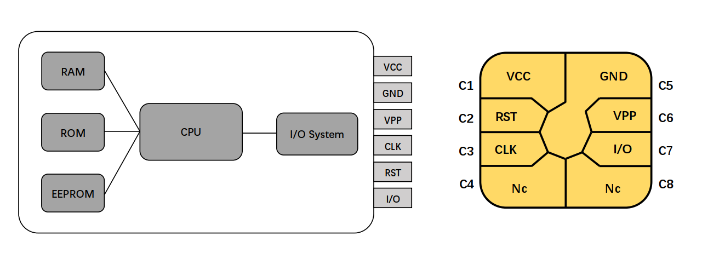

# 硬件结构

本文主要介绍SIM卡的硬件结构、使用的通信协议和通信方式。

## 硬件结构

SIM卡实际是装有微处理器的芯片卡，它的是根据ISO 7816标准来设计的，其内部按功能模块划分，可以分为5个部分：

* 微处理器CPU

  这是SIM卡的核心部分，负责处理所有的计算和逻辑操作，比如执行加密算法、处理输入/输出数据等。

* 程序存储器ROM

  存储SIM卡的固定信息，比如操作系统和预装的应用程序。这些信息一旦写入，就不能再改变。

* 工作存储器RAM

  在程序执行复杂计算或者任务处理时，存储一些临时数据。

* 数据存储器EEPROM

  数据存储区，可以被多次读写的存储空间，用于存储电话簿、短信、用户身份认证密钥等可变的信息。我们经常可以在SIM卡上看到标注了“xxxk”，表示的就是这个存储区的大小。比如128K，表示的就是EEPROM存储区大小为128K。

* 串行通信单元

  SIM卡与ME进行通信的唯一通道，支持半双工串行通信模式。

其硬件架构大致如下：

## SIM卡电器管脚

SIM卡的触点分配，遵循ISO 7816-2协议的规定，具体如下：

| 触点号 | 说明     | 触点号 | 说明      |
| ------ | -------- | ------ | --------- |
| C1     | 电源电压 | C5     | 地        |
| C2     | 复位     | C6     | 编程电压  |
| C3     | 时钟     | C7     | 输入/输出 |
| C4     | 保留     | C8     | 保留      |

一般SIM卡都会有8个触点，使用过程中，至少保证有5个触点与设备是连接状态才能保证SIM卡正常工作，这5个触点是：VCC、GND、RST、CLK和I/O。

* C1触点：电源电压触点（VCC），有1.2v/1.8V/3V/5V几种规格。5V供电的SIM卡已经很少使用，现在主要是1.8V和3V供电的SIM卡。
* C2触点：复位信号触点（RST）。
* C3触点：时钟信号触点（CLK），频率在1~5MHz，由终端设备提供，CLK应维持在复位应答期间所用频率的正负10%之内。
* C4触点：保留。
* C5触点：接地端触点（GND）。
* C6触点：编程电压触点（VPP），在5V供电的SIM卡中可用作供电引脚，在1.8V和3V的SIM卡中，该引脚通常悬空。
* C7触点：数据触点（I/O），是SIM卡和终端设备之间的唯一通信通道，支持半双工串行通信，有发送和接收两种状态。
* C8触点：保留。

## SIM卡与设备的通信

SIM卡和设备之间的通信不仅遵循ISO 7816标准，还涉及到STK（SIM Application Toolkit）协议。eSIM通过APDUM实现，其遵信ISO 7816标准。

### STK协议

STK全称为SIM Application Toolkit，中文译为SIM卡应用工具包，是GSM协会定义的一种标准，用于开发和部署在SIM卡上运行的应用。

STK协议定义了一套指令集，允许SIM卡和手机之间进行交互。通过STK，SIM卡可以向手机发送命令，让手机执行一些操作，如显示菜单、发送短信、启动一个电话等。

APDU全称为Application Protocol Data Unit，中文译为应用协议数据单元。 通过APDU指令，可以完成对eSIM数据的读取、删除、添加、更新、逻辑通道的管理、终端能力的上报等功能。

### 通信方式

SIM卡和设备之间的通信，是由SIM卡的操作系统和设备的操作系统之间通过APDU传递特定的命令与数据来实现，这些命令和数据是按照ISO 7816标准和STK协议等规范来定义的。

ISO 7816-3定义了电信号和传输协议，确保数据可以安全、可靠地在SIM卡和设备之间进行传输。

ISO 7816-4定义了命令和数据结构，描述了如何通过命令来操作SIM卡，如读取数据、写入数据、验证密码等。

STK协议基于ISO 7816-3和ISO 7816-4标准，增加了一些专门针对SIM卡和手机交互的指令。这些指令在SIM卡和手机设备之间传递，允许SIM卡进行复杂的操作和交互。

本文中不再详述ISO 7816标准中规定的具体命令与数据结构，将在后续《APDU》章节对命令以及数据结构进行说明。用户也可自行参考ISO 7816标准文件、STK协议以及ESTI标准中关于SIM卡的规范文档进行详细的了解。

