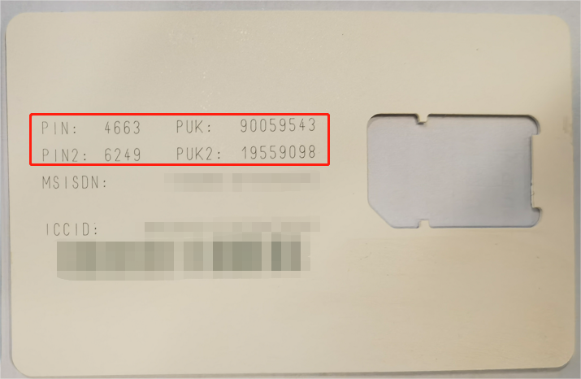

# 专业术语说明

本文主要介绍一些和SIM卡相关的专业名词。

## IMSI

IMSI，全称为International Mobile Subscriber Identity，即国际移动用户识别码，用于在全球范围内唯一标识移动网订阅者，是移动网络核心的识别参数。

IMSI最大长度为15位数字，由3个部分组成：MCC（3位数字）+MNC（2位数字）+MSIN，这3个部分说明如下：

* MCC：表示移动国家码。

* MNC：表示移动网络码。

* MSIN：表示移动用户识别码。

IMSI是按规范分配和管理，不支持私人设置。IMSI有一个非常重要的功能，即设备在进行网络注册时，需要将SIM卡的IMSI给到运营商基站，运营商网络需要通过IMSI来验证移动用户的身份和服务资格。

## ICCID

ICCID全称为Integrated Circuit Card Identifier，即集成电路卡标识符，是国际电信联盟（ITU）制定的一种唯一识别SIM卡的方式。相当于是SIM卡的身份证。ICCID是预先在SIM卡生产时写入的，且不能被改变。

ICCID通常由19到20个数字字符组成，由如下3个部分组成：

* 发行者标识号（Issuer Identification Number，简称IIN）：它是ICCID的前6位，包含了行业标识符、发行国家码和发卡机构识别码。

* 个人账号识别码：这一部分用于表示个人账户，长度取决于发卡的机构。

* 校验码：这是ICCID的最后一位，用于根据Luhn算法校验ICCID其他部分是否有误。

## PIN/PIN2

PIN和PIN2是与SIM卡安全有关的概念，它们的主要作用是对SIM卡进行保护。

**PIN（Personal Identification Number）**：个人识别码。这是一个由4到8位数字组成的密码，用于保护SIM卡数据的安全。如果用户启用了SIM卡的PIN验证功能，则在使用SIM卡时，需要输入PIN来解锁SIM卡。如果连续几次（通常是3次）输入错误的PIN，SIM卡将会被锁定，需要使用PUK来解锁。

**PIN2**：表示第二个个人识别码，用于保护更高级别或更敏感的功能，在尝试访问或更改这些特殊功能时，需要输入PIN2。例如固定拨号（FDN）等。需要注意的是，并非所有的SIM卡都支持PIN2功能。

## PUK/PUK2

PUK和PUK2是与SIM卡安全有关的概念，它们的主要作用是对SIM卡进行解锁。

**PUK（Personal Unblocking Key）**：个人解锁键。这是一个由8位数字组成的码，用于在多次连续输入错误的PIN导致SIM卡被锁后解锁SIM卡。如果用户连续多次输入错误的PUK（通常是10次），SIM卡将会被永久地锁定，无法再次使用。

**PUK2**：这是第二个个人解锁键，与PUK类似，但用于在多次连续输入错误的PIN2导致SIM卡被锁后解锁SIM卡。同样，连续输入错误的PUK2（通常是10次），将会导致SIM卡被永久锁定。需要注意的是，并非所有的SIM卡都支持PIN2功能。

PIN/PIN2/PUK/PUK2一般都会在SIM卡的卡托上直接标注，如果用户需要知道所使用的SIM卡的这些信息，可以查看SIM卡的卡托。如果卡托上没有标注，或者卡托遗失，则需要联系运营商进行确认。

## Ki

Ki是存储在SIM卡中的一个非常重要的认证密钥。在手机与移动网络之间进行通信时，Ki起着至关重要的作用，因为它用于在网络上验证SIM卡的有效性，以保护用户的通信安全。

每个SIM卡都有一个唯一的Ki，这个密钥在生产SIM卡时就被写入，并且存储在SIM卡的安全芯片中，外部不可读取和修改。同时，网络运营商的数据库中也存储了与该SIM卡匹配的Ki。

当手机尝试连接到移动网络时，网络运营商会发送一个随机数（RAND）给手机。手机中的SIM卡会使用Ki和RAND生成一个签名（SRES）。然后，这个签名会被发送回网络运营商。网络运营商也会使用其数据库中的Ki和同样的RAND生成另一个签名。如果这两个签名匹配，那么SIM卡会被认为是有效的，手机就可以连接到网络。这个过程被称为认证过程。

## SIM/USIM

SIM（Subscriber Identity Module） 和 USIM（Universal Subscriber Identity Module） 都是用于身份验证和服务访问的智能卡，但它们在设计、安全性、服务支持等方面存在一些不同。

**SIM卡**：最初用于GSM网络，SIM卡存储了用户的身份信息，包括IMSI（国际移动用户识别码）和Ki（加密密钥）。SIM卡通过使用这些信息与网络进行交互，使用户能够接入网络并进行通话、信息发送等。SIM卡还可以存储一些其他信息，例如联系人和短信。

**USIM卡**：这是一种新型的SIM卡，最初是为3G UMTS网络设计的，现在也用于4G、5G网络。相比SIM卡，USIM卡在安全性、隐私保护、网络访问等方面都有所提升。例如，USIM卡支持AES（高级加密标准）加密，而SIM卡通常只支持相对较弱的COMP128加密。此外，USIM卡还增加了对用户个人设置、电话簿、短信等更多数据的存储和管理能力。USIM卡还引入了一些新的服务和功能，例如，固定电话号码拨打、个人号码服务等。

其实在中国，我们如今在手机上使用的SIM卡，基本都是USIM，只不过我们习惯性都称之为SIM卡。

## MCC/MNC

**MCC（Mobile Country Code）**：移动国家码。由3位数字组成，用于唯一标识SIM卡所在的国家和地区。每个国家或地区都有一个唯一的MCC，这个码是由国际电信联盟（ITU）分配的。例如，中国的MCC是460。

**MNC（Mobile Network Code）**：移动网络码，由2位或3位数字组成，用于唯一标识在特定国家或地区的特定移动网络运营商。例如，中国移动的MNC是00或02，中国联通的MNC是01或06，中国电信的MNC是03或05。

MCC和MNC组合在一起，就可以唯一的识别全球任何一个移动网络运营商。比如46001就代表中国联通。MCC和MNC不仅用于标识移动网络运营商，在移动通信网络中，也用于识别公共陆地移动网络PLMN。PLMN就是由MCC和MNC组合而成。另外，SIM卡的IMSI中也包含了MCC和MNC。

## PLMN

PLMN (Public Land Mobile Network) 是公共陆地移动网络的缩写，由MCC和MNC组合而成，主要用于标识移动网络。PLMN代表的是一个移动运营商的整个网络，包括移动运营商的基站、移动交换中心、存储用户信息的数据库以及核心网等。

SIM卡中存储了归属PLMN（HOME PLMN，简称HPLMN），用于UE进行网络注册时，查找归属网络，即查找这张SIM卡所属运营商的网络。除了HPLMN，其实还有其他多种类型的PLMN，下面列出了一些常见的PLMN类型：

| 名称   | 说明                                                         |
| ------ | ------------------------------------------------------------ |
| RPLMN  | 已登记PLMN，是终端在上次关机或者脱网之前登记保存的PLMN。     |
| HPLMN  | 归属PLMN，USIM的IMSI中包含的MCC、MNC和HPLMN中的MCC、MNC一致。 |
| EHPLMN | 等效归属PLMN，一般指与HPLMN具有相同优先级的其他PLMN。        |
| EPLMN  | 等效PLMN，与终端当前所选择的PLMN处于同等地位的PLMN。         |
| UPLMN  | 用户控制PLMN，是存储在USIM卡上的一个与PLMN选择有关的参数。   |
| OPLMN  | 运营商控制PLMN，是存储在USIM卡上的一个与PLMN选择有关的参数。 |
| FPLMN  | 被禁止接入的PLMN，一般终端在尝试接入某个PLMN时，如果被拒绝，会将其加入到FPLMN列表中。 |
| VPLMN  | 访问PLMN，当终端不在其USIM对应运营商网络覆盖范围内时，终端可能会选择其他运营商的网络，此时接入的就是VPLMN。当然，前提是终端及其USIM是支持漫游功能的。 |

## ISO 7816

ISO 7816是由国际标准化组织（International Organization for Standardization，简称ISO）制定的一套关于智能卡的国际标准。这套标准定义了智能卡的物理特性、电信号、传输协议和命令集等多个方面。

ISO 7816标准包含了多个部分，每个部分都专门描述了一种特定的特性或协议。具体如下：

- ISO 7816-1：定义了智能卡的物理特性，如尺寸、重量、材质等。
- ISO 7816-2：定义了智能卡的接触点的位置和功能。这部分标准对于SIM卡尤其重要，因为它确保了不同厂家生产的SIM卡可以在任何遵守这个标准的手机上使用。
- ISO 7816-3：定义了智能卡的电信号和传输协议。这部分标准确保了数据可以安全、可靠地在智能卡和设备之间进行传输。
- ISO 7816-4：定义了智能卡的命令和数据结构。这部分标准描述了如何通过命令来操作智能卡，如读取数据、写入数据、验证密码等。

在移动通信领域，ISO 7816标准被广泛应用于SIM卡的设计和制造。通过遵守这个标准，SIM卡可以安全、可靠地在全球范围内的移动设备上使用，为用户提供通信、存储和其他服务。

