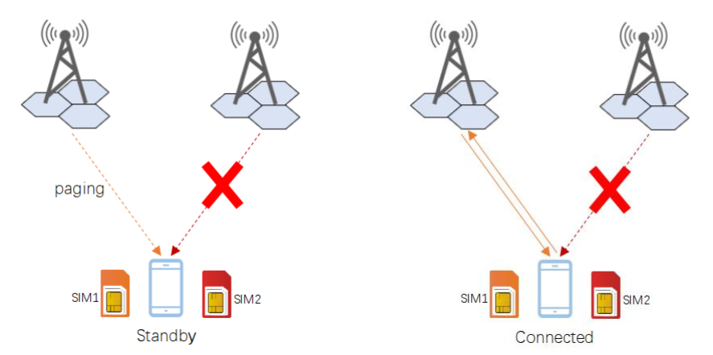
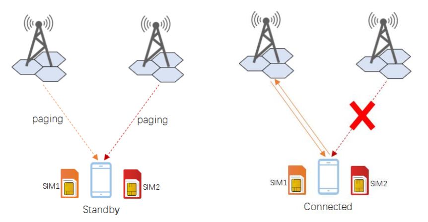
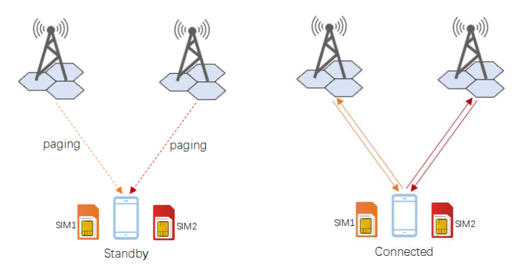

# 双卡功能

双卡功能，指的是设备上安装和使用了两张SIM卡的功能，这两张SIM卡可以来自同一运营商，也可以来自不同的运营商。设备可以选择使用其中一张SIM卡，或者两张同时使用。当然，能否两张SIM卡同时使用，还取决于设备的双卡机制是双卡单待还是双卡双待。

## 待机态与连接态

在介绍双卡功能之前，我们先来简要介绍一下什么是待机态和连接态。

* 待机态（standby）：当UE处于待机态时，UE与网络之间没有活跃的数据连接，也就是说，没有进行通话或者数据传输，但UE需要接收网络的寻呼消息（paging）。

* 连接态（Connected）：在这种状态下，UE有一个或多个活跃的数据连接，也就是说，UE正在进行通话或数据传输。在连接状态下，UE需要频繁地发送和接收信号，以保持数据连接。因此，连接状态下的UE通常会消耗更多的电池能量。

## 双卡单待

双卡单待（Dual SIM Single Standby），指的是UE支持插入两张SIM卡，但是在任意时刻，有且仅有一张SIM卡可以使用射频资源。当SIM卡1在使用射频资源时，无论是处于连接态还是待机态，SIM卡2都无法使用射频资源，对于网络侧而言，SIM卡2是处于关机状态。

## 双卡双待

双卡双待（Dual SIM Dual Standby），指的是UE支持插入两张SIM卡，并且两张SIM卡可以同时处于活跃状态。双卡双待又分为双卡双待单通和双卡双待双通两种模式。

### 双卡双待单通

双卡双待单通是指设备只有一套射频资源，两张SIM卡共享这一套射频资源，当第一张卡进入连接态（通话或者数据业务）时，另一张卡将不能进入连接态，即另一张卡此时无法进行通话或者数据业务。也就是说，虽然两张SIM卡都在待机状态下保持连接（接收寻呼消息），但一次只能有一个活动的连接。这种模式也是目前最普遍的双卡双待模式。

### 双卡双待双通

有的设备拥有两套射频资源，两张SIM卡各自使用一套，互不影响。在这种设备上，两张SIM卡不仅可以同时处于待机状态，甚至可以同时处于连接态，即一张SIM卡处于通话或者数据业务时，另一张SIM卡同样可以进行数据业务，甚至进行通话。这就是双卡双待双通模式。

双卡双待双通模式，虽然功能强大，但是因为同时使用两套射频资源，必然带来更大的功耗，且设备的成本也要高很多。因此这种模式使用的并不多。

## QuecPython双卡支持情况

QuecPython支持的模组，目前仅支持双卡单待模式，具体支持的型号如下：

| 平台         | 模组型号                                                     |
| ------------ | ------------------------------------------------------------ |
| 展锐8910平台 | EG912UGL_AA                                                  |
| ASR1606平台  | EC600MCN_CC/EC600MCN_LA/EC600MCN_LC/EC600MCN_LE/EC600MCN_LF/EC800MCN_LA/EC800MCN_LC/EC800MCN_LE |

