#  SIM卡异常

SIM卡异常主要有下面3种情况，分别是：

## 设备没有检测到SIM卡

我们可以先通过如下方式，查看SIM卡的状态：

步骤1：将终端设备通过USB数据线连接到电脑的USB端口上。

步骤2：在电脑上打开QPYcom工具，打开QuecPython的REPL命令端口，进入到交互模式。

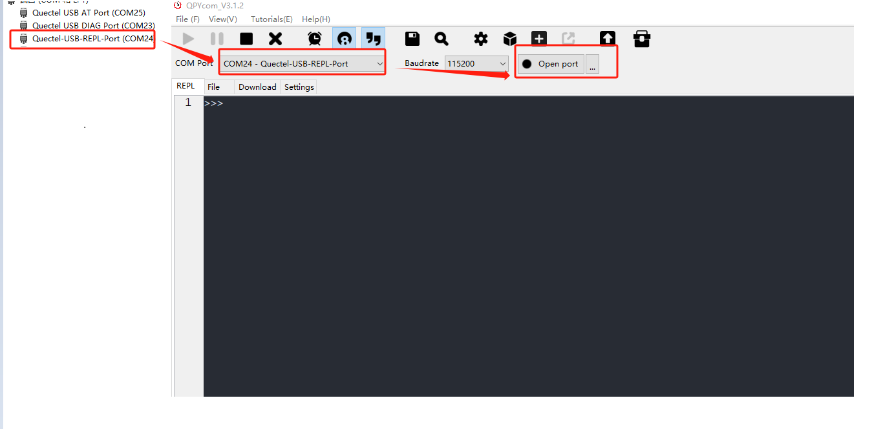

步骤3：在命令交互行，按照如下方式调用API查询注网状态。

```
import sim
sim.getStatus()
```

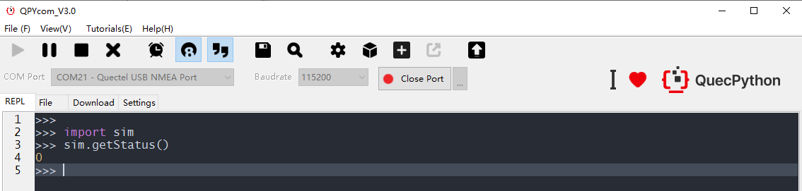

如果`sim.getStatus()`的返回值为0，说明设备没有检测到SIM卡，此时需要确定是否插入了SIM卡。如果用户已经插入SIM卡并且重启设备后，查询状态值还是0，那可能的原因如下：

- SIM卡没有插好，比如插反了，或者没有插紧。可以重新插入SIM卡并重启设备，开机后再次查询SIM卡状态是否为1。
- SIM卡本身有损坏。可以换一张可以正常使用的SIM卡插入后，重启设备，然后再次查询SIM卡状态是否为1。
- SIM卡卡槽有损坏。如果确认是这个问题，则需要更换新的卡槽。
- SIM卡的硬件电路存在问题，比如接触不良，导致设备无法正常识别SIM卡。需要硬件工程师检查电路确认问题。

用户可以依次排查上面几种情况来确认问题。


## SIM卡状态异常

SIM卡状态异常是指通过`sim.getStatus()`这个API查询的值既不是0也不是1，比较常见的是2和3。

- 当SIM卡状态值是2时

当SIM卡状态值为2的时候，说明用户之前为这张SIM卡启用了PIN码验证功能。这种情况下，需要先输入正确的PIN码进行验证，然后关闭PIN码验证功能，最后重启设备，开机后再次确认SIM卡状态是否为1。

> 关于SIM卡应该使用什么PIN码，一般在SIM卡的卡托上有标注默认的PIN码。如果用户找不到卡托了，则需要用户与SIM卡所属运营商进行确认，请勿随意输入PIN码进行尝试。我们强烈建议用户，如果没有特殊需要，不要随便使用PIN码相关的功能，因为很可能因为误操作导致SIM卡永久无法使用。

比如用户现在使用的是中国联通的SIM卡，默认的PIN码是'1234'，现在这张卡启用了PIN码验证，查询的状态值是2，那么可以按照如下步骤来恢复：

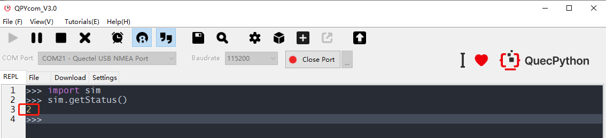

步骤1：先通过下面方法输入PIN码进行验证。

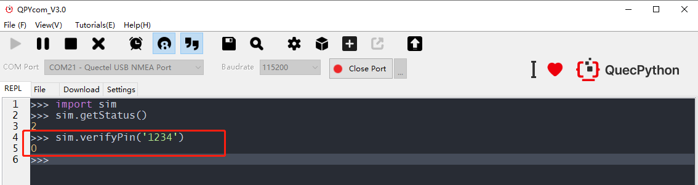

步骤2：关闭PIN码验证。

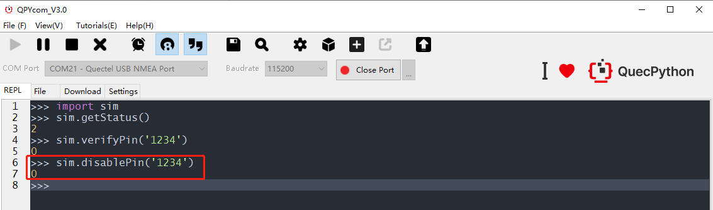

步骤3：重启设备，再次查询SIM卡状态，确认是否恢复正常。

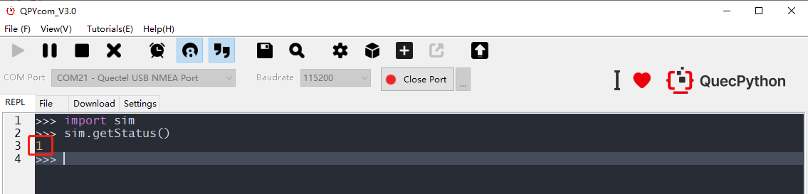

- 当SIM卡状态值是3时

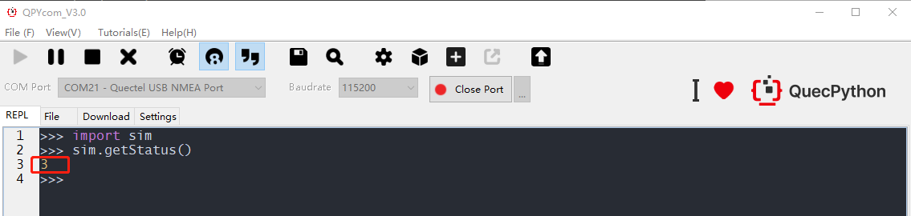

当SIM卡状态值为3的时候，说明这一张卡已经被锁，此时需要使用PUK码来进行解锁。PUK码一般在SIM卡的卡托上可以找到，如下图所示：

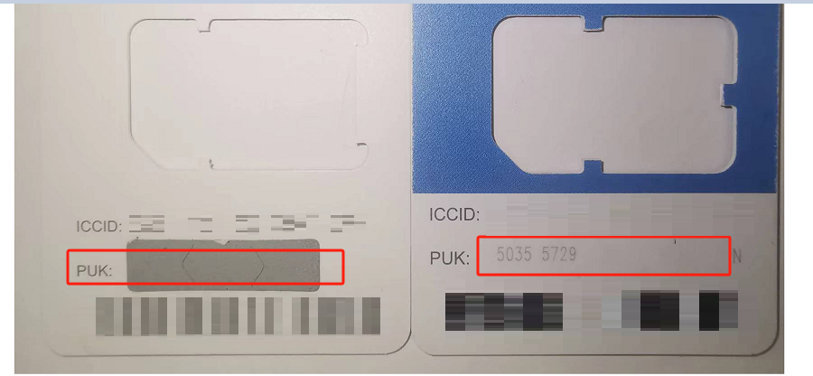

需要说明的是，每一张SIM卡都有自己的PUK，用户在解锁SIM卡时，一定要确定使用的PUK是正确的。如果多次输入PUK错误，这张SIM卡将永久锁定，再也无法使用。

当用户确认了PUK码后，可以按照下面的步骤来解锁：

步骤1：输入正确的PUK解锁，并设置新的PIN码。

SIM卡解锁使用的是下面的方法。该方法有两个参数，第一个参数表示PUK码，第二个参数表示新设置的PIN码。一般SIM卡被锁的原因就是用户启用了PIN码验证，但是在进行PIN码验证时，连续3次输入了错误的PIN码，此时SIM卡就会被锁。所以使用PUK码进行解锁时，需要用户重新设置一个新的PIN码。

```
sim.unblockPin(puk, newPin)
```

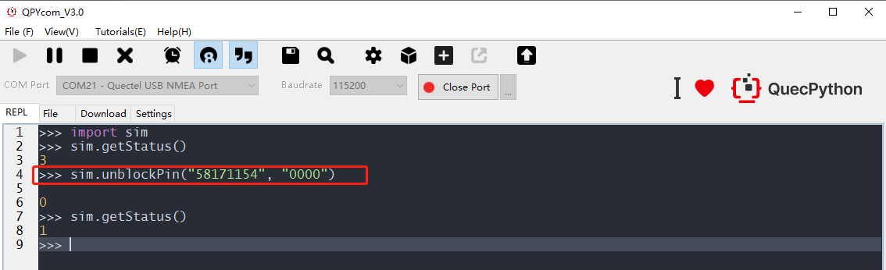

通过上图可以看到，SIM卡已经解锁成功，解锁后查询SIM卡状态，状态值已经变成了1。但是需要注意，此时仅仅是解锁成功了，但是SIM卡的PIN码验证功能并没有关闭，如果现在重启设备，开机后，SIM卡的状态值依然是2，表示需要用户输入PIN码进行验证。因此我们可以先将PIN码验证功能关闭，然后再重启设备。当然，也可以在解锁SIM卡并重启后，先进入PIN码验证，验证成功后，再把PIN码验证功能关闭。

步骤2：关闭PIN码验证功能。

注意，由于SIM卡解锁时，我们已经重新设置了PIN码，因此进行PIN码验证和关闭PIN码验证时，必须使用最新设置的PIN码。

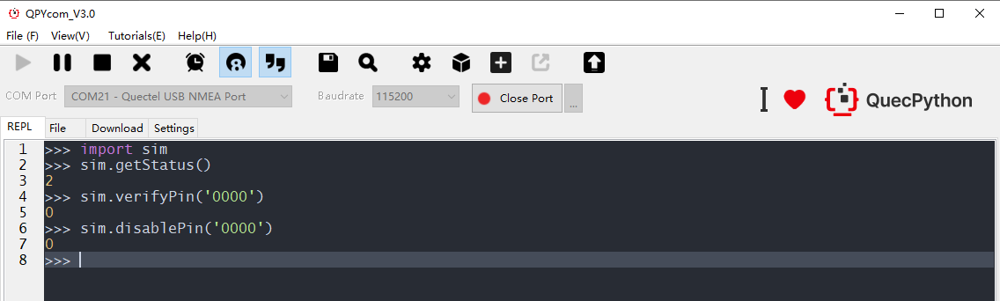

步骤3：重启设备，确认SIM卡状态是否为1。

## SIM卡欠费

这种情况有些特殊，因为不同运营商的SIM卡情况可能不太一样，没办法用一个完全统一的标准去判断。一般如果出现下面两种情况，我们建议用户先去查询一下SIM卡是否出现欠费的情况。

情况1：SIM卡状态值为1，设备网络注册已经成功，并且蜂窝无线网卡也激活成功，但是无法进行网络业务，比如无法发送数据或者接收数据。

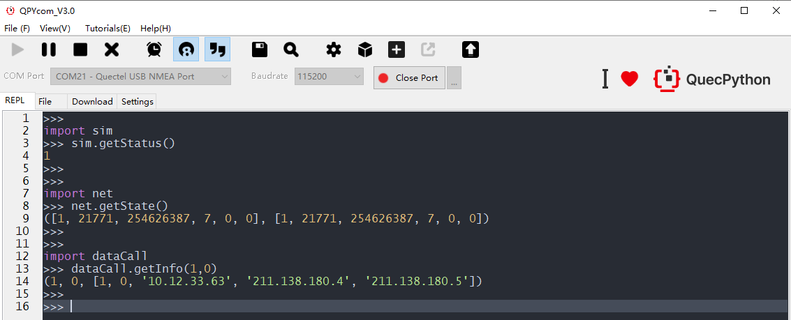

情况2：SIM卡状态值为1，但是网络注册失败。

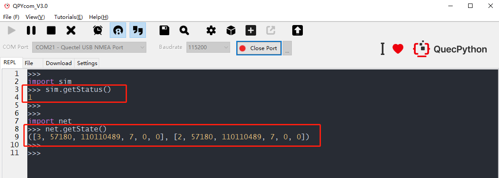

> 注意，并不是说出现“SIM卡状态值为1，但是网络注册失败。”的情况时，就一定是SIM卡欠费了。SIM卡欠费仅仅是导致出现这种情况的可能原因之一。
