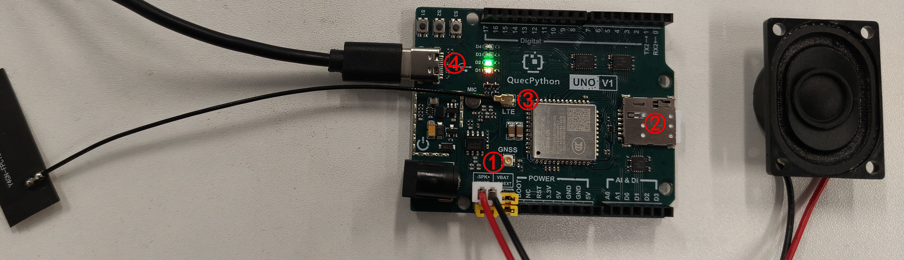

# 豆包 RTC AI 聊天机器人

该 AI 聊天机器人方案基于豆包火山 RTC 引擎开发，具有以下特性：

- 支持智能体切换。
- 支持音色切换。
- 支持ASR字幕。
- 支持TTS字幕。
- 支持语音中断/打断。
- 支持服务器地址切换。
- 支持语音唤醒。
- 使用 Python 语言，便于二次开发。

 

---

- [开发资源汇总](./dev_resources.md)
- [快速上手](./quick_start.md)
- [软件设计讲解](./software_design.md)
