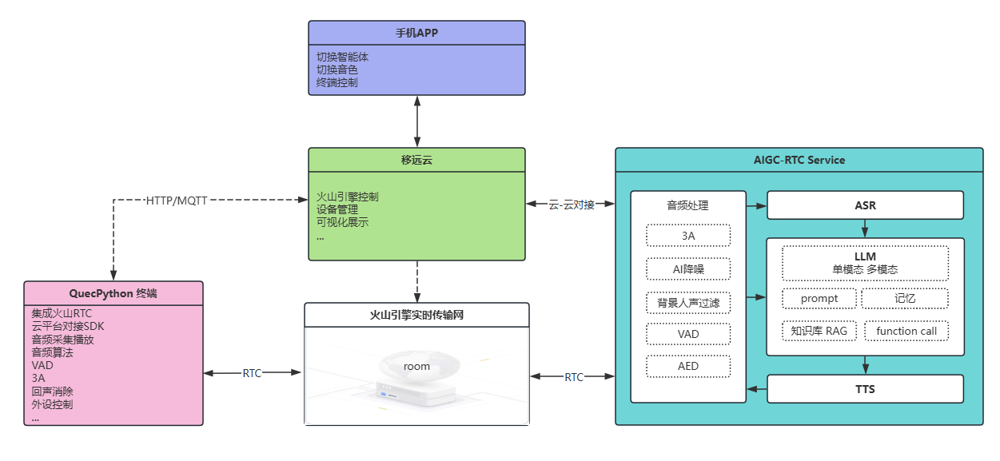
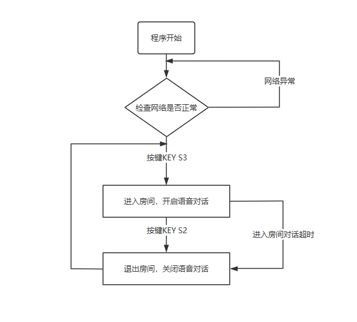

# 软件设计讲解

## 软件框架

### 框架设计图

 

### 业务系统启动流程

 

## 代码讲解

### AI 事件管理

处理 AI 事件

```python
def ai_callback(args):
    global GPIO39 # audio PA GPIO管脚
    event = args[0]
    msg = args[1]
    if event == 1:
        print('TIKTOK_RTC_EVENT_START') # 进入房间，可以开始进行语音对话。
        GPIO39.write(1)
    elif event == 2:
        print('TIKTOK_RTC_EVENT_STOP') # 退出房间，语音对话结束。
        GPIO39.write(0)
    elif event == 3:
        print('TIKTOK_RTC_EVENT_TTS_TEXT {}'.format(msg)) # TTS 文本，模组播放tts文本。
    elif event == 4:
        print('TIKTOK_RTC_EVENT_ASR_TEXT {}'.format(msg)) # ASR 文本，模组识别到语音文本。
    elif event == 5:
        print('TIKTOK_RTC_EVENT_ERROR {}'.format(msg)) # 错误信息，模组发生错误时，上报错误信息。
    else:
        print('TIKTOK_RTC_EVENT UNKNOWN {}'.format(event)) #未知异常事件

```

### AI 初始化

初始化 AI 对象，注册回调接口，以及配置AI对话时间。

```python
tiktok = TiktokRTC(300000, ai_callback)
```

**参考运行日志**
```python

import example
>>> example.exec('/usr/ai_main.py')
volume: 11
>>> lte network normal
ai task running

```

### AI 进入房间

按下KEY S3键进入房间，开始进行语音对话，调用`tiktok.active(True)`接口激活。

```python
tiktok.active(True)
```

**参考运行日志**
```python
# 按KEY S3键进入智能体
rtc_queue key event 1
start rtc
TIKTOK_RTC_EVENT_START
TIKTOK_RTC_EVENT_TTS_TEXT 你
TIKTOK_RTC_EVENT_TTS_TEXT 你好
TIKTOK_RTC_EVENT_TTS_TEXT 你好有
TIKTOK_RTC_EVENT_TTS_TEXT 你好有什
TIKTOK_RTC_EVENT_TTS_TEXT 你好有什么
TIKTOK_RTC_EVENT_TTS_TEXT 你好有什么可
TIKTOK_RTC_EVENT_TTS_TEXT 你好有什么可以
TIKTOK_RTC_EVENT_TTS_TEXT 你好有什么可以帮
TIKTOK_RTC_EVENT_TTS_TEXT 你好有什么可以帮到
TIKTOK_RTC_EVENT_TTS_TEXT 你好有什么可以帮到你
TIKTOK_RTC_EVENT_TTS_TEXT 你好有什么可以帮到你的
TIKTOK_RTC_EVENT_TTS_TEXT 你好有什么可以帮到你的吗

```

### AI 退出房间

按下KEY S2键退出房间，结束语音对话，调用`tiktok.active(False)`接口去激活。

```python
tiktok.active(False)
```

**参考运行日志**
```python

# 按KEY S2键退出智能体
rtc_queue key event 2
stop rtc
TIKTOK_RTC_EVENT_STOP
```
