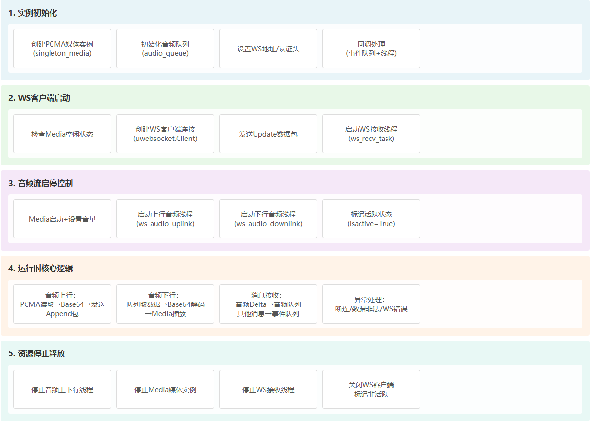

# 软件设计讲解

## 软件框架

### 框架设计图



 

## 代码讲解

### 类初始化（**init**）

```python
def __init__(self, url, auth, callback=None):
    # 初始化PCMA媒体实例（单例），检查占用状态
    self.media = singleton_media('pcma', 4)
    if self.media is None:
        print('media is busy, please stop it first')
        return
    # 初始化音频下行队列（存储服务端推送的音频数据）
    self.audio_queue = Queue()
    
    # 配置WS连接信息（地址+认证头）
    self.url = url
    self.headers = {"Authorization": "Bearer " + auth}

    # 初始化线程ID（用于后续停止线程）、活跃状态、音量配置
    self.ws_recv_task_id = None
    self.ws_audio_uplink_handler_id = None
    self.ws_audio_downlink_handler_id = None
    self.isactive = False
    self.volume = 8
    self.callback = callback

    # 若传入回调函数，初始化事件队列并启动回调处理线程
    if self.callback:
        self.event_queue = Queue()
        self.ws_callback_event_id = _thread.start_new_thread(self.ws_server_event_handler, ())
```

### WS 连接启动（start）

建立 WebSocket 连接，发送初始化消息，启动消息接收线程。

```python
def start(self):
    # 检查媒体实例空闲状态，避免资源冲突
    if self.media.is_idle() is False:
        print('media is busy, please stop it first')
        return
    # 创建WS客户端连接（基于uwebsocket.Client）
    self.client = uwebsocket.Client.connect(self.url, self.headers)
    # 发送update初始化数据包
    msg = ujson.dumps(packet.update)
    self.client.send(msg)

    # 启动WS消息接收线程，独立处理服务端推送数据
    self.ws_recv_task_id = _thread.start_new_thread(self.ws_recv_task, ())
```

### 资源停止释放（stop + stop_audio_stream）

停止音频流线程、释放媒体资源、关闭 WS 连接，完成全生命周期收尾。

1. 音频流停止（stop_audio_stream）

```python
def stop_audio_stream(self):
    # 停止音频上行线程并释放线程ID
    if self.ws_audio_uplink_handler_id:
        _thread.stop_thread(self.ws_audio_uplink_handler_id)
        self.ws_audio_uplink_handler_id = None
    # 停止音频下行线程并释放线程ID
    if self.ws_audio_downlink_handler_id:
        _thread.stop_thread(self.ws_audio_downlink_handler_id)
        self.ws_audio_downlink_handler_id = None
    # 停止媒体实例，释放音频硬件
    self.media.stop()
```

2. 整体停止（stop）

```python
def stop(self):
    # 先停止音频流
    self.stop_audio_stream()

    # 停止WS消息接收线程
    if self.ws_recv_task_id:
        _thread.stop_thread(self.ws_recv_task_id)
        self.ws_recv_task_id = None

    # 关闭WS连接，标记非活跃状态
    self.client.close()
    self.isactive = False
```


### WS 消息接收（ws_recv_task）

持续监听 WS 服务端消息，分流音频数据和事件消息，处理断连异常。

```python
def ws_recv_task(self):
    while True:
        try:
            # 接收WS消息（最大4096字节）
            recv_data = self.client.recv(4096)
            if recv_data is None or len(recv_data) <= 1:
                print('illegal data {}'.format(recv_data))
                continue
            # 分流：音频Delta消息 → 音频队列；其他消息 → 事件队列（回调处理）
            if  packet.EventType.CONVERSATION_AUDIO_DELTA in recv_data:
                self.audio_queue.put(recv_data)
            else:
                if self.callback:
                    self.event_queue.put(recv_data)
        except Exception as e:
            # 断连异常（EIO）：停止音频流、关闭连接、触发回调通知
            if "EIO" in str(e):
                if self.isactive:
                    self.stop_audio_stream()
                    self.client.close()
                    self.isactive = False
                msg = '{"event_type": "client.disconnected"}'
                if self.callback:
                    self.event_queue.put(msg)
                break
            else:
                # 其他异常：打印错误日志
                if recv_data is not None:
                    print('recv error[{}] |{}|'.format(len(recv_data), recv_data))
                print('ws error |{}|'.format(e))
        utime.sleep_ms(1)
```


## 回调事件处理（ws_server_event_handler）

消费事件队列中的非音频消息，调用外部传入的回调函数处理。

```python
def ws_server_event_handler(self):
    while True:
        # 阻塞获取事件队列中的消息
        recv_data = self.event_queue.get()
        # 调用外部回调函数，传递当前实例和消息数据
        self.callback(self, recv_data)
        utime.sleep_ms(1)
```


## 音频流启停（start_audio_stream）

启动音频硬件，配置音量，启动音频上下行线程，标记活跃状态

```python
def start_audio_stream(self):
    # 启动媒体实例，设置音量
    self.media.start()
    self.media.set_volume(self.volume)

    # 启动音频上行/下行线程
    self.ws_audio_uplink_handler_id = _thread.start_new_thread(self.ws_audio_uplink_handler, ())
    self.ws_audio_downlink_handler_id = _thread.start_new_thread(self.ws_audio_downlink_handler, ())
    # 标记模块为活跃状态
    self.isactive = True
```

