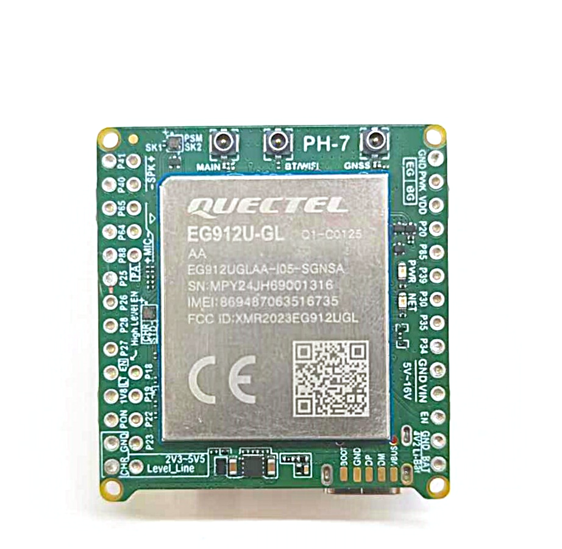

#  基于 EG912U 核心版 DTU

基于 EG912U 核心版 DTU，支持 4G，可实现串口与 4G（CAT1）的数据互传，相比于传统 2G/3G 网络，覆盖更广、速率更快、延时更低。开发方便快捷，支持透传，支持 Python 二次开发。体型小巧安装方便，可使本产品应用于各种行业和复杂场景满足通信数传的需求，如电网、交通、消防、工业生产、气象环境、农业、矿产等等。 

**功能列表**：

- 支持Mqtt透明传输
- 支持TCP/UDP透明传输
- 支持4G全网通
- 支持Python语言二次开发

 **产品图示**： 

------

- [开发资源汇总](./dev_resources.md)
- [快速上手](./quick_start.md)
- [软件设计讲解](./software_design.md)

