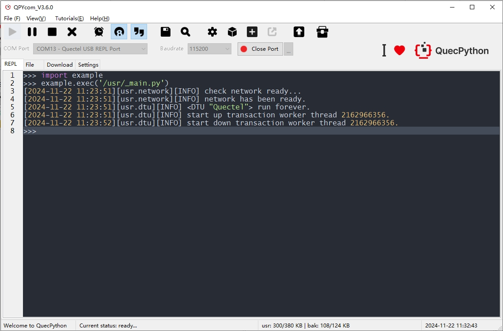
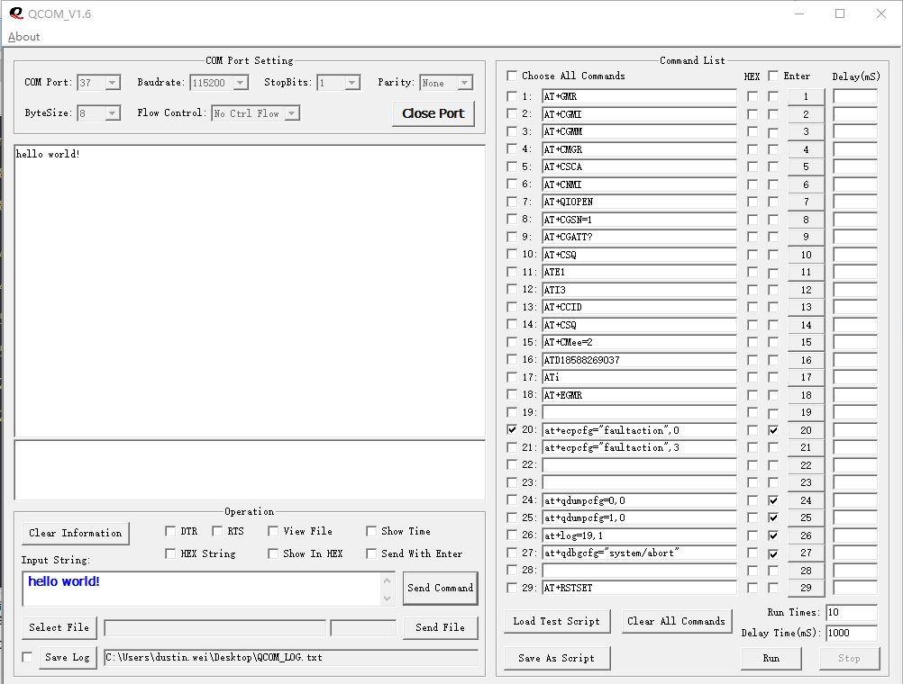
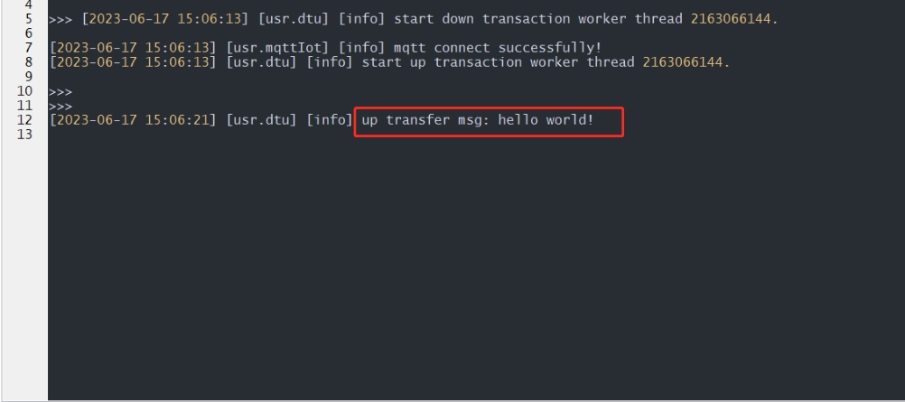
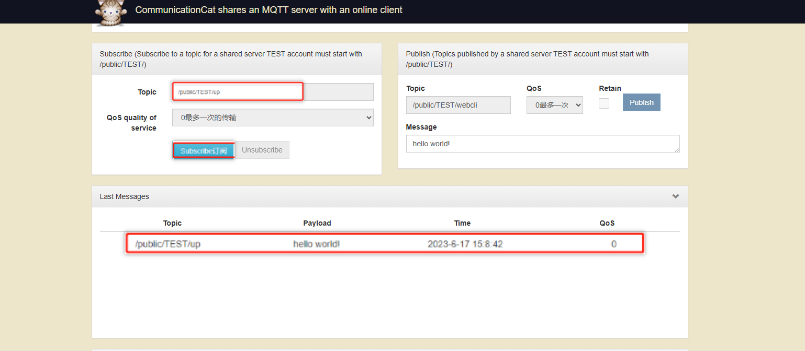
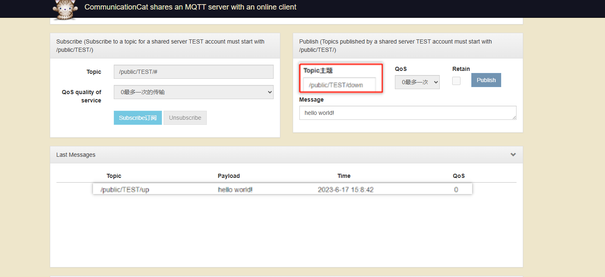
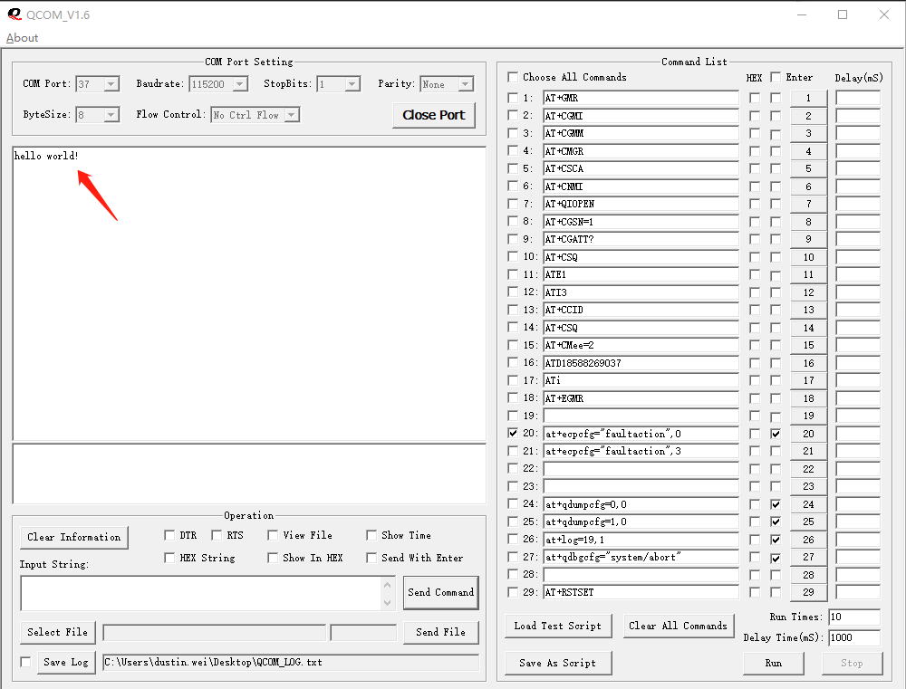

# 基于MQTT协议设备开发

## 修改配置文件

工程配置文件路径：`code/dtu_config.json`。 

基于 TCP 私有服务器数据透传做如下配置： 

-  默认 `system_config.cloud` 配置项定义为 `"tcp"` 即 TCP 透传模式，系统会自行读取 `socket_private_cloud_config` 配置项。 此处改为 mqtt 协议模式。

  ```python
  {
      "system_config": {
          "cloud": "mqtt"  # The mqtt transparent transmission mode is configured by default
      }
  }
  ```

-  本实验采用 MQTT 透传模式，用户需根据实际情况设置 `mqtt_private_cloud_config` 配置项中的 MQTT 服务器域名（*server*）、端口（*port*）、客户端id（*client_id*）以及订阅和发布主题等参数，如下。 

  ```python
  {
      "mqtt_private_cloud_config": {
          "server": "mq.tongxinmao.com",
          "port": 18830,
          "client_id": "txm_1682300809",
          "user": "",
          "password": "",
          "clean_session": true,
          "qos": 0,
          "keepalive": 60,
          "subscribe": {"down": "/public/TEST/down"},  # Downlink data transparent topic
          "publish": {"up":  "/public/TEST/up"}  # Uplink data transparent transmission topic
      }
  }
  ```

- `uart_config` 配置项是串口配置参数，默认是根据当前实验开发板做的配置，不可更改。如用户采用其他开发板则需要根据实际硬件进行配置。

```python
{
    "uart_config": {
        "port": 2,  # Serial port number. Set this parameter based on the actual hardware configuration
        "baudrate": 115200,  # Baud rate
        "bytesize": 8,  # data bits
        "parity": 0,  # Parity check
        "stopbits": 1,  # stop bit
        "flowctl": 0,  # fluid control

        }
    }
}
```

 完整配置文件模版如下： 

```json
{
    "system_config": {
        "cloud": "tcp"
    },
    "mqtt_private_cloud_config": {
        "server": "mq.tongxinmao.com",
        "port": 18830,
        "client_id": "txm_1682300809",
        "user": "",
        "password": "",
        "clean_session": true,
        "qos": 0,
        "keepalive": 60,
        "subscribe": {"down": "/public/TEST/down"},
        "publish": {"up":  "/public/TEST/up"}
    },
    "socket_private_cloud_config": {
        "domain": "112.31.84.164",
        "port": 8305,
        "timeout": 5,
        "keep_alive": 5
    },
    "uart_config": {
        "port": 2,
        "baudrate": 115200,
        "bytesize": 8,
        "parity": 0,
        "stopbits": 1,
        "flowctl": 0,
        "rs485_config": {
        	"gpio_num": 28,
            "direction": 0
        }
    }
}
```

参数说明：

- `system_config.config`: 指定当前使用的私有云类型。目前支持tcp和mqtt。
- `mqtt_private_cloud_config`: MQTT私有云配置。
- `socket_private_cloud_config`: tcp私有云配置。
- `uart_config`：串口参数配置。

## 脚本导入并运行

 下载安装 **QPYCom** 工具后使用该工具下载脚本至 QuecPython 模组。 

> 💡 **Tips**
>
>  QPYCom 安装和使用教程：https://developer.quectel.com/doc/quecpython/Application_guide/zh/dev-tools/QPYcom/index.html 

## 业务调试

**查看 REPL 交互口日志** 

程序运行后，在 REPL 交互页面可以看到日志输出如下图所示。 DTU服务中有2个线程处理数据，一个是用于检测读取串口数据并转发数据给云端，一个是检测云端下行数据透传给串口，如下图所示。 

**上行数据透传** 

使用串口调试工具模拟mcu给模组发送上行数据。

- 在`Input String`输入框中输入`hello world!`字符串。
- 点击`Send Command`按钮通过串口发送数据。



 DTU接收串口数据，直接透传至mqtt云端。 



云端接收上行数据日志 

ps：通信猫云平台仅用于测试，可根据实际需要更换云平台



**下行数据透传**

云端发送下行数据。

- 设置云端下行数据主题（与DTU应用配置的订阅主题一致）。
- 输入下行数据。
- 发布。



使用QCOM观察串行调试工具，模拟mcu接收模块下行数据。



