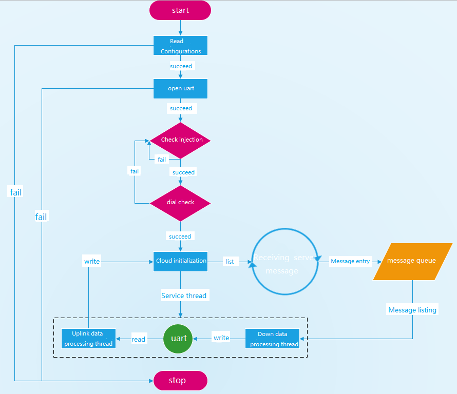
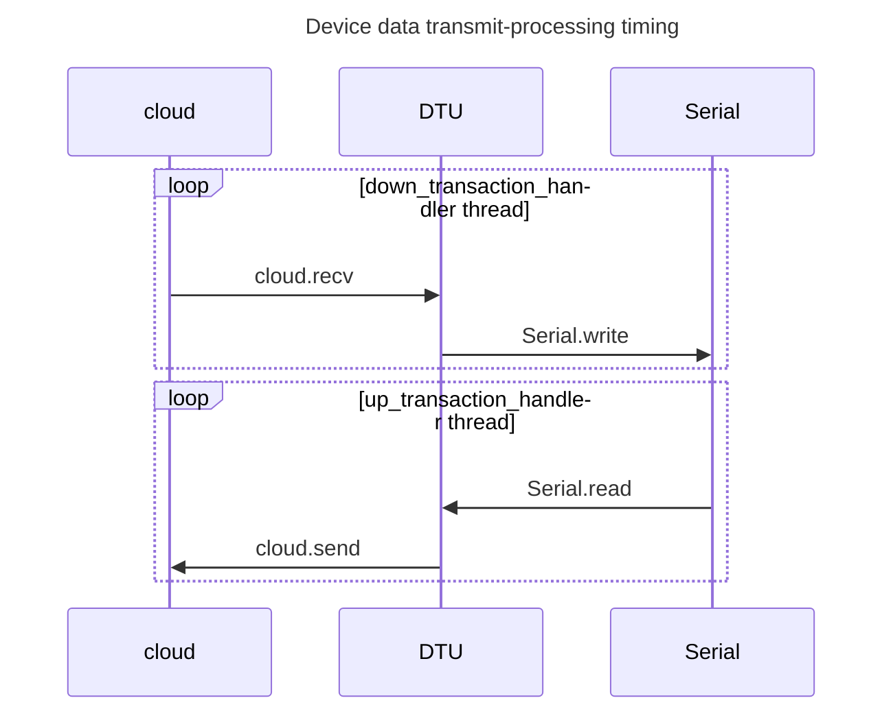

# 软件设计讲解

## 应用流程图

 一般了解一个程序代码大多从启动部分开始，这里也采取这种方式，先寻找程序的启动源头。本例程，一般的程序启动顺序如下图所示： 



整体上业务可以总结为如下流程：

1. 启动喂狗线程（华系列 4G DTU 载有硬件狗）
2. 初始化 DTU 对象后，读取系统配置
3. 初始化串口外设
4. 检查网络状态
5. 初始化云端配置和消息队列
6. 启动数据上下、下行业务线程

> 💡  基本原理：本 DTU 采用 **多线程 + 消息队列** 实现串口和云端数据的上下行转发。其中，上行线程（Uplink data thread）用于读取串口数据并发送至云端；下行线程（Downlink data thread）读取消息队列中的云端数据通过串口转发；消息队列用于缓存云端的下行数据。 

## 目录结构

- usr
  - `_main.py`：主脚本
  - `dtu_config.json`：配置文件
  - `dtu.py`：DTU 模型对象
  - `logging.py`：日志模块
  - `cloud_abc.py`：云对象模型抽象基类
  - `mqttIot.py`：Mqtt 云对象模型实现
  - `network.py`：网络
  - `serial.py`：串口模型对象实现
  - `socketIot.py`：Socket 云对象模型实现
  - `threading.py`：线程、队列和互斥锁
  - `utils.py`：工具类

## API 说明

### 对象模型

 本方案中定义了多个对象模型，其中主要有 `DTU` 对象模型、云对象模型（`CloudABS`）和串口对象模型（`Serial`）。

#### DTU对象模型

DTU类在 `dtu.py` 模块中定义，主要用于初始化串行端口、云以及上下游数据服务。

实现MQTT协议的云通信功能，提供连接、订阅、发布和监控功能。云对象初始化如下：

```python
self.cloud = MqttIot(
    mqtt_config['client_id'],
    mqtt_config['server'],
    port=mqtt_config['port'],
    user=mqtt_config['user'],
    password=mqtt_config['password'],
    keepalive=mqtt_config['keepalive'],
    clean_session=mqtt_config['clean_session'],
    qos=mqtt_config['qos'],
    subscribe_topic=mqtt_config['subscribe'],
    publish_topic=mqtt_config['publish'],
    queue=self.queue,
    error_trans=True
)
```

实现TCP/UDP协议的云通信功能，提供连接、发送、接收和监听功能。socket对象初始化如下：

```python
self.cloud = SocketIot(
    ip_type=socket_config['ip_type'],
    keep_alive=socket_config['keep_alive'],
    domain=socket_config['domain'],
    port=socket_config['port'],
    queue=self.queue,
    error_trans=True
)
```

`up_transaction_handler` 方法: 上行数据传输业务线程的入口函数。

`down_transaction_handler` 方法: 行数据传输业务线程的入口函数。

```python
def down_transaction_handler(self):
    while True:
        topic, data = self.cloud.recv()
        logger.info('down transfer msg: {}'.format(data))
        self.serial.write(data)
            
def up_transaction_handler(self):
    while True:
        data = self.serial.read(1024, timeout=100)
        if data:
            logger.info('up transfer msg: {}'.format(data))
            self.cloud.send(data)
```

`run方法：启动业务操作，包括基于配置文件创建串行端口和云对象，以及为上下游行业创建业务数据处理线程。

#### Serial object model

- In the `serial.py` module, the serial port model class `Serial` is defined. This class is mainly used to implement the read and write operations of the serial port. The main interfaces include:`Serial`
  - `__init__`: Serial port initialization.
  - `open`：Open the serial port.
  - `close`：Shut down the serial port.
  - `write`：Serial port write.
  - `read`：Serial port read.

Example of serial port:：

```python
from usr.serial import Serial

# init Serial object
s = Serial(port=2, baudrate=115200, bytesize=8, parity=0, stopbits=1, flowctl=0, rs485_config=None)
# open serial
s.open()

# serial write method
s.write(b"hello world!")

# serial read method
recv_data = s.read()
print(recv_data)
```

## 业务代码讲解

数传业务主要在 DTU 类（`dtu.py`）中实现，该类主要用于管理串口、云、以及数据的上下行业务。

DTU 对象在主脚本中通过调用 `run` 方法来开启整个 DTU 业务，其中该方法主要用于创建并运行两个线程，分别是上行数据处理线程（线程工作函数是 `up_transaction_handler`）和下行数据处理线程（线程工作函数是 `down_transaction_handler`）。在线程函数中分别通过两个 property 属性来获取对应的串口对象和云对象。其中串口对象属性是 `serial`，线程在调用该属性时即刻创建并打开配置的串口对象提供读写接口。其中云对象属性是 `cloud`，线程在调用该属性时即刻创建并连云对象提供接收和发送接口。

函数调用时序图：



 上行数据处理线程函数 `DTU.up_transaction_handler` 实现如下： 

```python
class DTU(object):
    
    # ...
    
    def up_transaction_handler(self):
        while True:
            data = self.serial.read(1024, timeout=100)
            if data:
                logger.info('up transfer msg: {}'.format(data))
                self.cloud.send(data)

    # ...
```

 `up_transaction_handler`函数按照 1KB 的 buffer 读取串口数据（用户可以自行调整buffer大小），并格式化消息后通过 `CloudABC.send` 接口发送数据至云端。用户继承 `CloudABC` 并自定义云对象并实现 。

 下行数据处理线程函数 `down_transaction_handler` 实现如下： 

```python
class DTU(object):
    
    # ...
    
    def down_transaction_handler(self):
        while True:
            topic, data = self.cloud.recv()
            logger.info('down transfer msg: {}'.format(data))
            self.serial.write(data)
                
    # ...
```

 `down_transaction_handler` 函数通过调用 `CloudABC.recv` 来获取下行消息，并通过 `Serial.write` 转发消息。 