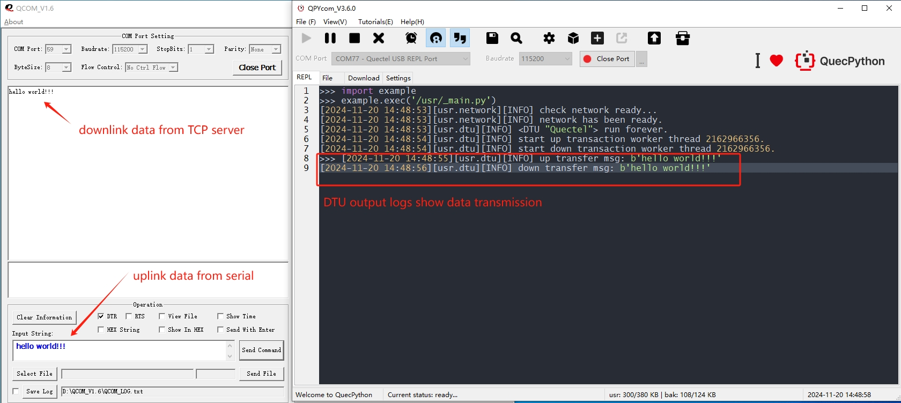

# 基于TCP协议设备开发

## 修改配置文件

工程配置文件路径：`code/dtu_config.json`。 

基于 TCP 私有服务器数据透传做如下配置： 

打开 TCP 服务器 ：http://tt.ai-thinker.com:8000/ttcloud

-  默认 `system_config.cloud` 配置项定义为 `"tcp"` 即 TCP 透传模式，系统会自行读取 `socket_private_cloud_config` 配置项。 

  ```python
  {
      "system_config": {
          "cloud": "tcp"  # The tcp transparent mode is configured by default
      }
  }
  ```

-  本实验采用 TCP 透传模式，用户需根据实际情况设置 `socket_private_cloud_config` 配置项中的 TCP 服务器域名（*domain*）和端口（*port*）。 

  ```python
  {
      "socket_private_cloud_config": {
          "domain": "36.137.226.30",  # ip
          "port": 42298,  # port number
          "timeout": 5,  # time-out period (unit: s)
          "keep_alive": 1  # heartbeat cycle (unit: s)
      }
  }
  ```

- `uart_config` 配置项是串口配置参数，默认是根据当前实验开发板做的配置，不可更改。如用户采用其他开发板则需要根据实际硬件进行配置。

```python
{
    "uart_config": {
        "port": 2,  # Serial port number. Set this parameter based on the actual hardware configuration
        "baudrate": 115200,  # Baud rate
        "bytesize": 8,  # data bits
        "parity": 0,  # parity check
        "stopbits": 1,  # stop bit
        "flowctl": 0,  # fluid control
    }
}
```

 完整配置文件模版如下： 

```json
{
    "system_config": {
        "cloud": "tcp"
    },
    "mqtt_private_cloud_config": {
        "server": "mq.tongxinmao.com",
        "port": 18830,
        "client_id": "txm_1682300809",
        "user": "",
        "password": "",
        "clean_session": true,
        "qos": 0,
        "keepalive": 60,
        "subscribe": {"down": "/public/TEST/down"},
        "publish": {"up":  "/public/TEST/up"}
    },
   "socket_private_cloud_config": { 
        "ip_type":"IPv4",
        "domain": "36.137.226.30",
        "port": "42298",
        "keep_alive": 1
    },
    "uart_config": {
        "port": 2,
        "baudrate": 115200,
        "bytesize": 8,
        "parity": 0,
        "stopbits": 1,
        "flowctl": 0,
    }
}
```

参数说明：

- `system_config.config`: 指定当前使用的私有云类型。目前支持tcp和mqtt。
- `mqtt_private_cloud_config`: MQTT私有云配置。
- `socket_private_cloud_config`: tcp私有云配置。
- `uart_config`：串口参数配置。

## 脚本导入并运行

 下载安装 **QPYCom** 工具后使用该工具下载脚本至 QuecPython 模组。 

> 💡 **Tips**
>
> QPYCom  安装和使用教程 ：https://developer.quectel.com/doc/quecpython/Application_guide/zh/dev-tools/QPYcom/index.html

## 业务调试

程序运行后，在 REPL 交互页面可以看到日志输出如下图所示。

左侧图示，我们使用 QCOM 模拟 MCU 打开用于透传的模组串口（即 USB 转 TTL 模块对应的 COM 口）。

右侧图示，REPL 交互口输出的模组日志。

使用串口工具 QCOM 模拟 MCU 串口上行数据，通过 DTU 透传至 TCP 回显服务器，再由回显服务器将相同数据通过 DTU 下行透传至 QCOM。



 本案例中采用的是 TCP 回显服务器，所以 QCOM 上行数据，经过 DTU 透传至 TCP 服务器接收到之后会立即按原路径下行。 

