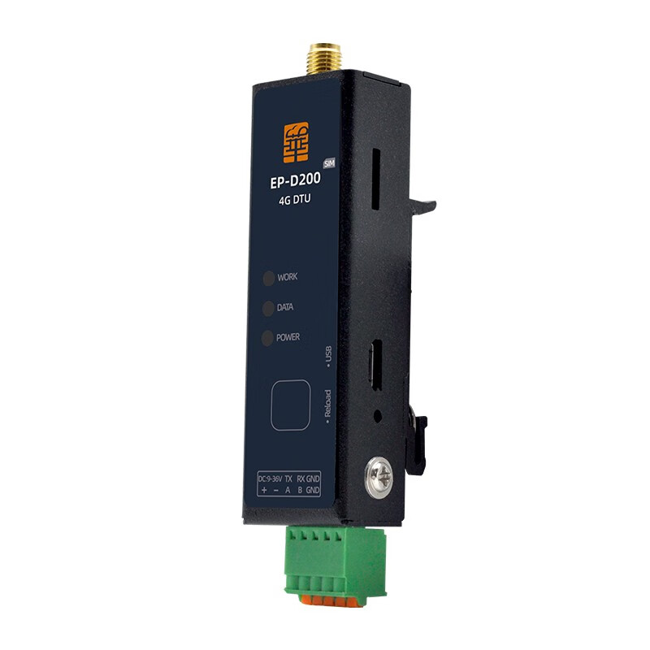

# EP-D200 华系列 DTU

华系列 DTU 产品搭载移远 EC800G-CN 模块，支持 4G Cat1 全网通，可实现串口与 4G（CAT1）的数据互传，相比于传统 2G/3G 网络，覆盖更广、速率更快、延时更低。采用宽电（9~36V）供电。接口丰富，提供 RS232、RS485 和 TTL 三种接口可选。开发方便快捷，支持透传，支持 Python 二次开发。安全可靠，支持软、硬件看门狗守护。体型小巧安装方便（22.6 * 74.6 mm）。 本产品方案支持 4G 全网通，采用宽电压（9~36V）供电，提供 RS232、RS485 和 TTL 三种接口，可使本产品应用于各种行业和复杂场景满足通信数传的需求，如电网、交通、消防、工业生产、气象环境、农业、矿产等等。

**功能列表**：

- 支持 Mqtt 透传
- 支持 TCP/UDP 透传
- 支持 RS485 转 4G
- 支持 4G 全网通
- 支持 Python 语言二次开发
- 支持 9~36V 宽幅供电
- POWER/DATA/WORK 指示灯

**产品图示**：

------

- [开发资源汇总](./dev_resources.md)
- [快速上手](./quick_start.md)
- [软件设计讲解](./software_design.md)

