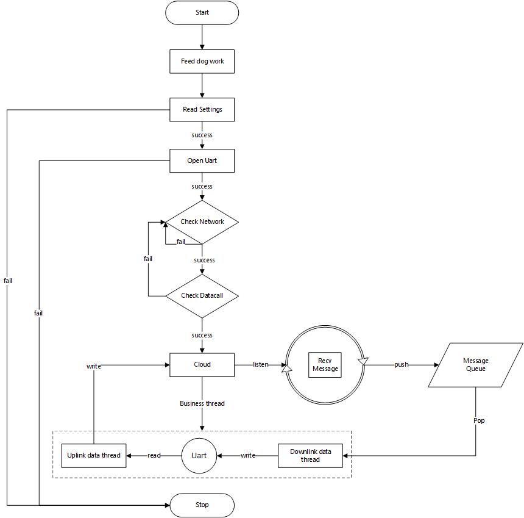
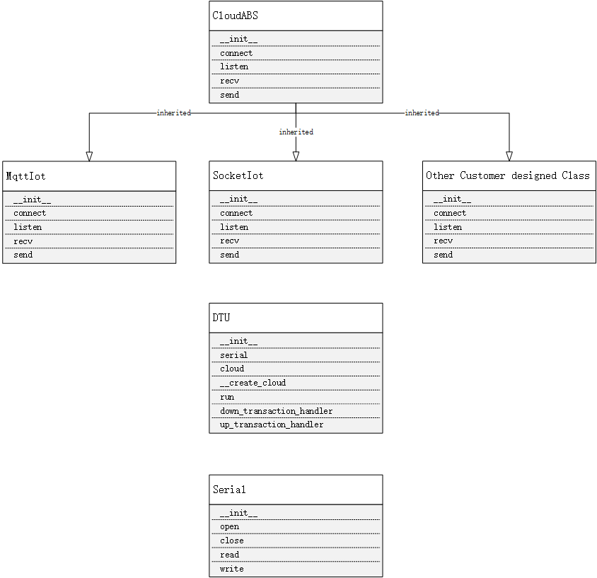
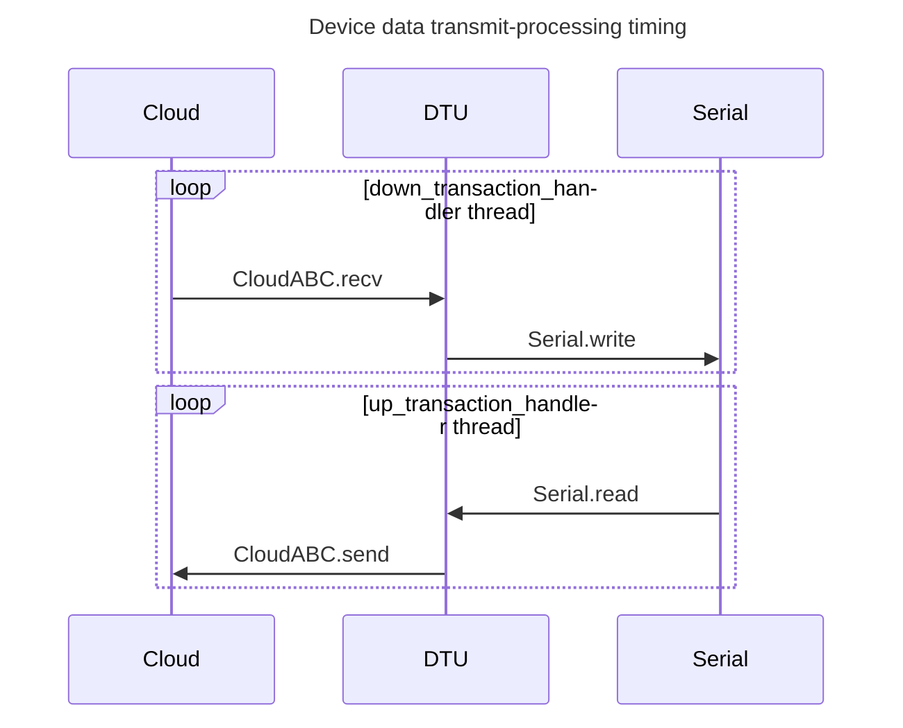

# 软件设计讲解

## 应用流程图

一般了解一个程序代码大多从启动部分开始，这里也采取这种方式，先寻找程序的启动源头。本例程，一般的程序启动顺序如下图所示：



整体上业务可以总结为如下流程：

1. 启动喂狗线程（华系列 4G DTU 载有硬件狗）
2. 初始化 DTU 对象后，读取系统配置
3. 初始化串口外设
4. 检查网络状态
5. 初始化云端配置和消息队列
6. 启动数据上下、下行业务线程

> 💡 基本原理：本 DTU 采用 **多线程 + 消息队列** 实现串口和云端数据的上下行转发。其中，上行线程（Uplink data thread）用于读取串口数据并发送至云端；下行线程（Downlink data thread）读取消息队列中的云端数据通过串口转发；消息队列用于缓存云端的下行数据。

## 目录结构

- `usr`: 
  - `_main.py`：主脚本
  - `dtu_config.json`：配置文件
  - `dtu.py`：DTU 模型对象
  - `logging.py`：日志模块
  - `cloud_abc.py`：云对象模型抽象基类
  - `mqttIot.py`：Mqtt 云对象模型实现
  - `network.py`：网络
  - `serial.py`：串口模型对象实现
  - `socketIot.py`：Socket 云对象模型实现
  - `threading.py`：线程、队列和互斥锁
  - `utils.py`：工具类

## API说明

### Manager 管理类

示例程序的主脚本 `_main.py` 中我们定义一个 `Manager` 类来管理初始化的各种关联的对象。

主要方法：

- `__init__`：管理类初始化方法
  - 看门狗：由于华系列 4G DTU 配置硬件看门狗（GPIO12），所以主脚本程序中需要初始化一个 `self.dog_pin` 对象并采用 `osTimer` 周期喂狗。
  - DTU 模型对象：`self.dtu` 是 DTU 对象，通过该对象方法 `self.dty.config.read_from_json("/usr/dtu_config.json")` 从文件中读取相关配置。`start` 方法是程序主入口，先启动间隔 3s 的喂狗定时器，然后检查 sim 卡和网络状态，最后调用 `self.dtu.run()` 来启动 DTU 例程。
- `start`：启动方法
  - 开启喂狗定时器
  - 检查 sim 卡状态
  - 检查网络状态
  - 启动 dtu 例程
- `__feed`：喂狗定时器的回调函数

实现如下：

```python
import sim
import osTimer
from machine import Pin
from usr import network
from usr.dtu import DTU


class Manager(object):

    def __init__(self, dog_gpio=Pin.GPIO12):
        self.dog_pin = Pin(dog_gpio, Pin.OUT, Pin.PULL_DISABLE, 1)
        self.dog_feed_timer = osTimer()

        self.dtu = DTU('Quectel')
        self.dtu.config.read_from_json('/usr/dtu_config.json')

    def start(self):
        # start timer to feed dog
        self.dog_feed_timer.start(3000, 1, self.__feed)
        # check sim card
        if sim.getStatus() != 1:
            raise ValueError("sim card not ready")
        # check network
        network.wait_network_ready()
        # start dtu business
        self.dtu.run()

    def __feed(self, args):
        if self.dog_pin.read():
            self.dog_pin.write(0)
        else:
            self.dog_pin.write(1)


if __name__ == "__main__":
    manager = Manager()
    manager.start()
```

### 对象模型

本方案中定义了多个对象模型，其中主要有 `DTU` 对象模型、云对象模型（`CloudABS`）和串口对象模型（`Serial`）。基本定义如下：



#### DTU 对象模型

在 `dtu.py` 模块中定义 DTU 类，该类主要用于管理串口、云、以及数据的上下行业务。

`config` 属性：

DTU 对象中有一个属性 `config` 是类 `Configure` 对象，该对象用于管理应用配置。如下：

```python
from usr.dtu import DTU

dtu = DTU('Quectel')
dtu.config.read_from_json('/usr/dtu_config.json')
```

其中，支持从 json 文件中存储相关配置，操作方法类似内置字典类型，可以采用如下方式来读写配置（以读取 `system_config`  配置项为例）。

- 从指定 json 文件中导入配置：`dtu.config.read_from_json('/usr/dtu_config.json')`
- 使用`get` 方法读取配置项：`dtu.config.get("system_config")`
- 使用运算符`[]` 读取配置项：`dtu.config["system_config"]`
- 保存并更新配置：`dtu.config.save()`

`serial` 属性：

该属性是一个 property 属性，用于构建串口对象，用户一般无需修改，只需要按照实际情况定义配置参数即可。

```python
@property
def serial(self):
    """create&get serial object according configure"""
    __serial__ = getattr(self, '__serial__', None)
    if __serial__ is None:
        __serial__ = Serial(**self.config.get('uart_config'))  # init serial
        __serial__.open()  # open serial
    setattr(self, '__serial__', __serial__)
    return __serial__
```

`cloud`属性：

该属性是一个 property 属性，用于获取云对象，方法中使用 `__create_cloud` 来实际构建云对象。

```python
@property
def cloud(self):
    """get cloud object"""
    cloud = getattr(self, '__cloud__', None)
    if cloud is None:
        cloud = self.__create_cloud()  # create cloud object
    setattr(self, '__cloud__', cloud)
    return cloud
```

`__create_cloud` 方法：

该方法，是用于实际创建云对象，如果用户自定义云对象，则需要再该函数中新增自定义对象初始化。

```python
def __create_cloud(self):
    """create cloud object according configure"""
    # read cloud type
    cloud_type = self.config.get('system_config.cloud')
    if cloud_type == "mqtt":
        mqtt_config = self.config.get('mqtt_private_cloud_config')  # init mqtt cloud
        cloud = MqttIot(**mqtt_config)
    elif cloud_type == "tcp":
        socket_config = self.config.get('socket_private_cloud_config')  # init tcp cloud
        cloud = SocketIot(**socket_config)
    else:
        raise ValueError('\"{}\" not supported now!'.format(cloud_type))
    cloud.connect()  # connect to cloud
    cloud.listen()  # start listen message from cloud
    return cloud
```

`up_transaction_handler` 方法：用于上行数据传输业务线程入口函数。

`down_transaction_handler` 方法：用于下行数据传输业务线程入口函数。

`run` 方法：启动业务，包括根据配置文件创建串口和云对象以及创建上下行业务数据处理线程。

#### Serial 对象模型

在 `serial.py` 模块中定义串口模型类 `Serial`，主要用户实现串口的读写操作。主要接口如：

- `Serial`
  - `__init__`: 串口初始化。
  - `open`：打开串口。
  - `close`：关闭串口。
  - `write`：串口写。
  - `read`：串口读。

串口使用示例：

```python
from usr.serial import Serial

# init Serial object
s = Serial(port=2, baudrate=115200, bytesize=8, parity=0, stopbits=1, flowctl=0, rs485_config=None)
# open serial
s.open()

# serial write method
s.write(b"hello world!")

# serial read method
recv_data = s.read()
print(recv_data)
```

#### Cloud 对象模型

**Cloud 模型**

为了适配不同的云平台（socket 私有云、mqtt 等），本方案定义抽象云类型如下，用户可以自行按照抽象类型，自定义 Cloud 对象以适配不同云平台。

> 💡 Cloud 模型对象实现可以参考 `socketIot` 和 `MqttIot`。

```python
class CloudABC(object):
    
    def __init__(self, **kwargs):
        """
        key arguments: kwargs, used for initial params for cloud (customer used).
        """
        raise NotImplementedError("this method should me implemented for customer designed Cloud Object")
    
    def connect(self):
        """connect to Coud"""
        raise NotImplementedError("customer should implement this method to connect cloud")
    
    def listen(self):
        """listen message from cloud.
        
        usually we use this method to start a thread for receiving message from the cloud and put message input a Queue, and then use `self.recv` method to get it on app side.
        """
        raise NotImplementedError("customer should implement this method to listen cloud message")
    
    def recv(self):
        """receive a message"""
        raise NotImplementedError("customer should implement this method to recv a message")
    
    def send(self, *args):
        """send message
        
        position arguments: args, customer designed method used for send message
        """
        raise NotImplementedError("customer should implement this method to send a message")
```

上述是 Cloud 对象模型主要方法和属性，其中：

- `__init__`：接收关键字参数，通常用于配置云端初始化参数，用户可自行定义。
- `connect`：连接云端服务器。
- `listen`：监听云端下行消息，通常在该方法中使用线程来读取云端下行数据，并放入消息队列中方便应用侧通过 `self.recv` 方法来获取。
- `recv`：获取下行消息。
- `send`：发送上行消息，接收若干位置参数用户可自定义。

## 业务代码讲解

数传业务主要在 DTU 类（`dtu.py`）中实现，该类主要用于管理串口、云、以及数据的上下行业务。

DTU 对象在主脚本中通过调用 `run` 方法来开启整个 DTU 业务，其中该方法主要用于创建并运行两个线程，分别是上行数据处理线程（线程工作函数是 `up_transaction_handler`）和下行数据处理线程（线程工作函数是 `down_transaction_handler`）。在线程函数中分别通过两个 property 属性来获取对应的串口对象和云对象。其中串口对象属性是 `serial`，线程在调用该属性时即刻创建并打开配置的串口对象提供读写接口。其中云对象属性是 `cloud`，线程在调用该属性时即刻创建并连云对象提供接收和发送接口。

函数调用时序图：



上行数据处理线程函数 `DTU.up_transaction_handler` 实现如下：

```python
class DTU(object):
    
    # ...
    
    def up_transaction_handler(self):
        while True:
            try:
                data = self.serial.read(1024)
                if data:
                    logger.info('up transfer msg: {}'.format(data))
                    if isinstance(self.cloud, SocketIot):
                        msg = [data]
                    elif isinstance(self.cloud, MqttIot):
                        msg = ['up', data]
                    else:
                        raise TypeError('unknow cloud type.')
                    self.cloud.send(*msg)
            except Exception as e:
                logger.error('up transfer error: {}'.format(e))
    
    # ...
```

`up_transaction_handler`函数按照 1KB 的 buffer 读取串口数据（用户可以自行调整buffer大小），并格式化消息后通过 `CloudABC.send` 接口发送数据至云端。用户继承 `CloudABC` 并自定义云对象并实现 `CloudABC.send` 方法后可根据自定义消息格式处理并发送数据。

下行数据处理线程函数 `down_transaction_handler` 实现如下：

```python
class DTU(object):
    
    # ...
    
    def down_transaction_handler(self):
        while True:
            try:
                msg = self.cloud.recv()
                logger.info('down transfer msg: {}'.format(msg['data']))
                self.serial.write(msg['data'])
            except Exception as e:
                logger.error('down transfer error: {}'.format(e))
                
    # ...
```

`down_transaction_handler` 函数通过调用 `CloudABC.recv` 来获取下行消息，并通过 `Serial.write` 转发消息。