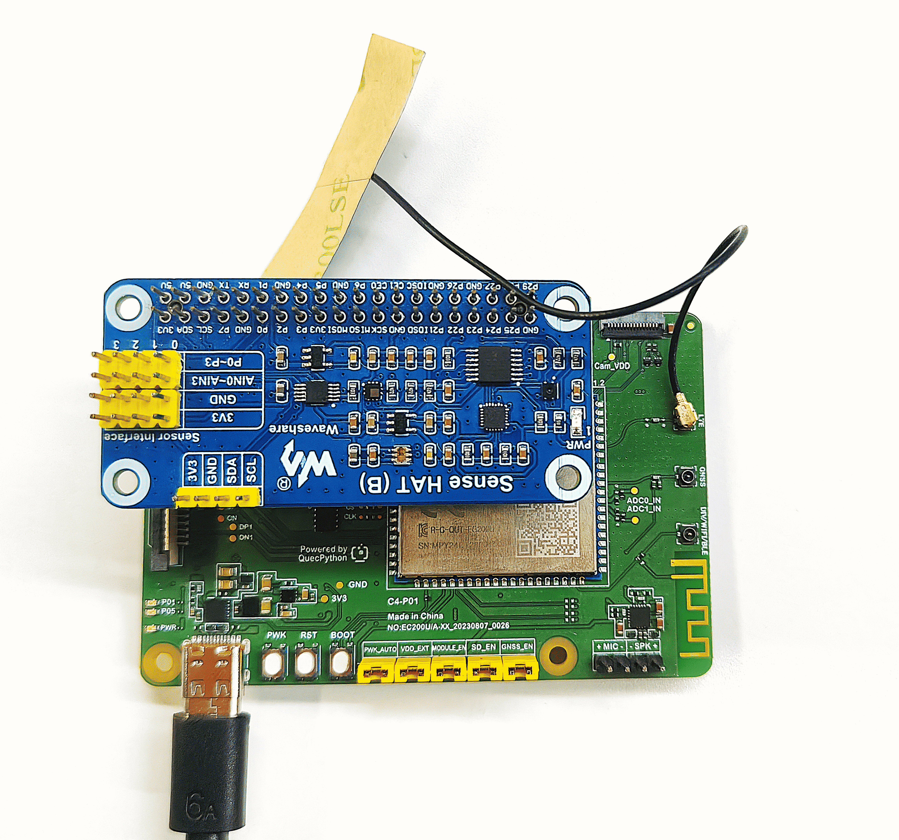

# SensorHub解决方案

该SimpliKit方案基于EC200U-EU QuecPython 标准开发板实现，具有以下特性：

- 提供准确的温湿度检测功能和高精度GNSS定位。
- 支持quectel云，APP远程查看数据。
- 使用python语言，便于二次开发

------

- [开发资源汇总](./dev_resources.md)
- [快速上手](quick_start.md)
- [软件设计讲解](./software_design.md)
