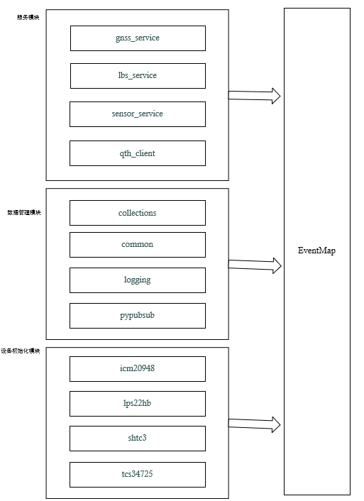
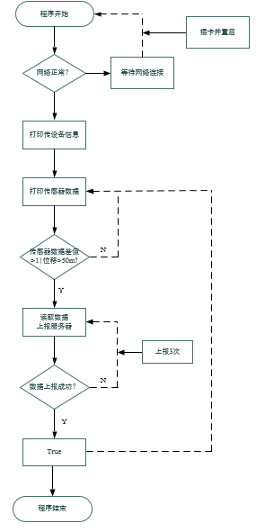
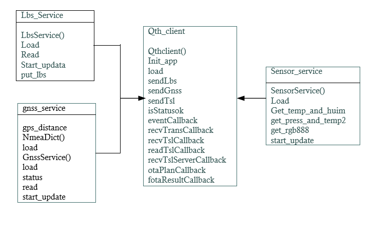

# 软件设计讲解


## 软件框架

- ### 软件设计图

  
  
  
  
- ### 业务启动流程

  

## 代码讲解

### 数据管理

common.py的`Storage` 类是一个基于 Python 内置 `dict` 类的扩展，用于提供线程安全的字典存储，并支持从 JSON 文件加载和保存数据。

```python
class Storage(dict):
    def __init__(self, *args, **kwargs):
        super().__init__(*args, **kwargs)
        self.__lock__ = Lock()
        self.__storage_path__ = None
    def __enter__(self):
        self.__lock__.acquire()
        return self

    def __exit__(self, *args, **kwargs):
        self.__lock__.release()

    def __from_json(self, path):
        if self.__storage_path__ is not None:
            raise ValueError('storage already init from \"{}\"'.format(self.__storage_path__))
        if not ql_fs.path_exists(path):
            ql_fs.touch(path, {})
        else:
            self.update(ql_fs.read_json(path))

    def init(self, path):
        if path.endswith('.json'):
            self.__from_json(path)
        else:
            raise ValueError('\"{}\" file type not supported'.format(path))
        self.__storage_path__ = path

    def save(self):
        if self.__storage_path__ is None:
            raise ValueError('storage path not existed, did you init?')
        ql_fs.touch(self.__storage_path__, self)

```

### 服务模块


1.Lbs_Service:提供Lbs数据定位服务

2.gnss_service:提供gnss数据定位服务

3.Sensor_service:提供传感器数据检测服务

4.Qth_client:提供数据上传和回调服务

各个service和client的关系图如下：




### 传感器数据采集

SensorService.py的`SensorService` 类是一个用于管理传感器数据采集和更新的服务类，主要负责初始化 I2C 通道和多个传感器（SHTC3、LPS22HB 和 TCS34725），并持续从这些传感器中读取温度、湿度、气压和 RGB 颜色值。它还负责将这些数据发送到指定的QTH 客户端。

```python
class SensorService(object):

    def __init__(self, app=None):
        # i2c channel 0 
        self.i2c_channel0 = I2C(I2C.I2C0, I2C.STANDARD_MODE)
        # SHTC3
        self.shtc3 = Shtc3(self.i2c_channel0, SHTC3_SLAVE_ADDR)
        self.shtc3.init()
        # LPS22HB
        self.lps22hb = Lps22hb(self.i2c_channel0, LPS22HB_SLAVE_ADDRESS)
        self.lps22hb.init()
        # TCS34725
        self.tcs34725 = Tcs34725(self.i2c_channel0, TCS34725_SLAVE_ADDR)
        self.tcs34725.init()

        if app is not None:
            self.init_app(app)
    def __str__(self):
        return '{}'.format(type(self).__name__)

    def init_app(self, app):
        app.register('sensor_service', self)

    def load(self):
        logger.info('loading {} extension, init sensors will take some 		  seconds'.format(self))
        Thread(target=self.start_update).start()

    def get_temp1_and_humi(self):
        return self.shtc3.getTempAndHumi()
    
    def get_press_and_temp2(self):
        return self.lps22hb.getTempAndPressure()
    def get_rgb888(self):
            rgb888 = self.tcs34725.getRGBValue()
            logger.debug("R: {}, G: {}, B: {}".format((rgb888 >> 16) & 0xFF, (rgb888 >> 8) & 0xFF, rgb888 & 0xFF))

            r = (rgb888 >> 16) & 0xFF
            g = (rgb888 >> 8) & 0xFF
            b = rgb888 & 0xFF
            return r, g, b       
    def start_update(self):
        prev_temp1 = None
        prev_humi = None
        prev_press = None
        prev_temp2 = None
        prev_rgb888 = None


        while True:
            data = {}

            try:
                temp1, humi = self.shtc3.getTempAndHumi()
                logger.debug("temp1: {:0.2f}, humi: {:0.2f}".format(temp1, humi))

                if prev_temp1 is None or abs(prev_temp1 - temp1) > 1:
                    data.update({3: round(temp1, 2)})
                    prev_temp1 = temp1

                if prev_humi is None or abs(prev_humi - humi) > 1:
                    data.update({4: round(humi, 2)})
                    prev_humi = humi

            except Exception as e:
                logger.error("getTempAndHumi error:{}".format(e))

            utime.sleep_ms(100)
            try:
                press, temp2 = self.lps22hb.getTempAndPressure()
                logger.debug("press: {:0.2f}, temp2: {:0.2f}".format(press, temp2))

                if prev_temp2 is None or abs(prev_temp2 - temp2) > 1:
                    data.update({5: round(temp2, 2)})
                    prev_temp2 = temp2

                if prev_press is None or abs(prev_press - press) > 1:
                    data.update({6: round(press, 2)})
                    prev_press = press

            except Exception as e:
                logger.error("getTempAndPressure error:{}".format(e))

            utime.sleep_ms(100)

            utime.sleep_ms(100)

            try:
                rgb888 = self.tcs34725.getRGBValue()
                logger.debug("R: {}, G: {}, B: {}".format((rgb888 >> 16) & 0xFF, (rgb888 >> 8) & 0xFF, rgb888 & 0xFF))

                r = (rgb888 >> 16) & 0xFF
                g = (rgb888 >> 8) & 0xFF
                b = rgb888 & 0xFF

                if prev_rgb888 is None:
                    data.update({7: {1: r, 2: g, 3: b}})
                    prev_rgb888 = rgb888
                else:
                    prev_r = (prev_rgb888 >> 16) & 0xFF
                    dr = abs(r - prev_r)
                    
                    prev_g = (prev_rgb888 >> 8) & 0xFF
                    dg = abs(g - prev_g)
                    
                    prev_b = prev_rgb888 & 0xFF
                    db = abs(b - prev_b)
                    
                    # 色差超过 150 即认为颜色有变化
                    if pow(sum((dr*dr, dg*dg, db*db)), 0.5) >= 150:
                        data.update({7: {1: r, 2: g, 3: b}})
                        prev_rgb888 = rgb888

            except Exception as e:
                logger.error("getRGBValue error:{}".format(e))

            if data:
                with CurrentApp().qth_client:
                    for _ in range(3):
                        if CurrentApp().qth_client.sendTsl(1, data):
                            break
                    else:
                        prev_temp1 = None
                        prev_humi = None
                        prev_press = None
                        prev_temp2 = None
                        prev_rgb888 = None

            utime.sleep(1)
```


### QTH平台客户端

`QthClient` 类是一个用于与 QTH（Quantum Technology Hub）平台进行通信的客户端类。它负责初始化、启动和管理与 QTH 平台的连接，并处理来自平台的各种事件和回调。

```python
logger = getLogger(__name__)


class QthClient(object):

    def __init__(self, app=None):
        self.opt_lock = Lock()
        if app:
            self.init_app(app)
    
    def __enter__(self):
        self.opt_lock.acquire()
        return self
    def __exit__(self, *args, **kwargs):
        self.opt_lock.release()

    def init_app(self, app):
            """
            初始化应用程序与Qth服务器的连接。

            该方法将当前实例注册到应用程序中，并根据应用程序的配置信息初始化Qth客户端。
            它设置了产品信息、服务器地址以及事件回调函数，以确保与Qth服务器的正确通信。

            参数:
            - app: 应用程序实例，必须包含正确配置的Qth产品密钥、产品密钥和服务器地址。

            返回值:
            无
   			 """
        app.register("qth_client", self)
        Qth.init()
        Qth.setProductInfo(app.config["QTH_PRODUCT_KEY"], app.config["QTH_PRODUCT_SECRET"])
        Qth.setServer(app.config["QTH_SERVER"])
        Qth.setEventCb(
            {
                "devEvent": self.eventCallback, 
                "recvTrans": self.recvTransCallback, 
                "recvTsl": self.recvTslCallback, 
                "readTsl": self.readTslCallback, 
                "readTslServer": self.recvTslServerCallback,
                "ota": {
                    "otaPlan":self.otaPlanCallback,
                    "fotaResult":self.fotaResultCallback
                }
            }
        )
    def load(self):
        self.start()

    def start(self):
        Qth.start()
    
    def stop(self):
        Qth.stop()
    
    def sendTsl(self, mode, value):
        return Qth.sendTsl(mode, value)

    def isStatusOk(self):
        return Qth.state()

        def sendLbs(self, lbs_data):
        return Qth.sendOutsideLocation(lbs_data)
    
    def sendGnss(self, nmea_data):
        return Qth.sendOutsideLocation(nmea_data)

    def eventCallback(self, event, result):
        logger.info("dev event:{} result:{}".format(event, result))
        if(2== event and 0 == result):
            Qth.otaRequest()

    def recvTransCallback(self, value):
        ret = Qth.sendTrans(1, value)
        logger.info("recvTrans value:{} ret:{}".format(value, ret))
    def recvTslCallback(self, value):
        logger.info("recvTsl:{}".format(value))
        for cmdId, val in value.items():
            logger.info("recvTsl {}:{}".format(cmdId, val))
            
    def readTslCallback(self, ids, pkgId): #回调函数，回调传感器和位置数据
        logger.info("readTsl ids:{} pkgId:{}".format(ids, pkgId))
        value=dict()
        
        temp1, humi =CurrentApp().sensor_service.get_temp1_and_humi()
        press, temp2 = CurrentApp().sensor_service.get_press_and_temp2()
        r,g,b = CurrentApp().sensor_service.get_rgb888()

        value={
            3:temp1,
            4:humi,
            5:temp2,
            6:press,
            7:{1:r, 2:g, 3:b},
	        }
        
        #Proactively obtain lbs data and upload it to the server
        lbs=lbs_service.LbsService()
        lbs.put_lbs()

        
        for id in ids:
            if 3 == id:
                value[3]=temp1
            elif 4 == id:
                value[4]=humi
            elif 5 == id:
                value[5]=temp2
            elif 6 == id:
                value[6]=press
            elif 7 == id:
                value[7]={1:r, 2:g, 3:b}
        Qth.ackTsl(1, value, pkgId)
       
    def recvTslServerCallback(self, serverId, value, pkgId):
        logger.info("recvTslServer serverId:{} value:{} pkgId:{}".format(serverId, value, pkgId))
        Qth.ackTslServer(1, serverId, value, pkgId)

    def otaPlanCallback(self, plans):
        logger.info("otaPlan:{}".format(plans))
        Qth.otaAction(1)

    def fotaResultCallback(self, comp_no, result):
        logger.info("fotaResult comp_no:{} result:{}".format(comp_no, result))
        
    def sotaInfoCallback(self, comp_no, version, url, md5, crc):
        logger.info("sotaInfo comp_no:{} version:{} url:{} md5:{} crc:{}".format(comp_no, version, url, md5, crc))
        # 当使用url下载固件完成，且MCU更新完毕后，需要获取MCU最新的版本信息，并通过setMcuVer进行更新
        Qth.setMcuVer("MCU1", "V1.0.0", self.sotaInfoCallback, self.sotaResultCallback)
       
    def sotaResultCallback(comp_no, result):
        logger.info("sotaResult comp_no:{} result:{}".format(comp_no, result))

```

### APP管理

__ init __.py的`Application` 是一个用于管理应用程序及其扩展的类，提供了初始化、注册扩展、加载扩展以及运行时打印设备信息的功能。

```
# Global context management class for storing and retrieving global variables

@Singleton
class Application(object):
    """Application Class"""

    def __init__(self, name, version='1.0.0'):
        self.__name = name
        self.config = Storage()
        self.__version = version
        self.__extensions = OrderedDict()
        
    def __repr__(self):
        return '{}(name=\"{}\", version=\"{}\")'.format(type(self).__name__, self.name, self.version)

# Allows access to registered extensions through properties
    def __getattr__(self, name):
        return self.__extensions[name]

    def register(self, name, ext):
        if name in self.__extensions:
            raise ValueError('extension name \"{}\" already in use'.format(name))
        self.__extensions[name] = ext
    def __powerOnPrintOnce(self):
        output = '==================================================\r\n'
        output += 'APP_NAME         : {}\r\n'
        output += 'APP_VERSION      : {}\r\n'
        output += 'FIRMWARE_VERSION : {}\r\n'
        output += 'POWERON_REASON   : {}\r\n'
        output += 'DEVICE_IMEI      : {}\r\n'
        output += 'SIM_STATUS       : {}\r\n'
        output += 'NET_STATUS       : {}\r\n'
        output += '=================================================='
        print(output.format(
            self.name,
            self.version,
            modem.getDevFwVersion(),
            Power.powerOnReason(),
            modem.getDevImei(),
            sim.getStatus(),
            net.getState()[1][0]
        ))
        
# load all registered extensions and call their load method (if present)
    def __loadExtensions(self):
        for ext in self.__extensions.values():
            if not hasattr(ext, 'load'):
                continue
            try:
                ext.load()
            except Exception as e:
                sys.print_exception(e)

    def run(self):
        self.__powerOnPrintOnce()
        self.__loadExtensions()

    @property
    def version(self):
        return self.__version

    @property
    def name(self):
        return self.__name
        
# Global application instance
CurrentApp = Application
```

