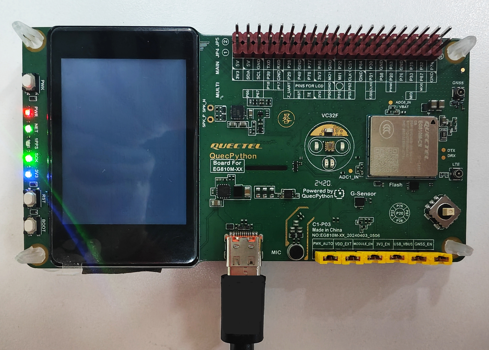
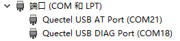
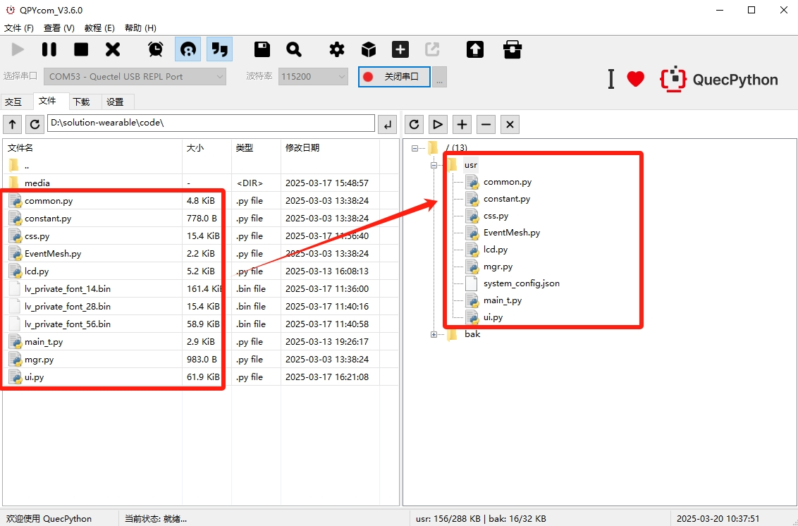
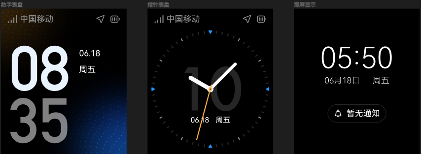
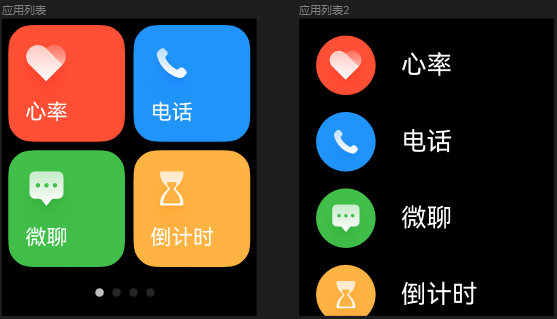
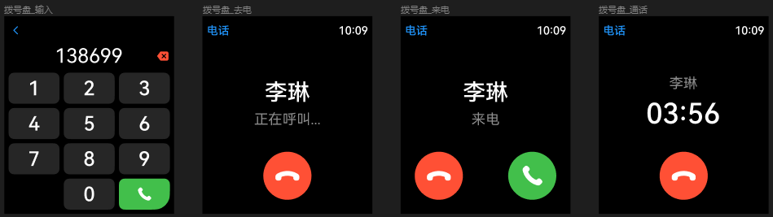
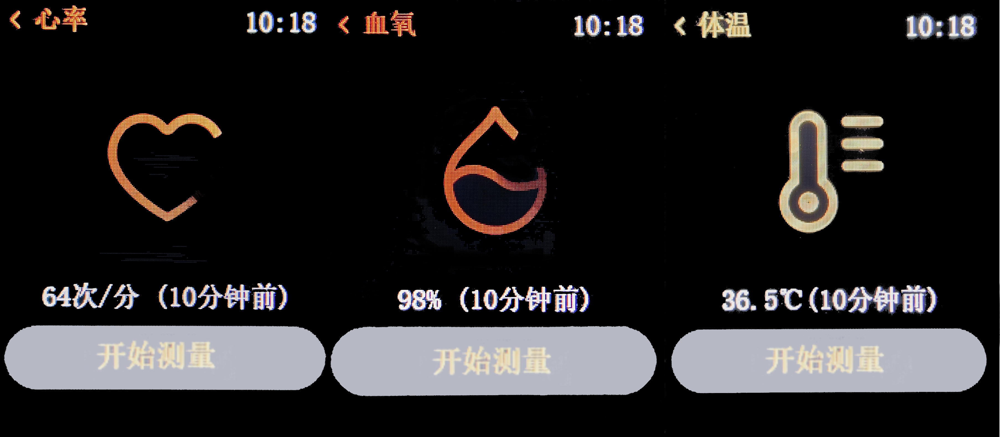

# 快速上手

## 硬件准备

- Windows 电脑一台，建议 `Win10` 系统。
- 一根TypeC数据线
- 一块QuecPython_EG810X C1-P03开发板

## 环境搭建

- 下载并安装 EG810M模组驱动：[QuecPython_USB_Driver_Win10_ASR](https://developer.quectel.com/wp-content/uploads/2024/09/Quectel_Windows_USB_DriverA_Customer_V1.1.13.zip)
- 下载并安装[VSCode](https://code.visualstudio.com/)
- 下载并解压 [QPYCom](https://python.developer.com/wp-content/uploads/2024/09/QPYcom_V4.1.0.zip) 工具到电脑的合适位置。
- 下载[固件包](https://github.com/QuecPython/solution-wearable/blob/master/EG810MCNGAR06A01M08_VOEXT_OCPU_QPY_BETA0222_20250317-1147_20250317-1152.zip)
- 下载[实验源码](https://codeload.github.com/QuecPython/solution-wearable/zip/refs/tags/v1.0.1)

## 硬件连接

按照下图进行硬件连接：

使用TypeC数据线连接开发板和电脑

## 设备开发

### 开机

完成硬件连接的工作后，长按开发板上标识为`PWk`的按键，直到网络灯`net`闪烁，或电脑设备管理器的端口列表中出现包含`Quectel USB` 字样的 COM 口，表示开机成功。

​	

### 烧录固件包

参考[此章节](../../../Getting_started/flash_firmware.md)，烧录固件包 [EG810MCNGAR06A01M08_VOEXT_OCPU_QPY_BETA0222.zip](https://github.com/QuecPython/solution-wearable/blob/master/EG810MCNGAR06A01M08_VOEXT_OCPU_QPY_BETA0222_20250317-1147_20250317-1152.zip) 至开发板。

### 脚本导入与运行

1. 参考[此章节](../../../Getting_started/first_python.md#传输脚本文件到模组)，将源码目录下 `code`文件夹中的所有以`.py`结尾文件导入到模组文件系统，如下图所示：

   

   2.参考[此章节](../../../Getting_started/first_python.md#执行脚本文件)，执行主程序文件_main.py

   3.参考[此章节](../../../Getting_started/first_python.md#停止程序运行)，停止程序运行。

## 界面展示

穿戴方案提供首页，表盘页， 应用页， 待机页， 拨号页， 心率/血氧/体温检测页。

### 表盘页面

组成部分：

 1. **通用头部栏：**

    - 信号显示。
    - 运营商显示。
    - 电池电量显示。
    - 导航图标显示。

 2. **表盘内容：**

    - 时间显示： 时间实时刷新。

    - 时针/分针/秒针： 实时和时间联动。
    - 背景盘当前时间， 时钟显示。
    - 日期显示： 日期实时刷新。

    3. 交互关系

    - 数字表盘左滑进入息屏显示界面， 右滑进入时间表盘界面。
    - 指针表盘左滑进入数字表盘界面， 右滑进入应用列表1页面
    - 设备(30s内无任何操作进入)息屏显示界面， 右滑进入表盘界面

### 应用列表页面

1. **心率检测：**
   - 点击跳转心率检测页面。
2. **电话：**
   - 点击可进入电话拨打界面。
3. **微聊：**
   - 点击可进入微聊界面进行语音的发送接收。
4. **倒计时界面：**
   - 点击进入倒计时界面。
5. **交互关系：**
   - 应用列表界面右滑进入应用列表2界面。
   - 应用列表2界面左滑可进入应用列表界面， 右滑进入心率检测等界面。

### 电话界面

提供了电话的拨打， 去点/来电/通话等模式和显示等。

### 检测界面

检测界面包括了对体温/血氧/心率的检测， 以及检测状态和历史检测的显示等。
