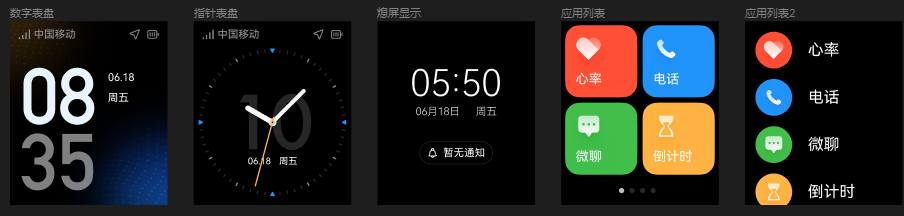

# 可穿戴解决方案

可穿戴解决方案基于 QuecPython_EG810M C1-P03开发板实现，具有以下特性：

- 包括时钟显示、电话拨打与接听现实、心率/温度/血氧测量等界面
- 使用 [LVGL](https://lvgl.io/) 绘制图形化界面，它是一个轻量级的、开源的嵌入式图形库。
- 拥有基础的应用框架，用户可基于该框架完善应用程序开发
- 使用 Python 语言，便于二次开发。

	

------

- [开发资源汇总](./dev_resources.md)
- [快速上手](./quick_start.md)
- [软件设计讲解](./software_design.md)
