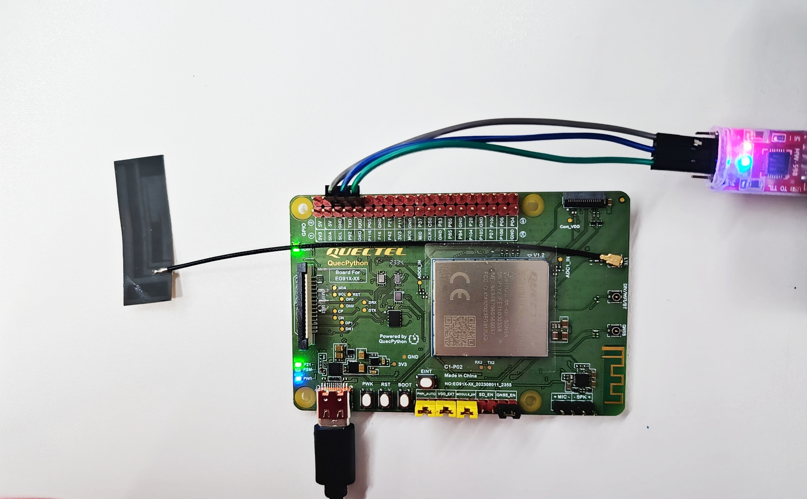

# 智能电表解决方案

智能电表解决方案基于 [QuecPython_EG91X系列C1-P02开发板](https://developer.quectel.com/doc/quecpython/Dev_board_guide/zh/eg91x-evb.html)实现，具有以下特性：	

- 包含了串口通信模块、TCP 客户端、RFC1662 协议、DLMS 协议（开发中）等电表行业常用功能组件
- 拥有基础的应用框架，用户可基于该框架完善应用程序开发
- 使用 Python 语言，便于二次开发。

	

------

- [开发资源汇总](./dev_resources.md)
- [快速上手](./quick_start.md)
- [软件设计讲解](./software_design.md)
