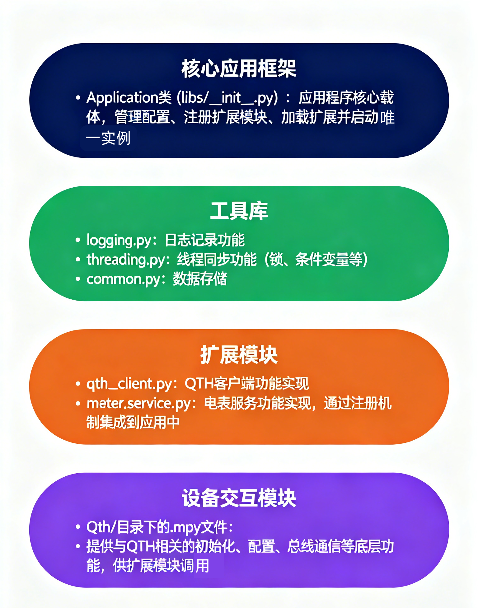
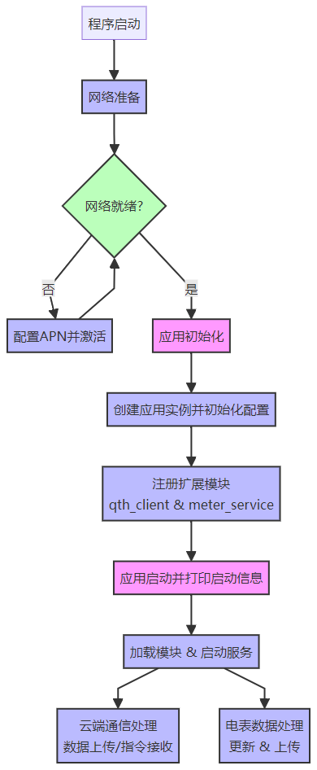

# 软件设计详解

## 程序架构

该软件采用模块化架构设计，主要包含以下核心应用框架、工具库、扩展模块和设备交互模块四个部分，各模块职责清晰、耦合度低，便于维护和扩展。

​	

## 业务流程

​	

## 代码详解

### 程序入口_main.py初始化流程

`_main.py`是程序的入口文件，负责网络准备、应用创建和启动，具体流程如下：

* **网络等待与激活**：通过`wait_network_ready`函数检查网络状态，若未就绪则配置 APN 并激活。

```python
def wait_network_ready():
    wait_cnt = WAIT_NETWORK_READY_S / 5
    is_ready = False
    while wait_cnt:
       lte = dataCall.getInfo(1, 0)
       if lte[2][0] == 1:
           is_ready = True
           break
       utime.sleep(5)
       wait_cnt -= 1
    return is_ready

if __name__ == "__main__":
    while True:
       if wait_network_ready():
           logger.debug('lte network normal')
           break
       logger.debug('wait lte network normal...')
       ret=dataCall.setPDPContext(1, 0, 'BICSAPN', '', '', 0)
       ret2=dataCall.activate(1)
       while not ret and ret2:
           ret=dataCall.setPDPContext(1, 0, 'BICSAPN', '', '', 0)# 激活之前，应该先配置APN，这里配置第1路的APN
           ret2=dataCall.activate(1)
           if  ret and ret2:
               print("Net injection failure")
               break
```

* **应用创建与初始化**：`create_app`函数初始化应用实例，加载配置，并注册扩展模块。

```python
def create_app(name="meter_demo", version="1.0.0", config_path="/usr/config.json"):
   _app = Application(name, version)
   _app.config.init(config_path)
    
   qth_client.init_app(_app)
   meter_service.init_app(_app)
    
   return _app
```

* **应用启动**：创建应用实例后调用`app.run()`启动应用，执行系统信息打印和扩展加载。

```python
app = create_app()
app.run()
```

### QTH 客户端上传数据到云端

`qth_client.py`实现了 QTH 客户端功能，负责与云端通信，上传数据的流程如下：

* **客户端初始化**：`QthClient`类的`init_app`方法初始化 QTH 相关配置，注册事件回调函数。

```python
def init_app(self, app):
   app.register("qth_client", self)
   qth_init.init()
   qth_config.setProductInfo(app.config["QTH_PRODUCT_KEY"], app.config["QTH_PRODUCT_SECRET"])
   qth_config.setServer(app.config["QTH_SERVER"])
   qth_config.setEventCb(
       {
           "devEvent": self.eventCallback,
           "recvTrans": self.recvTransCallback,
           "recvTsl": self.recvTslCallback,
           "readTsl": self.readTslCallback,
           "readTslServer": self.recvTslServerCallback,
           "ota": {
               "otaPlan":self.otaPlanCallback,
               "fotaResult":self.fotaResultCallback
           }
       }
   )
```

* **数据发送接口**：提供`sendTsl`、`sendLbs`、`sendGnss`等方法用于发送不同类型的数据到云端，本方案仅用到`sendTsl`方法。

```python
def sendTsl(self, mode, value):
   return qth_bus.sendTsl(mode, value)

def sendLbs(self, lbs_data):
   return qth_bus.sendOutsideLocation(lbs_data)

def sendGnss(self, nmea_data):
   return qth_bus.sendOutsideLocation(nmea_data)
```

* **数据上传触发**：当接收到读取数据的指令时，在`readTslCallback`方法中生成随机模拟数据并通过相关机制上传。

```python
def readTslCallback(self, ids, pkgId):
   logger.info("readTsl ids:{} pkgId:{}".format(ids, pkgId))
   value=dict()
   # 生成各类电表数据...
   # 数据生成后通过QTH客户端发送
```

### 电表数据更新逻辑

电表数据更新逻辑主要在`qth_client.py`的`readTslCallback`方法中实现，当接收到读取数据的指令时，生成随机的电表数据，具体如下：

* **数据生成**：根据不同的`id`生成对应的电表数据，包括总电量、各相电压、电流、功率等，部分数据基于随机函数生成。

```python
def readTslCallback(self, ids, pkgId):
   logger.info("readTsl ids:{} pkgId:{}".format(ids, pkgId))
   value=dict()

   # 组合总有功电量等随机模拟数据生成
   com_total_active_energy = random_float(int(total_phase_a_energy + total_phase_b_energy + com_total_phase_c_energy), int(total_phase_a_energy + total_phase_b_energy + com_total_phase_c_energy), 2)
   com_forward_active_energy = random_float(4500, 5500, 2)
   com_reverse_active_energy = random_float(int(com_total_active_energy - com_forward_active_energy), int(com_total_active_energy - com_forward_active_energy), 2)

# 各相电压、电流等随机模拟数据生成
   voltage_a = 220.0
   current_a = random_float(9, 10, 2)
   # ... 其他相数据生成

   # 根据id映射数据
   for id in ids:
       if 1 == id:
           value[1]=True
       elif 2 == id:
           value[2]=random_float(6000, 6600, 2)
       # ... 其他id对应数据的映射
```

* **数据更新触发**：当云端或其他模块触发读取数据的指令时，`readTslCallback`方法被调用，生成最新的随机数据，实现电表数据的动态更新。
