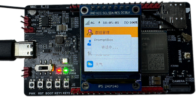

# 公网对讲机解决方案

该公网对讲机方案基于 EC600MCNLE QuecPython 标准开发板实现，具有以下特性：

- 提供半双工高清、安全的语音对讲功能。
- 支持连接常用对讲平台：卓智达、善理、伯纳德及其芯平台。
- 超长待机: 支持超低功耗模式。
- 使用 Python 语言，便于二次开发。

 

---

- [开发资源汇总](./dev_resources.md)
- [快速上手](./quick_start.md)
- [软件设计讲解](./software_design.md)
