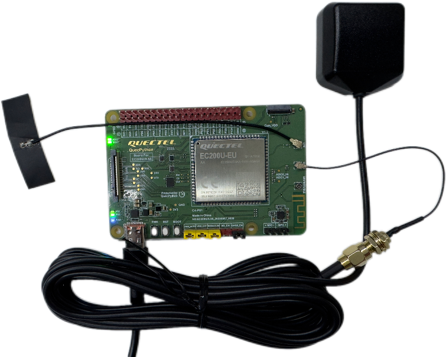

# 智能定位器

该智能定位器方案基于 EC200UEUAA QuecPython 标准开发板实现，具有以下特性：

- MQTT协议通讯（当前方案支持阿里 IoT 平台/ThingsBoard 平台）
- 配置文件读写
- OTA 远程升级
- LED 指示灯
- 设备网络管理
- 设备信息管理
- 电池电量与充电管理
- 备份信息存储
- GNSS 定位/基站定位/Wifi 定位
- 低功耗管理
- 日志存储记录

 

------

- [开发资源汇总](./dev_resources.md)
- [快速上手](./quick_start.md)
- [软件设计讲解](./software_design.md)